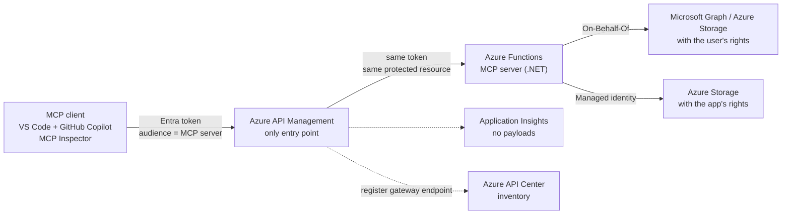

# Governed MCP on Azure — hands-on workshop

> **Status: work in progress.** This repository is built module by module with the GitHub Copilot app,
> following [`docs/BUILD-PLAN.md`](docs/BUILD-PLAN.md). Progress: [`docs/PROGRESS.md`](docs/PROGRESS.md).

A self-paced, end-to-end workshop that takes one Model Context Protocol (MCP) server from **open** to **governed** on Azure.

| Level | You add | You see |
|---|---|---|
| 0 | An open MCP server protected by a function key | Anyone with the key can call any tool, including write tools |
| 1 | Microsoft Entra ID authentication | 401 without a token, the token's audience and roles, unassigned users blocked |
| 2 | Azure API Management as the only entry point | Per-tool authorization, rate limiting, payload-free logs, direct calls refused |
| 3 | On-Behalf-Of vs app-only access | The same tool returns different results depending on who carries the rights |
| 4 | Observability and inventory | Who called which tool, when, with what result; the server listed in Azure API Center |

**Audience:** enterprise platform, identity and Microsoft 365 administrators (PowerShell, C#, Terraform)
and developers who are new to agents and MCP.
**Goal:** every participant can deploy, verify and destroy every module alone, in a non-production Azure subscription.

## Target architecture

## Modules

| # | Module |
|---|---|
| 00 | Prerequisites and environment |
| 01 | Discover MCP (no Azure) |
| 02 | An "open" MCP server (level 0) |
| 03 | Identity with Microsoft Entra (level 1) |
| 04 | API Management as the only entry point (level 2) |
| 05 | On-Behalf-Of vs app-only (level 3) |
| 06 | Observe and inventory (level 4) |
| 07 | Optional: other clients (Microsoft Foundry, Copilot Studio) |
| 99 | Clean up |

What each module takes, builds, shows and validates: [`docs/BUILD-PLAN.md`](docs/BUILD-PLAN.md).

## How this repository is built

The workshop is written "as code" with the GitHub Copilot app:

| File | Role |
|---|---|
| [`.github/copilot-instructions.md`](.github/copilot-instructions.md) | Permanent rules: content, security invariants, stack, module contract |
| [`docs/BUILD-PLAN.md`](docs/BUILD-PLAN.md) | What to take, in which order, and what each module must show |
| [`docs/PROGRESS.md`](docs/PROGRESS.md) | Status and validation evidence of each module |
| [`.github/skills/workshop-module-builder/`](.github/skills/workshop-module-builder/SKILL.md) | Agent skill that builds, deploys and validates the next module |
| [`.github/agents/workshop-builder.agent.md`](.github/agents/workshop-builder.agent.md) | Custom agent that applies the skill |
| [`docs/COPILOT-RUNBOOK.md`](docs/COPILOT-RUNBOOK.md) | Step-by-step guide: sessions, modes and prompts |

Start with [`docs/COPILOT-RUNBOOK.md`](docs/COPILOT-RUNBOOK.md).

The [P1 recommendations](docs/BUILD-PLAN.md#p1-recommendations-design-only) describe the target tree,
networking and identity decisions. The [source assessment](docs/sources.md) selects the useful parts of official
samples, pins upstream snapshots, and records updates, licensing boundaries and unresolved compatibility gates.
**Modules are not implemented yet.** No Azure deployment has been validated.

The project includes a **Workshop build board** canvas under `.github/extensions/workshop-build-board/`.
In the Copilot app, ask: "Show the workshop build board." It reads and updates `docs/PROGRESS.md`.
The canvas SDK is **Preview**. Saving progress does not run module validation.

## Safety

- Use non-production subscriptions and synthetic data only.
- Preview features are labeled **Preview** wherever they are used.
- Every implemented module must ship a clean-up script; module 99 must remove workshop-owned resources.
- The key-only demonstration must use the MCP extension system key. Never publish an anonymous MCP endpoint.
- Keep live credentials, tenant data and confidential notes out of the repository and build board.

## Disclaimer

This is a community workshop. It is not an official Microsoft product, service or documentation, and it is provided
"as is" under the MIT License, without warranty. The official documentation linked in each module is the reference.

## Sources

[Verified sources and upstream reuse decisions](docs/sources.md). Last verified: 2026-10-14.
