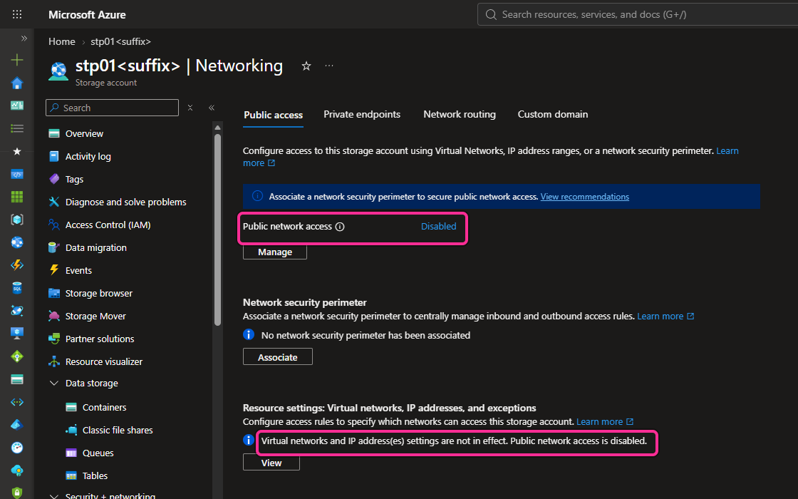
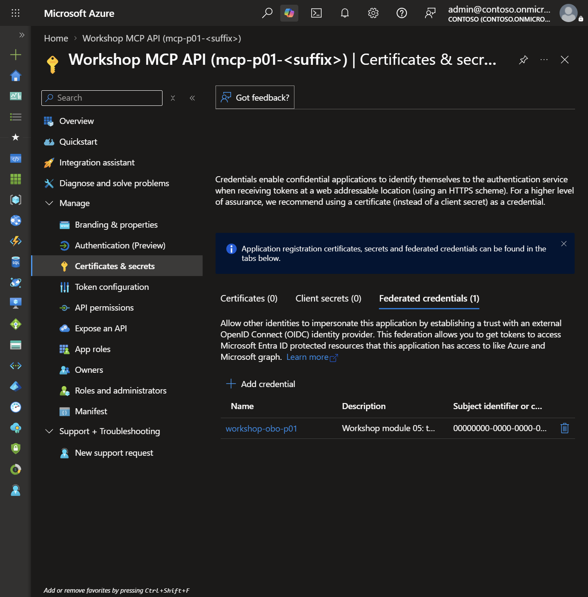
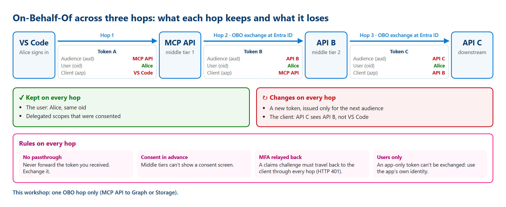

# 🔐 Governed MCP on Azure — hands-on workshop

> ⚠️ **Work in progress.** Every module can be followed today. The **Test status** column of the modules table below
> says how far the author has tested each one in Azure.
> Details: [what is available](docs/IMPLEMENTATION-STATUS.md).

Take one MCP server from **open** to **governed** on Azure, alone, in **your own non-production** subscription.
🇫🇷 [Version française](docs/fr/GETTING-STARTED.md)

## Choose your role

| | Start here |
|---|---|
| Presenter | [Publish one shared portal](docs/PRESENTER.md) · [Guide présentateur](docs/fr/PRESENTER.md) |
| Participant | [Follow the workshop](docs/GETTING-STARTED.md) · [Guide participant](docs/fr/GETTING-STARTED.md) |

The presenter shares the deployed portal's `?lang=fr#/start` or `?lang=en#/start` link. Paths such as `/fr/` return 404 by design: language is set by query string only.
Participants do not deploy another portal or use the presenter's administrator account.
The presenter shares the portal link only after its deployment and HTTPS checks succeed; it is not listed in this repository.
Working locally? Start with [clone and installation](docs/GETTING-STARTED.md#0-get-the-repository-onto-your-computer)
or [clonage et installation en français](docs/fr/GETTING-STARTED.md#0-récupérer-le-dépôt-sur-votre-poste).


## 🚀 Use it in 5 steps

| | Step | What you do | What you should see |
|---|---|---|---|
| 1️⃣ | 🧭 **Choose** | Dev container, local terminal or Codespaces. One is enough. | The same tools in all three. |
| 2️⃣ | 📖 **Read** | Open the [board](#-open-the-board) or the module README. | One page per module, with a diagram. |
| 3️⃣ | 🛠️ **Prepare** | Run the module 00 checks. They only read. | `PASS` lines, then a private `.workshop` file. |
| 4️⃣ | ▶️ **Do** | Follow the module steps, one module at a time. | The result written under "What you should see". |
| 5️⃣ | ✅ **Validate, then clean up** | Run the published module's validator. Review cleanup before deleting anything. | Offline `PASS` does not prove Azure deployment. Module 00 preflight creates nothing. |

### 💻 PowerShell: run module 00

Open **PowerShell 7.4+** in the repository root, locally or in your chosen development container.
Missing a tool? Follow the [installation guide](docs/GETTING-STARTED.md)
([français](docs/fr/GETTING-STARTED.md)). Stop if any command fails.

**1. Check the installed tools.** No Azure access:

```powershell
$ErrorActionPreference = 'Stop'
& .\scripts\check-tools.ps1
```

**2. Prepare your private parameters once.** Replace the example labels and region with approved values:

```powershell
$expiry = [datetime]::UtcNow.AddDays(1).ToString('yyyy-MM-dd')
& .\scripts\prepare-workshop.ps1 -ParticipantPrefix p01 -Location swedencentral -Owner alice -Expiry $expiry
```

Expected: `PASS private participant parameters created with a stable random suffix.`
The ignored `.workshop\participant.tfvars.json` stores your names. Keep it and your Terraform state through cleanup.
On later visits, reuse this file; do not regenerate the suffix or rerun preparation with a different expiry.
For an administrator-provided resource group, add `-ExistingResourceGroupName` on this first preparation command.
The expiry is a tag, **not automatic deletion**.

**3. Choose your approved test tenant and subscription.** Keep the same terminal open:

```powershell
& .\scripts\select-azure-context.ps1 -Language en
```

For French prompts, use `-Language fr`. Enter your approved tenant and subscription IDs **in the terminal only**,
then type `NONPROD`. The script signs in and selects that subscription; it creates no resources.
Expected: `PASS context: tenant and subscription verified.`

**4. Run the read-only Azure checks:**

```powershell
& .\modules\00-prerequisites\validate.ps1 `
    -TenantId $env:ARM_TENANT_ID `
    -SubscriptionId $env:ARM_SUBSCRIPTION_ID
```

Expected: `PASS module 00 foundation environment checks.`
If a check fails, use [module 00 troubleshooting](modules/00-prerequisites/README.md#troubleshooting);
do not register providers or widen permissions as a workaround.
These commands do not deploy a resource group, MCP server, Entra identity or gateway.
The [module 00 guide](modules/00-prerequisites/README.md) also covers offline checks and cleanup.

### 🔍 PowerShell: run module 01 without Azure

With .NET 10 and PowerShell 7 installed, run from the repository root:

```powershell
& .\modules\01-discover-mcp\validate.ps1
```

Expected: `PASS local MCP checks complete (expected HTTP N/A; stdio, no Azure).`
Then follow the [EN guide](modules/01-discover-mcp/README.md) or [guide français](modules/01-discover-mcp/README.fr.md)
to discover/call the tool with Inspector and observe approval in VS Code.
**No presenter portal, Azure sign-in or Terraform is needed for this local exercise.**
Module 02 deploys real Azure resources: start it only after module 00 validation and explicit plan/cost approval.

📸 This is the module 00 guide, not a deployed Azure result:


## 🗺️ Modules

| # | Module | Need it? | Test status | Guide |
|---|---|---|---|---|
| 00 | 🧰 Prerequisites and environment | ✅ Required | 🟢 Fully tested in Azure (2026-10-14) | [Open](modules/00-prerequisites/README.md) |
| 01 | 🔍 Discover MCP (no Azure) | ✅ Required | 🟢 Tested on a laptop (no Azure); the VS Code approval prompt is a manual check | [Open](modules/01-discover-mcp/README.md) · [FR](modules/01-discover-mcp/README.fr.md) |
| 02 | 🔑 Server protected by a key (level 0) | ✅ Required | 🟢 Fully tested in Azure (2026-10-16) | [Open](modules/02-open-server/README.md) · [FR](modules/02-open-server/README.fr.md) |
| 03 | 🪪 Microsoft Entra identity (level 1) | ✅ Required | 🟢 Fully tested in Azure (2026-10-19): operator, Alice, Bob and Eve | [Open](modules/03-entra-authentication/README.md) · [FR](modules/03-entra-authentication/README.fr.md) |
| 04 | 🚪 API Management as the only entry (level 2), optional part B: a REST API exposed as MCP | ✅ Required (part B optional) | 🟢 Fully tested in Azure (2026-10-20): operator, Alice, Bob and Eve; part B: Alice and Bob | [Open](modules/04-governed-gateway/README.md) · [FR](modules/04-governed-gateway/README.fr.md) |
| 05 | 👤 On-Behalf-Of vs app-only (level 3) | ✅ Required | 🟡 Tested in Azure; test users Alice, Bob and Eve to do | [Open](modules/05-delegated-and-app-only/README.md) · [FR](modules/05-delegated-and-app-only/README.fr.md) |
| 06 | 📊 Observe and inventory (level 4) | ✅ Required | 🟡 Tested in Azure; test users Alice, Bob and Eve to do | [Open](modules/06-observe-inventory/README.md) · [FR](modules/06-observe-inventory/README.fr.md) |
| 07 | 🤖 Other clients (Foundry, Copilot Studio) | ➕ Optional | ⚪ Written and checked offline; not yet tried in Azure | [Open](modules/07-clients/README.md) · [FR](modules/07-clients/README.fr.md) |
| 99 | 🧹 Clean up | ♻️ As soon as you create resources | ⚪ Written and checked offline; not yet run in Azure (each module has its own tested cleanup) | [Open](modules/99-cleanup/README.md) · [FR](modules/99-cleanup/README.fr.md) |

> 💡 **What the test status means.** It describes the author's own tests, not your work. Every module is usable.
>
> - 🟢 **Fully tested**: the author deployed the module in a test subscription and every check passed.
> - 🟡 **Tested in Azure**: deployed and checked as the administrator. The checks signed in as the test users
>   (Alice, Bob, Eve) are not all done yet.
> - ⚪ **Checked offline**: the guide, code and offline checks are ready; it was not yet deployed in Azure.
>
> Whatever the colour, run the module's validator in **your** subscription: that is what proves it works for you.

## 📸 What you will see (real captures)

These are real captures from the author's test tenant. Names are pseudonymised and IDs are replaced by zeros.
Pink frames mark what to check. Each module shows its own captures at the step where they appear.



*Module 02, optional private storage: public network access is disabled; the server reaches Storage only through private endpoints.*
See [module 02, steps](modules/02-open-server/README.md#steps).


*Module 03 validator: each `== Step N ==` header says what is checked, `Why:` says what it proves, then one `PASS` line per check with the expected HTTP status.*
See [module 03, steps](modules/03-entra-authentication/README.md#steps).


*Module 03, signed in as Alice (after her MFA registration): her token for the MCP server is accepted and she sees the five tools.*
See [module 03, persona checks](modules/03-entra-authentication/README.md#steps).


*Module 03 app roles: what a user or an application may do on the MCP server.*
See [module 03, check the same result in the Azure portal](modules/03-entra-authentication/README.md#check-the-same-result-in-the-azure-portal).


*Module 04: API Management is the only entry. Two MCP servers on one gateway: the Azure Functions server (part A) and a REST API exposed as tools (optional part B).*
See [module 04, steps](modules/04-governed-gateway/README.md#steps).



*Module 05: no client secret, one federated credential for the On-Behalf-Of exchange.*
See [module 05, identity administrator step](modules/05-delegated-and-app-only/README.md#identity-administrator-approve-trust-and-consent-before-applying).



*Module 05, good to know: what On-Behalf-Of keeps and loses on each hop.*
See [module 05, go further](modules/05-delegated-and-app-only/README.md#good-to-know-obo-across-several-hops-and-rbac).


*Module 06 logs: only MCP traffic, and each row holds metadata only (operation, status, duration, client name); no body, token or prompt.*
See [module 06, step 3](modules/06-observe-inventory/README.md#step-3---query-mcp-traffic-in-application-insights).


*Module 06, optional: the Observability Agent answers the same question in plain English and finds the same rows.*
See [module 06, ask the Observability Agent](modules/06-observe-inventory/README.md#optional---ask-the-observability-agent-the-same-question).

## 🧭 Run order (presenter and attendees)

Run the modules in this order. Each row ends with a checkpoint you can show the room before moving on.

| Step | Module | Azure needed? | Who | Checkpoint before the next step |
|---|---|---|---|---|
| 1 | 00 Prerequisites | Test subscription only (no paid resources) | Attendee | Tools and sign-in confirmed |
| 2 | 01 Discover MCP | No | Attendee | Local MCP server lists its tools in the Inspector |
| 3 | 02 Open server (level 0) | Yes (paid stage, function key only) | Attendee | Anonymous call is refused (401); keyed call works, which shows the risk |
| 4 | 03 Entra identity (level 1) | Yes, and identity administrator approval | Identity admin, then attendee | Alice and Bob get HTTP 200; a token for another audience is refused |
| 5 | 04 Governed gateway (level 2) | Yes (billed per hour: deploy and clean up the same day) | Attendee | Bob's `create_ticket` returns HTTP 403; Alice's returns HTTP 200 |
| 5b | 04 part B, optional: REST API exposed as MCP | Yes, on the same gateway (no new billed resource) | Attendee | Alice lists the two tools built from REST operations; a call without a token returns HTTP 401 |
| 6 | 05 On-Behalf-Of vs app-only (level 3) | Yes, and identity administrator consent | Identity admin, then attendee | Bob's user-context report read returns `isError: true`; the app-only read gives the same result for Alice and Bob |
| 7 | 06 Observe and inventory (level 4) | Yes | Attendee | Logs show tool, caller, status and latency (no bodies) |
| 8 | 07 Other clients (optional) | Optional | Attendee | Foundry or Copilot Studio calls the governed endpoint |
| 9 | 99 Clean up | Runs against your state | Attendee | Report shows only workshop-owned resources; apply after review |

**Presenter flow:** publish the shared guides once (see [PRESENTER](docs/PRESENTER.md)), then walk steps 1 to 2 live, then let each attendee run steps 3 to 9 in their own subscription. Run step 9 after every paid stage, not only at the end.

## 🧭 Open the board

| Where | How |
|---|---|
| 🌐 Copilot app | Ask: "Show the workshop build board." |
| 📄 No tool | Read the Markdown guides. Start with [GETTING-STARTED](docs/GETTING-STARTED.md). |

The board has three parts: **Start** (environment, concepts, overview) · **Main route** (modules in order,
optional ones are marked) · **Resources** (practice, Azure context, governance, architecture, sources). A
**Facilitators and authors** menu holds the presenter guide, the Session 2 page on integration options and the hosting guide. Switch **EN / FR** at the top.

Each module page reads **one step at a time**: use **Next** and **Previous**, or **Outline** to jump to a step.
Below the steps:

- **Try this stage**: the validator command to copy, and a hint.
- **Go further (optional)**: the architecture diagram, prerequisites and why the boundary matters.
- **Download as PDF**: opens the print dialog with the whole module (answers and captures included).
  Choose **Save as PDF** to keep it offline, annotate it or share it. Nothing is generated on the server.

## 🧪 Try your MCP

Calls run in **your** MCP client (VS Code, Inspector…), never in the board. See the [practice guide](docs/PRACTICE.md).
What does the server answer? [The MCP server and its answers](docs/MCP-SERVER.md) shows its five tools and their real
responses at each level ([en français](docs/fr/MCP-SERVER.md)).

### Agent 365 integration — Preview, optional

[Microsoft Agent 365 + API Management (Preview)](https://learn.microsoft.com/azure/api-management/agent-365)
is a **planned facilitator demo**, not an implemented exercise.
API Management v2 supports inventory and server blocking; tool-level blocking requires the **AI Gateway tier (Preview)**.
Tenant-wide administrator consent is required. The core workshop does not request it.
See module 06 in the [governance guide](docs/LEARNING-GUIDE.md#06---observe-metadata-inventory-endpoints).

## 📐 Architecture

Each module has a diagram, with its security flow: [Mermaid guide](assets/architecture/STEPS.md) ·
[en français](assets/architecture/STEPS.fr.md) · [editable Draw.io source](assets/architecture/README.md).

| Icon | Meaning |
|---|---|
| 💡 | Tip |
| ⚠️ | Important to keep in mind |
| 🛑 | Danger: never do this |

## 🛡️ Safety

- 🧪 Non-production subscription and synthetic data only (Alice, Bob, Eve).
- 🔒 No secret, token or tenant ID in the repository.
- 🏷️ **Preview** features are labeled where used.
- 🎲 Names get a random suffix. This avoids collisions, **not** quota limits.
- 💸 Nothing is created in Azure without your approval of a reviewed plan.

## 🏗️ For authors

[`docs/BUILD-PLAN.md`](docs/BUILD-PLAN.md) · [`docs/PROGRESS.md`](docs/PROGRESS.md) ·
[`docs/COPILOT-RUNBOOK.md`](docs/COPILOT-RUNBOOK.md) · [`.github/copilot-instructions.md`](.github/copilot-instructions.md) ·
[hosting the guides](docs/HOSTING.md) · [verified sources](docs/sources.md) (last verified 2026-10-14).

## ⚖️ Disclaimer

Community workshop, not an official Microsoft product. Provided "as is" under the MIT License.
The official documentation linked in each module is the reference.
