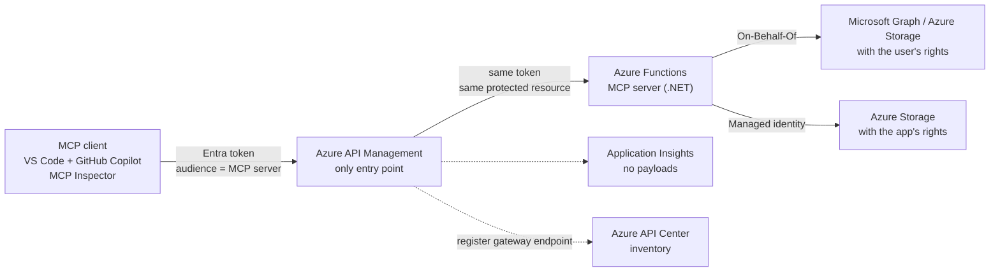

# Governed MCP on Azure — hands-on workshop

> **Status: work in progress.** This repository is built module by module with the GitHub Copilot app,
> following [`docs/BUILD-PLAN.md`](docs/BUILD-PLAN.md). Progress: [`docs/PROGRESS.md`](docs/PROGRESS.md).

A self-paced, end-to-end workshop that takes one Model Context Protocol (MCP) server from **open** to **governed** on Azure.

| Level | You add | You see |
|---|---|---|
| 0 | An open MCP server protected by a function key | Anyone with the key can call any tool, including write tools |
| 1 | Microsoft Entra ID authentication | 401 without a token, the token's audience and roles, unassigned users blocked |
| 2 | Azure API Management as the only entry point | Per-tool authorization, rate limiting, payload-free logs, direct calls refused |
| 3 | On-Behalf-Of vs app-only access | The same tool returns different results depending on who carries the rights |
| 4 | Observability and inventory | Who called which tool, when, with what result; the server listed in Azure API Center |

**Audience:** enterprise platform, identity and Microsoft 365 administrators (PowerShell, C#, Terraform)
and developers who are new to agents and MCP.
**Goal:** every participant can deploy, verify and destroy every module alone, in a non-production Azure subscription.

## Start here: choose your workspace

Read [the start guide](docs/GETTING-STARTED.md) or [le guide français](docs/fr/GETTING-STARTED.md).
Choose **VS Code dev container**, **local terminal**, or optional Codespaces at the start of the board (`#/start`).
The same tool-check and preparation scripts serve every route. You can also follow the Markdown without Copilot.
The container configuration is published locally, but its runtime build is not yet validated.

Prepare one ignored private participant file. A random suffix is generated once and reused across Terraform runs.
The [workload foundation](infra/workload/README.md) creates one dedicated resource group, or reads an
administrator-provided group without managing it. It currently deploys no MCP service.
Unique names reduce collisions; **they do not increase or reset Azure quotas**.

## Public landing site or internal hosting

The same bilingual portal can run outside Copilot as a static GitHub Pages site.
Build it with `node scripts/build-site.mjs`; only allowlisted public content goes into ignored `site-dist`.
The manually triggered [Pages workflow](.github/workflows/workshop-pages.yml) publishes that directory,
not the repository. No site has been published yet.
Read [hosting and publication](docs/HOSTING.md) or [le guide français](docs/fr/HOSTING.md).

The public portal never collects Azure keys or deploys into a visitor's tenant.
Optional Linux App Service B1 Terraform and an Entra-authenticated ZIP deployment script are available,
disabled by default. A paid deployment still requires an exact approved target and reviewed plan.
Azure Container Apps and private visitor authentication are not implemented.
Participants still authenticate and run reviewed Terraform in their own approved environment.

## Target architecture

## Modules

| # | Module |
|---|---|
| 00 | [Prerequisites and environment](modules/00-prerequisites/README.md) |
| 01 | Discover MCP (no Azure) |
| 02 | An "open" MCP server (level 0) |
| 03 | Identity with Microsoft Entra (level 1) |
| 04 | API Management as the only entry point (level 2) |
| 05 | On-Behalf-Of vs app-only (level 3) |
| 06 | Observe and inventory (level 4) |
| 07 | Optional: other clients (Microsoft Foundry, Copilot Studio) |
| 99 | Clean up |

What each module takes, builds, shows and validates: [`docs/BUILD-PLAN.md`](docs/BUILD-PLAN.md).

## How this repository is built

The workshop is written "as code" with the GitHub Copilot app:

| File | Role |
|---|---|
| [`.github/copilot-instructions.md`](.github/copilot-instructions.md) | Permanent rules: content, security invariants, stack, module contract |
| [`docs/BUILD-PLAN.md`](docs/BUILD-PLAN.md) | What to take, in which order, and what each module must show |
| [`docs/PROGRESS.md`](docs/PROGRESS.md) | Status and validation evidence of each module |
| [`.github/skills/workshop-module-builder/`](.github/skills/workshop-module-builder/SKILL.md) | Agent skill that builds, deploys and validates the next module |
| [`.github/agents/workshop-builder.agent.md`](.github/agents/workshop-builder.agent.md) | Custom agent that applies the skill |
| [`docs/COPILOT-RUNBOOK.md`](docs/COPILOT-RUNBOOK.md) | Step-by-step guide: sessions, modes and prompts |

Participants start with [`docs/GETTING-STARTED.md`](docs/GETTING-STARTED.md).
Workshop authors use [`docs/COPILOT-RUNBOOK.md`](docs/COPILOT-RUNBOOK.md).

The [P1 recommendations](docs/BUILD-PLAN.md#p1-recommendations-design-only) describe the target tree,
networking and identity decisions. The [source assessment](docs/sources.md) selects the useful parts of official
samples, pins upstream snapshots, and records updates, licensing boundaries and unresolved compatibility gates.
**Module 00 is implemented locally, but not Azure-validated.** Its EN/FR guide, read-only preflight,
identity request and optional public hosting have offline evidence. Later MCP modules remain unimplemented.
No Azure deployment has been validated; no cloud resource or identity has been changed.

The project includes a **Workshop build board** canvas under `.github/extensions/workshop-build-board/`.
In the Copilot app, ask: "Show the workshop build board." Its responsive single-page application (SPA) is a
read-only workshop route: browse modules, participant guides, expected outcomes and verified sources, without
progress-entry forms. Hash routes support back, forward and direct module links. Unpublished modules show
clearly labeled design outlines from the build plan, not invented deployment steps. Published module READMEs
appear automatically after refreshing.
The agent still records build status and actual validation evidence in `docs/PROGRESS.md`.
The canvas SDK is **Preview**. Browsing does not run commands, deploy resources or change progress.

Use **Try your MCP** for Codespaces setup, local launch commands, an endpoint-only connection helper,
Inspector launch commands, and prompts for discovery, reads and preparing an approval-gated synthetic write.
Per-module hints explain the intended control, expected denials and common mistakes. The actual calls run in
your chosen MCP client, not through the canvas. No credential is accepted and no connection setting is saved.
Validation commands appear only when the module guide and script exist. See [the practice guide](docs/PRACTICE.md).

Switch **EN / FR** in the board. The French route is `?lang=fr#/overview`; language selection stays in the URL,
not a tracking profile. The route, call hints, starter prompts, governance guide, reference library and deployment
preparation have authored French versions. Repository decisions/evidence retain their explicitly labeled original text.
A missing future `README.fr.md` is reported rather than silently presenting an English guide as translated.

Each module includes an [editable architecture diagram](assets/architecture/README.md) with EN/FR SVG and PNG
exports, security-flow explanations, accessible tip/important/warning icons, and a contextual next step.
The core route goes from 06 to cleanup 99; 07 remains optional. Microsoft product imagery identifies technologies,
not endorsement; see the asset usage and trademark notices.
The [governance guide](docs/LEARNING-GUIDE.md) explains scopes, roles, OBO, app-only, private ingress and metadata-only logs.
The [Azure context guide](docs/DEPLOYMENT.md) and its [French version](docs/fr/DEPLOYMENT.md) prepare **your** approved
test tenant/subscription using fail-fast context selectors. Tool checks and the resource-group foundation are partial
module 00 preparation, not a validated module, runtime deployment or permission grant.
Run the real module only after its guide is published and the plan, identity changes and costs are explicitly approved.

## Safety

- Use non-production subscriptions and synthetic data only.
- Preview features are labeled **Preview** wherever they are used.
- Every implemented module must ship a clean-up script; module 99 must remove workshop-owned resources.
- The key-only demonstration must use the MCP extension system key. Never publish an anonymous MCP endpoint.
- Keep live credentials, tenant data and confidential notes out of the repository and build board.

## Disclaimer

This is a community workshop. It is not an official Microsoft product, service or documentation, and it is provided
"as is" under the MIT License, without warranty. The official documentation linked in each module is the reference.

## Sources

[Verified sources and upstream reuse decisions](docs/sources.md). Last verified: 2026-10-14.
