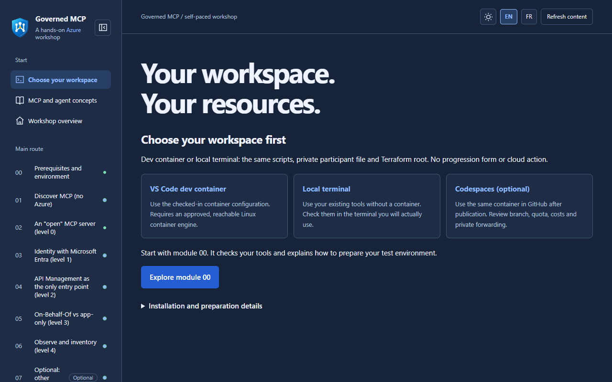
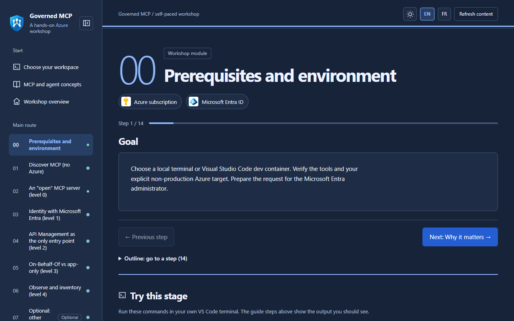

# 🔐 Governed MCP on Azure — hands-on workshop

> ⚠️ **Work in progress.** Module 00 is validated. Modules 01 to 07 and 99 are authored, and their offline checks pass.
> Only module 00 is validated on a live subscription. Modules 02 to 07 and 99 are not yet deployed or validated in Azure. Module 01's client-approval observation is still manual.
> Details: [what is available](docs/IMPLEMENTATION-STATUS.md).

Take one MCP server from **open** to **governed** on Azure, alone, in **your own non-production** subscription.
🇫🇷 [Version française](docs/fr/GETTING-STARTED.md)

## Choose your role

| | Start here |
|---|---|
| Presenter | [Publish one shared portal](docs/PRESENTER.md) · [Guide présentateur](docs/fr/PRESENTER.md) |
| Participant | [Follow the workshop](docs/GETTING-STARTED.md) · [Guide participant](docs/fr/GETTING-STARTED.md) |

The presenter shares the deployed portal's `?lang=fr#/start` or `?lang=en#/start` link. Paths such as `/fr/` return 404 by design: language is set by query string only.
Participants do not deploy another portal or use the presenter's administrator account.
No live portal URL is available until deployment and HTTPS checks succeed.
Working locally? Start with [clone and installation](docs/GETTING-STARTED.md#0-get-the-repository-onto-your-computer)
or [clonage et installation en français](docs/fr/GETTING-STARTED.md#0-récupérer-le-dépôt-sur-votre-poste).



## 🚀 Use it in 5 steps

| | Step | What you do | What you should see |
|---|---|---|---|
| 1️⃣ | 🧭 **Choose** | Dev container, local terminal or Codespaces. One is enough. | The same tools in all three. |
| 2️⃣ | 📖 **Read** | Open the [board](#-open-the-board) or the module README. | One page per module, with a diagram. |
| 3️⃣ | 🛠️ **Prepare** | Run the module 00 checks. They only read. | `PASS` lines, then a private `.workshop` file. |
| 4️⃣ | ▶️ **Do** | Follow the module steps, one module at a time. | The result written under "What you should see". |
| 5️⃣ | ✅ **Validate, then clean up** | Run the published module's validator. Review cleanup before deleting anything. | Offline `PASS` does not prove Azure deployment. Module 00 preflight creates nothing. |

### 💻 PowerShell: run module 00

Open **PowerShell 7.4+** in the repository root, locally or in your chosen development container.
Missing a tool? Follow the [installation guide](docs/GETTING-STARTED.md)
([français](docs/fr/GETTING-STARTED.md)). Stop if any command fails.

**1. Check the installed tools.** No Azure access:

```powershell
$ErrorActionPreference = 'Stop'
& .\scripts\check-tools.ps1
```

**2. Prepare your private parameters once.** Replace the example labels and region with approved values:

```powershell
$expiry = [datetime]::UtcNow.AddDays(1).ToString('yyyy-MM-dd')
& .\scripts\prepare-workshop.ps1 -ParticipantPrefix p01 -Location swedencentral -Owner alice -Expiry $expiry
```

Expected: `PASS private participant parameters created with a stable random suffix.`
The ignored `.workshop\participant.tfvars.json` stores your names. Keep it and your Terraform state through cleanup.
On later visits, reuse this file; do not regenerate the suffix or rerun preparation with a different expiry.
For an administrator-provided resource group, add `-ExistingResourceGroupName` on this first preparation command.
The expiry is a tag, **not automatic deletion**.

**3. Choose your approved test tenant and subscription.** Keep the same terminal open:

```powershell
& .\scripts\select-azure-context.ps1 -Language en
```

For French prompts, use `-Language fr`. Enter your approved tenant and subscription IDs **in the terminal only**,
then type `NONPROD`. The script signs in and selects that subscription; it creates no resources.
Expected: `PASS context: tenant and subscription verified.`

**4. Run the read-only Azure checks:**

```powershell
& .\modules\00-prerequisites\validate.ps1 `
    -TenantId $env:ARM_TENANT_ID `
    -SubscriptionId $env:ARM_SUBSCRIPTION_ID
```

Expected: `PASS module 00 foundation environment checks.`
If a check fails, use [module 00 troubleshooting](modules/00-prerequisites/README.md#troubleshooting);
do not register providers or widen permissions as a workaround.
These commands do not deploy a resource group, MCP server, Entra identity or gateway.
The [module 00 guide](modules/00-prerequisites/README.md) also covers offline checks and cleanup.

### 🔍 PowerShell: run module 01 without Azure

With .NET 10 and PowerShell 7 installed, run from the repository root:

```powershell
& .\modules\01-discover-mcp\validate.ps1
```

Expected: `PASS local MCP checks complete (expected HTTP N/A; stdio, no Azure).`
Then follow the [EN guide](modules/01-discover-mcp/README.md) or [guide français](modules/01-discover-mcp/README.fr.md)
to discover/call the tool with Inspector and observe approval in VS Code.
**No presenter portal, Azure sign-in or Terraform is needed for this local exercise.**
Module 02 deploys real Azure resources: start it only after module 00 validation and explicit plan/cost approval.

📸 This is the module 00 guide, not a deployed Azure result:



## 🗺️ Modules

| # | Module | Need it? | Status | Guide |
|---|---|---|---|---|
| 00 | 🧰 Prerequisites and environment | ✅ Required | 🟢 Validated (live, 2026-10-14) | [Open](modules/00-prerequisites/README.md) |
| 01 | 🔍 Discover MCP (no Azure) | ✅ Required | 🟡 Local SDK + Inspector checks pass; manual approval pending | [Open](modules/01-discover-mcp/README.md) · [FR](modules/01-discover-mcp/README.fr.md) |
| 02 | 🔑 Server protected by a key (level 0) | ✅ Required | 🟡 Authored; offline checks pass, not deployed | [Open](modules/02-open-server/README.md) · [FR](modules/02-open-server/README.fr.md) |
| 03 | 🪪 Microsoft Entra identity (level 1) | ✅ Required | 🟡 Authored; offline checks pass, not deployed | [Open](modules/03-entra-authentication/README.md) · [FR](modules/03-entra-authentication/README.fr.md) |
| 04 | 🚪 API Management as the only entry (level 2) | ✅ Required | 🟡 Authored; offline checks pass, not deployed | [Open](modules/04-governed-gateway/README.md) · [FR](modules/04-governed-gateway/README.fr.md) |
| 05 | 👤 On-Behalf-Of vs app-only (level 3) | ✅ Required | 🟡 Authored; offline checks pass, not deployed | [Open](modules/05-delegated-and-app-only/README.md) · [FR](modules/05-delegated-and-app-only/README.fr.md) |
| 06 | 📊 Observe and inventory (level 4) | ✅ Required | 🟡 Authored; offline checks pass, not deployed | [Open](modules/06-observe-inventory/README.md) · [FR](modules/06-observe-inventory/README.fr.md) |
| 07 | 🤖 Other clients (Foundry, Copilot Studio) | ➕ Optional | 🟡 Authored; offline checks pass, not deployed | [Open](modules/07-clients/README.md) · [FR](modules/07-clients/README.fr.md) |
| 99 | 🧹 Clean up | ♻️ As soon as you create resources | 🟡 Authored; offline checks pass, not run live | [Open](modules/99-cleanup/README.md) · [FR](modules/99-cleanup/README.fr.md) |

> 💡 **Authored** means the guide and offline checks exist. It is not proof of a completed Azure deployment.

## 🧭 Run order (presenter and attendees)

Run the modules in this order. Each row ends with a checkpoint you can show the room before moving on.

| Step | Module | Azure needed? | Who | Checkpoint before the next step |
|---|---|---|---|---|
| 1 | 00 Prerequisites | Test subscription only (no paid resources) | Attendee | Tools and sign-in confirmed |
| 2 | 01 Discover MCP | No | Attendee | Local MCP server lists its tools in the Inspector |
| 3 | 02 Open server (level 0) | Yes (paid stage, function key only) | Attendee | Anonymous call is refused (401); keyed call works, which shows the risk |
| 4 | 03 Entra identity (level 1) | Yes, and identity administrator approval | Identity admin, then attendee | Alice and Bob get HTTP 200; a token for another audience is refused |
| 5 | 04 Governed gateway (level 2) | Yes (paid stage) | Attendee | Bob's `create_ticket` returns HTTP 403; Alice's returns HTTP 200 |
| 6 | 05 On-Behalf-Of vs app-only (level 3) | Yes, and identity administrator consent | Identity admin, then attendee | Bob's user-context report read returns `isError: true`; Alice's app-only read succeeds |
| 7 | 06 Observe and inventory (level 4) | Yes | Attendee | Logs show tool, caller, status and latency (no bodies) |
| 8 | 07 Other clients (optional) | Optional | Attendee | Foundry or Copilot Studio calls the governed endpoint |
| 9 | 99 Clean up | Runs against your state | Attendee | Report shows only workshop-owned resources; apply after review |

**Presenter flow:** publish the shared guides once (see [PRESENTER](docs/PRESENTER.md)), then walk steps 1 to 2 live, then let each attendee run steps 3 to 9 in their own subscription. Run step 9 after every paid stage, not only at the end.

## 🧭 Open the board

| Where | How |
|---|---|
| 🌐 Copilot app | Ask: "Show the workshop build board." |
| 📄 No tool | Read the Markdown guides. Start with [GETTING-STARTED](docs/GETTING-STARTED.md). |

The board has three parts: **Start** (environment, overview, what exists) · **Main route** (modules in order,
optional ones are marked) · **References** (practice, governance, sources). Switch **EN / FR** at the top.

## 🧪 Try your MCP

Calls run in **your** MCP client (VS Code, Inspector…), never in the board. See the [practice guide](docs/PRACTICE.md).

### Agent 365 integration — Preview, optional

[Microsoft Agent 365 + API Management (Preview)](https://learn.microsoft.com/azure/api-management/agent-365)
is a **planned facilitator demo**, not an implemented exercise.
API Management v2 supports inventory and server blocking; tool-level blocking requires the **AI Gateway tier (Preview)**.
Tenant-wide administrator consent is required. The core workshop does not request it.
See module 06 in the [governance guide](docs/LEARNING-GUIDE.md#06---observe-metadata-inventory-endpoints).

## 📐 Architecture

Each module has a diagram, with its security flow: [Mermaid guide](assets/architecture/STEPS.md) ·
[en français](assets/architecture/STEPS.fr.md) · [editable Draw.io source](assets/architecture/README.md).

| Icon | Meaning |
|---|---|
| 💡 | Tip |
| ⚠️ | Important to keep in mind |
| 🛑 | Danger: never do this |

## 🛡️ Safety

- 🧪 Non-production subscription and synthetic data only (Alice, Bob, Eve).
- 🔒 No secret, token or tenant ID in the repository.
- 🏷️ **Preview** features are labeled where used.
- 🎲 Names get a random suffix. This avoids collisions, **not** quota limits.
- 💸 Nothing is created in Azure without your approval of a reviewed plan.

## 🏗️ For authors

[`docs/BUILD-PLAN.md`](docs/BUILD-PLAN.md) · [`docs/PROGRESS.md`](docs/PROGRESS.md) ·
[`docs/COPILOT-RUNBOOK.md`](docs/COPILOT-RUNBOOK.md) · [`.github/copilot-instructions.md`](.github/copilot-instructions.md) ·
[hosting the guides](docs/HOSTING.md) · [verified sources](docs/sources.md) (last verified 2026-10-14).

## ⚖️ Disclaimer

Community workshop, not an official Microsoft product. Provided "as is" under the MIT License.
The official documentation linked in each module is the reference.
