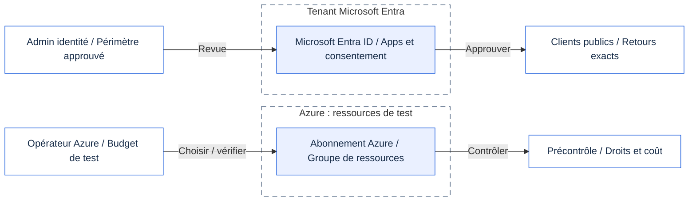
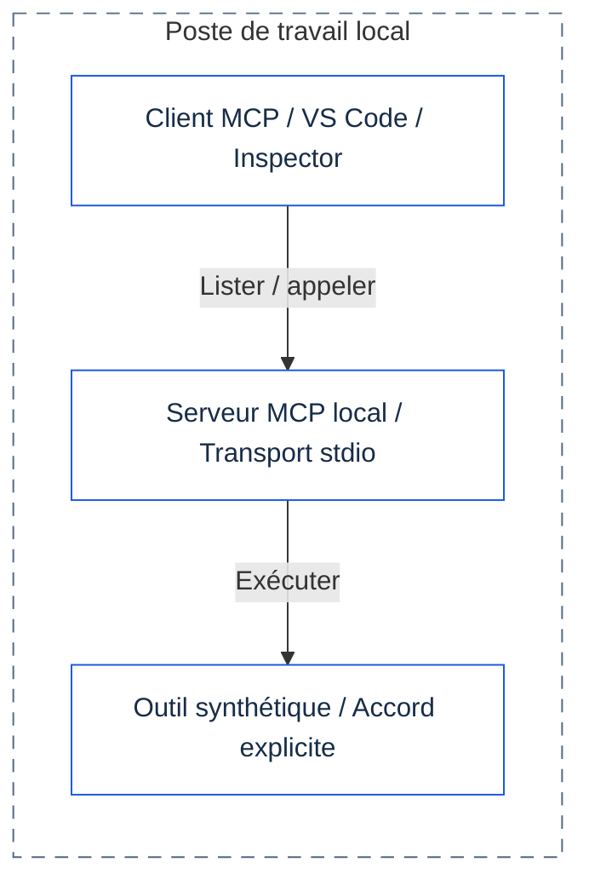
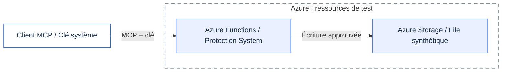
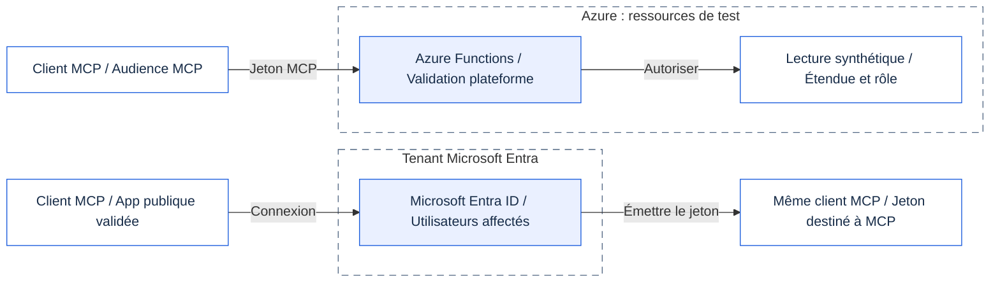
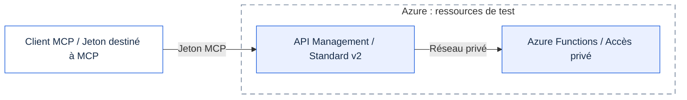
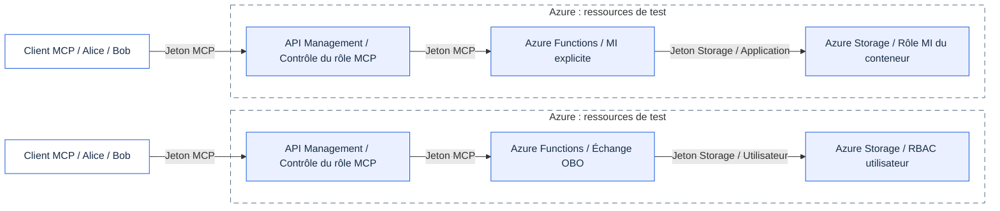
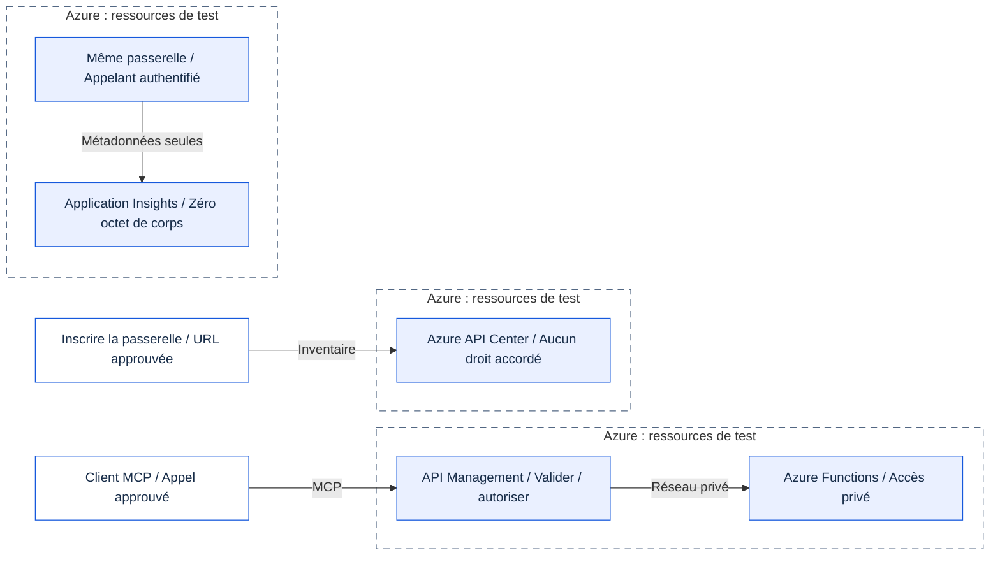
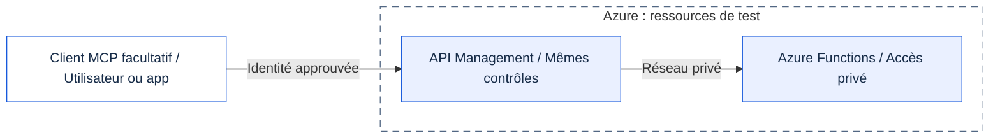
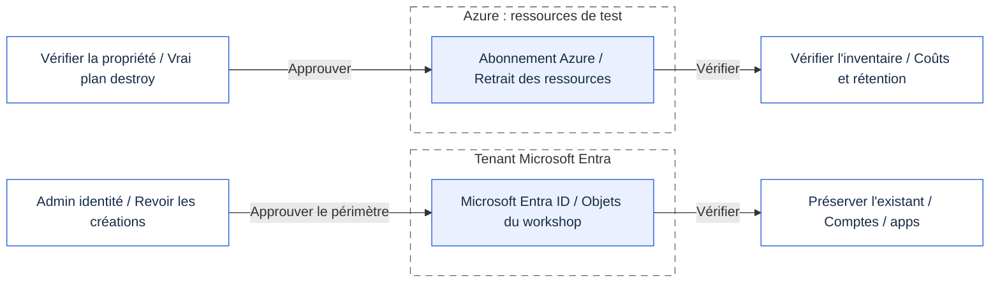

# L'architecture, étape par étape

Ces schémas montrent les objectifs du parcours, pas des déploiements réalisés. Consultez le suivi de construction pour les preuves de validation.

Le protocole de contexte de modèle (MCP) relie un client à des outils. Chaque étape ajoute un contrôle ou explique une responsabilité.

[Ce qui est réellement disponible](../../docs/fr/IMPLEMENTATION-STATUS.md). [Modifier les schémas et vérifier les icônes](README.fr.md).

Fichier généré depuis `workshop.drawio` : ne le modifiez pas séparément. Les cadres représentent des périmètres ; les vues répétées désignent le même environnement. GitHub affiche Mermaid ; l'application affiche le SVG équivalent avec ses icônes et son routage vérifiés.

## 00 - Préparer les identités et les ressources

L'autorité Entra et les droits Azure sont distincts. Ni appel MCP ni création de ressources ici.

[SVG](00.fr.svg) · [PNG](00.fr.png)

## 01 - Découvrir et appeler en local

Découverte et exécution diffèrent. Accord humain pour chaque écriture. Négocier le protocole supporté.

[SVG](01.fr.svg) · [PNG](01.fr.png)

## 02 - Une clé partagée n'est pas une identité

Aucun accès anonyme. Outils d'identité simulés jusqu'à 05. Garder cette étape par clé très brève.

[SVG](02.fr.svg) · [PNG](02.fr.png)

## 03 - Se connecter, puis appeler la ressource protégée

401 sans jeton MCP valide. Eve non affectée. Aucun jeton réel dans journaux, chat, fichiers ou sites.

[SVG](03.fr.svg) · [PNG](03.fr.png)

## 04 - Seule la passerelle gouvernée accepte les clients

Accès public Function désactivé. DNS privé et intégration sortante. 403 Bob / 429 débit. API de gestion MCP : Preview.

[SVG](04.fr.svg) · [PNG](04.fr.png)

## 05 - Deux identités cibles, deux contrôles de droits

Ne jamais transmettre le jeton MCP à Storage ou Graph. Jeton Graph distinct. Un 403 cible peut être dans HTTP 200.

[SVG](05.fr.svg) · [PNG](05.fr.png)

## 06 - Requêtes, observation et inventaire sont séparés

Seulement outil, ID objet appelant, statut, latence et corrélation. API Center n'autorise ni ne relaie les appels.

[SVG](06.fr.svg) · [PNG](06.fr.png)

## 07 - Les clients facultatifs utilisent la même frontière

Aucun agent déployé ici. Vérifier licences, Preview et accès sans secret. Reporter tout flux exigeant un secret.

[SVG](07.fr.svg) · [PNG](07.fr.png)

## 99 - Retirer les ressources du workshop, préserver le reste

Ressources d'abord, puis objets Entra créés. Vérifier rôles, DNS privé, inventaire, rétention et codespaces.

[SVG](99.fr.svg) · [PNG](99.fr.png)

## Sources

- [Draw.io](workshop.drawio).
- [GitHub Mermaid](https://docs.github.com/en/get-started/writing-on-github/working-with-advanced-formatting/creating-diagrams).
- [Mermaid flowcharts](https://mermaid.js.org/syntax/flowchart.html).

Dernière vérification : 2026-10-14.
