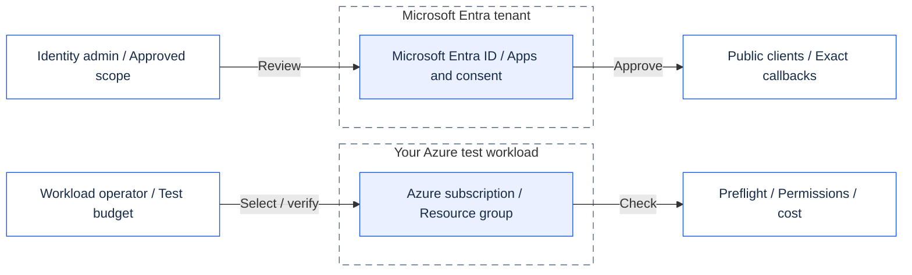
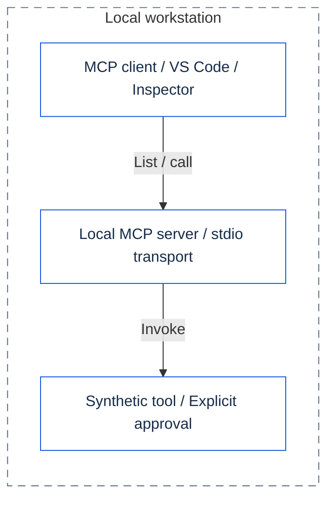
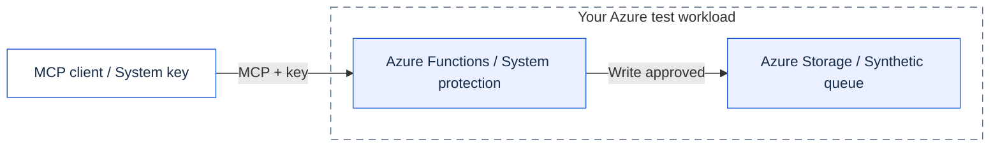
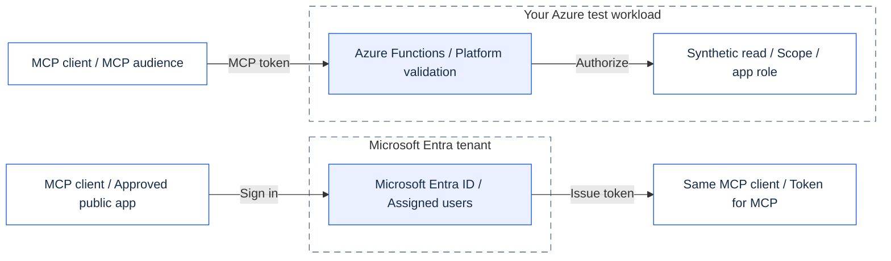
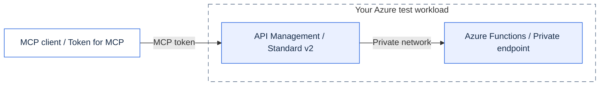
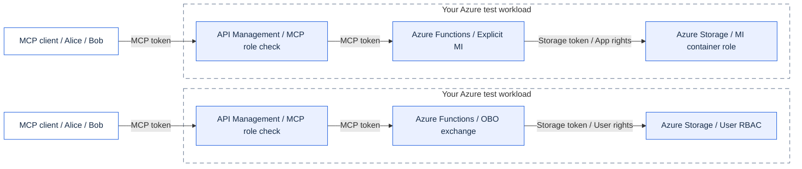
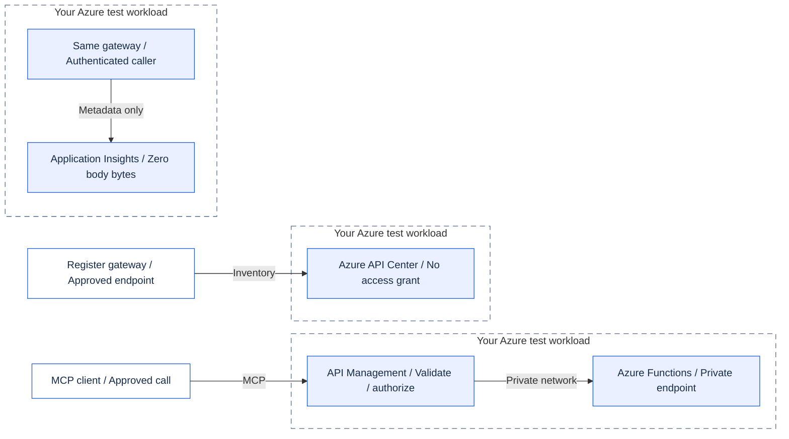
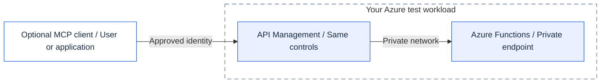
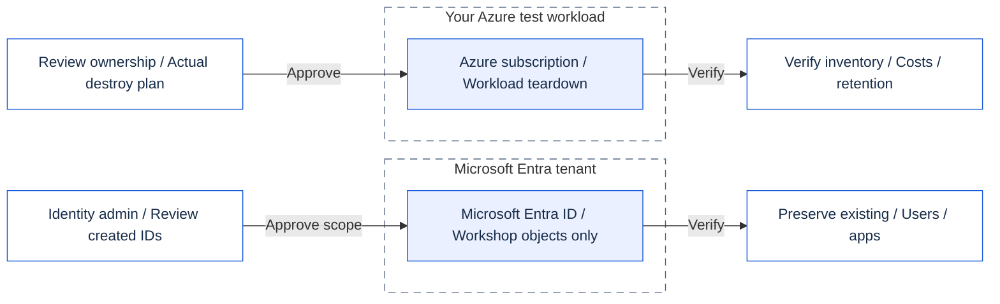

# Architecture, step by step

These diagrams show learning targets, not deployed resources. See build progress for validation evidence.

The Model Context Protocol (MCP) connects a client to tools. Each step adds a control or explains an ownership boundary.

[What is actually available](../../docs/IMPLEMENTATION-STATUS.md). [Edit diagrams and verify icon provenance](README.md).

Generated from `workshop.drawio`; do not edit separately. Frames are ownership boundaries; repeated views refer to the same environment. GitHub renders Mermaid; the application displays the equivalent SVG with verified icons and routing.

## 00 - Prepare identity and resource authority

Entra authority and Azure resource permissions are distinct. No MCP call or resource creation is shown.

[SVG](00.en.svg) · [PNG](00.en.png)

## 01 - Discover and call locally

Discovery is not execution. Keep human approval for each write. Negotiate the supported protocol era.

[SVG](01.en.svg) · [PNG](01.en.png)

## 02 - A shared key is not a user's identity

No anonymous endpoint. Identity tools are simulated until 05. Stop this shared-key stage promptly.

[SVG](02.en.svg) · [PNG](02.en.png)

## 03 - Sign in first, call the protected resource second

401 without a valid MCP token. Eve is unassigned. No live tokens in logs, chat, files or decoder websites.

[SVG](03.en.svg) · [PNG](03.en.png)

## 04 - Only the governed gateway accepts clients

Public Function access disabled. Private DNS + outbound integration. 403 Bob / 429 burst. MCP management API: Preview.

[SVG](04.en.svg) · [PNG](04.en.png)

## 05 - Two downstream identities, two different permission checks

Never forward the MCP token to Storage or Graph. Graph needs its own token. Downstream 403 can be inside HTTP 200.

[SVG](05.en.svg) · [PNG](05.en.png)

## 06 - Requests, observation and inventory are separate flows

Only tool, caller object ID, status, latency and correlation ID. API Center does not authorize or relay requests.

[SVG](06.en.svg) · [PNG](06.en.png)

## 07 - Optional clients use the same governed boundary

No agent deployed here. Check licensing, Preview and secretless support. Defer any client-secret requirement.

[SVG](07.en.svg) · [PNG](07.en.png)

## 99 - Remove workshop-owned resources, preserve shared identities

Workload first, then only created Entra objects. Check assignments, private DNS, inventory, retention and codespaces.

[SVG](99.en.svg) · [PNG](99.en.png)

## Sources

- [Draw.io](workshop.drawio).
- [GitHub Mermaid](https://docs.github.com/en/get-started/writing-on-github/working-with-advanced-formatting/creating-diagrams).
- [Mermaid flowcharts](https://mermaid.js.org/syntax/flowchart.html).

Last verified: 2026-10-14.
