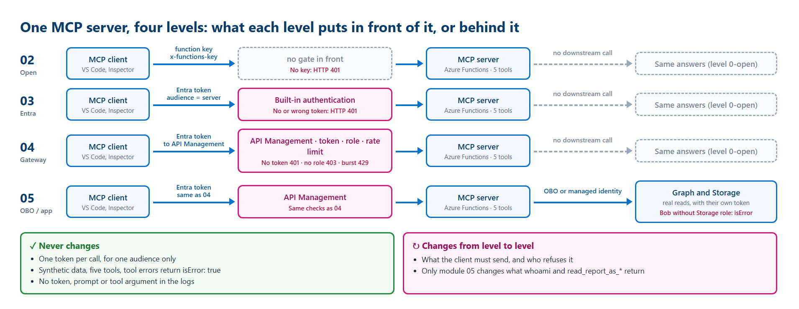

# The workshop MCP server: what runs and what it answers

[Français](fr/MCP-SERVER.md)

One MCP server runs through the whole workshop. Each module puts a new control **in front of it** or changes **who
reads the data behind it**. This page shows what the server is, how to reach it at each level, and its **real
responses**, captured on 2026-10-19 in the author's test tenant. Names are pseudonymised and IDs replaced by zeros.

## What runs

| | |
|---|---|
| Code | [src/FunctionsMcpServer](../src/FunctionsMcpServer) (.NET, Azure Functions MCP extension) |
| Name and version | `workshop-open-mcp` 0.2.0 |
| Endpoint | `https://func-mcp-<prefix>-<suffix>.azurewebsites.net/runtime/webhooks/mcp` |
| Transport | Streamable HTTP: one `POST` per JSON-RPC message, the answer comes back as `text/event-stream` |
| Data | Synthetic only: two services (`workshop-api`, `ticket-queue`) and one report (`monthly-usage`) |
| Tools | Five: four read tools and one write tool |

On 2026-10-19, the author's test tenant runs the **module 03** state: the module 02 server, protected by Microsoft Entra
built-in authentication. The module 04 gateway was cleaned up, and the module 05 mode is off.

## How you reach it at each level



| Level | What you send | Without it | What changes in the answers |
|---|---|---|---|
| 02 Open server | `x-functions-key` header | HTTP 401 | Nothing: level `0-open` |
| 03 Entra identity | `Authorization: Bearer` token for the server's audience | HTTP 401 and a `WWW-Authenticate` challenge | Nothing yet (see the question below) |
| 04 Gateway | The same token, sent to API Management | HTTP 401; HTTP 403 without the right role | Nothing; the gateway filters before the server |
| 05 Delegated vs app-only | The same token | Same | `whoami` and `read_report_as_*` call Graph and Storage for real |

## The five tools

| Tool | Kind | Input | Answer at levels 0 to 2 | Answer at level 3 (module 05) |
|---|---|---|---|---|
| `get_service_health` | Read | `service`: `workshop-api` or `ticket-queue` | `healthy` or `degraded`, fixed | Same |
| `create_ticket` | **Write** | `service`, `severity` (`low`, `medium`, `high`), `summary` (10 to 120 plain characters) | Queues one synthetic ticket, returns its ID and a **risk warning** | Same tool; module 04 requires the `Tools.Write` role |
| `whoami` | Read | none | `caller: unknown`, no downstream call | Persona label from Microsoft Graph, through On-Behalf-Of |
| `read_report_as_user` | Read | `report`: `monthly-usage` | Labelled demonstration, no downstream call | Reads Storage **as the user**: the user's own role decides |
| `read_report_as_app` | Read | `report`: `monthly-usage` | Labelled demonstration, no downstream call | Reads Storage **as the app**: the same result for everyone |

## Six requests, one at a time

You need the module 03 state (or later) and a test account such as Alice. Each request below has the command to run
and the **real answer** captured on 2026-10-19 as Alice (pseudonymised). Read the answer before the next request.

### Prepare your terminal (once)

Sign in as your test account first (see module 03). Then define one helper. It reads the endpoint and the audience
from your Terraform outputs, asks Azure CLI for a fresh token for **this server only**, and never prints the token.

```powershell
$mcp = terraform -chdir=infra/workload output -raw mcp_endpoint
$audience = terraform -chdir=infra/workload output -raw mcp_auth_audience
function Send-Mcp([string]$Body, [switch]$NoToken) {
    $headers = @{ Accept = 'application/json, text/event-stream'; 'MCP-Protocol-Version' = '2025-06-18' }
    if (-not $NoToken) { $headers.Authorization = 'Bearer ' + (az account get-access-token --resource $audience --query accessToken -o tsv) }
    $r = Invoke-WebRequest $mcp -Method Post -ContentType 'application/json' -Body $Body -Headers $headers -SkipHttpErrorCheck
    "HTTP $($r.StatusCode)"
    if ($r.StatusCode -eq 401) { return "WWW-Authenticate: $($r.Headers['WWW-Authenticate'])" }
    $data = (($r.Content -split "`n") -match '^data: ') -replace '^data: ' | ConvertFrom-Json
    if ($data.result.tools) { $data.result.tools | ForEach-Object { "$($_.name): $($_.description)" } }
    elseif ($data.result.content) { $data.result.content.text; if ($data.result.isError) { 'isError: true' } }
    else { $data | ConvertTo-Json -Depth 8 -Compress }
}
```

> **Expected result** — nothing is printed. `$mcp` ends with `/runtime/webhooks/mcp` and `$audience` starts with `api://`.

Bash: the same helper prints the raw JSON-RPC answer. Use the same request bodies as below, for example
`send_mcp '{"jsonrpc":"2.0","id":2,"method":"tools/list"}'`.

```bash
mcp=$(terraform -chdir=infra/workload output -raw mcp_endpoint)
audience=$(terraform -chdir=infra/workload output -raw mcp_auth_audience)
send_mcp() {
  auth=()
  [ "$2" = "--no-token" ] || auth=(-H "Authorization: Bearer $(az account get-access-token --resource "$audience" --query accessToken -o tsv)")
  curl -sS -i "$mcp" -H 'Content-Type: application/json' -H 'Accept: application/json, text/event-stream' \
    -H 'MCP-Protocol-Version: 2025-06-18' "${auth[@]}" -d "$1" | grep -iE '^(HTTP/|www-authenticate:|data: )' | sed 's/^data: //'
}
```

> **Expected result** — nothing is printed. Each later call prints the HTTP status line, then the `data:` line of the answer.

A real MCP client first sends `initialize`. This Functions server keeps no session, so each request below works on
its own. Each call takes about 2 to 3 seconds here: most of it is Azure CLI getting the token.

### Request 1 of 6: knock without a token

**Predict:** refused, and told where to get a token.

```powershell exchange
Send-Mcp '{"jsonrpc":"2.0","id":1,"method":"tools/list"}' -NoToken
```

> **Real result** — 2026-10-19, author's test tenant.
>
> ```text
> HTTP 401
> WWW-Authenticate: Bearer realm="func-mcp-p01-<suffix>.azurewebsites.net", scope="api://00000000-0000-0000-0000-000000000000/user_impersonation", resource_metadata="https://func-mcp-p01-<suffix>.azurewebsites.net/.well-known/oauth-protected-resource/runtime/webhooks/mcp"
> ```
>
> **What it means for you:** the platform refuses before your code runs. The challenge names the scope and the
> metadata document (Protected Resource Metadata, **Preview**): that is how VS Code knows where to sign you in.

### Request 2 of 6: discover the tools

**Predict:** five tools, each with a description an agent can read.

```powershell exchange
Send-Mcp '{"jsonrpc":"2.0","id":2,"method":"tools/list"}'
```

> **Real result** — 2026-10-19, signed in as Alice.
>
> ```text
> HTTP 200
> create_ticket: WRITE: queue one synthetic ticket in the workshop Storage queue. Synthetic text only. Level 0 checks no identity or role.
> get_service_health: Read fixed synthetic health data for a workshop service. No real monitoring.
> read_report_as_app: Read the synthetic report as the application. Levels 0-2: labeled demonstration. Level 3 (module 05): the app-only managed identity reads Azure Storage, same result for every caller.
> read_report_as_user: Read the synthetic report as the signed-in user. Levels 0-2: labeled demonstration. Level 3 (module 05): On-Behalf-Of to Azure Storage, so the caller's own Storage role applies.
> whoami: Who am I? Levels 0-2: synthetic explanation, no downstream call. Level 3 (module 05): On-Behalf-Of to Microsoft Graph /me; returns only an allowlisted synthetic persona label, never a name or email.
> ```
>
> **What it means for you:** the server describes itself. An agent picks a tool from these descriptions; a plain REST
> API cannot do that. Alice sees the write tool too: module 04 decides who may **call** it.

### Request 3 of 6: call a read tool

**Predict:** `workshop-api` is `healthy`.

```powershell exchange
Send-Mcp '{"jsonrpc":"2.0","id":3,"method":"tools/call","params":{"name":"get_service_health","arguments":{"service":"workshop-api"}}}'
```

> **Real result** — 2026-10-19, signed in as Alice.
>
> ```text
> HTTP 200
> {"service":"workshop-api","status":"healthy","source":"synthetic","level":"0-open"}
> ```
>
> **What it means for you:** the answer is text inside `result.content`; here, that text is JSON. Bash shows the full
> envelope: `{"result":{"content":[{"type":"text","text":"{...}"}]},"id":3,"jsonrpc":"2.0"}`.

### Request 4 of 6: same tool, another argument

**Predict:** only the argument changes; `ticket-queue` is `degraded`.

```powershell exchange
Send-Mcp '{"jsonrpc":"2.0","id":4,"method":"tools/call","params":{"name":"get_service_health","arguments":{"service":"ticket-queue"}}}'
```

> **Real result** — 2026-10-19, signed in as Alice.
>
> ```text
> HTTP 200
> {"service":"ticket-queue","status":"degraded","source":"synthetic","level":"0-open"}
> ```
>
> **What it means for you:** `degraded` is a normal answer, not an error. The data is fixed and synthetic.

### Request 5 of 6: send a wrong argument

**Predict:** a tool error, not an HTTP error.

```powershell exchange
Send-Mcp '{"jsonrpc":"2.0","id":5,"method":"tools/call","params":{"name":"get_service_health","arguments":{"service":"payroll"}}}'
```

> **Real result** — 2026-10-19, signed in as Alice.
>
> ```text
> HTTP 200
> An error occurred invoking 'get_service_health'.
> isError: true
> ```
>
> **What it means for you:** in MCP, a **tool** error is part of the answer: HTTP stays 200 and `isError` is `true`.
> The message is short and generic, with no stack trace or internal detail.

### Request 6 of 6: ask the server who you are

**Predict:** you are signed in, so the server knows you... or does it?

```powershell exchange
Send-Mcp '{"jsonrpc":"2.0","id":6,"method":"tools/call","params":{"name":"whoami","arguments":{}}}'
```

> **Real result** — 2026-10-19, signed in as Alice.
>
> ```text
> HTTP 200
> {"caller":"unknown","source":"synthetic-demonstration","level":"0-open","downstreamCall":"none","explanation":"A function key identifies no user. Module 03 adds Microsoft Entra sign-in; module 05 adds On-Behalf-Of to Microsoft Graph."}
> ```
>
> **What it means for you:** the door checked Alice; the tool code did not read who she is. Module 05 changes that.

**Question:** Alice is signed in with Microsoft Entra, so why does `whoami` still say `caller: unknown` and `level: 0-open`?

<details>
<summary>Show answer</summary>

Because authentication runs **in front of** the code. In module 03, the Functions platform checks the token before the
request reaches the server, and the server code does not change. The tools keep their level 0 answers until module 05
turns on the code that reads the caller and calls Graph and Storage. The label describes the tool code, not the door.

</details>

`create_ticket` is not called here: it writes. In module 02, its answer looks like this (the ID changes every call):

```json
{"ticketId":"TCK-1A2B3C4D","service":"ticket-queue","severity":"low","status":"queued","source":"synthetic","level":"0-open",
 "warning":"Level 0: anyone holding the function key can call this write tool. No user identity or role was checked."}
```

## At level 3 (module 05)

With the module 05 mode on, the same calls answer with the real identity path. Module 05 shows the full results:
[module 05, what you should see](../modules/05-delegated-and-app-only/README.md#what-you-should-see).

| Tool | Answer shape at level 3 |
|---|---|
| `whoami` | `persona` (for example `alice`), `identity: signed-in user (On-Behalf-Of)`, `graphMatchesCaller: true`; never a name or an email |
| `read_report_as_user` | `mode: as-user`, the rows **if the user's own Storage role allows it**; Bob gets `isError: true` |
| `read_report_as_app` | `mode: as-app`, the same rows for Alice and Bob: the managed identity's role decides |

## Next: use a real client

The requests above show the raw protocol. Day to day, use an MCP client: VS Code or the Inspector signs you in through
the metadata of request 1. See [Try your MCP](PRACTICE.md). Each module's validator also makes these calls for you.

## Sources

- [Model Context Protocol: Streamable HTTP transport](https://modelcontextprotocol.io/specification/2025-06-18/basic/transports)
- [Model Context Protocol: tools, results and `isError`](https://modelcontextprotocol.io/specification/2025-06-18/server/tools)
- [Azure Functions MCP extension](https://learn.microsoft.com/azure/azure-functions/functions-bindings-mcp)
- [Protected Resource Metadata for App Service and Functions (Preview)](https://learn.microsoft.com/azure/app-service/configure-authentication-mcp)

Last verified: 2026-10-19.
