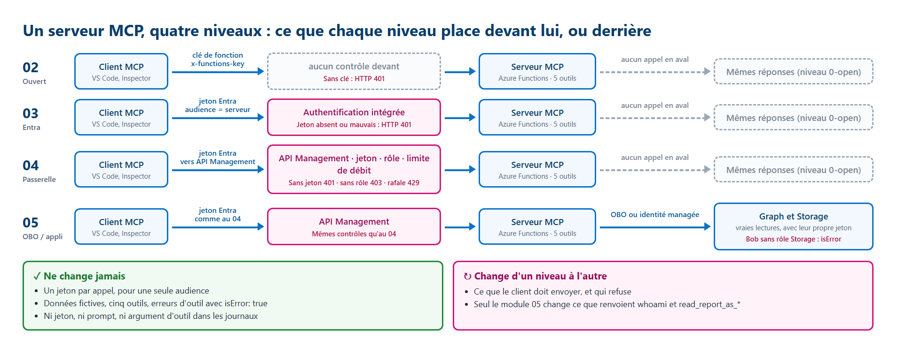

# Le serveur MCP de l'atelier : ce qui tourne et ce qu'il répond

[English](../MCP-SERVER.md)

Un seul serveur MCP sert pendant tout l'atelier. Chaque module ajoute un contrôle **devant lui**, ou change **qui lit
les données derrière lui**. Cette page montre ce qu'est ce serveur, comment l'atteindre à chaque niveau, et ses
**réponses réelles**, relevées le 2026-10-19 dans le tenant de test de l'auteur. Les noms sont pseudonymisés et les
identifiants remplacés par des zéros.

## Ce qui tourne

| | |
|---|---|
| Code | [src/FunctionsMcpServer](../../src/FunctionsMcpServer) (.NET, extension MCP d'Azure Functions) |
| Nom et version | `workshop-open-mcp` 0.2.0 |
| Point de terminaison | `https://func-mcp-<prefix>-<suffix>.azurewebsites.net/runtime/webhooks/mcp` |
| Transport | Streamable HTTP : un `POST` par message JSON-RPC, la réponse revient en `text/event-stream` |
| Données | Fictives uniquement : deux services (`workshop-api`, `ticket-queue`) et un rapport (`monthly-usage`) |
| Outils | Cinq : quatre en lecture, un en écriture |

Le 2026-10-19, le tenant de test de l'auteur est dans l'état du **module 03** : le serveur du module 02, protégé par
l'authentification intégrée Microsoft Entra. La passerelle du module 04 a été supprimée et le mode du module 05 est désactivé.

## Comment l'atteindre à chaque niveau



| Niveau | Ce que vous envoyez | Sans cela | Ce qui change dans les réponses |
|---|---|---|---|
| 02 Serveur ouvert | En-tête `x-functions-key` | HTTP 401 | Rien : niveau `0-open` |
| 03 Identité Entra | Jeton `Authorization: Bearer` pour l'audience du serveur | HTTP 401 et un défi `WWW-Authenticate` | Rien encore (voir la question plus bas) |
| 04 Passerelle | Le même jeton, envoyé à API Management | HTTP 401 ; HTTP 403 sans le bon rôle | Rien : la passerelle filtre avant le serveur |
| 05 Délégué ou application seule | Le même jeton | Pareil | `whoami` et `read_report_as_*` appellent vraiment Graph et Storage |

## Les cinq outils

| Outil | Type | Entrée | Réponse aux niveaux 0 à 2 | Réponse au niveau 3 (module 05) |
|---|---|---|---|---|
| `get_service_health` | Lecture | `service` : `workshop-api` ou `ticket-queue` | `healthy` ou `degraded`, valeur fixe | Identique |
| `create_ticket` | **Écriture** | `service`, `severity` (`low`, `medium`, `high`), `summary` (10 à 120 caractères simples) | Met un ticket fictif en file, renvoie son identifiant et un **avertissement de risque** | Même outil ; le module 04 exige le rôle `Tools.Write` |
| `whoami` | Lecture | aucune | `caller: unknown`, aucun appel en aval | Libellé de persona venant de Microsoft Graph, via On-Behalf-Of |
| `read_report_as_user` | Lecture | `report` : `monthly-usage` | Démonstration étiquetée, aucun appel en aval | Lit Storage **au nom de l'utilisateur** : c'est son propre rôle qui décide |
| `read_report_as_app` | Lecture | `report` : `monthly-usage` | Démonstration étiquetée, aucun appel en aval | Lit Storage **au nom de l'application** : même résultat pour tout le monde |

## Chemin simple : VS Code, sans commande

VS Code a déjà le droit de demander des jetons pour ce serveur (il est pré-autorisé dans l'inscription d'application du
module 03). Il lit les métadonnées de la requête 1 ci-dessous et vous connecte tout seul. Ajoutez le serveur à votre
configuration MCP **utilisateur** (**MCP: Open User Configuration**). Il n'y a ni en-tête, ni clé, ni jeton à coller :

```json
{
  "servers": {
    "workshop-entra": { "type": "http", "url": "https://<function-app-host>/runtime/webhooks/mcp" }
  }
}
```

Démarrez le serveur et connectez-vous avec votre compte de test. Ensuite, dans Copilot Chat (mode **Agent**, approbations
**manuelles**), envoyez un prompt par requête. Approuvez vous-même chaque appel, puis dépliez l'appel d'outil pour lire
son **entrée** et sa **sortie** : ce sont la requête et la réponse du chemin « protocole brut » ci-dessous.

```prompt
Use only the workshop-entra MCP server. List its tools with their descriptions. Do not call any tool.
```

```prompt
Call get_service_health once with service "workshop-api". Show the raw tool result.
```

```prompt
Call get_service_health once with service "ticket-queue". Show the raw tool result.
```

```prompt
Call get_service_health once with service "payroll". Show the raw tool result and say whether it is an error. Do not retry.
```

```prompt
Call whoami once. Show the raw tool result.
```

> **Résultat attendu** — les mêmes réponses que les requêtes 2 à 6 ci-dessous. La requête 1 (sans jeton) se fait en
> coulisses : c'est ainsi que VS Code découvre où vous connecter.

D'autres outils, si vous préférez un client graphique :

| Outil | Module 01 (local) et 02 (clé) | Modules 03 et suivants (Microsoft Entra) |
|---|---|---|
| VS Code (ci-dessus) | Oui | **Oui** : pré-autorisé, il vous connecte tout seul |
| MCP Inspector (`npx @modelcontextprotocol/inspector`) | Oui : requête et réponse côte à côte | Non : il s'enregistre lui-même comme nouveau client, ce que Microsoft Entra ne permet pas |
| Postman (**New** → **MCP**) | Oui : commande stdio, ou URL avec la clé dans une variable secrète | Seulement si un administrateur des identités enregistre Postman comme client ; ne collez jamais de jeton dans une requête |
| Visual Studio 2022 17.14+ ou 2026 (`.mcp.json`) | Oui | Seulement si un administrateur des identités pré-autorise Visual Studio ; non testé dans cet atelier |

## Chemin « protocole brut » : six requêtes, une à la fois

Il vous faut l'état du module 03 (ou plus loin) et un compte de test, par exemple Alice. Chaque requête ci-dessous donne
la commande à lancer et la **réponse réelle**, relevée le 2026-10-19 avec Alice (pseudonymisée). Lisez la réponse avant
de passer à la requête suivante.

### Préparer votre terminal (une seule fois)

Connectez-vous d'abord avec votre compte de test (voir le module 03). Définissez ensuite une fonction d'aide. Elle lit
le point de terminaison et l'audience dans vos sorties Terraform, demande à Azure CLI un nouveau jeton pour **ce serveur
seulement**, et n'affiche jamais ce jeton.

```powershell
$mcp = terraform -chdir=infra/workload output -raw mcp_endpoint
$audience = terraform -chdir=infra/workload output -raw mcp_auth_audience
function Send-Mcp([string]$Body, [switch]$NoToken) {
    $headers = @{ Accept = 'application/json, text/event-stream'; 'MCP-Protocol-Version' = '2025-06-18' }
    if (-not $NoToken) { $headers.Authorization = 'Bearer ' + (az account get-access-token --resource $audience --query accessToken -o tsv) }
    $r = Invoke-WebRequest $mcp -Method Post -ContentType 'application/json' -Body $Body -Headers $headers -SkipHttpErrorCheck
    "HTTP $($r.StatusCode)"
    if ($r.StatusCode -eq 401) { return "WWW-Authenticate: $($r.Headers['WWW-Authenticate'])" }
    $data = (($r.Content -split "`n") -match '^data: ') -replace '^data: ' | ConvertFrom-Json
    if ($data.result.tools) { $data.result.tools | ForEach-Object { "$($_.name): $($_.description)" } }
    elseif ($data.result.content) { $data.result.content.text; if ($data.result.isError) { 'isError: true' } }
    else { $data | ConvertTo-Json -Depth 8 -Compress }
}
```

> **Résultat attendu** — rien ne s'affiche. `$mcp` se termine par `/runtime/webhooks/mcp` et `$audience` commence par `api://`.

En Bash, la même fonction affiche la réponse JSON-RPC brute. Utilisez les mêmes corps de requête que ci-dessous, par
exemple `send_mcp '{"jsonrpc":"2.0","id":2,"method":"tools/list"}'`.

```bash
mcp=$(terraform -chdir=infra/workload output -raw mcp_endpoint)
audience=$(terraform -chdir=infra/workload output -raw mcp_auth_audience)
send_mcp() {
  auth=()
  [ "$2" = "--no-token" ] || auth=(-H "Authorization: Bearer $(az account get-access-token --resource "$audience" --query accessToken -o tsv)")
  curl -sS -i "$mcp" -H 'Content-Type: application/json' -H 'Accept: application/json, text/event-stream' \
    -H 'MCP-Protocol-Version: 2025-06-18' "${auth[@]}" -d "$1" | grep -iE '^(HTTP/|www-authenticate:|data: )' | sed 's/^data: //'
}
```

> **Résultat attendu** — rien ne s'affiche. Chaque appel suivant affiche la ligne de statut HTTP, puis la ligne `data:` de la réponse.

Un vrai client MCP envoie d'abord `initialize`. Ce serveur Functions ne garde pas de session : chaque requête ci-dessous
fonctionne seule. Ici, chaque appel prend 2 à 3 secondes, surtout le temps qu'Azure CLI obtienne le jeton.

### Requête 1 sur 6 : frapper à la porte sans jeton

**Prévoyez :** un refus, avec l'indication de l'endroit où obtenir un jeton.

```powershell exchange
Send-Mcp '{"jsonrpc":"2.0","id":1,"method":"tools/list"}' -NoToken
```

> **Résultat réel** — 2026-10-19, tenant de test de l'auteur.
>
> ```text
> HTTP 401
> WWW-Authenticate: Bearer realm="func-mcp-p01-<suffix>.azurewebsites.net", scope="api://00000000-0000-0000-0000-000000000000/user_impersonation", resource_metadata="https://func-mcp-p01-<suffix>.azurewebsites.net/.well-known/oauth-protected-resource/runtime/webhooks/mcp"
> ```
>
> **Ce que cela signifie pour vous :** la plateforme refuse avant que votre code ne s'exécute. Le défi indique le scope
> et le document de métadonnées (Protected Resource Metadata, en **Preview**) : c'est ainsi que VS Code sait où vous connecter.

### Requête 2 sur 6 : découvrir les outils

**Prévoyez :** cinq outils, chacun avec une description qu'un agent peut lire.

```powershell exchange
Send-Mcp '{"jsonrpc":"2.0","id":2,"method":"tools/list"}'
```

> **Résultat réel** — 2026-10-19, connecté en tant qu'Alice.
>
> ```text
> HTTP 200
> create_ticket: WRITE: queue one synthetic ticket in the workshop Storage queue. Synthetic text only. Level 0 checks no identity or role.
> get_service_health: Read fixed synthetic health data for a workshop service. No real monitoring.
> read_report_as_app: Read the synthetic report as the application. Levels 0-2: labeled demonstration. Level 3 (module 05): the app-only managed identity reads Azure Storage, same result for every caller.
> read_report_as_user: Read the synthetic report as the signed-in user. Levels 0-2: labeled demonstration. Level 3 (module 05): On-Behalf-Of to Azure Storage, so the caller's own Storage role applies.
> whoami: Who am I? Levels 0-2: synthetic explanation, no downstream call. Level 3 (module 05): On-Behalf-Of to Microsoft Graph /me; returns only an allowlisted synthetic persona label, never a name or email.
> ```
>
> **Ce que cela signifie pour vous :** le serveur se décrit lui-même. Un agent choisit un outil à partir de ces
> descriptions, ce qu'une simple API REST ne permet pas. Alice voit aussi l'outil d'écriture : c'est le module 04 qui
> décide qui a le droit de l'**appeler**.

### Requête 3 sur 6 : appeler un outil en lecture

**Prévoyez :** `workshop-api` est `healthy`.

```powershell exchange
Send-Mcp '{"jsonrpc":"2.0","id":3,"method":"tools/call","params":{"name":"get_service_health","arguments":{"service":"workshop-api"}}}'
```

> **Résultat réel** — 2026-10-19, connecté en tant qu'Alice.
>
> ```text
> HTTP 200
> {"service":"workshop-api","status":"healthy","source":"synthetic","level":"0-open"}
> ```
>
> **Ce que cela signifie pour vous :** la réponse est du texte placé dans `result.content` ; ici, ce texte est du JSON.
> Bash montre l'enveloppe complète : `{"result":{"content":[{"type":"text","text":"{...}"}]},"id":3,"jsonrpc":"2.0"}`.

### Requête 4 sur 6 : même outil, autre argument

**Prévoyez :** seul l'argument change ; `ticket-queue` est `degraded`.

```powershell exchange
Send-Mcp '{"jsonrpc":"2.0","id":4,"method":"tools/call","params":{"name":"get_service_health","arguments":{"service":"ticket-queue"}}}'
```

> **Résultat réel** — 2026-10-19, connecté en tant qu'Alice.
>
> ```text
> HTTP 200
> {"service":"ticket-queue","status":"degraded","source":"synthetic","level":"0-open"}
> ```
>
> **Ce que cela signifie pour vous :** `degraded` est une réponse normale, pas une erreur. Les données sont fixes et fictives.

### Requête 5 sur 6 : envoyer un mauvais argument

**Prévoyez :** une erreur d'outil, pas une erreur HTTP.

```powershell exchange
Send-Mcp '{"jsonrpc":"2.0","id":5,"method":"tools/call","params":{"name":"get_service_health","arguments":{"service":"payroll"}}}'
```

> **Résultat réel** — 2026-10-19, connecté en tant qu'Alice.
>
> ```text
> HTTP 200
> An error occurred invoking 'get_service_health'.
> isError: true
> ```
>
> **Ce que cela signifie pour vous :** en MCP, une erreur d'**outil** fait partie de la réponse : le statut HTTP reste
> 200 et `isError` vaut `true`. Le message est court et générique, sans pile d'appels ni détail interne.

### Requête 6 sur 6 : demander au serveur qui vous êtes

**Prévoyez :** vous êtes connecté, donc le serveur vous connaît... vraiment ?

```powershell exchange
Send-Mcp '{"jsonrpc":"2.0","id":6,"method":"tools/call","params":{"name":"whoami","arguments":{}}}'
```

> **Résultat réel** — 2026-10-19, connecté en tant qu'Alice.
>
> ```text
> HTTP 200
> {"caller":"unknown","source":"synthetic-demonstration","level":"0-open","downstreamCall":"none","explanation":"A function key identifies no user. Module 03 adds Microsoft Entra sign-in; module 05 adds On-Behalf-Of to Microsoft Graph."}
> ```
>
> **Ce que cela signifie pour vous :** la porte d'entrée a vérifié Alice, mais le code de l'outil ne lit pas qui elle
> est. Le module 05 change cela.

**Question :** Alice est connectée avec Microsoft Entra. Pourquoi `whoami` répond-il encore `caller: unknown` et `level: 0-open` ?

<details>
<summary>Afficher la réponse</summary>

Parce que l'authentification se fait **devant** le code. Au module 03, la plateforme Functions vérifie le jeton avant
que la requête n'atteigne le serveur, et le code du serveur ne change pas. Les outils gardent leurs réponses de niveau 0
jusqu'au module 05, qui active le code qui lit l'appelant et appelle Graph et Storage. L'étiquette décrit le code de
l'outil, pas la porte d'entrée.

</details>

`create_ticket` n'est pas appelé ici : il écrit. Au module 02, sa réponse ressemble à ceci (l'identifiant change à chaque appel) :

```json
{"ticketId":"TCK-1A2B3C4D","service":"ticket-queue","severity":"low","status":"queued","source":"synthetic","level":"0-open",
 "warning":"Level 0: anyone holding the function key can call this write tool. No user identity or role was checked."}
```

## Au niveau 3 (module 05)

Quand le mode du module 05 est activé, les mêmes appels suivent le vrai chemin d'identité. Le module 05 montre les
résultats complets : [module 05, ce que vous devez voir](../../modules/05-delegated-and-app-only/README.fr.md#ce-que-vous-devez-voir).

| Outil | Forme de la réponse au niveau 3 |
|---|---|
| `whoami` | `persona` (par exemple `alice`), `identity: signed-in user (On-Behalf-Of)`, `graphMatchesCaller: true` ; jamais de nom ni d'adresse e-mail |
| `read_report_as_user` | `mode: as-user`, les lignes **si le rôle Storage de l'utilisateur le permet** ; Bob obtient `isError: true` |
| `read_report_as_app` | `mode: as-app`, les mêmes lignes pour Alice et Bob : c'est le rôle de l'identité managée qui décide |

## Ensuite

Au quotidien, prenez le chemin simple : un client MCP vous connecte et montre chaque appel. Voir
[Tester votre serveur MCP](PRACTICE.md). Le script de validation de chaque module fait aussi ces appels pour vous et
affiche une ligne `PASS` par contrôle.

## Sources

- [Model Context Protocol : transport Streamable HTTP](https://modelcontextprotocol.io/specification/2025-06-18/basic/transports)
- [Model Context Protocol : outils, résultats et `isError`](https://modelcontextprotocol.io/specification/2025-06-18/server/tools)
- [Extension MCP d'Azure Functions](https://learn.microsoft.com/azure/azure-functions/functions-bindings-mcp)
- [Protected Resource Metadata pour App Service et Functions (Preview)](https://learn.microsoft.com/azure/app-service/configure-authentication-mcp)
- [Utiliser des serveurs MCP dans Visual Studio](https://learn.microsoft.com/visualstudio/ide/mcp-servers)
- [Postman : requêtes MCP](https://learning.postman.com/docs/use/send-requests/protocols/mcp-requests/overview/)

Dernière vérification : 2026-10-19.
