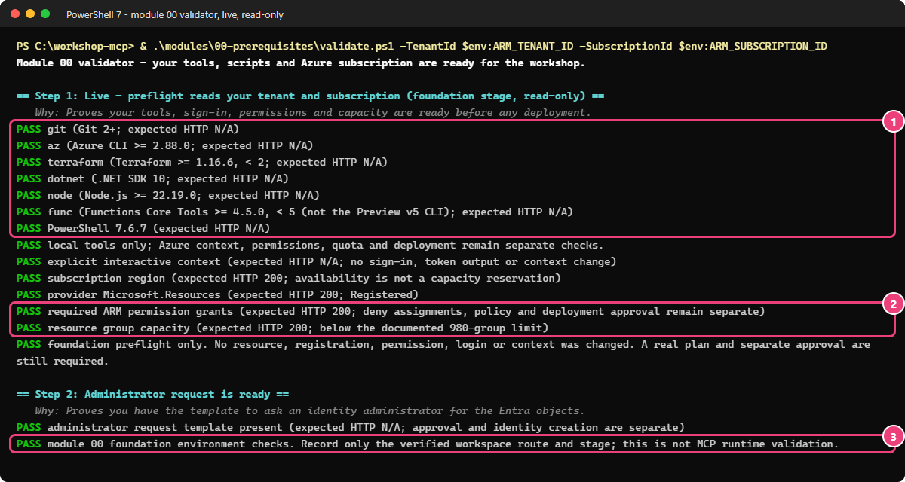
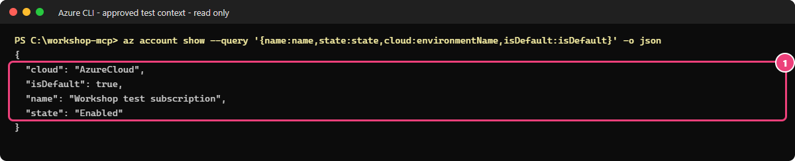

# 00 - Préparer l'environnement Terraform + PowerShell

[English](README.md)

## Objectif

Ce guide suit le parcours **Terraform + PowerShell**. Pour préparer le parcours centré sur le portail,
ouvrez le [guide low-code séparé](LOW-CODE.fr.md).

Vous allez choisir votre environnement de travail, vérifier vos outils et contrôler vos droits dans l'abonnement Azure de test.
Vous préparerez ensuite les informations à transmettre à l'administrateur Microsoft Entra pour le module 03.

## Pourquoi c'est important

Avoir les bons outils ne suffit pas : il faut aussi les droits et la capacité nécessaires dans Azure.
Les noms propres à chaque participant limitent les conflits, mais n'augmentent pas les quotas disponibles.

> [!IMPORTANT]
> Utilisez uniquement un tenant et un abonnement **hors production** approuvés. N'exécutez jamais l'atelier
> en production ni dans le tenant de quelqu'un d'autre.

Consultez les [schémas étape par étape](../../assets/architecture/STEPS.fr.md).
Un schéma explique l'objectif ; il ne prouve pas que des identités ou des ressources ont été déployées.

## Ce que vous déployez

**Les scripts de vérification ne créent aucune ressource.** Ils consultent votre configuration et vos droits.
Plus tard, dans une étape distincte et après approbation, Terraform crée un groupe de ressources dédié
ou réutilise celui fourni par l'administrateur. [GitHub Pages](../../docs/fr/HOSTING.md) héberge les guides :
vous n'avez aucun site Azure à déployer. Aucun serveur Model Context Protocol (MCP) n'est encore déployé.

## Prérequis et droits nécessaires

Commencez par [choisir votre environnement de travail](../../docs/fr/GETTING-STARTED.md).

**Raccourci facultatif :** le [Microsoft Foundry Dev Pack](https://devblogs.microsoft.com/foundry/foundry-devpack-announcement/),
en anglais, peut installer en une seule fois Azure CLI, Azure Developer CLI (`azd`) et l'extension Foundry
(Windows : `winget install Microsoft.FoundryDevPack`). Il n'installe **pas** Terraform, le SDK .NET, Node.js,
PowerShell ni Functions Core Tools : installez aussi les autres outils de la liste de référence. Lancez ensuite `scripts/check-tools.ps1` : il doit indiquer Azure CLI 2.88.0 ou plus récent. Sinon, installez Azure CLI par la méthode habituelle.
Utilisez uniquement un annuaire Microsoft Entra et un abonnement Azure autorisés pour des tests hors production.
L'annuaire contient les identités ; l'abonnement contient les ressources facturées.

Si votre administrateur vous fournit un groupe de ressources, utilisez-le. Ne demandez pas le rôle
Propriétaire (Owner) sur tout l'abonnement pour simplifier l'exercice.
Aucun droit d'administration Entra n'est nécessaire à cette étape. La
[demande destinée à l'administrateur](../../docs/requests/identity-request.md), en anglais,
liste ce dont le module 03 aura besoin.

## Étapes

### PowerShell

Depuis le dossier principal du dépôt :

> [!TIP]
> Lancez chaque vérification dans le terminal que vous utiliserez pour l'atelier. Une vérification faite
> dans un autre terminal ne prouve rien pour celui-ci.

```powershell
$ErrorActionPreference = 'Stop'
& .\scripts\check-tools.ps1
$expiry = [datetime]::UtcNow.AddDays(1).ToString('yyyy-MM-dd')
& .\scripts\prepare-workshop.ps1 -ParticipantPrefix p01 -Location swedencentral -Owner alice -Expiry $expiry
& .\scripts\select-azure-context.ps1 -Language fr
& .\modules\00-prerequisites\validate.ps1 -TenantId $env:ARM_TENANT_ID -SubscriptionId $env:ARM_SUBSCRIPTION_ID
```

> **Résultat réel** — `check-tools.ps1` et `validate.ps1` exécutés dans l'abonnement de test de l'auteur, 2026-10-17.
> Les lignes des scripts de préparation et de sélection du contexte sont décrites sous l'encadré. Noms et identifiants masqués.
>
> ```text
> PASS git (Git 2+; expected HTTP N/A)
> PASS az (Azure CLI >= 2.88.0; expected HTTP N/A)
> PASS terraform (Terraform >= 1.16.6, < 2; expected HTTP N/A)
> PASS dotnet (.NET SDK 10; expected HTTP N/A)
> PASS node (Node.js >= 22.19.0; expected HTTP N/A)
> PASS func (Functions Core Tools >= 4.5.0, < 5 (not the Preview v5 CLI); expected HTTP N/A)
> PASS PowerShell 7.6.7 (expected HTTP N/A)
> PASS local tools only; Azure context, permissions, quota and deployment remain separate checks.
> ...
> PASS explicit interactive context (expected HTTP N/A; no sign-in, token output or context change)
> PASS subscription region (expected HTTP 200; availability is not a capacity reservation)
> PASS provider Microsoft.Resources (expected HTTP 200; Registered)
> PASS required ARM permission grants (expected HTTP 200; deny assignments, policy and deployment approval remain separate)
> PASS resource group capacity (expected HTTP 200; below the documented 980-group limit)
> PASS foundation preflight only. No resource, registration, permission, login or context was changed. A real plan and separate approval are still required.
> PASS administrator request template present (expected HTTP N/A; approval and identity creation are separate)
> PASS module 00 foundation environment checks. Record only the verified workspace route and stage; this is not MCP runtime validation.
> ```
>
> **Comment lire vos résultats :** si vous obtenez les mêmes lignes `PASS`, vos outils répondent aux exigences et le script peut lire votre abonnement de test.
> Ces contrôles ne créent rien dans Azure. Entre les deux séries de contrôles, `prepare-workshop.ps1` affiche `PASS private participant parameters created with a
> stable random suffix.` (ou `PASS existing participant parameters reused unchanged.` lors d'une relance), et le sélecteur affiche
> `PASS contexte : tenant et abonnement vérifiés. ...`. Le script de validation répète d'abord les lignes des outils (omises ici).



Cette capture provient d'une exécution réelle dans le tenant de test de l'auteur (2026-10-20), pas de votre environnement.
Comparez vos résultats : le cadre 1 regroupe les outils ; le cadre 2, les droits détectés et la capacité disponible pour
un groupe de ressources ; le cadre 3, le bilan des contrôles. Ce bilan ne remplace pas l'approbation d'un déploiement.

Adaptez `p01`, la région, le libellé du propriétaire et la date aux choix approuvés pour votre atelier.
La date sert de rappel : elle ne déclenche pas de suppression automatique.
Pour un groupe existant, ajoutez `-ExistingResourceGroupName` avec son nom dès le premier appel à
`prepare-workshop.ps1`. Conservez le fichier de paramètres privé et l'état Terraform jusqu'au nettoyage.

Le sélecteur vous demande les identifiants de l'annuaire et de l'abonnement, puis la confirmation `NONPROD`.
Il vous connecte à Azure, puis sélectionne l'abonnement. **Gardez le même terminal pour la suite.**

> [!WARNING]
> Ne copiez aucune clé, aucun jeton ni aucune information sur votre compte dans le portail public de l'atelier,
> le dépôt ou la conversation.

<details>
<summary>Vous utilisez bash ?</summary>

PowerShell doit aussi être installé : les scripts bash appellent les mêmes contrôles.

```bash
bash ./scripts/check-tools.sh
read -r -p 'Date de nettoyage approuvée (yyyy-MM-dd) : ' expiry
bash ./scripts/prepare-workshop.sh -ParticipantPrefix p01 -Location swedencentral -Owner alice -Expiry "$expiry"
source ./scripts/select-azure-context.sh fr
bash ./modules/00-prerequisites/validate.sh -TenantId "$ARM_TENANT_ID" -SubscriptionId "$ARM_SUBSCRIPTION_ID"
```

> **Résultat attendu** — les mêmes lignes PASS que l'exécution PowerShell ci-dessus (les scripts bash appellent les mêmes scripts PowerShell).

</details>

## Résultat attendu

Chaque contrôle réussi affiche `PASS`. En cas d'erreur, corrigez le problème avant de poursuivre.
Les lectures Azure doivent renvoyer un code HTTP 200 ; les contrôles locaux indiquent `N/A`, car ils ne font pas
de requête réseau. Le script n'enregistre aucun fournisseur de ressources et n'attribue aucun rôle.

> **Note de validation — environnements facultatifs :** le conteneur et Codespaces n'ont pas encore été testés
> en conditions réelles. Si vous utilisez l'un de ces environnements, lancez les contrôles à l'intérieur :
> une exécution réussie sur votre poste ne le valide pas.

**Question :** toutes les lignes du contrôle préalable affichent `PASS`. Pouvez-vous maintenant déployer sans rien demander ?

<details>
<summary>Afficher la réponse</summary>

Non. Le contrôle préalable consulte seulement les droits, les fournisseurs et la capacité. Des refus explicites, Azure Policy et
les quotas partagés peuvent encore bloquer un déploiement. Il faut aussi relire et faire approuver, à part, chaque plan Terraform réel.

</details>

**Question :** votre première tentative a échoué. Pourquoi garder le même suffixe et le même état Terraform au lieu de générer de nouveaux noms ?

<details>
<summary>Afficher la réponse</summary>

Le suffixe et l'état permettent à Terraform et aux scripts de nettoyage de retrouver ce que vous avez créé. De nouveaux noms
laisseraient des ressources orphelines et ne remettraient aucun quota à zéro.

</details>

### Vérifier vous-même avec Azure CLI

**Pourquoi :** une connexion réussie ne garantit pas que vous avez choisi le bon abonnement.
Dans PowerShell 7, à la racine du dépôt, copiez ce bloc. Il consulte votre connexion sans créer de ressource :

```powershell
az account show --query '{name:name,state:state,cloud:environmentName,isDefault:isDefault}' -o json
if ($LASTEXITCODE -ne 0) { throw 'Impossible de lire le contexte Azure. Arrêtez-vous ici.' }
```

> **Résultat attendu** — `name` est votre abonnement de test approuvé, `state` vaut `Enabled` et `isDefault` vaut `true`.
> Le cloud public apparaît sous le nom `AzureCloud`. Ce contrôle ne vérifie pas encore vos droits de déploiement :
> lancez ensuite le validateur ci-dessous.



*Capture en lecture seule du 20 octobre 2026 ; le nom de l'abonnement est masqué.
Si le nom ne correspond pas à votre cible approuvée, reprenez la sélection du contexte avant de poursuivre.*

## Vérifier avant de poursuivre

Exécutez `validate.ps1` ou `validate.sh` dans l'abonnement de test approuvé.
Vérifiez aussi que vous comprenez la demande Entra et que vous pourrez la transmettre en privé à l'administrateur.
Passez au module 01 seulement quand chaque contrôle affiche `PASS`.


## En cas de problème

- **Mauvais abonnement :** relancez le sélecteur dans le terminal utilisé pour l'atelier.
- **Droits manquants :** demandez à l'administrateur de vérifier l'action refusée sur le groupe concerné.
- **Fournisseur non enregistré :** demandez à l'administrateur d'examiner son enregistrement ; le script ne l'enregistre pas.
- **Quota insuffisant :** vérifiez la capacité partagée. Renommer les ressources ne règle rien.
- **Functions Core Tools ne démarre pas :** terminez son installation selon la procédure approuvée.
- **Blocage par Azure Policy :** examinez la règle avec l'administrateur ; ne la désactivez pas.

## Nettoyer

```powershell
& .\modules\00-prerequisites\cleanup.ps1
```

> **Résultat attendu** — contrôles locaux uniquement.
>
> ```text
> PASS module 00 preflight cleanup (expected HTTP N/A): checks create no Azure or Entra resources.
> PASS private parameters and state preserved (expected HTTP N/A). Use module 99 to clean up deployed workshop resources.
> ```
>
> **Comment lire vos résultats :** les contrôles du module 00 n'ont créé aucune ressource à supprimer.
> Vos paramètres privés restent en place pour la suite.

Avec bash : `bash ./modules/00-prerequisites/cleanup.sh` (mêmes lignes PASS).
Les vérifications n'ont rien créé. Ce script conserve vos paramètres privés et votre état Terraform.
Si vous avez déployé le groupe de ressources, suivez le [module 99](../99-cleanup/README.fr.md)
pour examiner son nettoyage. Ne supprimez jamais un groupe partagé.

## Pour aller plus loin

<details>
<summary>Versions des outils, droits vérifiés et limites du contrôle</summary>

Versions retenues : Terraform 1.16.6, fournisseur AzureRM 5.9.0, Azure CLI 2.88.0, kit de développement .NET 10,
PowerShell 7.4+, Node.js 22.19+ et Functions Core Tools v4 >= 4.5.0.
La CLI Functions v5, distincte, est en **Preview** (préversion) et n'est pas utilisée.

Pour créer un groupe, il faut des droits de lecture, de création et de suppression sur l'abonnement.
Un groupe existant évite de demander ces droits, mais nécessite toujours les autorisations prévues sur ce groupe.
Le script lit les actions qu'Azure Resource Manager (ARM) autorise, retire les exclusions de chaque
ensemble d'autorisations, puis combine les ensembles. Chaque page de résultats doit venir du même
serveur HTTPS et rester dans le même périmètre. Les refus explicites et les règles Azure Policy peuvent encore
empêcher un déploiement, même si ces contrôles réussissent.

Le mode « nouveau groupe » vérifie aussi la limite de 980 groupes par abonnement.
Cette vérification n'est pas nécessaire si vous utilisez un groupe existant.
Le script de vérification ne vous connecte pas et ne change pas l'abonnement sélectionné.

</details>

<details>
<summary>Tester les scripts localement, sans valider un déploiement Azure</summary>

```powershell
terraform -chdir=infra/workload init -backend=false -lockfile=readonly
if ($LASTEXITCODE -ne 0) { throw 'Provider initialization failed.' }
& .\modules\00-prerequisites\validate.ps1 -Offline
```

> **Résultat réel** — exécution hors ligne sur le poste de l'auteur, 2026-10-17. Extrait ; vos durées diffèrent.
>
> ```text
> ✔ preflight is read-only and fails closed for context, permission, provider, quota, runtime and evidence errors (2819.2349ms)
> ...
> ℹ tests 19
> ℹ suites 0
> ℹ pass 19
> ℹ fail 0
> ...
> PASS local script/HTTP checks (expected HTTP N/A; no Azure access)
> Success! The configuration is valid.
> ...
> Success! 49 passed, 0 failed.
> PASS Terraform schema and mock-only plans (expected HTTP N/A; no live plan/apply)
> PASS offline checks only. Module 00 is NOT Azure-validated by this result.
> ```
>
> **Comment lire vos résultats :** les tests vérifient le comportement des scripts et du code Terraform avec des réponses fictives.
> `terraform init` affiche d'abord `Terraform has been successfully initialized!`. La dernière ligne le dit clairement : aucun contrôle Azure n'a eu lieu.

```bash
terraform -chdir=infra/workload init -backend=false -lockfile=readonly &&
bash ./modules/00-prerequisites/validate.sh -Offline
```

> **Résultat attendu** — les mêmes lignes PASS que l'exécution PowerShell ci-dessus.

Ces tests utilisent des réponses fictives et des fournisseurs Terraform simulés.
Leur réussite ne valide **ni votre abonnement Azure ni le conteneur**.

</details>

<details>
<summary>Préparer une étape payante ultérieure</summary>

L'option `-Stage mcp` exige une revue de capacité et de coût, conservée en privé et fournie avec `-CapacityReviewPath`.
Elle contient `subscriptionId`, `location`, `stage: "mcp"`, `unit: "MB"`, un entier `availableUnits`,
une date UTC `checkedAtUtc` au format `yyyy-MM-ddTHH:mm:ssZ` et le booléen `costApproved: true`.
La revue doit dater de moins de 24 heures et couvrir `FlexMemoryMB * FlexMaximumInstances` dans cet abonnement
et cette région. Gardez les valeurs réelles privées.
Le mode `mcp` vérifie les prérequis des modules suivants ; il ne valide pas leur déploiement.
Il vérifie aussi que des rôles peuvent être attribués. Confiez ces attributions à l'administrateur,
dans une étape séparée, plutôt que d'élargir les droits de tous les participants.

</details>

Consultez aussi les [explications sur la sécurité](../../docs/fr/LEARNING-GUIDE.md) et le
[schéma de cette étape](../../assets/architecture/00.fr.svg).

## Sources

- [Lire le contexte avec Azure CLI](https://learn.microsoft.com/cli/azure/account#az-account-show), vérifié le 20 octobre 2026.

- [Installer Azure CLI](https://learn.microsoft.com/cli/azure/install-azure-cli).
- [Terraform sur Azure](https://learn.microsoft.com/azure/developer/terraform/overview).
- [Installer PowerShell](https://learn.microsoft.com/powershell/scripting/install/installing-powershell).
- [.NET 10](https://dotnet.microsoft.com/download/dotnet/10.0).
- [Outils Functions](https://learn.microsoft.com/azure/azure-functions/functions-run-local).
- [API des autorisations](https://learn.microsoft.com/rest/api/authorization/permissions/list-for-resource-group).
- [Limites Azure](https://learn.microsoft.com/azure/azure-resource-manager/management/azure-subscription-service-limits).
- [Capacité et versions d'exécution Flex](https://learn.microsoft.com/azure/azure-functions/flex-consumption-plan).
- [Conteneurs VS Code](https://code.visualstudio.com/docs/devcontainers/containers).
- [Versions et sources retenues](../../docs/sources.md).

Dernière vérification : 2026-10-14.
