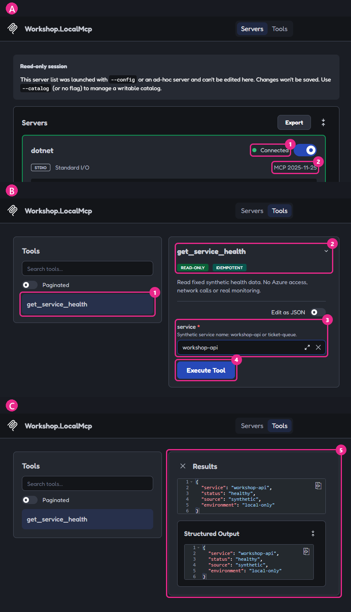

# 01 - Découvrir MCP en local

[English](README.md)

## Objectif

Découvrir un outil Model Context Protocol (MCP), lire ses paramètres, puis l'appeler pour de vrai.
**Vous pouvez faire ce module dès maintenant : il ne demande ni déploiement Azure, ni portail du présentateur, ni connexion.**

## Pourquoi c'est important

Découvrir un outil ne l'exécute pas. Une réponse du modèle ne prouve pas qu'un appel a eu lieu.
L'approbation du client ne remplace pas l'autorisation du serveur. Ce module ne teste ni identité ni rôle.

## Ce que vous déployez

Rien dans Azure. Votre client lance un processus C# et communique avec lui par ses entrées et sorties standard (stdio).
Il expose uniquement `get_service_health`, avec des données fictives fixes, sans appeler d'autre service.
Il n'y a ni adresse HTTP, ni données persistantes, ni écriture, ni journalisation du contenu des échanges.


**Construisez-le étape par étape.** Cliquez sur **Suivant** pour ajouter un élément à la fois ; le schéma complet suit.

```reveal
{
  "title": "Un appel d'outil, sur votre poste",
  "audience": "attendee",
  "width": 760,
  "height": 380,
  "lanes": [
    {"x": 8, "width": 232, "label": "Client"},
    {"x": 264, "width": 232, "label": "Messages (stdio)"},
    {"x": 520, "width": 232, "label": "Serveur local"}
  ],
  "nodes": [
    {"id":"c","step":0,"x":30,"y":44,"width":188,"title":"VS Code ou Inspector","detail":["démarre le serveur","en processus enfant"]},
    {"id":"s","step":0,"x":542,"y":44,"width":188,"title":"Serveur MCP local","detail":["Workshop.LocalMcp","stdio, sans réseau"]},
    {"id":"tool","step":1,"x":542,"y":164,"width":188,"title":"get_service_health","detail":["lecture seule","entrée : service"]},
    {"id":"human","step":2,"tone":"governed","x":30,"y":164,"width":188,"title":"Vous approuvez","detail":["Manual permissions","arguments affichés"]},
    {"id":"limit","step":4,"tone":"risk","x":286,"y":284,"width":188,"title":"Vous seul, ici","detail":["pas de réseau","pas d'identité"]}
  ],
  "edges": [
    {"from":"c","to":"s","step":0,"label":"initialize"},
    {"from":"c","to":"tool","step":1,"label":"tools/list"},
    {"from":"human","to":"tool","step":2,"offset":-10,"label":"tools/call"},
    {"from":"tool","to":"human","step":3,"offset":10,"label":"résultat"}
  ],
  "steps": [
    {"title": "Le client démarre le serveur", "simple": "Pas d'Azure : le client lance le serveur sur votre poste, et ils dialoguent en stdio.", "say": "Ils échangent des messages JSON-RPC. `initialize` fixe d'abord la version du protocole."},
    {"title": "Découvrir l'outil", "simple": "Le client demande la liste des outils et lit ce que chacun attend.", "say": "`tools/list` renvoie un seul outil en lecture, `get_service_health`, avec son schéma d'entrée : un texte `service` obligatoire. Rien ne s'exécute encore."},
    {"title": "Vous approuvez l'appel", "simple": "Rien ne s'exécute tant que vous n'avez pas dit oui dans le client.", "say": "En mode **Manual permissions**, le client affiche l'outil et ses arguments, puis n'envoie `tools/call` qu'après votre accord."},
    {"title": "Lire le résultat", "simple": "Le serveur répond avec des données synthétiques. Vérifiez le résultat, pas seulement le code de sortie.", "say": "`structuredContent` contient `status: healthy` et `source: synthetic`. Un service inconnu renvoie une erreur d'outil (`isError: true`)."},
    {"title": "Voir la limite", "simple": "Personne d'autre ne peut utiliser ce serveur : ni réseau, ni identité.", "say": "Le module 02 déplace les mêmes outils dans Azure. Les vraies questions commencent alors : qui peut appeler, et avec quels droits ?"}
  ]
}
```


Ce schéma explique le parcours ; il ne prouve pas qu'un service est déployé.
Aucune fonctionnalité **Preview** n'est utilisée ici. Les modules suivants signalent eux-mêmes leurs préversions.

## Prérequis et rôles nécessaires

- Votre propre [copie du dépôt](../../docs/fr/GETTING-STARTED.md#0-récupérer-le-dépôt-sur-votre-poste).
- PowerShell 7.4+ et le kit de développement .NET 10 (SDK). Vérifiez `pwsh --version` et `dotnet --list-sdks`.
- Un accès autorisé au registre de paquets. Les versions sont fixées et verrouillées ; ne contournez pas les contrôles réseau.
- Node.js 22.19+ et npm pour l'exercice facultatif avec Inspector.
- Visual Studio Code (VS Code) avec GitHub Copilot pour observer l'approbation manuelle.
  Les contrôles de protocole ne demandent ni modèle ni abonnement Copilot. En revanche, utiliser Copilot peut consommer votre forfait.

**Aucun rôle Azure.** Vous pouvez faire cet exercice même si vous n'avez pas encore terminé les contrôles Azure du module 00.
Ils restent obligatoires, avec les approbations de déploiement, avant tout exercice dans le cloud.

## Étapes

### PowerShell

Ouvrez PowerShell 7 à la racine du dépôt. Arrêtez-vous si une commande échoue.

**1. Construire et vérifier le serveur local.**

```powershell
& .\modules\01-discover-mcp\validate.ps1
```

> **Résultat réel** — capture locale sur le poste de l'auteur, 2026-10-16. Données fictives ; vos durées diffèrent.
>
> ```text
> PASS locked local server build (expected HTTP N/A).
> PASS SDK protocol negotiation (expected HTTP N/A; stdio).
> INFO negotiated MCP protocol: 2026-07-28
> PASS tools/list exposes exactly one read tool (expected HTTP N/A; stdio).
> PASS tools/call workshop-api succeeds (expected HTTP N/A; stdio).
> PASS unknown service returns a tool error (expected HTTP N/A; stdio).
> PASS write tool is not exposed (expected HTTP N/A; stdio).
> PASS local MCP checks complete (expected HTTP N/A; stdio, no Azure).
> MANUAL CHECK: client approval prompts are not tested by this validator.
> ```
>
> **Ce que cela signifie pour vous :** votre poste sait compiler et lancer un serveur MCP, et un client peut négocier
> une version du protocole avec lui. La ligne `MANUAL CHECK` le rappelle : un script ne peut pas prouver qu'une personne a vu
> la demande d'approbation. L'étape 3 s'en charge.

Le script restaure les paquets verrouillés, compile en Release, lance son serveur, l'appelle, puis l'arrête.
Il n'installe aucun service permanent et n'utilise pas votre connexion Azure.

**2. Inspecter le serveur sans modèle d'IA, avec un second client facultatif.**

### Préparer Inspector dans le même terminal PowerShell

**Pourquoi :** le client a besoin du chemin du serveur compilé ; les commandes suivantes réutilisent ces variables.
Lisez la demande d'installation de npm avant de l'accepter. Les identifiants d'Inspector restent uniquement en mémoire.

```powershell
$server = (Resolve-Path .\modules\01-discover-mcp\server\bin\Release\net10.0\Workshop.LocalMcp.dll).Path
$env:MCP_INSPECTOR_SECRET_STORE = 'memory'
$env:MCP_INSPECTOR_PERSIST_TOKENS = 'none'
```

> **Résultat attendu** — déduit des commandes elles-mêmes ; ces lignes n'affichent rien.
> Si tout se passe bien, rien ne s'affiche. Vérifiez avec `Test-Path $server`, qui affiche `True`.
> Si `Resolve-Path` signale un chemin inexistant, l'étape 1 n'est pas terminée.

**Observez :** aucun serveur n'a démarré. Si la DLL est absente, l'étape 1 n'est pas terminée ; arrêtez-vous.

Les quatre requêtes suivantes utilisent ce même terminal. Chaque commande lance et ferme son propre serveur local.
Le portail montre des exemples enregistrés ou attendus, jamais votre exécution. Comparez-les avec la sortie de votre terminal.
Ne collez ni jetons ni sortie du terminal dans la page publique.

### Requête 1 sur 4 : Découvrir

**Pourquoi :** avant de choisir un outil, le client demande au serveur ce qu'il sait faire. Il découvre un contrat, pas un état de santé.

**Anticipez :** vous devez obtenir un seul outil, `get_service_health`, avec un argument obligatoire `service`.

```powershell exchange
npx @modelcontextprotocol/inspector@2.9.0 --cli dotnet $server --method tools/list
if ($LASTEXITCODE -ne 0) { throw 'Inspector discovery failed.' }
```

> **Résultat réel** — capture locale, 2026-10-16 (extrait de la sortie d'Inspector).
>
> ```text
> "name": "get_service_health",
> "description": "Read fixed synthetic health data. No Azure access, network calls or real monitoring.",
> "inputSchema": { "type": "object", "properties": { "service": { "type": "string", ... } }, "required": ["service"] },
> "annotations": { "readOnlyHint": true, "destructiveHint": false, "idempotentHint": true, "openWorldHint": false }
> ```
>
**Ce que cela signifie pour vous :** `description` aide le modèle à choisir l'outil. `inputSchema` lui indique comment construire les arguments.
Vous avez découvert l'outil, pas appelé celui-ci.

**À repérer :** `get_service_health`, `required: ["service"]` et `readOnlyHint: true`. Aucun état de santé n'a encore été renvoyé.

**Question :** `readOnlyHint: true` suffit-il à empêcher un outil d'écrire ?

<details>
<summary>Afficher la réponse</summary>

Non. Les annotations sont des indications déclarées par le serveur pour le client ; rien ne les impose. Seuls le code du
serveur et, dans les modules suivants, ses contrôles d'authentification et de rôles d'application décident de ce qu'un appelant peut faire.

</details>

### Requête 2 sur 4 : Lire un service

**Pourquoi :** vous connaissez maintenant le contrat. Utilisez-le pour demander l'état d'un service.

**Anticipez :** `workshop-api` doit renvoyer `healthy` et `isError: false`, avec des données fictives.

```powershell exchange
npx @modelcontextprotocol/inspector@2.9.0 --cli dotnet $server --method tools/call --tool-name get_service_health --tool-arg service=workshop-api
if ($LASTEXITCODE -ne 0) { throw 'Inspector tool call failed.' }
```

> **Résultat réel** — capture locale, 2026-10-16.
>
> ```text
> "structuredContent": { "service": "workshop-api", "status": "healthy", "source": "synthetic", "environment": "local-only" },
> "isError": false
> ```
>
**Ce que cela signifie pour vous :** le client a réellement appelé l'outil. `healthy` est l'état fictif du service.
`isError: false` indique la réussite de l'outil ; `source: synthetic` rappelle qu'il ne s'agit pas de supervision réelle.

**À repérer :** `service: workshop-api`, `status: healthy`, `source: synthetic` et `isError: false` dans votre terminal.
Comparez les champs, pas les espaces ni les durées.

### Requête 3 sur 4 : Changer le service

**Pourquoi :** gardez le même outil et changez seulement `service`. Les arguments sélectionnent les données, sans nouvel outil.

**Anticipez :** `ticket-queue` renvoie `degraded`. Cela signifie-t-il que l'outil a échoué ?

```powershell exchange
npx @modelcontextprotocol/inspector@2.9.0 --cli dotnet $server --method tools/call --tool-name get_service_health --tool-arg service=ticket-queue
if ($LASTEXITCODE -ne 0) { throw 'Inspector tool call failed.' }
```

> **Résultat attendu** — extrait de la réponse fictive fixe contrôlée par le validateur. Ce n'est pas une réponse exécutée par cette page.
>
> ```text
> "structuredContent": { "service": "ticket-queue", "status": "degraded", "source": "synthetic", "environment": "local-only" },
> "isError": false
> ```

**Ce que cela signifie pour vous :** un état dégradé est une donnée, pas un échec de l'outil. Celui-ci a correctement renvoyé cet état.

**À repérer :** seuls le service et son état changent dans le résultat. `isError` reste à `false`.

### Requête 4 sur 4 : Tester un refus

**Pourquoi :** un outil fiable refuse une entrée inconnue au lieu d'inventer une réponse. Testez cette limite.

**Anticipez :** `billing` renvoie `isError: true`, sans état de santé inventé. Inspector 2.9.0 se termine avec le code **5** pour cette erreur d'outil, pas 0.

```powershell exchange
npx @modelcontextprotocol/inspector@2.9.0 --cli dotnet $server --method tools/call --tool-name get_service_health --tool-arg service=billing
if ($LASTEXITCODE -ne 5) { throw 'Expected Inspector exit code 5 for this tool error.' }
```

> **Résultat réel** — capture locale avec Inspector 2.9.0, 2026-10-20 (extrait). Données fictives.
>
> ```text
> "text": "An error occurred invoking 'get_service_health': Unknown synthetic service. Use workshop-api or ticket-queue."
> "isError": true
> ```
>
> Inspector écrit aussi un résumé d'erreur avec `code: tool_is_error` et se termine avec le code **5**. Le contrôle ci-dessus attend ce code uniquement pour cette requête.

**Ce que cela signifie pour vous :** l'échange MCP peut réussir alors que l'outil signale un échec. C'est un refus d'entrée,
pas une panne Azure ni un contrôle d'identité. Le client a reçu le refus de l'outil et le signale par son propre code de sortie.
Aucun service cloud n'a été contacté.

**À repérer :** `isError: true`, les noms des services acceptés et le code de sortie 5 d'Inspector. Tout autre résultat doit être examiné.

**Question :** Inspector se termine avec le code 5. Cela signifie-t-il forcément que la connexion a échoué ?

<details>
<summary>Afficher la réponse</summary>

Non. Ici, la connexion a transporté un résultat avec `isError: true`. Inspector traduit cet échec d'outil par le code de sortie 5.
Lisez l'erreur et le résultat. D'autres clients peuvent signaler les erreurs d'outil autrement.

</details>

### Facultatif : utiliser la page web de l'Inspector

Vous préférez cliquer plutôt que taper ? Lancez l'Inspector sans `--cli` :

```powershell
npx @modelcontextprotocol/inspector@2.9.0 dotnet $server
```

> **Résultat attendu** — le terminal affiche `MCP Inspector Web is up and running at: http://127.0.0.1:6274?MCP_INSPECTOR_API_TOKEN=...`
> et ouvre cette page. Le jeton protège la page sur votre poste : ne le partagez pas. Arrêtez avec **Ctrl+C** quand vous avez terminé.

Dans la page : activez **dotnet** (A) ; ouvrez **Tools**, sélectionnez `get_service_health`, saisissez `workshop-api` dans
**service** puis sélectionnez **Execute Tool** (B) ; lisez le résultat (C).



*Capture réelle, 2026-10-19, poste de l'auteur. Les badges du cadre 2 sont les annotations de l'outil : des indications, pas des contrôles.*

**3. Connecter VS Code et observer une approbation.**

Ouvrez cette copie du dépôt dans VS Code. Le fichier `.vscode/mcp.json` déclare `workshop-local`
et garde aussi le serveur Microsoft Learn. Lancez **MCP: List Servers**, choisissez **workshop-local**, puis **Start**.
La configuration lance directement le fichier DLL compilé. Ne le démarrez pas à la main dans un autre terminal.
Vous n'avez aucune adresse à coller.

Utilisez une conversation locale avec **Manual permissions**, pas Allow all ni Autopilot.
Avec Agent Host, choisissez l'isolation Folder ; une session worktree peut imposer Allow all.
Dans **Chat: Manage Tool Approval**, désactivez la préapprobation de cet outil.
Si la confirmation n'apparaît toujours pas, utilisez le réglage documenté
`chat.tools.eligibleForAutoApproval` : mettez `false` pour l'identifiant réel de l'outil, tel que votre client l'affiche.

> [!WARNING]
> N'activez pas l'approbation globale et ne modifiez pas une règle de votre organisation.
> La confiance accordée au dossier et le démarrage du serveur ne valent pas approbation d'un appel.

Sélectionnez uniquement `workshop-local` dans les outils du chat et envoyez :

> Appelle get_service_health une seule fois avec service workshop-api. Demande mon approbation avant l'appel.
> Ne remplace pas l'outil par une commande de terminal et n'invente pas le résultat.

Vérifiez le nom réel de l'outil et ses paramètres, puis approuvez **une seule fois**.
Dépliez l'appel et examinez son résultat, pas seulement la réponse de l'assistant.

<details>
<summary>Comment faire dans VS Code, clic par clic</summary>

1. Ouvrez le dossier du dépôt avec **File** > **Open Folder...**. Si VS Code vous demande si vous faites confiance aux
   auteurs, ne faites confiance qu'à votre propre copie.
2. Appuyez sur **Ctrl+Maj+P** (macOS : **Cmd+Maj+P**), lancez **MCP: List Servers**, choisissez `workshop-local`, puis
   **Start Server**. Son état passe à **Running**.
3. Ouvrez le Chat avec **Ctrl+Alt+I** (macOS : **Ctrl+Cmd+I**). Dans la liste des modes sous la zone de saisie, choisissez
   **Agent**. Sélectionnez l'icône des outils (**Configure Tools**) et ne gardez que les outils de `workshop-local`.
4. Gardez les approbations manuelles : ne passez pas le sélecteur d'autorisations sur **Allow all** ni **Autopilot**.
5. Collez le prompt. VS Code affiche le nom de l'outil `get_service_health` et l'argument `service: workshop-api` :
   sélectionnez **Allow** une seule fois. Dépliez l'appel d'outil dans le Chat pour lire son entrée et sa sortie.
6. Quand vous avez terminé, lancez **MCP: List Servers**, choisissez `workshop-local`, puis **Stop Server**.

</details>

> [!IMPORTANT]
> Si votre client ne permet pas d'imposer une approbation par appel, notez **non vérifié**.
> Le script automatique ne peut pas prouver qu'une personne a vu une confirmation.

### Bash

La version bash appelle le même script PowerShell 7. Il n'existe pas de seconde version du serveur :

```bash
bash ./modules/01-discover-mcp/validate.sh
server="$PWD/modules/01-discover-mcp/server/bin/Release/net10.0/Workshop.LocalMcp.dll"
export MCP_INSPECTOR_SECRET_STORE=memory MCP_INSPECTOR_PERSIST_TOKENS=none
```

> **Résultat attendu** — le validateur affiche ses contrôles PASS, puis la préparation ne produit aucune sortie. Arrêtez-vous si la compilation échoue.

Suivez ensuite les quatre mêmes requêtes. Exécutez chaque bloc séparément. Les trois premières requêtes attendent le code 0 ;
le dernier refus attend volontairement le code 5.

```bash
npx @modelcontextprotocol/inspector@2.9.0 --cli dotnet "$server" --method tools/list
```

> **Résultat attendu** — l'exemple de la requête 1 : un outil avec son argument obligatoire `service`, pas un état de santé.

```bash
npx @modelcontextprotocol/inspector@2.9.0 --cli dotnet "$server" --method tools/call --tool-name get_service_health --tool-arg service=workshop-api
```

> **Résultat attendu** — requête 2 : `workshop-api`, `healthy`, `source: synthetic` et `isError: false`.

```bash
npx @modelcontextprotocol/inspector@2.9.0 --cli dotnet "$server" --method tools/call --tool-name get_service_health --tool-arg service=ticket-queue
```

> **Résultat attendu** — requête 3 : `ticket-queue`, `degraded` et `isError: false`.

```bash
code=0
npx @modelcontextprotocol/inspector@2.9.0 --cli dotnet "$server" --method tools/call --tool-name get_service_health --tool-arg service=billing || code=$?
if [ "$code" -ne 5 ]; then printf '%s\n' 'Expected Inspector exit code 5 for this tool error.' >&2; false; fi
```

> **Résultat attendu** — requête 4 : l'erreur nomme les services autorisés, avec `isError: true` et `tool_is_error`. Le contrôle accepte uniquement le code de sortie 5 d'Inspector.

Faites ensuite l'exercice VS Code ci-dessus dans la même copie.
Exécutez les blocs un par un et arrêtez-vous dès que le code de sortie est inattendu.

## Ce que vous devez voir

| Action | Résultat attendu | Ce que cela signifie |
|---|---|---|
| `tools/list` | Un seul outil, `get_service_health`, avec le paramètre texte obligatoire `service` | Vous avez découvert un contrat, pas exécuté un outil. |
| `service=workshop-api` | `isError: false`, `status: healthy` | Un appel réel renvoie un état de santé fictif. |
| `service=ticket-queue` | `isError: false`, `status: degraded` | Un état fictif dégradé n'est pas une erreur de protocole. |
| Service inconnu | `isError: true` | L'outil refuse cette entrée ; il ne vérifie pas Azure. |
| `create_ticket` | Outil absent ou appel rejeté | Aucun outil d'écriture ici ; ce n'est pas un refus fondé sur un rôle. |

Exemple **fictif** de `structuredContent`, également renvoyé dans un bloc texte :

```json
{"service":"workshop-api","status":"healthy","source":"synthetic","environment":"local-only"}
```

Le script affiche notamment :

```text
PASS tools/list exposes exactly one read tool (expected HTTP N/A; stdio).
PASS exact synthetic result for workshop-api (expected HTTP N/A; stdio).
PASS unknown service returns a tool error (expected HTTP N/A; stdio).
PASS local MCP checks complete (expected HTTP N/A; stdio, no Azure).
MANUAL CHECK: client approval prompts are not tested by this validator.
```

**Statut HTTP : sans objet.** stdio relie des processus locaux ; ce n'est pas un service HTTP.
Sur le poste de l'auteur, le test entre le client et le serveur du SDK a négocié la version `2026-07-28` du protocole.
Inspector 2.9.0 a également découvert et appelé le serveur. Laissez les clients négocier ; n'écrivez pas vous-même l'échange d'initialisation.
Ces résultats ne prouvent rien sur la compatibilité des modules suivants (Functions et passerelle).

## Valider

Relancez `validate.ps1` ou `validate.sh`. Chaque contrôle automatique doit afficher `PASS`, avec un code de sortie 0.
Le script vérifie le protocole, la liste exacte, le schéma, les indications de lecture seule,
les deux résultats fictifs complets, les entrées inconnues ou manquantes et le rejet d'un nom d'outil d'écriture.
Il ne consigne que l'issue des contrôles, jamais les paramètres, les résultats d'outil ni les échanges du protocole.

Observez séparément l'approbation et le résultat dans VS Code. La réussite des contrôles automatiques ne remplace pas cette observation.
Le module reste `in-progress` tant que l'approbation manuelle et le jalon d'environnement précédent ne sont pas consignés.

**Question :** le validateur affiche `PASS unknown service returns a tool error`. Pourquoi une entrée refusée compte-t-elle comme une réussite ?

<details>
<summary>Afficher la réponse</summary>

Parce que le contrôle **attend** ce refus. Un bon test prouve une règle, pas seulement le cas où tout va bien : le serveur
doit rejeter un service inconnu avec `isError: true` au lieu de deviner. `PASS` signifie que la règle a tenu.

</details>


## Dépannage

| Problème | À vérifier |
|---|---|
| .NET 10 absent ou restauration impossible | Suivez le guide d'installation et rouvrez PowerShell. Passez par votre accès autorisé aux paquets ; ne désactivez pas TLS. |
| Fichier DLL introuvable | Lancez d'abord le script dans votre copie. Ne copiez pas les fichiers compilés d'un autre participant. |
| Aucun outil dans VS Code | Démarrez `workshop-local`, actualisez les outils et vérifiez l'erreur réelle de démarrage. |
| Aucune approbation | Vérifiez les autorisations, la préapprobation de l'outil et les règles de l'organisation. Un résultat n'est pas une confirmation. |
| Inspector ne démarre pas | Vérifiez Node/npm et la version fixée dans votre registre. Ne changez pas la version ni le registre géré sans le signaler. |
| Le client demande une URL | Vous avez choisi HTTP au lieu de stdio. Ce serveur n'a pas d'adresse réseau. |

## Nettoyer

Arrêtez `workshop-local` avec **MCP: List Servers**. Les commandes Inspector s'arrêtent seules.
Lancez ensuite :

```powershell
& .\modules\01-discover-mcp\cleanup.ps1
```

> **Résultat attendu** — d'après les messages de `cleanup.ps1` ; pas encore de capture enregistrée.
>
> ```text
> PASS no Azure resources or persistent tool data created by module 01 (expected HTTP N/A).
> MANUAL CHECK: stop workshop-local in MCP: List Servers; stop Inspector with Ctrl+C in its terminal.
> MANUAL CHECK: you may leave workshop-local configured but stopped; do not remove other servers.
> KEEP private module 00 parameters and Terraform state. This script does not delete files or stop unrelated processes.
> ```
>
> **Ce que cela signifie pour vous :** il n'y a rien à supprimer dans Azure. Les lignes `MANUAL CHECK` décrivent ce que vous devez faire vous-même dans VS Code.

```bash
bash ./modules/01-discover-mcp/cleanup.sh
```

> **Résultat attendu** — les mêmes quatre lignes que l'exécution PowerShell ci-dessus.

Ce script d'aide rappelle les actions manuelles ; il n'arrête aucun autre processus et ne supprime aucun fichier.
Les fichiers compilés restent dans `server/bin` et `server/obj` (ignorés par Git) : vous pourrez les réutiliser.
Conservez les paramètres et l'état privés du module 00. Aucun nettoyage Azure n'est nécessaire ici.

## Aller plus loin

Expliquez la différence entre `degraded` avec `isError: false` et un service inconnu avec `isError: true`.
Expliquez pourquoi une indication de lecture seule n'est pas un contrôle d'accès.
Suite : le [module 02](../02-open-server/README.fr.md) déploie le même serveur dans Azure, protégé seulement par une clé.
Le portail facultatif du présentateur ne fait que diffuser ces instructions.

## Sources

- [Prise en main du SDK C# 2.2.0, version figée](https://github.com/modelcontextprotocol/csharp-sdk/blob/6fa3825973949a9c4f0cd8af344e15a8db09dc35/docs/concepts/getting-started.md).
- [Réutilisation et licences, en anglais](UPSTREAM.md).
- [Transports MCP](https://modelcontextprotocol.io/specification/2026-07-28/basic/transports) et [outils](https://modelcontextprotocol.io/specification/2026-07-28/server/tools).
- [MCP Inspector](https://modelcontextprotocol.io/docs/tools/inspector).
- [Sorties et codes de retour de l'Inspector CLI](https://modelcontextprotocol.io/docs/2026-07-28/tools/inspector/cli).
- [Configuration MCP de VS Code](https://code.visualstudio.com/docs/agent-customization/mcp-servers) et [approbations](https://code.visualstudio.com/docs/agents/run/approvals).

Dernière vérification : 2026-10-20 (exercice guidé et références publiques outils/Inspector ; aucune modification cloud).
