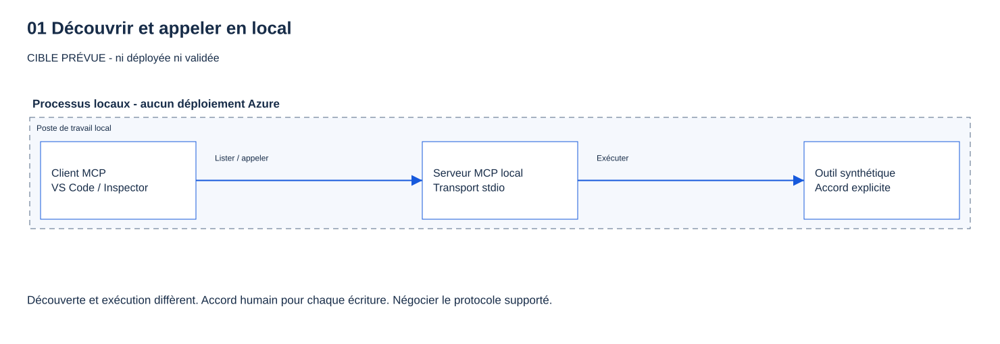

# 01 - Découvrir MCP en local

[English](README.md)

## Objectif

Afficher un outil du protocole de contexte de modèle (MCP), lire ses paramètres, puis l'appeler réellement.
**Ce module est exécutable maintenant. Aucun déploiement Azure, portail présentateur ou connexion n'est nécessaire.**

## Pourquoi cette étape compte

Découvrir un outil ne l'exécute pas. Une réponse du modèle ne prouve pas qu'un appel a eu lieu.
L'approbation du client ne remplace pas l'autorisation du serveur. Ici, on ne teste ni identité ni rôle.

## Ce que vous déployez

Rien dans Azure. Votre client lance un processus C# par ses entrées et sorties standard, dites stdio.
Il expose uniquement `get_service_health`, avec des données fictives fixes, sans appeler d'autre service.
Aucune adresse HTTP, donnée persistante, écriture ni journalisation du contenu des échanges.



Ce schéma explique le parcours ; il ne prouve pas qu'un service est déployé.
Aucune fonctionnalité **Preview** n'est utilisée ici. Les préversions des étapes suivantes restent indiquées dans leurs modules.

## Prérequis et rôles nécessaires

- Votre propre [copie du dépôt](../../docs/fr/GETTING-STARTED.md#0-récupérer-le-dépôt-sur-votre-poste).
- PowerShell 7.4+ et le kit de développement .NET 10 (SDK). Vérifiez `pwsh --version` et `dotnet --list-sdks`.
- Un accès autorisé aux paquets. Les versions sont fixées et verrouillées ; ne contournez pas les contrôles réseau.
- Node.js 22.19+ et npm pour l'exercice facultatif avec Inspector.
- Visual Studio Code (VS Code) avec GitHub Copilot pour observer l'approbation manuelle.
  Les contrôles de protocole ne demandent ni modèle ni abonnement Copilot. L'utilisation de Copilot peut consommer votre forfait.

**Aucun rôle Azure.** Vous pouvez faire cet exercice sans Azure pendant que les contrôles Azure du module 00 restent en attente.
Ils restent nécessaires, avec les approbations de déploiement, avant tout exercice dans le cloud.

## Étapes

### PowerShell

Ouvrez PowerShell 7 à la racine du dépôt. Arrêtez-vous si une commande échoue.

**1. Construire et vérifier le serveur local.**

```powershell
& .\modules\01-discover-mcp\validate.ps1
```

Le script restaure les paquets verrouillés, compile en Release, lance son serveur, l'appelle, puis l'arrête.
Il n'installe aucun service permanent et n'utilise pas votre connexion Azure.

**2. L'inspecter sans modèle d'IA, avec un second client facultatif.**

```powershell
$server = (Resolve-Path .\modules\01-discover-mcp\server\bin\Release\net10.0\Workshop.LocalMcp.dll).Path
$env:MCP_INSPECTOR_SECRET_STORE = 'memory'
$env:MCP_INSPECTOR_PERSIST_TOKENS = 'none'
npx @modelcontextprotocol/inspector@2.9.0 --cli dotnet $server --method tools/list
if ($LASTEXITCODE -ne 0) { throw 'Inspector discovery failed.' }
npx @modelcontextprotocol/inspector@2.9.0 --cli dotnet $server --method tools/call --tool-name get_service_health --tool-arg service=workshop-api
if ($LASTEXITCODE -ne 0) { throw 'Inspector tool call failed.' }
```

Examinez la demande d'installation de npm. Chaque commande lance et ferme son propre serveur.
Ces commandes affichent des résultats fictifs, pas des identifiants cloud.
Ne réutilisez pas un enregistrement de terminal pour les modules suivants.

**3. Connecter VS Code et observer une approbation.**

Ouvrez cette copie du dépôt dans VS Code. Le fichier `.vscode/mcp.json` contient `workshop-local`
et conserve le serveur Microsoft Learn. Lancez **MCP: List Servers**, choisissez **workshop-local**, puis **Start**.
La configuration lance directement le fichier DLL compilé. Ne le démarrez pas à la main dans un autre terminal.
Aucune adresse à coller.

Utilisez une conversation locale avec **Manual permissions**, pas Allow all ni Autopilot.
Avec Agent Host, choisissez l'isolation Folder ; une session worktree peut imposer Allow all.
Dans **Chat: Manage Tool Approval**, désactivez la préapprobation de cet outil.
Si la confirmation est encore ignorée, utilisez le réglage documenté
`chat.tools.eligibleForAutoApproval`, avec `false` pour l'identifiant réel de l'outil affiché par votre client.
N'activez pas l'approbation globale et ne modifiez pas une règle de votre organisation.
La confiance accordée au dossier et le démarrage du serveur ne sont pas une approbation d'appel.

Sélectionnez uniquement `workshop-local` dans les outils du chat et envoyez :

> Appelle get_service_health une seule fois avec service workshop-api. Demande mon approbation avant l'appel.
> Ne remplace pas l'outil par une commande de terminal et n'invente pas le résultat.

Vérifiez le vrai nom et les paramètres, puis approuvez **une seule fois**.
Dépliez l'appel et examinez son résultat, pas seulement la réponse de l'assistant.
Si votre client ne permet pas d'imposer une approbation par appel, notez **non vérifié**.
Le script automatique ne peut pas prouver qu'une personne a vu une confirmation.

### Bash

Le même script utilise PowerShell 7, sans seconde implémentation du serveur :

```bash
bash ./modules/01-discover-mcp/validate.sh
server="$PWD/modules/01-discover-mcp/server/bin/Release/net10.0/Workshop.LocalMcp.dll"
export MCP_INSPECTOR_SECRET_STORE=memory MCP_INSPECTOR_PERSIST_TOKENS=none
npx @modelcontextprotocol/inspector@2.9.0 --cli dotnet "$server" --method tools/list
npx @modelcontextprotocol/inspector@2.9.0 --cli dotnet "$server" --method tools/call --tool-name get_service_health --tool-arg service=workshop-api
```

Faites ensuite l'exercice VS Code ci-dessus dans la même copie.
Exécutez les commandes séparément et arrêtez-vous si le code de sortie est différent de zéro.

## Ce que vous devez voir

| Action | Résultat attendu | Ce que cela signifie |
|---|---|---|
| `tools/list` | Un seul outil, `get_service_health`, avec le paramètre texte obligatoire `service` | Vous avez découvert un contrat, pas exécuté un outil. |
| `service=workshop-api` | `isError: false`, `status: healthy` | Un appel réel renvoie une santé fictive. |
| `service=ticket-queue` | `isError: false`, `status: degraded` | Un état fictif dégradé n'est pas une erreur de protocole. |
| Service inconnu | `isError: true` | L'outil refuse cette entrée ; il ne vérifie pas Azure. |
| `create_ticket` | Outil absent ou appel rejeté | Aucun outil d'écriture ici ; ce n'est pas un refus fondé sur un rôle. |

Exemple **fictif** de `structuredContent`, également renvoyé dans un bloc texte :

```json
{"service":"workshop-api","status":"healthy","source":"synthetic","environment":"local-only"}
```

Le script affiche notamment :

```text
PASS tools/list exposes exactly one read tool (expected HTTP N/A; stdio).
PASS exact synthetic result for workshop-api (expected HTTP N/A; stdio).
PASS unknown service returns a tool error (expected HTTP N/A; stdio).
PASS local MCP checks complete (expected HTTP N/A; stdio, no Azure).
MANUAL CHECK: client approval prompts are not tested by this validator.
```

**Statut HTTP : sans objet.** stdio relie des processus locaux ; ce n'est pas un service HTTP.
Le contrôle entre clients et serveurs du SDK a négocié le protocole `2026-07-28` sur le poste de construction.
Inspector 2.9.0 a également découvert et appelé le serveur. Laissez les clients négocier ; ne fabriquez pas de dialogue de connexion.
Ces résultats ne prouvent pas la compatibilité des futurs modules Functions ou passerelle.

## Valider

Relancez `validate.ps1` ou `validate.sh`. Chaque contrôle automatique doit afficher `PASS`, avec un code de sortie 0.
Le script vérifie le protocole, la liste exacte, le schéma, les indications de lecture seule,
les deux résultats fictifs complets, les entrées inconnues ou manquantes et le rejet d'un nom d'outil d'écriture.
Il n'enregistre que les contrôles, pas les paramètres, résultats ou échanges du protocole.

Observez séparément l'approbation et le résultat dans VS Code. Une réussite automatique ne valide pas cette observation.
Le module reste `in-progress` tant que l'approbation manuelle et le jalon d'environnement précédent ne sont pas consignés.

## Dépannage

| Problème | À vérifier |
|---|---|
| .NET 10 absent ou restauration impossible | Suivez le guide d'installation et rouvrez PowerShell. Utilisez votre accès aux paquets autorisé ; ne désactivez pas TLS. |
| Fichier DLL introuvable | Lancez d'abord le script dans votre copie. Ne copiez pas les fichiers compilés d'un autre participant. |
| Aucun outil dans VS Code | Démarrez `workshop-local`, actualisez les outils et vérifiez l'erreur réelle de démarrage. |
| Aucune approbation | Vérifiez les permissions, la préapprobation de l'outil et les règles de l'organisation. Un résultat n'est pas une confirmation. |
| Inspector ne démarre pas | Vérifiez Node/npm et la version fixée dans votre registre. Ne changez pas silencieusement la version ou le registre géré. |
| Le client demande une URL | Vous avez choisi HTTP au lieu de stdio. Ce serveur n'a pas d'adresse réseau. |

## Nettoyer

Arrêtez `workshop-local` avec **MCP: List Servers**. Les commandes Inspector s'arrêtent seules.
Puis lancez :

```powershell
& .\modules\01-discover-mcp\cleanup.ps1
```

```bash
bash ./modules/01-discover-mcp/cleanup.sh
```

L'aide rappelle les actions manuelles ; elle ne tue pas d'autres processus et ne supprime aucun fichier.
Les fichiers compilés restent dans `server/bin` et `server/obj`, ignorés par Git, pour réutilisation.
Conservez les paramètres et l'état privés du module 00. Aucun nettoyage Azure n'est nécessaire ici.

## Aller plus loin

Essayez `ticket-queue` après avoir prédit le résultat. Expliquez pourquoi une indication de lecture seule n'est pas un contrôle d'accès.
Lisez ensuite le [plan du module 02](../../docs/fr/BUILD-PLAN.md#02---serveur-par-clé-niveau-0).
Son serveur cloud reste à construire ; le serveur local ne le déploie pas.
Le portail facultatif du présentateur ne sert que ces instructions.

## Sources

- [Démarrage C# SDK 2.2.0, version figée](https://github.com/modelcontextprotocol/csharp-sdk/blob/6fa3825973949a9c4f0cd8af344e15a8db09dc35/docs/concepts/getting-started.md).
- [Réutilisation et licences, en anglais](UPSTREAM.md).
- [Transports MCP](https://modelcontextprotocol.io/specification/2026-07-28/basic/transports) et [outils](https://modelcontextprotocol.io/specification/2026-07-28/server/tools).
- [MCP Inspector](https://modelcontextprotocol.io/docs/tools/inspector).
- [Configuration MCP de VS Code](https://code.visualstudio.com/docs/agent-customization/mcp-servers) et [approbations](https://code.visualstudio.com/docs/agents/run/approvals).

Dernière vérification : 2026-10-14. Exécution locale Windows avec le SDK et Inspector, pas une validation Azure ou de l'approbation dans l'interface.
