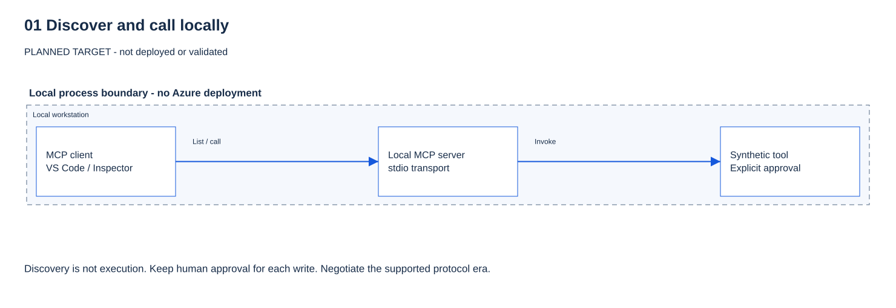

# 01 - Discover MCP locally

[Français](README.fr.md)

## Goal

Discover a Model Context Protocol (MCP) tool, read its input schema, then make a real call.
**You can run this module now. No Azure deployment, presenter portal or sign-in is required.**

## Why it matters

Discovery is not execution. A model's answer is not proof that a tool ran.
Client approval is not server authorization. This local exercise does not test identity or roles.

## What you deploy

Nothing in Azure. Your client starts one C# process using standard input/output (stdio).
It exposes only `get_service_health`. It returns fixed synthetic data and makes no downstream calls.
The server has no HTTP listener, persistent data, write tool or payload logging.



The diagram is a learning view, not evidence of a deployed service.
No **Preview** feature is used by this module. Later Preview features remain labeled in their own modules.

## Prerequisites and required roles

- Your own [checkout](../../docs/GETTING-STARTED.md#0-get-the-repository-onto-your-computer).
- PowerShell 7.4+ and the .NET 10 software development kit (SDK). Check `pwsh --version` and `dotnet --list-sdks`.
- Package download access. Dependencies are pinned and locked; do not bypass certificate or registry controls.
- Node.js 22.19+ and npm for the optional Inspector exercise.
- Visual Studio Code (VS Code) with GitHub Copilot access for the manual client-approval exercise.
  Protocol tests do not need a model or a Copilot subscription. Copilot usage can consume your plan's allowance.

**Azure roles: none.** You may do this offline-from-Azure exercise while module 00's Azure checks are pending.
Those checks and deployment approvals are still required before any cloud exercise.

## Steps

### PowerShell

Open PowerShell 7 in the repository root. Stop on any failed command.

**1. Build and verify the local server.**

```powershell
& .\modules\01-discover-mcp\validate.ps1
```

> **Real result** — local capture on the authoring host, 2026-10-16. Synthetic data; your timings differ.
>
> ```text
> PASS locked local server build (expected HTTP N/A).
> PASS SDK protocol negotiation (expected HTTP N/A; stdio).
> INFO negotiated MCP protocol: 2026-07-28
> PASS tools/list exposes exactly one read tool (expected HTTP N/A; stdio).
> PASS tools/call workshop-api succeeds (expected HTTP N/A; stdio).
> PASS unknown service returns a tool error (expected HTTP N/A; stdio).
> PASS write tool is not exposed (expected HTTP N/A; stdio).
> PASS local MCP checks complete (expected HTTP N/A; stdio, no Azure).
> MANUAL CHECK: client approval prompts are not tested by this validator.
> ```
>
> **What it means for you:** your machine can build and run an MCP server, and a client can negotiate a protocol
> version with it. `MANUAL CHECK` is honest: a script cannot prove that a human saw an approval dialog. Step 3 covers that.

The validator restores locked packages, builds Release, starts its own server, calls it, then closes it.
It does not install a background service or use your Azure session.

**2. Inspect it without an AI model (optional second client).**

### Prepare Inspector in the same PowerShell terminal

**Why:** the client needs the compiled server path; later commands reuse these variables.
Review npm's package-install prompt. Keep Inspector credentials in memory only.

```powershell
$server = (Resolve-Path .\modules\01-discover-mcp\server\bin\Release\net10.0\Workshop.LocalMcp.dll).Path
$env:MCP_INSPECTOR_SECRET_STORE = 'memory'
$env:MCP_INSPECTOR_PERSIST_TOKENS = 'none'
```

> **Expected result** — from the commands themselves; these lines print nothing.
> Success is a silent return. Confirm with `Test-Path $server`, which prints `True`.
> If `Resolve-Path` reports that the path does not exist, step 1 did not finish.

**Observe:** no server has started. A missing DLL means step 1 did not finish; stop.

### Discover the contract without invoking a tool

**Predict:** one tool, `get_service_health`, with a required `service` argument.

```powershell
npx @modelcontextprotocol/inspector@2.9.0 --cli dotnet $server --method tools/list
if ($LASTEXITCODE -ne 0) { throw 'Inspector discovery failed.' }
```

> **Real result** — local capture, 2026-10-16 (excerpt of the Inspector output).
>
> ```text
> "name": "get_service_health",
> "description": "Read fixed synthetic health data. No Azure access, network calls or real monitoring.",
> "inputSchema": { "type": "object", "properties": { "service": { "type": "string", ... } }, "required": ["service"] },
> "annotations": { "readOnlyHint": true, "destructiveHint": false, "idempotentHint": true, "openWorldHint": false }
> ```
>
> **What it means for you:** this is the **contract** an agent reads before choosing a tool. The model relies on the
> `description` to decide, and on `inputSchema` to build arguments. The `annotations` are hints for the client, not
> a security control: a server could lie. Nothing has run yet.

**Observe:** the tool name and input schema, not a service-health result.

**Before continuing:** explain the difference between listing a tool and calling it.

**Question:** the `annotations` say `readOnlyHint: true`. Does that prevent this tool from writing anything?

<details>
<summary>Show answer</summary>

No. Annotations are hints the server declares for the client; they are not enforced. Only the server's own code and,
in later modules, its authentication and app-role checks decide what a caller may do.

</details>

### Make one explicit read-only call

**Predict:** `workshop-api` returns `healthy` and `isError: false`, with synthetic data.

```powershell
npx @modelcontextprotocol/inspector@2.9.0 --cli dotnet $server --method tools/call --tool-name get_service_health --tool-arg service=workshop-api
if ($LASTEXITCODE -ne 0) { throw 'Inspector tool call failed.' }
```

> **Real result** — local capture, 2026-10-16.
>
> ```text
> "structuredContent": { "service": "workshop-api", "status": "healthy", "source": "synthetic", "environment": "local-only" },
> "isError": false
> ```
>
> With an unsupported value (`service=billing`), the same command returns:
>
> ```text
> "text": "An error occurred invoking 'get_service_health': Unknown synthetic service. Use workshop-api or ticket-queue."
> "isError": true
> ```
>
> **What it means for you:** a tool can fail **inside a successful MCP exchange**. Always read `isError`, not only
> whether the command ran. The server rejects unknown input instead of guessing: that is the behavior you want
> from every tool, especially before writes exist.

Review npm's package-install prompt. Each command starts and closes its own server.
These commands print synthetic results, not cloud credentials. Do not reuse transcript recording for later modules.

**Observe:** a real local tool invocation, not a model's invented answer. No Azure service was contacted.

**Question:** the Inspector command exited with code 0. Does that prove the tool succeeded?

<details>
<summary>Show answer</summary>

No. The MCP exchange can succeed while the tool itself reports an error. Read `isError` (and the result content);
an unknown service returns `isError: true` inside a successful call.

</details>

**3. Connect VS Code and observe one approval.**

Open this checkout in VS Code. Its reviewed `.vscode/mcp.json` contains `workshop-local` and preserves
the Microsoft Learn server. Run **MCP: List Servers**, select **workshop-local**, then **Start**.
The configuration runs the built DLL directly; do not start it manually in a second terminal.
There is no endpoint URL to paste.

Use a local chat session with **Manual permissions**, not Allow all or Autopilot.
For Agent Host sessions, use Folder isolation; worktree sessions can force Allow all.
Run **Chat: Manage Tool Approval** and turn off pre-approval for this tool.
If a confirmation is still skipped, use the documented per-tool
`chat.tools.eligibleForAutoApproval` setting with `false` for the actual tool identifier shown by your client.

> [!WARNING]
> Do not enable global auto-approval or change organization policy.
> Workspace Trust and starting a server are different from approving a tool call.

Select only `workshop-local` in the tool picker and send:

> Call get_service_health once with service workshop-api. Ask for my approval before the tool runs.
> Do not substitute a terminal command or invent the result.

Review the actual tool name and arguments; approve **once**.
Expand the tool-call record and inspect its result, not only the assistant's answer.

> [!IMPORTANT]
> If your client cannot enforce per-call approval, record this exercise as **not verified**.
> The validator cannot prove that a human saw a dialog.

### Bash

The same validator runs through PowerShell 7; no separate server implementation:

```bash
bash ./modules/01-discover-mcp/validate.sh
server="$PWD/modules/01-discover-mcp/server/bin/Release/net10.0/Workshop.LocalMcp.dll"
export MCP_INSPECTOR_SECRET_STORE=memory MCP_INSPECTOR_PERSIST_TOKENS=none
npx @modelcontextprotocol/inspector@2.9.0 --cli dotnet "$server" --method tools/list
npx @modelcontextprotocol/inspector@2.9.0 --cli dotnet "$server" --method tools/call --tool-name get_service_health --tool-arg service=workshop-api
```

> **Expected result** — the same PASS lines and Inspector output as the PowerShell runs above; `validate.sh` calls the same `validate.ps1`.

Run the VS Code exercise above from the same checkout.
Keep each command separate and stop if its exit code is nonzero.

## What you should see

| Action | Expected result | Meaning |
|---|---|---|
| `tools/list` | Exactly one tool, `get_service_health`; required string input `service` | You discovered a schema, not a result. |
| `service=workshop-api` | `isError: false`, `status: healthy` | A real call returned synthetic health data. |
| `service=ticket-queue` | `isError: false`, `status: degraded` | Degraded synthetic health is not a protocol failure. |
| Unknown service | `isError: true` | The tool rejects unsupported input; it does not check Azure. |
| `create_ticket` | Tool absent / rejected | This module exposes no writes, not a role-based denial. |

Example **synthetic** `structuredContent`, also returned as a text block:

```json
{"service":"workshop-api","status":"healthy","source":"synthetic","environment":"local-only"}
```

The validator prints, among other checks:

```text
PASS tools/list exposes exactly one read tool (expected HTTP N/A; stdio).
PASS exact synthetic result for workshop-api (expected HTTP N/A; stdio).
PASS unknown service returns a tool error (expected HTTP N/A; stdio).
PASS local MCP checks complete (expected HTTP N/A; stdio, no Azure).
MANUAL CHECK: client approval prompts are not tested by this validator.
```

**HTTP status: not applicable.** stdio is a local process transport, not an HTTP service.
The SDK-to-SDK check negotiated protocol `2026-07-28` on the authoring host.
Inspector 2.9.0 also listed and called the server successfully. Let clients negotiate; do not handcraft a handshake.
These observations do not prove compatibility with future Functions or gateway modules.

## Validate

Rerun `validate.ps1` or `validate.sh` above. Every automatic check must say `PASS`, with exit code 0.
It checks protocol negotiation, exact discovery/schema/annotations, both complete synthetic results,
unknown and missing service inputs, and rejection of a write-tool name.
It logs only concise checks, not tool arguments/results or protocol transcripts.

Separately observe the client approval and result in VS Code. Do not mark that manual check passed
because the automated validator succeeded.
The module remains `in-progress` until the manual check and the preceding environment gate are recorded.

## Troubleshooting

| Symptom | Check |
|---|---|
| .NET 10 missing / restore fails | Follow the installation guide. Reopen PowerShell. Use approved package/proxy access; do not disable TLS checks. |
| DLL not found | Run the validator first, from this checkout. Do not copy another participant's build output. |
| No tools in VS Code | Start `workshop-local`, refresh tools and select the correct server. Check its actual startup error. |
| No approval | Check permission level, per-tool pre-approval and organization settings. Do not confuse a result with a confirmation. |
| Inspector fails | Check Node/npm and the pinned package in your configured registry. Do not silently change the pin or managed registry. |
| A browser URL is requested | You selected HTTP instead of stdio. This server has no URL. |

## Clean up

Stop `workshop-local` through **MCP: List Servers** when finished. Inspector CLI commands stop themselves.
Then run:

```powershell
& .\modules\01-discover-mcp\cleanup.ps1
```

> **Expected result** — from the messages in `cleanup.ps1`; not yet a recorded capture.
>
> ```text
> PASS no Azure resources or persistent tool data created by module 01 (expected HTTP N/A).
> MANUAL CHECK: stop workshop-local in MCP: List Servers; stop Inspector with Ctrl+C in its terminal.
> MANUAL CHECK: you may leave workshop-local configured but stopped; do not remove other servers.
> KEEP private module 00 parameters and Terraform state. This script does not delete files or stop unrelated processes.
> ```
>
> **What it means for you:** there is nothing to delete in Azure. The `MANUAL CHECK` lines are yours to do in VS Code.

```bash
bash ./modules/01-discover-mcp/cleanup.sh
```

> **Expected result** — the same four lines as the PowerShell run above.

The helper reports manual actions; it does not kill other processes or delete files.
Build artifacts stay in ignored `server/bin` and `server/obj` for reuse.
Keep module 00's private parameters/state. No Azure teardown is needed for module 01.

## Go further

Try `ticket-queue` and predict its result first. Explain why a read-only annotation is a hint, not an access check.
Then read the [module 02 plan](../../docs/BUILD-PLAN.md#02--an-open-mcp-server-level-0).
Its cloud server is not implemented yet; do not infer that this local server deploys it.
The presenter's optional portal hosts these instructions only.

## Sources

- [C# SDK 2.2.0 quickstart, pinned commit](https://github.com/modelcontextprotocol/csharp-sdk/blob/6fa3825973949a9c4f0cd8af344e15a8db09dc35/docs/concepts/getting-started.md).
- [Reuse and license notices](UPSTREAM.md).
- [MCP transports](https://modelcontextprotocol.io/specification/2026-07-28/basic/transports) and [tools](https://modelcontextprotocol.io/specification/2026-07-28/server/tools).
- [MCP Inspector](https://modelcontextprotocol.io/docs/tools/inspector).
- [VS Code MCP configuration](https://code.visualstudio.com/docs/agent-customization/mcp-servers) and [tool approvals](https://code.visualstudio.com/docs/agents/run/approvals).

Last verified: 2026-10-14. Local Windows SDK/Inspector execution, not Azure or manual UI approval evidence.
