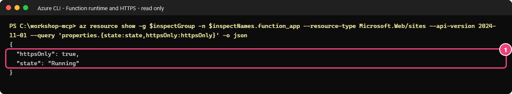

# 02 — Déployer un serveur MCP protégé par une clé

[English](LOW-CODE.md)

## Objectif

[Guide Terraform + PowerShell](README.fr.md)

Vous allez déployer dans Azure un serveur Model Context Protocol (MCP) qui propose cinq outils.
Vous créerez les ressources dans le portail, puis publierez le code depuis votre terminal.

Vous testerez ensuite deux situations : sans la clé, l'appel est refusé ; avec la clé, vous pouvez créer un ticket fictif.
Vous constaterez ainsi la limite de cette protection : **le serveur accepte toute personne qui possède la clé,
sans savoir qui elle est ni quels droits lui accorder.**

## Pourquoi c'est important

Si Alice, Bob et Eve utilisent la même clé, le serveur leur donne le même accès.
Il ne peut pas autoriser Alice à créer un ticket tout en l'interdisant à Bob.
L'outil `whoami` vous le montrera : il répond `caller: unknown`, car la clé ne permet pas d'identifier la personne.

Le module 03 remplacera la clé par une connexion Microsoft Entra ID.
Le module 04 ajoutera une passerelle API Management qui vérifiera les droits nécessaires pour chaque outil.

> [!WARNING]
> Ne laissez pas ce serveur protégé par une simple clé en service après l'exercice.
> Passez au module 03 ou supprimez les ressources si vous vous arrêtez ici.
> Ne désactivez jamais la protection par clé pour faciliter un test.
> Une réponse HTTP 401 sans clé confirme que la clé est exigée ; elle ne prouve pas que le serveur vérifie les droits de chaque utilisateur.

## Ce que vous déployez

Vous créez les ressources suivantes dans un groupe réservé à ce parcours :

- une application Azure Functions (**Function App**) sur le plan Flex Consumption, avec .NET 10 en processus isolé et 2048 Mo de mémoire ;
- une identité managée pour que l'application accède aux services Azure sans mot de passe ;
- un compte de stockage avec le conteneur `app-package` pour le code et la file `tickets` pour les tickets fictifs ;
- un espace Log Analytics et un composant Application Insights pour la supervision.

Si les règles de votre environnement imposent un stockage privé, vous ajoutez aussi un réseau virtuel,
deux points de terminaison privés et des zones DNS privées pour la résolution des noms.

Le serveur propose `get_service_health`, `create_ticket`, `whoami`, `read_report_as_user` et `read_report_as_app`.
Seul `create_ticket` écrit des données, toutes fictives. Les trois derniers outils simulent encore les accès liés à l'identité :
vous mettrez en place les appels réels au module 05.
Les journaux ne doivent contenir ni clé, ni jeton, ni arguments d'appel, ni résultats d'outil.

**Coût :** vous payez les exécutions, le stockage et la collecte des données de supervision.
Les points de terminaison privés sont aussi facturés à l'heure.
Le déploiement n'utilise aucune instance maintenue prête en permanence et ne dépasse pas 10 instances.
Supprimez les ressources le jour même si vous ne poursuivez pas l'atelier.
Aucune fonctionnalité en préversion n'est utilisée dans ce module.

## Prérequis et rôles nécessaires

- [Module 00 low-code](../00-prerequisites/LOW-CODE.fr.md) terminé pour un abonnement de test approuvé ; [module 01](../01-discover-mcp/README.fr.md) terminé.
- Dépôt ouvert dans VS Code, PowerShell 7.4+, Azure CLI et SDK .NET 10. Exécutez les commandes depuis la racine du dépôt.
- Le fichier privé `.workshop/participant.tfvars.json` contient déjà `participant_prefix`, `resource_suffix`, `owner` et `expiry`.
  Il est exclu du suivi Git. Ce parcours en lit les paramètres de nommage sans utiliser Terraform. Conservez le suffixe existant.
- Vous avez le rôle Contributor sur le groupe de ressources. Pour les trois attributions prévues ci-dessous,
  demandez un rôle Role Based Access Control Administrator temporaire et limité à ces besoins, pas le rôle Owner.
  Aucun rôle d'administration Microsoft Entra n'est nécessaire.
- Ce parcours utilise la région **Europe Ouest (`westeurope`)**. Avant de commencer, vérifiez qu'elle propose
  Flex Consumption avec .NET 10 et que vos quotas et les règles de votre abonnement permettent le déploiement.
  N'utilisez pas la région de l'exemple Terraform à la place sans refaire ces vérifications.
- Faites approuver la création des ressources et leur coût avant l'étape 2.
  Si une stratégie Azure bloque une opération, arrêtez-vous pour en comprendre la raison ; ne désactivez pas ce contrôle.

## Étapes

### 1. Préparer le terminal et les noms

Dans le portail Azure, ouvrez **Subscriptions (Abonnements) → votre abonnement de test → Overview (Vue d'ensemble)**
et copiez le **Subscription ID**. Ouvrez ensuite **Microsoft Entra ID → Overview** et copiez le **Tenant ID**.
Remplacez les deux valeurs entre chevrons par ces identifiants ; ce ne sont pas des secrets.

```powershell
$tenant = '<tenant-id>'
$sub = '<subscription-id>'
az login --tenant $tenant
az account set --subscription $sub
$p = Get-Content .\.workshop\participant.tfvars.json -Raw | ConvertFrom-Json
$id = "$($p.participant_prefix)lc"; $sfx = $p.resource_suffix.Substring(0, 10); $loc = 'westeurope'
$rg = "rg-mcp-$id-$sfx"; $st = "st$id$sfx"; $fn = "func-mcp-$id-$sfx"; $mi = "id-mcp-$id-$sfx"
$ai = "appi-mcp-$id-$sfx"; $law = "log-mcp-$id-$sfx"; $vn = "vnet-mcp-$id-$sfx"
if ($p.existing_resource_group_name) { $rg = $p.existing_resource_group_name }
$rg; $st; $fn; $mi; $ai; $law; $vn
```

> **Résultat attendu** — les sept noms de vos ressources, construits à partir de votre préfixe, de `lc` et de votre suffixe.
> Si l'administrateur vous a fourni un groupe existant, son nom est conservé.
> Gardez ce terminal ouvert pour la suite et utilisez les noms affichés, pas ceux des captures.
> Ne créez pas de nouveau groupe à la place d'un groupe fourni et ne supprimez jamais ce dernier.

### 2. Créer groupe, identité et supervision dans le portail

1. Ouvrez **Resource groups → Create**. Sélectionnez l'abonnement de test, le nom `$rg` et la région **West Europe**.
   Dans **Tags**, ajoutez `workshop=governed-mcp`, `track=low-code`, ainsi que `owner` et `expiry` issus de votre fichier de paramètres.
   Sélectionnez **Review + create → Create**. Si un groupe vous a été fourni, ne le recréez pas et ne changez pas son propriétaire.
2. Recherchez **Managed Identities → Create**. Utilisez le même groupe, la même région, le nom `$mi` et les mêmes étiquettes.
   Dans **Overview**, repérez **Client ID**, **Principal ID** et **Resource ID** : ces trois identifiants ont des usages différents.
3. Ouvrez **Log Analytics workspaces → Create**. Utilisez le nom `$law`, le même groupe, la même région et les mêmes étiquettes.
   Dans **Usage and estimated costs → Daily cap**, fixez le plafond à **1 Go/jour**.
4. Ouvrez **Application Insights → Create**. Utilisez le nom `$ai`, le même groupe, la même région et l'espace de travail `$law`.
   Ajoutez les étiquettes. Dans **Properties**, désactivez l'authentification locale : l'application utilisera son identité managée.

> **Résultat attendu** — le groupe existe. Sa page **Overview** affiche l'identité managée, l'espace Log Analytics et Application Insights.

### 3. Créer le stockage et les trois attributions de rôle

1. Ouvrez **Storage accounts → Create**. Utilisez le nom `$st`, le même groupe, **West Europe**, **Standard**
   et **Locally-redundant storage (LRS)**. Dans **Advanced**, exigez le transfert sécurisé et TLS **1.2** au minimum.
   Désactivez l'accès anonyme aux blobs et l'accès par clé du compte. Activez l'autorisation Microsoft Entra par défaut
   dans le portail, puis créez le compte avec les mêmes étiquettes.
2. Les pages **Data storage → Containers** et **Queues** vous permettront de retrouver `app-package` (accès **Private**) et `tickets`.
   Créez-les avec les commandes de gestion ci-dessous : l'explorateur peut être inaccessible à cause du réseau privé
   ou parce que vous n'avez pas de rôle d'accès aux données. Ne demandez pas de droits plus larges et n'utilisez pas de clé pour les créer.
3. Sur le compte, ouvrez **Access control (IAM) → Add → Add role assignment**.
   Attribuez **Storage Blob Data Owner** à `$mi`, en choisissant **Managed identity**, puis **Review + assign**.
   Limitez cette attribution à ce compte de stockage.
4. Le portail ne permet pas toujours de sélectionner une file précise pour l'attribution.
   Utilisez la commande ci-dessous pour attribuer **Storage Queue Data Message Sender** à `$mi` sur `tickets` seulement, pas sur tout le compte.
5. Sur le composant Application Insights `$ai`, ouvrez **Access control (IAM)** et attribuez **Monitoring Metrics Publisher**
   à `$mi`, sur ce composant seulement. Attendez que les attributions soient prises en compte.

Créez le conteneur et la file avec les commandes suivantes. Elles passent par l'API de gestion Azure,
sans utiliser de clé de stockage ni modifier les restrictions réseau :

```powershell
az storage container-rm create -g $rg --storage-account $st -n app-package -o none
$stId = az storage account show -g $rg -n $st --query id -o tsv
az rest --method put --url "https://management.azure.com$stId/queueServices/default/queues/tickets?api-version=2023-05-01" --body '{}' -o none
```

> **Résultat attendu** — les commandes se terminent avec le code 0, sans rien afficher.
> Le conteneur `app-package` et la file `tickets` existent ; aucune clé de stockage n'a été utilisée.

Créez l'attribution sur cette file exacte dans le terminal :

```powershell
$stId = az storage account show -g $rg -n $st --query id -o tsv
$miPid = az identity show -g $rg -n $mi --query principalId -o tsv
az role assignment create --assignee-object-id $miPid --assignee-principal-type ServicePrincipal --role 'Storage Queue Data Message Sender' --scope "$stId/queueServices/default/queues/tickets" -o none
```

> **Résultat attendu** — la commande se termine avec le code 0, sans rien afficher.
> Cette attribution autorise l'identité à envoyer des messages dans la seule file `tickets`, pas dans les autres files du compte.
> Si l'attribution est refusée, faites vérifier vos droits au lieu d'élargir sa portée.

### 4. Préparer le stockage privé si la stratégie l'impose

Sur le compte de stockage, ouvrez **Networking → Public access**.
Si l'accès public est **Disabled**, préparez le réseau privé avant de créer l'application Azure Functions.
Ne réactivez pas l'accès public pour contourner la stratégie de votre environnement.
Sinon, passez à l'étape 5 ; vous aurez tout de même besoin d'un réseau virtuel au module 04.

1. **Virtual networks → Create** : même groupe/région, nom `$vn`, espace `10.52.0.0/23`. **IP addresses** : supprimez le sous-réseau par défaut. Ajoutez `snet-functions`, `10.52.1.32/27`, délégué à **Microsoft.App/environments**, puis `snet-private-endpoints`, `10.52.1.0/27`, sans délégation.
2. Compte → **Networking → Private endpoint connections → + Private endpoint** : nom `pe-<nom-stockage>-blob`, même groupe/région, sous-ressource **blob** ; réseau `$vn`, sous-réseau `snet-private-endpoints`. **DNS** : intégration activée, zone `privatelink.blob.core.windows.net`. Créez.
3. Recommencez pour `pe-<nom-stockage>-queue`, sous-ressource **queue**, zone `privatelink.queue.core.windows.net`.
4. **Private DNS zones** → chaque zone → **Virtual network links** : lien vers `$vn`, inscription automatique désactivée. Dans le compte → **Private endpoint connections**, les deux connexions doivent être **Approved**.


*Sur votre propre compte de stockage, vérifiez que Public network access vaut Disabled si votre environnement l'impose.
La capture sert de repère ; les noms affichés ne sont pas les vôtres.*


*Sur votre compte, les deux connexions blob et queue doivent être à l'état Approved.
Vérifiez aussi que les zones DNS privées sont bien liées au réseau virtuel.*

### 5. Créer et configurer la Function

1. Ouvrez **Create a resource → Function App → Flex Consumption → Create**.
   Sélectionnez le groupe `$rg`, le nom `$fn`, **West Europe**, **.NET**, la version **10 isolated** et **2048 MB** de mémoire.
2. Dans **Storage**, choisissez le compte `$st`, le conteneur de déploiement `app-package`,
   l'authentification **User-assigned managed identity** et l'identité `$mi`.
   Utilisez aussi cette identité pour le stockage nécessaire au fonctionnement de l'hôte Functions.
3. Si vous avez préparé le réseau privé à l'étape 4, activez **Networking → Enable virtual network integration**
   avec le réseau `$vn` et le sous-réseau `snet-functions`. Ne sélectionnez pas le sous-réseau des points de terminaison privés.
4. Dans **Monitoring**, sélectionnez le composant Application Insights existant `$ai`.
   Ajoutez les étiquettes, vérifiez la configuration, puis créez l'application.
5. Dans **Settings → Identity → User assigned**, vérifiez que `$mi` est associé à l'application.
   Dans **Settings → Configuration → General settings**, activez HTTPS uniquement, exigez TLS **1.2** au minimum
   et désactivez l'authentification de base pour la publication SCM et FTP.
   Dans **Scale and concurrency**, limitez le nombre d'instances à **10**, sans instance maintenue prête en permanence.
6. Ouvrez **Settings → Environment variables → App settings**.
   Supprimez `AzureWebJobsStorage` s'il contient une chaîne de connexion.
   Ajoutez les valeurs du tableau avec le **Client ID** visible dans la page **Overview** de `$mi` et le nom de votre compte de stockage.
   Conservez la chaîne Application Insights existante : ce n'est pas une clé de stockage.
   Sélectionnez **Apply → Confirm**.

| Nom | Valeur |
|---|---|
| `AzureWebJobsStorage__credential` | `managedidentity` |
| `AzureWebJobsStorage__clientId` | `<client-id-identite-managee>` |
| `AzureWebJobsStorage__blobServiceUri` | `https://<nom-stockage>.blob.core.windows.net/` |
| `AzureWebJobsStorage__queueServiceUri` | `https://<nom-stockage>.queue.core.windows.net/` |
| `APPLICATIONINSIGHTS_AUTHENTICATION_STRING` | `ClientId=<client-id-identite-managee>;Authorization=AAD` |
| `TICKET_QUEUE_SERVICE_URI` | `https://<nom-stockage>.queue.core.windows.net/` |
| `TICKET_QUEUE_NAME` | `tickets` |
| `WORKSHOP_IDENTITY_CLIENT_ID` | `<client-id-identite-managee>` |

Ne définissez pas `webhookAuthorizationLevel` sur `Anonymous` : conservez la valeur `System` de `host.json`,
qui impose la clé système pour accéder au serveur MCP.

### 6. Publier le code existant — terminal nécessaire

Le portail ne compile pas le projet .NET du dépôt. Dans le terminal de l'étape 1 :

```powershell
dotnet publish .\src\FunctionsMcpServer --configuration Release --output .\.workshop\lowcode-publish
if ($LASTEXITCODE) { throw 'Publish failed; stop.' }
Compress-Archive -Path .\.workshop\lowcode-publish\* -DestinationPath .\.workshop\lowcode.zip -Force
az functionapp deployment source config-zip -g $rg -n $fn --src .\.workshop\lowcode.zip -o none
if ($LASTEXITCODE) { throw 'Azure deployment failed; stop.' }
```

> **Résultat attendu** — la compilation et l'envoi du code réussissent avec le code de sortie 0.
> Après synchronisation, la page **Functions** affiche cinq fonctions.
> Le code nécessaire au module 05 est déjà inclus, mais ses appels réels ne seront activés qu'avec les paramètres de ce module.
> Publiez-le maintenant : au module 04, les adresses utilisées pour le déploiement ne seront plus accessibles depuis Internet.

### 7. Connecter VS Code sans écrire la clé dans un fichier

VS Code vous demandera la clé et la conservera dans son stockage de secrets.
Vous n'avez pas à l'inscrire dans la configuration du serveur.

1. Function → **Overview** : copiez **Default domain**. Remplacez `<function-host>` ci-dessous par ce domaine, sans second `https://`.
2. VS Code → **Ctrl+Shift+P → MCP: Open User Configuration**. Collez ceci dans la configuration utilisateur, pas dans le dépôt :

```json
{
  "inputs": [
    { "type": "promptString", "id": "workshop-mcp-key", "description": "mcp_extension system key", "password": true }
  ],
  "servers": {
    "workshop-open": {
      "type": "http",
      "url": "https://<function-host>/runtime/webhooks/mcp",
      "headers": { "x-functions-key": "${input:workshop-mcp-key}" }
    }
  }
}
```

3. Sélectionnez **Start** au-dessus de `workshop-open`. À la demande de clé, copiez-la directement dans le presse-papiers :

```powershell
az functionapp keys list -g $rg -n $fn --query systemKeys.mcp_extension -o tsv | Set-Clipboard
```

> **Résultat attendu** — la clé est copiée dans le presse-papiers sans s'afficher à l'écran.
> Si le presse-papiers reste vide, vérifiez que l'application a démarré et que la clé système est disponible.

4. Collez la clé uniquement dans le champ de saisie masqué de VS Code, puis videz le presse-papiers avec `Set-Clipboard -Value $null`.
   Ne la collez jamais dans une URL, un fichier ou une capture.
5. **Chat → Agent → Configure Tools** : sélectionnez uniquement `workshop-open`. Demandez : `Appelle create_ticket avec service "workshop-api", severity "low", summary "Synthetic Contoso test". Puis appelle whoami.`
6. Lisez les arguments et autorisez cet appel **une seule fois**, sans activer l'approbation automatique.
   Vous devez obtenir un ticket fictif, puis `caller: unknown`.
   Votre approbation dans VS Code ne signifie pas que le serveur a vérifié vos droits : il n'a contrôlé que la clé.

## Ce que vous devez voir

- L'application est à l'état **Running** et n'accepte que les connexions HTTPS.
- Le client découvre cinq outils.
- Sans clé, ou avec une mauvaise clé, le serveur répond **HTTP 401**.
- Avec la clé système, les appels réussissent avec **HTTP 200**.
- `create_ticket` crée un ticket fictif, mais `whoami` ne peut pas identifier la personne qui l'a demandé.

Vous avez donc un serveur qui fonctionne et exige une clé, **pas un serveur qui vérifie les droits de chaque utilisateur**.

### Vérifier vous-même avec Azure CLI

**Pourquoi :** vérifiez d'abord que l'application fonctionne et exige HTTPS.
Vous testerez ensuite le refus des appels sans clé.
Dans PowerShell 7, à la racine du dépôt, retrouvez vos noms sans dépendre d'un terminal resté ouvert :

```powershell
$ErrorActionPreference = 'Stop'
$inspectParticipant = Get-Content -LiteralPath .\.workshop\participant.tfvars.json -Raw | ConvertFrom-Json
$inspectId = "$($inspectParticipant.participant_prefix)lc"
$inspectSuffix = $inspectParticipant.resource_suffix.Substring(0, 10)
$inspectGroup = if ($inspectParticipant.existing_resource_group_name) { $inspectParticipant.existing_resource_group_name } else { "rg-mcp-$inspectId-$inspectSuffix" }
$inspectNames = [pscustomobject]@{ function_app = "func-mcp-$inspectId-$inspectSuffix" }
```

> **Résultat attendu** — aucune sortie : les variables reçoivent les noms de votre déploiement. Vérifiez avec `$inspectNames`.

Copiez ensuite cette commande en lecture seule :

```powershell
az resource show -g $inspectGroup -n $inspectNames.function_app --resource-type Microsoft.Web/sites --api-version 2024-11-01 --query 'properties.{state:state,httpsOnly:httpsOnly}' -o json
if ($LASTEXITCODE -ne 0) { throw "Lecture de l'application impossible. Vérifiez le contexte et son nom." }
```

> **Résultat attendu** — `state: Running` et `httpsOnly: true`. Aucune clé n'est lue ou affichée.



*Cette capture en lecture seule du 20 octobre 2026 montre les propriétés à comparer, pas un déploiement low-code revalidé.
Le validateur ci-dessous doit encore vérifier le refus sans clé. Si le résultat diffère, vérifiez l'application et le contexte,
sans modifier les protections pour faire réussir le test.*

## Valider

Reprenez le terminal de l'étape 1, avec votre compte Azure habituel :

```powershell
& .\modules\02-open-server\validate.ps1 -TenantId $tenant -SubscriptionId $sub -ResourceGroup $rg -FunctionApp $fn -DemonstrateWrite -SkipBuild
```

> **Résultat attendu** — le script affiche `PASS` pour l'état de l'application, l'utilisation de HTTPS,
> le refus sans clé ou avec une mauvaise clé (**401**), la connexion MCP et la découverte des cinq outils (**200**).
> Il crée aussi un ticket fictif avec la seule clé (**200**) : c'est la limite de sécurité que vous cherchez à constater.
> `-SkipBuild` évite les tests Terraform de ce dépôt, mais conserve les vérifications HTTP.
> Les paramètres `-ResourceGroup` et `-FunctionApp` permettent de retrouver vos ressources sans état Terraform.

**À propos de la vérification de ce parcours :** ces étapes s'appuient sur le code et les captures disponibles dans le dépôt.
Le parcours complet dans le portail n'a pas encore été testé sur un environnement neuf.
Les résultats ci-dessus sont ceux que vous devez vérifier sur votre propre déploiement.

Renouvelez la clé après la démonstration, sans afficher sa valeur :

```powershell
az functionapp keys set -g $rg -n $fn --key-type systemKeys --key-name mcp_extension -o none
```

> **Résultat attendu** — la commande se termine avec le code 0, sans afficher la nouvelle clé.
> Les clients qui utilisent encore l'ancienne clé reçoivent désormais HTTP 401.
> Arrêtez ensuite le serveur `workshop-open` dans VS Code.

## Dépannage

- **Erreur 403 liée au stockage pendant la publication :** vérifiez que les connexions privées blob et queue sont approuvées,
  que les liens DNS existent, que l'application utilise `snet-functions` et que l'identité a les rôles prévus.
  Ne réactivez ni les clés du compte de stockage ni son accès réseau public.
- **Clé système introuvable :** attendez la synchronisation de l'application, puis vérifiez sa configuration et la propagation des rôles.
  Une clé de fonction ordinaire ne remplace pas la clé système MCP.
- **Quota insuffisant ou version .NET indisponible :** ne créez pas d'autres ressources.
  Reprenez les vérifications du module 00. Changer les noms ne libère pas de quota.
- **Autre refus :** recherchez sa cause avant de poursuivre. Ne supprimez jamais l'exigence de clé pour faire réussir un appel.

## Nettoyer

Si vous poursuivez tout de suite, conservez les ressources pour le [module 03](../03-entra-authentication/LOW-CODE.fr.md).
Si vous vous arrêtez ici, suivez le [nettoyage du parcours portail](../99-cleanup/LOW-CODE.fr.md), après accord.
Vérifiez les noms et l'étiquette `track=low-code` avant de supprimer uniquement les ressources de votre exercice.

N'utilisez pas les scripts de nettoyage Terraform pour des ressources créées dans le portail.
Ne supprimez jamais un groupe fourni par l'administrateur.
Retirez aussi le serveur `workshop-open` de VS Code et la clé conservée par le client.

## Pour aller plus loin

**Question :** Si Bob obtient la même clé qu'Alice, ce serveur peut-il empêcher seulement Bob de créer un ticket ?

<details>
<summary>Afficher la réponse</summary>

Non. Avec la même clé, Alice et Bob ont le même accès ; le serveur ne sait pas lequel des deux l'appelle.
Renouveler la clé bloque toutes les anciennes copies, pas seulement celle de Bob.
Au module 03, vous identifierez les utilisateurs avec Microsoft Entra.
Au module 04, vous pourrez réserver la création de tickets aux utilisateurs qui ont le rôle d'écriture.

</details>

Expliquez pourquoi un refus sans clé ne prouve pas que le serveur distingue les utilisateurs.
Continuez ensuite avec [la connexion Microsoft Entra](../03-entra-authentication/LOW-CODE.fr.md).

## Sources

- [Lire une ressource Azure sans la modifier](https://learn.microsoft.com/cli/azure/resource#az-resource-show), vérifié le 20 octobre 2026.

- [Serveur MCP distant Functions](https://learn.microsoft.com/azure/azure-functions/scenario-custom-remote-mcp-server).
- [Exemple amont épinglé, MIT](https://github.com/Azure-Samples/remote-mcp-functions-dotnet/tree/468c518c884ec318e3001b9573254c9e775409c9) et [mentions](../../THIRD-PARTY-NOTICES.md).
- [Flex Consumption](https://learn.microsoft.com/azure/azure-functions/flex-consumption-plan).

Dernière vérification : 2026-10-20. Le parcours complet dans le portail reste à tester sur un environnement neuf.
