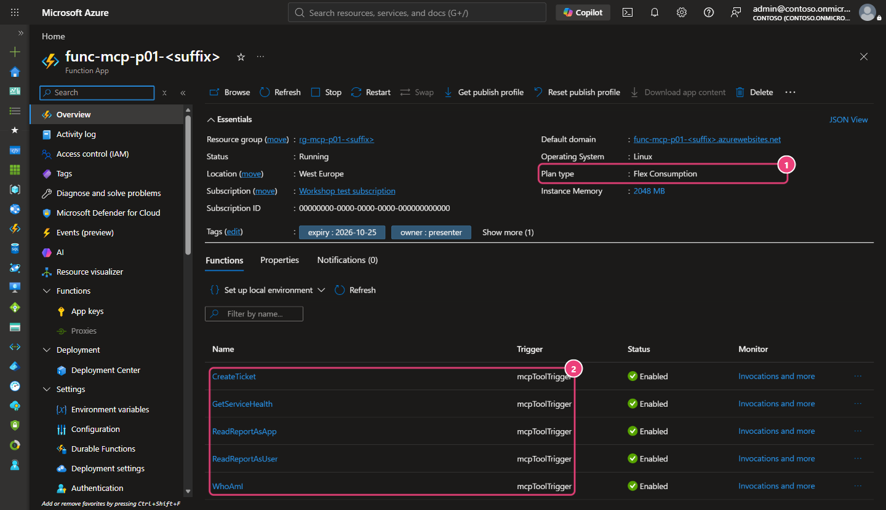
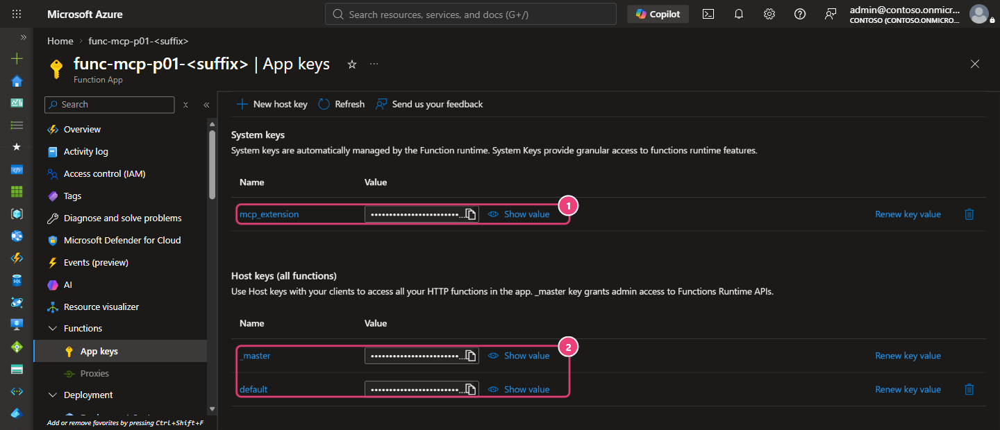

# 02 - Un serveur MCP « ouvert » (niveau 0)

[English](README.md)

## Objectif

[Guide low-code, portail d'abord](LOW-CODE.fr.md)

**Parcours Terraform + PowerShell.** Vous créerez les ressources avec Terraform, puis publierez le code et vérifierez
le serveur depuis PowerShell. Reprenez les fichiers privés et l'état Terraform du module 00.
Si vous avez choisi de créer vos ressources dans le portail, suivez plutôt le guide low-code :
ne gérez pas les mêmes ressources avec les deux méthodes.

Vous allez déployer le serveur Model Context Protocol (MCP) de l'atelier sur Azure Functions et en protéger l'accès par une clé.
Vous vérifierez qu'un appel sans clé est refusé (**HTTP 401**), puis qu'un appel avec la bonne clé réussit (**HTTP 200**).
Vous créerez enfin un ticket fictif pour constater la limite de cette protection :
**toute personne qui possède la clé peut appeler `create_ticket`, quels que soient ses droits.**

> [!WARNING]
> Ne laissez pas ce serveur protégé par une simple clé en service après l'exercice.
> Passez au module 03 ou supprimez les ressources si vous vous arrêtez ici.
> Ne désactivez jamais la protection par clé pour faciliter un test.
> Le module 03 ajoutera une connexion Microsoft Entra ID ; le module 04 vérifiera les droits nécessaires pour chaque outil avec API Management.

## Pourquoi c'est important

Une clé est un secret partagé, pas une identité. Le serveur ne fait pas la différence entre Alice, Bob et Eve.
Il ne peut ni appliquer de rôle par utilisateur, ni appeler une autre API « au nom de l'utilisateur ».
Les journaux ne peuvent pas dire qui a fait quoi. Une clé peut se retrouver exposée dans une capture d'écran, une conversation, un fichier de
configuration enregistré ou un historique de navigateur.

L'extension MCP d'Azure Functions protège `/runtime/webhooks/mcp` avec la **clé système** `mcp_extension`
lorsque `host.json` fixe `webhookAuthorizationLevel` à `System` (valeur par défaut). L'exemple d'origine utilise
`Anonymous` parce qu'il place l'authentification Microsoft Entra en amont. Ce module n'a pas encore de couche Entra :
il conserve `System`. Ne copiez jamais `Anonymous` dans un serveur protégé seulement par clé.

## Ce que vous déployez

Terraform crée tout dans le groupe de ressources de votre atelier, depuis `infra/workload` avec `enable_mcp_server = true` :

| Ressource | Rôle | Réglage de sécurité |
|---|---|---|
| Plan Flex Consumption (`FC1`) et application de fonctions | Héberge le serveur MCP .NET 10 (worker isolé) | HTTPS seulement, TLS 1.2, publication par mot de passe désactivée, liste d'adresses IPv4 autorisées en option |
| Identité managée attribuée par l'utilisateur | Seule identité de l'application | Aucun secret ; trois attributions de rôle ci-dessous |
| Compte de stockage | Stockage de l'hôte, paquet de déploiement et file `tickets` | Accès par clé partagée **désactivé**, autorisation Entra par défaut, aucun blob public |
| Espace Log Analytics et Application Insights | Télémétrie sans contenu | Authentification locale désactivée ; plafond de 1 Go/jour |
| *Facultatif, `mcp_private_storage = true` :* réseau virtuel, sous-réseau d'intégration Flex, points de terminaison privés blob et file d'attente, deux zones DNS privées | Pour les tenants où une Azure Policy force l'accès réseau public du stockage à `Disabled` | Stockage joignable uniquement depuis le sous-réseau de l'application ; le point de terminaison MCP et sa clé ne changent pas |

Attributions de rôle, chacune sur une ressource précise :

| Rôle | Portée | Pourquoi |
|---|---|---|
| Storage Blob Data Owner | Le compte de stockage de l'atelier | Stockage de l'hôte Functions et paquet de déploiement Flex (par identité) |
| Storage Queue Data Message Sender | La file `tickets` uniquement | `create_ticket` envoie un message synthétique |
| Monitoring Metrics Publisher | Le composant Application Insights | Télémétrie authentifiée par Entra |

Les cinq outils (toutes les données sont synthétiques) :

| Outil | Type | Comportement au niveau 0 |
|---|---|---|
| `get_service_health` | lecture | État fixe pour `workshop-api` ou `ticket-queue` |
| `create_ticket` | **écriture** | Vérifie `service`, `severity` et un court `summary`, puis place un ticket synthétique dans la file |
| `whoami` | démonstration | Indique que l'appelant est inconnu : une clé n'identifie personne |
| `read_report_as_user` | démonstration | Rapport fictif signalé comme tel ; l'appel réel avec On-Behalf-Of est ajouté au module 05 |
| `read_report_as_app` | démonstration | Rapport fictif signalé comme tel ; l'appel réel avec une identité managée est ajouté au module 05 |

Chaque outil refuse les arguments inconnus. `create_ticket` n'écrit rien si les arguments n'ont pas exactement la forme attendue.
Les journaux contiennent seulement le nom de l'outil, le statut de l'appel, la durée et l'identifiant d'invocation :
jamais les arguments, les résultats, les clés ni les jetons.


**Construisez-le étape par étape.** Cliquez sur **Suivant** pour ajouter un élément à la fois ; le schéma complet suit.

```reveal
{
  "title": "Un serveur dans Azure, protégé par une clé",
  "audience": "attendee",
  "width": 760,
  "height": 380,
  "lanes": [
    {"x": 8, "width": 232, "label": "Client"},
    {"x": 264, "width": 232, "label": "Protection"},
    {"x": 520, "width": 232, "label": "Azure"}
  ],
  "nodes": [
    {"id":"fn","step":0,"x":542,"y":44,"width":188,"icon":"functions","title":"Azure Functions","detail":["extension MCP","Flex Consumption"]},
    {"id":"st","step":0,"x":542,"y":164,"width":188,"icon":"storage","title":"Azure Storage","detail":["file : tickets","identité managée"]},
    {"id":"c","step":1,"x":30,"y":44,"width":188,"title":"VS Code + Copilot","detail":["Alice (Contoso)"]},
    {"id":"key","step":1,"tone":"risk","x":286,"y":44,"width":188,"title":"Clé de fonction","detail":["x-functions-key","secret partagé"]},
    {"id":"nokey","step":2,"x":30,"y":164,"width":188,"title":"Sans clé","detail":["n'importe quel appelant"]},
    {"id":"eve","step":3,"tone":"risk","x":30,"y":284,"width":188,"title":"Eve a la clé","detail":["create_ticket passe"]},
    {"id":"next","step":4,"tone":"governed","x":542,"y":284,"width":188,"icon":"entra","title":"Ensuite : Entra","detail":["jeton utilisateur","au lieu d'une clé"]}
  ],
  "edges": [
    {"from":"fn","to":"st","step":0,"label":"identité"},
    {"from":"c","to":"key","step":1,"label":"en-tête"},
    {"from":"key","to":"fn","step":1,"label":"HTTP 200"},
    {"from":"nokey","to":"fn","step":2,"tone":"risk","toSide":"bottom","toOffset":-40,"label":"HTTP 401"},
    {"from":"eve","to":"key","step":3,"tone":"risk","toSide":"bottom","label":"écriture"}
  ],
  "steps": [
    {"title": "Le serveur tourne dans Azure", "simple": "Votre serveur MCP tourne maintenant dans Azure Functions, avec une file de stockage pour les tickets.", "say": "La Function accède au stockage avec son identité managée : ni chaîne de connexion, ni clé dans le code."},
    {"title": "Une clé pour seul verrou", "simple": "Le client envoie une clé de fonction dans un en-tête. Avec la clé, l'appel réussit.", "say": "La clé passe dans l'en-tête `x-functions-key`. Elle n'identifie personne : c'est un secret partagé."},
    {"title": "Sans clé, pas d'accès", "simple": "Sans la clé, le serveur répond HTTP 401. Rien n'est anonyme.", "say": "C'est le strict minimum. Ne rendez jamais le point de terminaison anonyme, même pour un test."},
    {"title": "Qui a la clé peut écrire", "simple": "Si Eve obtient la clé, elle crée aussi des tickets : le serveur ne sait pas qui elle est.", "say": "L'outil d'écriture `create_ticket` s'exécute pour quiconque détient la clé. C'est le risque que montre ce module."},
    {"title": "La solution arrive", "simple": "Le module 03 remplace la clé partagée par un jeton Microsoft Entra personnel.", "say": "Gardez le niveau 0 le moins longtemps possible. Le module 03 (Entra ID) et le module 04 (API Management) comblent la faille."}
  ]
}
```


Aucune fonctionnalité en **Preview** n'est utilisée. Le code et l'infrastructure sont adaptés de
[Azure-Samples/remote-mcp-functions-dotnet](https://github.com/Azure-Samples/remote-mcp-functions-dotnet/tree/468c518c884ec318e3001b9573254c9e775409c9)
(MIT) ; voir [THIRD-PARTY-NOTICES.md](../../THIRD-PARTY-NOTICES.md).

**Coût :** Flex Consumption facture les exécutions et la mémoire consommée pendant leur durée, auxquels s'ajoutent les transactions de stockage et
l'ingestion de télémétrie. Le plan peut descendre à zéro instance et monter jusqu'à 10 instances, sans instance toujours prête.
Vérifiez les prix actuels dans votre région avant de demander l'accord. Nettoyez le jour même. Le stockage privé
facultatif ajoute deux points de terminaison privés (facturés à l'heure et au Go traité) et deux zones DNS privées.

## Prérequis et rôles nécessaires

- Module 00 validé pour votre abonnement et module 01 terminé.
- Vos paramètres privés et votre état Terraform du module 00 (`.workshop/participant.tfvars.json`). Ne les régénérez pas.
- Terraform 1.16.6 ou plus récent, Azure CLI, PowerShell 7.4+, le SDK .NET 10.
- Un abonnement hors production où Flex Consumption prend en charge .NET 10 dans votre région (exemple : `swedencentral`).

Rôles Azure sur le groupe de ressources de l'atelier (demandez-les à votre administrateur ; ne demandez pas Owner) :

- **Contributor** pour créer les ressources, lire la clé système et publier le code.
- **Role Based Access Control Administrator**, idéalement avec une condition qui n'autorise que les trois rôles
  ci-dessus, pour créer les trois attributions. Le rôle Contributor seul ne permet pas d'attribuer des rôles.

Aucune modification Microsoft Entra n'est nécessaire dans ce module.

## Étapes


### PowerShell

Exécutez les commandes depuis la racine du dépôt. Arrêtez-vous dès qu'une commande échoue.
Les étapes 3 à 6 modifient Azure : faites-les uniquement après accord.

**1. Vérifications hors ligne (sans Azure).**

```powershell
& .\modules\02-open-server\validate.ps1 -Offline
```

> **Résultat réel** — capture hors ligne sur le poste de l'auteur, 2026-10-16 (aucun appel Azure).
>
> ```text
> PASS host.json MCP webhook authorization level is System (expected HTTP 401 without the mcp_extension key).
> PASS no anonymous authorization level in server source (expected HTTP N/A).
> PASS no key, SAS, connection-string or client-secret pattern in module 02 files (expected HTTP N/A).
> PASS Terraform disables Storage shared keys, uses managed identity and outputs no key (expected HTTP N/A).
> PASS locked build and tool unit tests: synthetic results, strict inputs, no write without the exact shape (expected HTTP N/A).
> PASS Terraform format, schema and mock-only plans, including module 02 opt-in (expected HTTP N/A; no live plan/apply).
> NOT DEPLOYED CHECKS SKIPPED: supply -TenantId and -SubscriptionId after an approved deployment for HTTP checks.
> PASS offline checks only. Module 02 is NOT deployed or Azure-validated by this result.
> ```
>
> **Ce que cela signifie pour vous :** le code que vous allez déployer n'est jamais anonyme et ne contient aucun secret.
> La dernière ligne est volontaire : rien n'est encore prouvé dans Azure.

**2. Sélectionnez votre contexte approuvé.**

```powershell
& .\scripts\select-azure-context.ps1 -Language fr
```

> **Résultat attendu** — d'après les invites et le message final du sélecteur ; ce n'est pas une capture.
>
> ```text
> ID du tenant Entra de test approuvé (terminal uniquement): <tenant-id>
> ID de votre abonnement Azure de test approuvé: <subscription-id>
> Tapez NONPROD pour confirmer le périmètre de test et la connexion interactive: NONPROD
> PASS contexte : tenant et abonnement vérifiés. Variables ARM définies dans ce processus uniquement. Aucune ressource créée ; ce contrôle ne valide pas le module 00.
> ```
>
> **Ce que cela signifie pour vous :** après la saisie de `NONPROD`, une fenêtre de connexion s'ouvre dans le navigateur. Les commandes
> suivantes lisent `$env:ARM_TENANT_ID` et `$env:ARM_SUBSCRIPTION_ID` dans ce terminal : gardez-le ouvert pendant tout le module.

**3. Activez le module en privé, puis lancez le plan.** Le fichier d'activation est ignoré par Git. Ajoutez votre plage
IPv4 publique dans `mcp_allowed_ip_ranges` (par exemple `"203.0.113.10/32"`) pour limiter les adresses qui peuvent appeler le serveur.
Une liste vide désactive ce filtrage réseau, mais la clé reste obligatoire.

```powershell
'{ "enable_mcp_server": true, "mcp_allowed_ip_ranges": [] }' | Set-Content -LiteralPath .\.workshop\module02.tfvars.json
terraform -chdir=infra/workload init -lockfile=readonly
if ($LASTEXITCODE -ne 0) { throw 'Terraform init failed.' }
terraform '-chdir=infra\workload' plan '-var-file=..\..\.workshop\participant.tfvars.json' '-var-file=..\..\.workshop\module02.tfvars.json' '-out=..\..\.workshop\module02.tfplan'
if ($LASTEXITCODE -ne 0) { throw 'Terraform plan failed.' }
```

> **Résultat réel** — résumé du plan sauvegardé dans l'abonnement de test de l'auteur, 2026-10-16. Noms et identifiants masqués.
>
> ```text
> Plan: 11 to add, 1 to change, 0 to destroy.
> ```
>
> La modification de cette capture historique concernait l'hébergement Azure des guides, retiré le 2026-10-21.
> Les plans actuels doivent afficher `11 to add, 0 to change, 0 to destroy`.
>
> **Ce que cela signifie pour vous :** un plan décrit ce qui va changer, sans rien modifier. **Tout `to destroy` ici est un signal d'arrêt.**
> Relisez les onze ajouts : trois attributions de rôle, chacune sur une ressource précise, et aucun secret client.

Relisez le plan : attendez-vous à **onze nouvelles ressources du module 02**, sans remplacement ni suppression.
Les guides sont hébergés sur GitHub Pages et ne nécessitent aucun changement de paramètres Azure.
Arrêtez-vous et examinez toute autre modification. Passez les deux fichiers de variables
à chaque nouveau plan ; sinon, Terraform proposera de supprimer le serveur.

**Votre tenant impose-t-il un stockage privé ?** Certaines organisations attribuent une Azure Policy avec l'effet
`modify`, qui met l'accès réseau public du stockage à `Disabled` dès sa création. Terraform relit alors `Disabled`, et la
publication du code échoue avec HTTP 403 (voir Dépannage). Demandez à votre administrateur, ou vérifiez après le `terraform apply` :
`az storage account list -g $group --query "[].publicNetworkAccess" -o tsv`. Dans ce cas, ajoutez
`"mcp_private_storage": true` au fichier d'activation privé et relancez le plan. Attendez-vous à **neuf ressources
de plus** (réseau virtuel, deux sous-réseaux, deux zones DNS privées et leurs liens, points de terminaison privés blob et
file d'attente) et à une mise à jour sur place de l'application de fonctions, qui ajoute l'intégration au réseau virtuel. Ne demandez
jamais d'exemption de stratégie et n'activez jamais les clés partagées pour contourner ce blocage.

**4. Appliquez le plan relu (après accord).**

```powershell
terraform '-chdir=infra\workload' apply '..\..\.workshop\module02.tfplan'
if ($LASTEXITCODE -ne 0) { throw 'Terraform apply failed.' }
```

> **Résultat réel** — résumé de l'application dans l'abonnement de test de l'auteur, 2026-10-16. Noms et identifiants masqués.
>
> ```text
> ...
> Apply complete! Resources: 11 added, 1 changed, 0 destroyed.
> ```
>
> Avec `mcp_private_storage = true`, le second `apply` dans ce tenant a affiché
> `Apply complete! Resources: 9 added, 1 changed, 0 destroyed.`
>
> **Ce que cela signifie pour vous :** les chiffres doivent correspondre au plan relu. Le serveur existe, mais n'exécute encore aucun code.

Si vous avez activé `mcp_private_storage = true`, vérifiez-le dans le portail Azure : ouvrez le compte de stockage, puis
**Security + networking → Networking** (captures réelles, 2026-10-19, tenant de test de l'auteur ; noms pseudonymisés,
ID remplacés par des zéros ; portail en anglais ; les cadres roses indiquent ce qu'il faut vérifier). Cliquez sur une image pour
l'agrandir.


L'accès réseau public est **désactivé** (*Disabled*) : la Function App n'atteint les blobs et les files d'attente que par
les deux points de terminaison privés approuvés. Cela protège le stockage derrière le serveur ; le point de terminaison MCP
reste, lui, accessible avec une simple clé.

**5. Publiez le code du serveur.** Azure CLI utilise votre connexion Microsoft Entra ; il n'existe aucun mot de passe de publication.

```powershell
$group = terraform -chdir=infra/workload output -raw resource_group_name
$app = terraform -chdir=infra/workload output -raw mcp_function_app_name
dotnet publish .\src\FunctionsMcpServer --configuration Release --output .\.workshop\module02-publish
if ($LASTEXITCODE -ne 0) { throw 'Publish failed.' }
Compress-Archive -Path .\.workshop\module02-publish\* -DestinationPath .\.workshop\module02.zip -Force
az functionapp deployment source config-zip --resource-group $group --name $app --src .\.workshop\module02.zip --output none
if ($LASTEXITCODE -ne 0) { throw 'Code deployment failed.' }
```

> **Résultat réel** — publication dans l'abonnement de test de l'auteur, 2026-10-16. Noms et identifiants masqués.
> `dotnet publish` affiche ses lignes de compilation ; l'envoi lui-même n'affiche rien (`--output none`) et `$LASTEXITCODE` vaut 0.
> `az functionapp function list --resource-group $group --name $app --query "[].name" --output tsv` a ensuite listé :
>
> ```text
> func-mcp-p01-<suffix>/CreateTicket
> func-mcp-p01-<suffix>/GetServiceHealth
> func-mcp-p01-<suffix>/ReadReportAsApp
> func-mcp-p01-<suffix>/ReadReportAsUser
> func-mcp-p01-<suffix>/WhoAmI
> ```
>
> Dans un tenant dont la stratégie désactivait l'accès public du stockage, sans `mcp_private_storage`, l'envoi a échoué avec
> `ERROR: ... BlobUploadFailedException: Failed to upload blob to storage account: ... 403 (This request is not authorized to perform this operation.)`.
>
> **À vérifier :** la liste contient les cinq fonctions du serveur.
> Dans l'exemple ci-dessus, l'erreur 403 provenait du réseau de stockage.
> Si vous rencontrez ce refus, vérifiez sa cause dans votre environnement avant de modifier un rôle ou un réglage réseau.

**6. Connectez VS Code sans écrire la clé dans un fichier.** Ajoutez ce serveur à votre configuration MCP **utilisateur**
(pas à un fichier versionné). VS Code demande la clé et la garde dans son stockage de secrets.

```json
{
  "inputs": [
    { "type": "promptString", "id": "workshop-mcp-key", "description": "mcp_extension system key", "password": true }
  ],
  "servers": {
    "workshop-open": {
      "type": "http",
      "url": "https://<function-app-host>/runtime/webhooks/mcp",
      "headers": { "x-functions-key": "${input:workshop-mcp-key}" }
    }
  }
}
```

Obtenez l'adresse avec `terraform -chdir=infra/workload output -raw mcp_endpoint`.
Ne récupérez la clé que lorsque VS Code la demande, puis videz le presse-papiers :

```powershell
az functionapp keys list --resource-group $group --name $app --query systemKeys.mcp_extension --output tsv | Set-Clipboard
```

> **Résultat attendu** — aucune sortie. La clé va uniquement dans le presse-papiers, jamais à l'écran.
> Si tout va bien, rien ne s'affiche et `$LASTEXITCODE` vaut 0. Un presse-papiers vide signifie que l'hôte n'a pas
> encore démarré (voir Dépannage).

Après l'avoir collée dans la fenêtre de VS Code, exécutez `Set-Clipboard -Value $null`.
Ne mettez jamais la clé dans une URL (`?code=`), un fichier, une conversation ou une capture d'écran.

<details>
<summary>Comment faire dans VS Code, clic par clic</summary>

1. Récupérez l'URL dans votre terminal : `terraform -chdir=infra/workload output -raw mcp_endpoint`.
2. Appuyez sur **Ctrl+Maj+P** (macOS : **Cmd+Maj+P**) et lancez **MCP: Open User Configuration**. Collez le JSON
   ci-dessus, remplacez l'espace réservé par votre URL, puis enregistrez le fichier.
3. Sélectionnez **Start** juste au-dessus de `workshop-open` dans ce fichier. Vous pouvez aussi lancer **MCP: List Servers**,
   choisir `workshop-open`, puis **Start Server**.
4. VS Code demande la `mcp_extension system key`. Lancez la commande `az functionapp keys list ... | Set-Clipboard`
   ci-dessus, collez dans la fenêtre de saisie, puis lancez `Set-Clipboard -Value $null`.
5. Ouvrez le Chat avec **Ctrl+Alt+I** (macOS : **Ctrl+Cmd+I**). Dans la liste des modes sous la zone de saisie, choisissez
   **Agent**. Sélectionnez l'icône des outils (**Configure Tools**) et ne gardez que les outils de `workshop-open`.
6. Collez le prompt. Quand VS Code demande d'exécuter un outil, lisez son nom et ses arguments, puis sélectionnez
   **Allow** une seule fois. Dépliez l'appel d'outil dans le Chat pour lire son entrée et sa sortie.

</details>

**7. Lancez la validation et constatez le risque.**

```powershell
& .\modules\02-open-server\validate.ps1 -TenantId $env:ARM_TENANT_ID -SubscriptionId $env:ARM_SUBSCRIPTION_ID -DemonstrateWrite
```

> **Résultat réel** — exécution dans l'abonnement de test de l'auteur, 2026-10-16, avec `mcp_private_storage = true`
> (une stratégie du tenant imposait un stockage privé). Noms et identifiants masqués.
>
> ```text
> PASS Function App is running and HTTPS-only (expected HTTP 200 from Azure Resource Manager).
> PASS MCP request without the mcp_extension key is refused (expected HTTP 401).
> PASS anonymous access disabled: a random wrong key is refused (expected HTTP 401).
> PASS MCP initialize with the key succeeds; negotiated protocol 2025-06-18 (expected HTTP 200).
> PASS tools/list with the key returns exactly the five workshop tools (expected HTTP 200).
> PASS RISK SHOWN: create_ticket succeeds with only the key; no user or role was checked (expected HTTP 200).
> PASS module 02 live checks complete. Rotate or remove the key after the exercise (see README).
> ```
>
> Votre version de protocole peut différer.
>
> **Ce que cela signifie pour vous :** le serveur n'est pas anonyme (401 sans clé), **mais la clé est le seul contrôle**.
> Quiconque la détient, collègue ou attaquant, peut écrire. `whoami` répond `caller: unknown` : les journaux ne
> peuvent pas dire qui a agi. C'est le problème que résolvent les modules 03 à 05.

Dans VS Code, ouvrez Copilot Chat en mode **Agent** et collez ce prompt. Approuvez l'appel à `create_ticket` quand VS Code le demande.

```prompt
Utilise le serveur MCP workshop-open. Appelle create_ticket avec service "workshop-api", severity "low" et summary "Synthetic test ticket - Contoso workshop". Appelle ensuite whoami et dis-moi qui le serveur pense que je suis.
```

Le ticket est créé et `whoami` répond `caller: unknown`. L'appel réussit pour quiconque détient la clé.

**Question :** sans la clé, le serveur répond HTTP 401. Cela veut-il dire qu'il protège l'accès utilisateur par utilisateur ?

<details>
<summary>Afficher la réponse</summary>

Non. HTTP 401 prouve seulement que le point de terminaison n'est pas anonyme. Toute personne qui détient la clé obtient le même
accès complet, `create_ticket` compris. Une clé ne porte ni identité ni rôle d'application : le serveur ne distingue pas
Alice d'Eve (`whoami` renvoie `caller: unknown`). L'autorisation par utilisateur exige un jeton Microsoft Entra et des
rôles d'application : le module 03 identifie les utilisateurs autorisés à entrer,
et le module 04 contrôle leurs droits pour chaque outil.

</details>

**8. Renouvelez la clé après l'exercice.** Toute copie qui aurait été divulguée devient alors inutilisable.

```powershell
az functionapp keys set --resource-group $group --name $app --key-type systemKeys --key-name mcp_extension --output none
```

> **Résultat réel** — renouvellement de la clé dans l'abonnement de test de l'auteur, 2026-10-16.
> Aucune sortie (`--output none`) ; `$LASTEXITCODE` valait 0. La nouvelle valeur n'est jamais affichée.
>
> **Ce que cela signifie pour vous :** tout appel avec l'ancienne clé reçoit désormais HTTP 401, y compris depuis votre session VS Code.

**Question :** après le renouvellement, un collègue a encore l'ancienne clé dans une configuration enregistrée. Que se passe-t-il
quand il appelle le serveur, et qu'est-ce que cela vous apprend sur les clés ?

<details>
<summary>Afficher la réponse</summary>

Son appel reçoit HTTP 401. Le renouvellement est le seul moyen de révoquer une clé divulguée, et il coupe en même temps
tous les clients légitimes. Comme la clé est partagée, vous ne pouvez pas couper l'accès d'une seule personne sans couper tout le
monde. Les jetons Entra expirent d'eux-mêmes et sont émis pour un utilisateur ou une application.

</details>

### Bash

```bash
bash ./modules/02-open-server/validate.sh -Offline
source ./scripts/select-azure-context.sh
printf '%s\n' '{ "enable_mcp_server": true, "mcp_allowed_ip_ranges": [] }' > .workshop/module02.tfvars.json
terraform -chdir=infra/workload init -lockfile=readonly &&
terraform -chdir=infra/workload plan -var-file=../../.workshop/participant.tfvars.json \
  -var-file=../../.workshop/module02.tfvars.json -out=../../.workshop/module02.tfplan
# Relisez, puis après accord :
terraform -chdir=infra/workload apply ../../.workshop/module02.tfplan
group="$(terraform -chdir=infra/workload output -raw resource_group_name)"
app="$(terraform -chdir=infra/workload output -raw mcp_function_app_name)"
dotnet publish ./src/FunctionsMcpServer --configuration Release --output ./.workshop/module02-publish &&
(cd ./.workshop/module02-publish && zip -qr ../module02.zip .) &&
az functionapp deployment source config-zip --resource-group "$group" --name "$app" --src ./.workshop/module02.zip --output none
bash ./modules/02-open-server/validate.sh -TenantId "$ARM_TENANT_ID" -SubscriptionId "$ARM_SUBSCRIPTION_ID" -DemonstrateWrite
az functionapp keys set --resource-group "$group" --name "$app" --key-type systemKeys --key-name mcp_extension --output none
```

> **Résultat attendu** — les mêmes lignes PASS et le même résumé de plan que l'exécution PowerShell ci-dessus ;
> la publication et le renouvellement de la clé n'affichent rien non plus. `validate.sh -Offline` s'arrête après les vérifications hors ligne, comme `validate.ps1 -Offline`.

Utilisez la même configuration VS Code qu'à l'étape 6.

## Ce que vous devez voir

Dans le portail Azure, ouvrez votre Function App (captures réelles, 2026-10-20, tenant de test de l'auteur ; noms
pseudonymisés, ID remplacés par des zéros ; portail en anglais ; les cadres roses indiquent ce qu'il faut vérifier).
Cliquez sur une image pour l'agrandir.



Cadre 1 : le plan est **Flex Consumption**. Cadre 2 : chaque outil MCP est une fonction avec le déclencheur `mcpToolTrigger`.



Cadre 1 : `mcp_extension` est la **clé système** qui ouvre le point de terminaison MCP à ce niveau. Cadre 2 : les clés
d'hôte ouvrent toutes les fonctions : ne les donnez jamais à un client. Le portail masque chaque valeur tant que vous
ne sélectionnez pas **Show value**.

| Action | Résultat attendu | Signification |
|---|---|---|
| Requête MCP sans `x-functions-key` | HTTP 401 | Le webhook n'est pas anonyme. |
| Requête avec une mauvaise clé | HTTP 401 | Seule la clé système fonctionne. |
| `initialize`, puis `tools/list` avec la clé | HTTP 200, cinq outils | Le serveur fonctionne en Streamable HTTP. |
| `create_ticket` avec la clé | HTTP 200, `status: queued`, un `warning` | **Le risque :** ni utilisateur, ni rôle, ni approbation côté serveur. |
| `whoami` | `caller: unknown` | Une clé ne porte aucune identité. |
| `read_report_as_*` | `source: synthetic-demonstration` | Les appels réels aux services de données seront activés au module 05. |

Les requêtes complètes et les réponses réelles des cinq outils sont dans [Le serveur MCP et ses réponses](../../docs/fr/MCP-SERVER.md).

Après déploiement, le validateur affiche notamment :

```text
PASS MCP request without the mcp_extension key is refused (expected HTTP 401).
PASS anonymous access disabled: a random wrong key is refused (expected HTTP 401).
PASS MCP initialize with the key succeeds; negotiated protocol <version> (expected HTTP 200).
PASS tools/list with the key returns exactly the five workshop tools (expected HTTP 200).
PASS RISK SHOWN: create_ticket succeeds with only the key; no user or role was checked (expected HTTP 200).
```

### Comprendre les résultats avec la documentation

Ouvrez ces liens au moment du contrôle correspondant ci-dessus. Ils expliquent le mécanisme, pas un résultat observé dans votre abonnement.

| Résultat observé | Ce qu'il faut comprendre dans Microsoft Learn | Référence API ou SDK |
|---|---|---|
| Sans clé ou avec une mauvaise clé : HTTP 401 ; bonne clé `mcp_extension` : HTTP 200 | [Clés d'accès Functions](https://learn.microsoft.com/azure/azure-functions/function-keys-how-to) : une clé système est un identifiant partagé, pas une identité utilisateur. | [Configuration de l'extension MCP](https://learn.microsoft.com/azure/azure-functions/functions-bindings-mcp) : `webhookAuthorizationLevel` et point de terminaison MCP. |
| Découvrir les cinq outils, puis en appeler un | [Déclencheur d'outil MCP](https://learn.microsoft.com/azure/azure-functions/functions-bindings-mcp-tool-trigger) : comment une fonction devient un outil appelable. | La même référence décrit `McpToolTrigger` et `ToolInvocationContext`, utilisés par ce serveur. |
| `create_ticket` renvoie `status: queued` | Le ticket est fictif, mais l'envoi du message est un effet réel après déploiement. [Autoriser Queue Storage avec Entra](https://learn.microsoft.com/azure/storage/queues/authorize-access-azure-active-directory) explique l'identité distincte utilisée en aval. | [QueueClient.SendMessageAsync](https://learn.microsoft.com/dotnet/api/azure.storage.queues.queueclient.sendmessageasync), appelé par l'adaptateur de file de tickets. |
| `whoami` est inconnu ; `read_report_as_*` reste une démonstration | [Autorisation MCP dans App Service](https://learn.microsoft.com/azure/app-service/configure-authentication-mcp) explique la protection du serveur ajoutée au module 03. Les métadonnées de ressource protégée sont en **Preview**. | Aucun appel à Graph ni à l'API Blob du rapport à cette étape. Le module 05 ajoute ces appels réels ; une clé Functions ne prouve pas un accès utilisateur. |

Lire ces références n'approuve aucun déploiement, ne vous demande de divulguer aucune clé et n'active aucun accès anonyme.
Liens documentaires vérifiés le 2026-10-16.

### Vérifier vous-même avec Azure CLI

**Pourquoi :** avant de tester la clé, vérifiez que l'application existe, fonctionne et exige HTTPS.
Gardez votre compte Azure habituel. Depuis la racine du dépôt, préparez les noms de votre déploiement :

```powershell
$ErrorActionPreference = 'Stop'
$inspectGroup = terraform '-chdir=infra\workload' output -raw resource_group_name
if ($LASTEXITCODE -ne 0) { throw 'Groupe de ressources introuvable dans les sorties de votre déploiement.' }
$inspectNames = terraform '-chdir=infra\workload' output -json resource_names | ConvertFrom-Json
if ($LASTEXITCODE -ne 0) { throw 'Noms des ressources indisponibles.' }
```

> **Résultat attendu** — aucune sortie : les deux variables reçoivent les noms de votre déploiement.
> Vérifiez avec `$inspectNames.function_app`, qui affiche le nom de votre Function App.

Terraform ne fait ici que lire les noms. Copiez ensuite la commande Azure CLI ; `show` ne modifie rien :

```powershell
az resource show -g $inspectGroup -n $inspectNames.function_app --resource-type Microsoft.Web/sites --api-version 2024-11-01 --query 'properties.{state:state,httpsOnly:httpsOnly}' -o json
if ($LASTEXITCODE -ne 0) { throw "Lecture de l'application impossible. Vérifiez le contexte et son nom." }
```

> **Résultat attendu** — `state` vaut `Running` et `httpsOnly` vaut `true`.
> La requête lit les propriétés de l'application ; elle ne demande ni clé ni jeton MCP.


*Capture en lecture seule du 20 octobre 2026. Ces deux propriétés ne prouvent pas que la clé est exigée :
le validateur doit encore vérifier HTTP 401 sans clé et HTTP 200 avec la clé.
Si une valeur manque ou diffère, arrêtez-vous et vérifiez le déploiement ; ne désactivez aucune protection.*

## Valider

`validate.ps1` (ou `validate.sh`) lance toujours d'abord les vérifications hors ligne : niveau `System` dans
`host.json`, aucun accès anonyme dans le code, recherche de clés ou de secrets dans les fichiers du module,
clés de stockage partagées désactivées et aucune clé dans les sorties Terraform.
Il restaure les versions verrouillées des dépendances, compile le code, lance les tests unitaires
et les tests Terraform simulés. Avec `-Offline`, ou sans tenant ni abonnement, il s'arrête là et indique que le module
n'est **ni** déployé **ni** validé.

Avec `-TenantId` et `-SubscriptionId`, il vérifie le contexte, lit l'adresse depuis votre état Terraform et la clé
depuis Azure CLI **en mémoire seulement**, puis lance les vérifications HTTP ci-dessus. Chaque vérification affiche une
ligne PASS ou FAIL. Le module n'est terminé que lorsque ces vérifications réussissent sur un abonnement neuf,
juste après les modules 00 et 01.

**Question :** le validateur affiche `PASS MCP request without the mcp_extension key is refused (expected HTTP 401)`. Ici, HTTP 401 est-il un bon ou un mauvais résultat ?

<details>
<summary>Afficher la réponse</summary>

Un bon résultat. Chaque ligne indique le statut attendu. Un 401 sans clé prouve que le point de terminaison n'est pas
anonyme. Si le serveur répondait 200, ce même contrôle afficherait `FAIL`.

</details>


## Dépannage

| Symptôme | Vérification |
|---|---|
| HTTP 401 avec la clé | Utilisez la clé **système** `mcp_extension`, dans l'en-tête `x-functions-key`. Une clé de fonction ou d'hôte est différente. |
| Clé vide | Le code n'est pas encore publié ou l'hôte n'a pas démarré. Publiez (étape 5), attendez une minute, puis réessayez. |
| HTTP 403 | Votre adresse IP n'est pas dans `mcp_allowed_ip_ranges`. Modifiez le fichier privé et relancez le plan. |
| HTTP 404 sur `/runtime/webhooks/mcp` | La publication a échoué ou a utilisé le mauvais dossier. Vérifiez l'état du déploiement dans le portail. |
| L'hôte ne démarre pas / erreurs de stockage | Les attributions de rôle peuvent mettre quelques minutes à s'appliquer. Vérifiez les trois attributions ; n'activez jamais les clés partagées. |
| Échec de publication : `BlobUploadFailedException ... 403 (This request is not authorized)` | L'accès réseau public du stockage est `Disabled`, souvent imposé par une Azure Policy. Définissez `mcp_private_storage = true`, relancez le plan, appliquez-le, puis republiez le code. |
| Le plan propose de supprimer le serveur | Vous avez oublié `-var-file=..\..\.workshop\module02.tfvars.json`. |
| Erreur d'outil `Unexpected argument` | Les outils n'acceptent que leurs arguments documentés. C'est voulu. |

## Nettoyer

Lancez le nettoyage après l'exercice. Il établit un plan avec le module désactivé. Il refuse de continuer si ce plan contient autre chose
que la suppression de ressources du module 02 (réseau de stockage privé facultatif compris).
Lancez-le une première fois pour relire le plan, puis relancez-le avec `-Apply`.
Il est idempotent : s'il ne reste rien, il le dit et ne change rien.

```powershell
& .\modules\02-open-server\cleanup.ps1 -TenantId $env:ARM_TENANT_ID -SubscriptionId $env:ARM_SUBSCRIPTION_ID
& .\modules\02-open-server\cleanup.ps1 -TenantId $env:ARM_TENANT_ID -SubscriptionId $env:ARM_SUBSCRIPTION_ID -Apply
Remove-Item -LiteralPath .\.workshop\module02.tfvars.json, .\.workshop\module02.zip -ErrorAction SilentlyContinue
Remove-Item -LiteralPath .\.workshop\module02-publish -Recurse -ErrorAction SilentlyContinue
```

> **Résultat réel** — rapport de nettoyage (première commande, sans `-Apply`) dans l'abonnement de test de l'auteur, 2026-10-16,
> avec `mcp_private_storage = true`. Les lignes historiques d'hébergement des guides sont omises. Noms et identifiants masqués.
>
> ```text
> PASS explicit Azure context and private participant parameters (expected HTTP 200 from Azure Resource Manager).
> PLAN delete azurerm_application_insights.mcp[0]
> PLAN delete azurerm_function_app_flex_consumption.mcp[0]
> PLAN delete azurerm_log_analytics_workspace.mcp[0]
> PLAN delete azurerm_private_dns_zone.storage["blob"]
> PLAN delete azurerm_private_dns_zone.storage["queue"]
> PLAN delete azurerm_private_dns_zone_virtual_network_link.storage["blob"]
> PLAN delete azurerm_private_dns_zone_virtual_network_link.storage["queue"]
> PLAN delete azurerm_private_endpoint.storage["blob"]
> PLAN delete azurerm_private_endpoint.storage["queue"]
> PLAN delete azurerm_role_assignment.mcp_host_storage[0]
> PLAN delete azurerm_role_assignment.mcp_telemetry[0]
> PLAN delete azurerm_role_assignment.mcp_ticket_sender[0]
> PLAN delete azurerm_service_plan.mcp[0]
> PLAN delete azurerm_storage_account.mcp[0]
> PLAN delete azurerm_storage_container.mcp_package[0]
> PLAN delete azurerm_storage_queue.tickets[0]
> PLAN delete azurerm_subnet.gateway_private_endpoints[0]
> PLAN delete azurerm_subnet.mcp_integration[0]
> PLAN delete azurerm_user_assigned_identity.mcp[0]
> PLAN delete azurerm_virtual_network.gateway[0]
> ...
> ```
>
> Sans stockage privé, attendez-vous à 11 suppressions du module 02. Le nettoyage actuel refuse toute modification sans lien avec le module.
> Avec `-Apply`, le script affiche la sortie de `terraform apply`, puis (messages du script, hors de cette capture)
> `PASS module 02 resources deleted; the system key was deleted with the Function App (expected HTTP 200 from Azure Resource Manager).`
> et `KEEP private participant parameters, Terraform state and the resource group for later modules.`
> Les deux lignes `Remove-Item` n'affichent rien.
>
> **Ce que cela signifie pour vous :** lisez chaque ligne `PLAN` avant `-Apply`. Une ligne `FAIL cleanup plan contains ... change(s) outside module 02 deletions`
> signifie qu'autre chose changerait : rien n'est appliqué ; examinez le plan en privé. Une seconde exécution affiche
> `PASS no module 02 resources remain in this state; nothing to delete`.

```bash
bash ./modules/02-open-server/cleanup.sh -TenantId "$ARM_TENANT_ID" -SubscriptionId "$ARM_SUBSCRIPTION_ID" -Apply
```

> **Résultat attendu** — les mêmes lignes PASS, PLAN et KEEP que l'exécution PowerShell ci-dessus.

Le groupe de ressources, vos paramètres privés et votre état sont conservés pour les modules suivants. Retirez le serveur
`workshop-open` de votre configuration VS Code utilisateur. Si vous enchaînez directement avec le module 03,
vous pouvez garder le serveur et sauter le nettoyage ; le module 03 remplace la clé par l'authentification Microsoft Entra.

## Aller plus loin

- Limitez les appelants avec `mcp_allowed_ip_ranges` et observez HTTP 403 depuis un autre réseau.
- Renouvelez la clé et constatez que l'ancienne session VS Code reçoit HTTP 401.
- Lisez le [modèle de menaces](../../docs/fr/concepts/mcp-threat-model.md) : contre quelles menaces une clé ne protège-t-elle pas ?
- Suite : [module 03](../03-entra-authentication/README.fr.md).

## Sources

- [Lire une ressource Azure sans la modifier](https://learn.microsoft.com/cli/azure/resource#az-resource-show), vérifié le 20 octobre 2026.

- [Liaisons MCP de Functions : host.json, point de terminaison, clé système](https://learn.microsoft.com/azure/azure-functions/functions-bindings-mcp)
- [Déclencheur d'outil MCP](https://learn.microsoft.com/azure/azure-functions/functions-bindings-mcp-tool-trigger)
- [Serveur MCP distant personnalisé sur Functions](https://learn.microsoft.com/azure/azure-functions/scenario-custom-remote-mcp-server)
- [Plan Flex Consumption](https://learn.microsoft.com/azure/azure-functions/flex-consumption-plan)
- [Clés d'accès des fonctions](https://learn.microsoft.com/azure/azure-functions/function-keys-how-to)
- [Connexions par identité et rôle minimal du stockage de l'hôte](https://learn.microsoft.com/azure/azure-functions/functions-identity-based-connections-tutorial)
- [Azure-Samples/remote-mcp-functions-dotnet au commit 468c518](https://github.com/Azure-Samples/remote-mcp-functions-dotnet/tree/468c518c884ec318e3001b9573254c9e775409c9)
- [Ressource Flex Consumption d'AzureRM 5.9.0](https://github.com/hashicorp/terraform-provider-azurerm/blob/v5.9.0/website/docs/r/function_app_flex_consumption.html.markdown)
- [Configuration MCP et saisies protégées dans VS Code](https://code.visualstudio.com/docs/agent-customization/mcp-servers)
- [Réseau Functions : taille du sous-réseau Flex Consumption et délégation `Microsoft.App/environments`](https://learn.microsoft.com/azure/azure-functions/functions-networking-options)
- [Utiliser un compte de stockage sécurisé avec Azure Functions](https://learn.microsoft.com/azure/azure-functions/configure-networking-how-to#restrict-your-storage-account-to-a-virtual-network)
- [Points de terminaison privés pour Azure Storage](https://learn.microsoft.com/azure/storage/common/storage-private-endpoints)
- [Accès sortant par défaut : non applicable aux sous-réseaux délégués](https://learn.microsoft.com/azure/virtual-network/ip-services/default-outbound-access)

Dernière vérification : 2026-10-16.
