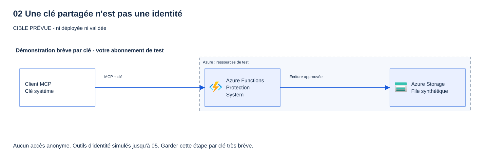

# 02 - Un serveur MCP « ouvert » (niveau 0)

[English](README.md)

## Objectif

Déployer le serveur Model Context Protocol (MCP) de l'atelier sur Azure Functions, protégé uniquement par une clé.
Prouver qu'une requête sans clé reçoit HTTP 401 et qu'une requête avec la clé reçoit HTTP 200.
Puis constater le risque : **toute personne qui détient la clé peut appeler l'outil d'écriture `create_ticket`.**

> [!WARNING]
> Le niveau 0 sert uniquement à montrer ce risque. Gardez-le peu de temps, ne rendez jamais le point de terminaison
> anonyme, et passez au module 03 (Microsoft Entra ID) puis au module 04 (API Management) pour le corriger.

## Pourquoi cette étape compte

Une clé est un secret partagé, pas une identité. Le serveur ne fait pas la différence entre Alice, Bob et Eve.
Il ne peut pas appliquer de rôle par utilisateur, ni appeler une API en aval « au nom de l'utilisateur », et les journaux
ne peuvent pas dire qui a fait quoi. Une clé peut se retrouver exposée dans une capture d'écran, une conversation, un fichier de
configuration enregistré ou un historique de navigateur.

L'extension MCP d'Azure Functions protège `/runtime/webhooks/mcp` avec la **clé système** `mcp_extension`
lorsque `host.json` fixe `webhookAuthorizationLevel` à `System` (valeur par défaut). L'exemple d'origine utilise
`Anonymous` parce qu'il place l'authentification Microsoft Entra en amont. Ce module n'a pas encore de couche Entra :
il conserve `System`. Ne copiez jamais `Anonymous` dans un serveur protégé seulement par clé.

## Ce que vous déployez

Tout est créé dans votre groupe de ressources d'atelier, depuis `infra/workload` avec `enable_mcp_server = true` :

| Ressource | Rôle | Réglage de sécurité |
|---|---|---|
| Plan Flex Consumption (`FC1`) et application de fonctions | Héberge le serveur MCP .NET 10 (worker isolé) | HTTPS seulement, TLS 1.2, publication par mot de passe désactivée, liste d'adresses IPv4 autorisées en option |
| Identité managée attribuée par l'utilisateur | Seule identité de l'application | Aucun secret ; trois attributions de rôle ci-dessous |
| Compte de stockage | Stockage de l'hôte, paquet de déploiement et file `tickets` | Accès par clé partagée **désactivé**, autorisation Entra par défaut, aucun blob public |
| Espace Log Analytics et Application Insights | Télémétrie sans contenu | Authentification locale désactivée ; plafond de 1 Go/jour |
| *Facultatif, `mcp_private_storage = true` :* réseau virtuel, sous-réseau d'intégration Flex, points de terminaison privés blob et file d'attente, deux zones DNS privées | Pour les locataires où une Azure Policy force l'accès réseau public du stockage à `Disabled` | Stockage joignable uniquement depuis le sous-réseau de l'application ; le point de terminaison MCP et sa clé ne changent pas |

Attributions de rôle, chacune sur une ressource précise :

| Rôle | Portée | Pourquoi |
|---|---|---|
| Storage Blob Data Owner | Le compte de stockage de l'atelier | Stockage de l'hôte Functions et paquet de déploiement Flex (par identité) |
| Storage Queue Data Message Sender | La file `tickets` uniquement | `create_ticket` envoie un message synthétique |
| Monitoring Metrics Publisher | Le composant Application Insights | Télémétrie authentifiée par Entra |

Les cinq outils (toutes les données sont synthétiques) :

| Outil | Type | Comportement au niveau 0 |
|---|---|---|
| `get_service_health` | lecture | État fixe pour `workshop-api` ou `ticket-queue` |
| `create_ticket` | **écriture** | Vérifie `service`, `severity` et un court `summary`, puis place un ticket synthétique dans la file |
| `whoami` | démonstration | Indique que l'appelant est inconnu : une clé n'identifie personne |
| `read_report_as_user` | démonstration | Rapport synthétique étiqueté ; l'appel On-Behalf-Of réel est ajouté au module 05 |
| `read_report_as_app` | démonstration | Rapport synthétique étiqueté ; l'appel réel par identité managée est ajouté au module 05 |

Chaque outil refuse les arguments inconnus. `create_ticket` n'écrit rien si la forme exacte des arguments n'est pas valide.
Les journaux contiennent seulement le nom de l'outil, le résultat, la durée et l'identifiant d'invocation :
jamais les arguments, les résultats, les clés ni les jetons.



Aucune fonctionnalité en **Preview** n'est utilisée. Le code et l'infrastructure adaptent
[Azure-Samples/remote-mcp-functions-dotnet](https://github.com/Azure-Samples/remote-mcp-functions-dotnet/tree/468c518c884ec318e3001b9573254c9e775409c9)
(MIT) ; voir [THIRD-PARTY-NOTICES.md](../../THIRD-PARTY-NOTICES.md).

**Coût :** Flex Consumption facture les exécutions et le temps de mémoire utilisé, plus les transactions de stockage et
l'ingestion de télémétrie. Le plan descend à zéro instance et est limité à 10 instances, sans instance toujours prête.
Vérifiez les prix actuels dans votre région avant de demander l'accord. Nettoyez le jour même. Le stockage privé
facultatif ajoute deux points de terminaison privés (facturés à l'heure et au Go traité) et deux zones DNS privées.

## Prérequis et rôles nécessaires

- Module 00 validé pour votre abonnement et module 01 terminé.
- Vos paramètres privés et votre état Terraform du module 00 (`.workshop/participant.tfvars.json`). Ne les régénérez pas.
- Terraform 1.16.6 ou plus récent, Azure CLI, PowerShell 7.4+, le SDK .NET 10.
- Un abonnement hors production où Flex Consumption prend en charge .NET 10 dans votre région (exemple : `swedencentral`).

Rôles Azure sur le groupe de ressources de l'atelier (demandez-les à votre administrateur ; ne demandez pas Owner) :

- **Contributor** pour créer les ressources, lire la clé système et publier le code.
- **Role Based Access Control Administrator**, idéalement avec une condition qui n'autorise que les trois rôles
  ci-dessus, pour créer les trois attributions. Contributor seul ne peut pas attribuer de rôle.

Aucune modification Microsoft Entra n'est nécessaire dans ce module.

## Étapes

### PowerShell

Exécutez les commandes depuis la racine du dépôt. Arrêtez-vous à la première commande en échec.
Les étapes 3 à 6 modifient Azure : faites-les uniquement après accord.

**1. Vérifications hors ligne (sans Azure).**

```powershell
& .\modules\02-open-server\validate.ps1 -Offline
```

> **Résultat réel** — capture hors ligne sur le poste de l'auteur, 2026-10-16 (aucun appel Azure).
>
> ```text
> PASS host.json MCP webhook authorization level is System (expected HTTP 401 without the mcp_extension key).
> PASS no anonymous authorization level in server source (expected HTTP N/A).
> PASS no key, SAS, connection-string or client-secret pattern in module 02 files (expected HTTP N/A).
> PASS Terraform disables Storage shared keys, uses managed identity and outputs no key (expected HTTP N/A).
> PASS locked build and tool unit tests: synthetic results, strict inputs, no write without the exact shape (expected HTTP N/A).
> PASS Terraform format, schema and mock-only plans, including module 02 opt-in (expected HTTP N/A; no live plan/apply).
> NOT DEPLOYED CHECKS SKIPPED: supply -TenantId and -SubscriptionId after an approved deployment for HTTP checks.
> PASS offline checks only. Module 02 is NOT deployed or Azure-validated by this result.
> ```
>
> **Ce que cela signifie pour vous :** le code que vous allez déployer n'est jamais anonyme et ne contient aucun secret.
> La dernière ligne est volontaire : rien n'est encore prouvé dans Azure.

**2. Sélectionnez votre contexte approuvé.**

```powershell
& .\scripts\select-azure-context.ps1 -Language fr
```

> **Résultat attendu** — d'après les invites et le message final du sélecteur ; ce n'est pas une capture.
>
> ```text
> ID du tenant Entra de test approuvé (terminal uniquement): <tenant-id>
> ID de votre abonnement Azure de test approuvé: <subscription-id>
> Tapez NONPROD pour confirmer le périmètre de test et la connexion interactive: NONPROD
> PASS contexte : tenant et abonnement vérifiés. Variables ARM définies dans ce processus uniquement. Aucune ressource créée ; ce contrôle ne valide pas le module 00.
> ```
>
> **Ce que cela signifie pour vous :** une connexion dans le navigateur s'ouvre après la saisie de `NONPROD`. Les commandes
> suivantes lisent `$env:ARM_TENANT_ID` et `$env:ARM_SUBSCRIPTION_ID` dans ce terminal : gardez-le ouvert pendant tout le module.

**3. Activez le module en privé, puis planifiez.** Le fichier d'activation est ignoré par Git. Ajoutez votre plage
IPv4 publique dans `mcp_allowed_ip_ranges` (par exemple `"203.0.113.10/32"`) pour limiter les appelants ;
laissez la liste vide pour montrer le niveau ouvert.

```powershell
'{ "enable_mcp_server": true, "mcp_allowed_ip_ranges": [] }' | Set-Content -LiteralPath .\.workshop\module02.tfvars.json
terraform -chdir=infra/workload init -lockfile=readonly
if ($LASTEXITCODE -ne 0) { throw 'Terraform init failed.' }
terraform '-chdir=infra\workload' plan '-var-file=..\..\.workshop\participant.tfvars.json' '-var-file=..\..\.workshop\module02.tfvars.json' '-out=..\..\.workshop\module02.tfplan'
if ($LASTEXITCODE -ne 0) { throw 'Terraform plan failed.' }
```

> **Résultat réel** — résumé du plan sauvegardé dans l'abonnement de test de l'auteur, 2026-10-16. Noms et identifiants masqués.
>
> ```text
> Plan: 11 to add, 1 to change, 0 to destroy.
> ```
>
> La modification correspond au portail facultatif existant, qui reçoit `WORKSHOP_MCP_ENDPOINT`. Sans portail,
> attendez-vous à `11 to add, 0 to change, 0 to destroy`.
>
> **Ce que cela signifie pour vous :** un plan est une promesse, pas une action. **Tout `to destroy` ici est un signal d'arrêt.**
> Relisez les onze ajouts : trois attributions de rôle, chacune sur une ressource précise, et aucun secret client.

Relisez le plan : attendez-vous à **onze nouvelles ressources du module 02**, sans remplacement ni suppression.
Si le portail public optionnel existe déjà, prévoyez aussi une **mise à jour sur place de ses paramètres**
pour ajouter `WORKSHOP_MCP_ENDPOINT`, son indication de connexion non secrète. Le portail peut redémarrer :
approuvez séparément cette interruption. Cette mise à jour ne publie ni les nouveaux guides ni le code de la Function.
Arrêtez-vous et examinez toute autre modification. Transmettez les deux fichiers de variables
à chaque nouveau plan ; sinon, Terraform proposera de supprimer le serveur.

**Votre locataire impose-t-il un stockage privé ?** Certaines organisations attribuent une Azure Policy avec l'effet
`modify`, qui met l'accès réseau public du stockage à `Disabled` dès sa création. Terraform relit alors `Disabled`, et la
publication du code échoue avec HTTP 403 (voir Dépannage). Demandez à votre administrateur, ou vérifiez après l'application :
`az storage account list -g $group --query "[].publicNetworkAccess" -o tsv`. Dans ce cas, ajoutez
`"mcp_private_storage": true` au fichier d'activation privé et planifiez de nouveau. Attendez-vous à **neuf ressources
de plus** (réseau virtuel, deux sous-réseaux, deux zones DNS privées et leurs liens, points de terminaison privés blob et
file d'attente) et à une mise à jour sur place de l'application, qui ajoute l'intégration au réseau virtuel. Ne demandez
jamais d'exemption de stratégie et n'activez jamais les clés partagées pour contourner ce blocage.

**4. Appliquez le plan relu (après accord).**

```powershell
terraform '-chdir=infra\workload' apply '..\..\.workshop\module02.tfplan'
if ($LASTEXITCODE -ne 0) { throw 'Terraform apply failed.' }
```

> **Résultat réel** — résumé de l'application dans l'abonnement de test de l'auteur, 2026-10-16. Noms et identifiants masqués.
>
> ```text
> ...
> Apply complete! Resources: 11 added, 1 changed, 0 destroyed.
> ```
>
> Avec `mcp_private_storage = true`, la seconde application dans ce locataire a affiché
> `Apply complete! Resources: 9 added, 1 changed, 0 destroyed.`
>
> **Ce que cela signifie pour vous :** les chiffres doivent correspondre au plan relu. Le serveur existe, mais n'exécute encore aucun code.

**5. Publiez le code du serveur.** Azure CLI utilise votre connexion Microsoft Entra ; aucun mot de passe de publication n'existe.

```powershell
$group = terraform -chdir=infra/workload output -raw resource_group_name
$app = terraform -chdir=infra/workload output -raw mcp_function_app_name
dotnet publish .\src\FunctionsMcpServer --configuration Release --output .\.workshop\module02-publish
if ($LASTEXITCODE -ne 0) { throw 'Publish failed.' }
Compress-Archive -Path .\.workshop\module02-publish\* -DestinationPath .\.workshop\module02.zip -Force
az functionapp deployment source config-zip --resource-group $group --name $app --src .\.workshop\module02.zip --output none
if ($LASTEXITCODE -ne 0) { throw 'Code deployment failed.' }
```

> **Résultat réel** — publication dans l'abonnement de test de l'auteur, 2026-10-16. Noms et identifiants masqués.
> `dotnet publish` affiche ses lignes de compilation ; l'envoi lui-même n'affiche rien (`--output none`) et `$LASTEXITCODE` vaut 0.
> `az functionapp function list --resource-group $group --name $app --query "[].name" --output tsv` a ensuite listé :
>
> ```text
> func-mcp-p01-<suffix>/CreateTicket
> func-mcp-p01-<suffix>/GetServiceHealth
> func-mcp-p01-<suffix>/ReadReportAsApp
> func-mcp-p01-<suffix>/ReadReportAsUser
> func-mcp-p01-<suffix>/WhoAmI
> ```
>
> Quand une stratégie du locataire désactivait l'accès public du stockage sans `mcp_private_storage`, l'envoi a échoué avec
> `ERROR: ... BlobUploadFailedException: Failed to upload blob to storage account: ... 403 (This request is not authorized to perform this operation.)`.
>
> **Ce que cela signifie pour vous :** cinq fonctions signifient que le code est en ligne. Un 403 ici vient d'une règle réseau,
> pas d'un rôle manquant (voir Dépannage).

**6. Connectez VS Code sans enregistrer la clé.** Ajoutez ce serveur à votre configuration MCP **utilisateur**
(pas à un fichier versionné). VS Code demande la clé et la garde dans son stockage de secrets.

```json
{
  "inputs": [
    { "type": "promptString", "id": "workshop-mcp-key", "description": "mcp_extension system key", "password": true }
  ],
  "servers": {
    "workshop-open": {
      "type": "http",
      "url": "https://<function-app-host>/runtime/webhooks/mcp",
      "headers": { "x-functions-key": "${input:workshop-mcp-key}" }
    }
  }
}
```

Obtenez l'adresse avec `terraform -chdir=infra/workload output -raw mcp_endpoint`.
Ne récupérez la clé que lorsque VS Code la demande, puis videz le presse-papiers :

```powershell
az functionapp keys list --resource-group $group --name $app --query systemKeys.mcp_extension --output tsv | Set-Clipboard
```

> **Résultat attendu** — aucune sortie. La clé va uniquement dans le presse-papiers, jamais à l'écran.
> La réussite est un retour silencieux avec `$LASTEXITCODE` égal à 0. Un presse-papiers vide signifie que l'hôte n'a pas
> encore démarré (voir Dépannage).

Après l'avoir collée dans la fenêtre de VS Code, exécutez `Set-Clipboard -Value $null`.
Ne mettez jamais la clé dans une URL (`?code=`), un fichier, une conversation ou une capture d'écran.

**7. Validez et montrez le risque.**

```powershell
& .\modules\02-open-server\validate.ps1 -TenantId $env:ARM_TENANT_ID -SubscriptionId $env:ARM_SUBSCRIPTION_ID -DemonstrateWrite
```

> **Résultat réel** — exécution dans l'abonnement de test de l'auteur, 2026-10-16, avec `mcp_private_storage = true`
> (une stratégie du locataire imposait un stockage privé). Noms et identifiants masqués.
>
> ```text
> PASS Function App is running and HTTPS-only (expected HTTP 200 from Azure Resource Manager).
> PASS MCP request without the mcp_extension key is refused (expected HTTP 401).
> PASS anonymous access disabled: a random wrong key is refused (expected HTTP 401).
> PASS MCP initialize with the key succeeds; negotiated protocol 2025-06-18 (expected HTTP 200).
> PASS tools/list with the key returns exactly the five workshop tools (expected HTTP 200).
> PASS RISK SHOWN: create_ticket succeeds with only the key; no user or role was checked (expected HTTP 200).
> PASS module 02 live checks complete. Rotate or remove the key after the exercise (see README).
> ```
>
> Votre version de protocole peut différer.
>
> **Ce que cela signifie pour vous :** le serveur n'est pas anonyme (401 sans clé), **mais la clé est le seul contrôle**.
> Quiconque la détient, collègue ou attaquant, peut écrire. `whoami` répond `caller: unknown` : les journaux ne
> peuvent pas dire qui a agi. C'est le problème que résolvent les modules 03 à 05.

Dans VS Code, demandez à l'agent d'appeler `create_ticket` avec des valeurs synthétiques.
L'appel réussit pour quiconque détient la clé.

**Question :** le serveur répond HTTP 401 sans la clé. Cela veut-il dire qu'il est protégé utilisateur par utilisateur ?

<details>
<summary>Afficher la réponse</summary>

Non. HTTP 401 prouve seulement que le point d'accès n'est pas anonyme. Toute personne qui détient la clé obtient le même
accès complet, `create_ticket` compris. Une clé ne porte ni identité ni rôle d'application : le serveur ne distingue pas
Alice d'Eve (`whoami` renvoie `caller: unknown`). L'autorisation par utilisateur exige un jeton Microsoft Entra et des
rôles d'application (modules 03 et 05).

</details>

**8. Renouvelez la clé après l'exercice.** Les éventuelles copies divulguées deviennent alors inutilisables.

```powershell
az functionapp keys set --resource-group $group --name $app --key-type systemKeys --key-name mcp_extension --output none
```

> **Résultat réel** — renouvellement de la clé dans l'abonnement de test de l'auteur, 2026-10-16.
> Aucune sortie (`--output none`) ; `$LASTEXITCODE` valait 0. La nouvelle valeur n'est jamais affichée.
>
> **Ce que cela signifie pour vous :** toute ancienne copie de la clé reçoit désormais HTTP 401, y compris votre session VS Code.

**Question :** après le renouvellement, un collègue a encore l'ancienne clé dans une configuration enregistrée. Que se passe-t-il
quand il appelle le serveur, et qu'est-ce que cela vous apprend sur les clés ?

<details>
<summary>Afficher la réponse</summary>

Son appel reçoit HTTP 401. Le renouvellement est le seul moyen de révoquer une clé divulguée, et il coupe en même temps
tous les clients légitimes. Comme la clé est partagée, impossible de révoquer une seule personne sans toucher tout le
monde. Les jetons Entra expirent d'eux-mêmes et sont émis pour un utilisateur ou une application.

</details>

### Bash

```bash
bash ./modules/02-open-server/validate.sh -Offline
source ./scripts/select-azure-context.sh
printf '%s\n' '{ "enable_mcp_server": true, "mcp_allowed_ip_ranges": [] }' > .workshop/module02.tfvars.json
terraform -chdir=infra/workload init -lockfile=readonly &&
terraform -chdir=infra/workload plan -var-file=../../.workshop/participant.tfvars.json \
  -var-file=../../.workshop/module02.tfvars.json -out=../../.workshop/module02.tfplan
# Relisez, puis après accord :
terraform -chdir=infra/workload apply ../../.workshop/module02.tfplan
group="$(terraform -chdir=infra/workload output -raw resource_group_name)"
app="$(terraform -chdir=infra/workload output -raw mcp_function_app_name)"
dotnet publish ./src/FunctionsMcpServer --configuration Release --output ./.workshop/module02-publish &&
(cd ./.workshop/module02-publish && zip -qr ../module02.zip .) &&
az functionapp deployment source config-zip --resource-group "$group" --name "$app" --src ./.workshop/module02.zip --output none
bash ./modules/02-open-server/validate.sh -TenantId "$ARM_TENANT_ID" -SubscriptionId "$ARM_SUBSCRIPTION_ID" -DemonstrateWrite
az functionapp keys set --resource-group "$group" --name "$app" --key-type systemKeys --key-name mcp_extension --output none
```

> **Résultat attendu** — les mêmes lignes PASS, le même résumé de plan, et la même publication et le même renouvellement silencieux
> que l'exécution PowerShell ci-dessus. `validate.sh -Offline` s'arrête après les vérifications hors ligne, comme `validate.ps1 -Offline`.

Utilisez la même configuration VS Code qu'à l'étape 6.

## Ce que vous devez voir

| Action | Résultat attendu | Signification |
|---|---|---|
| Requête MCP sans `x-functions-key` | HTTP 401 | Le webhook n'est pas anonyme. |
| Requête avec une mauvaise clé | HTTP 401 | Seule la clé système fonctionne. |
| `initialize`, puis `tools/list` avec la clé | HTTP 200, cinq outils | Le serveur fonctionne en Streamable HTTP. |
| `create_ticket` avec la clé | HTTP 200, `status: queued`, un `warning` | **Le risque :** ni utilisateur, ni rôle, ni approbation côté serveur. |
| `whoami` | `caller: unknown` | Une clé ne porte aucune identité. |
| `read_report_as_*` | `source: synthetic-demonstration` | L'accès réel en aval est ajouté au module 05. |

Le validateur en ligne affiche notamment :

```text
PASS MCP request without the mcp_extension key is refused (expected HTTP 401).
PASS anonymous access disabled: a random wrong key is refused (expected HTTP 401).
PASS MCP initialize with the key succeeds; negotiated protocol <version> (expected HTTP 200).
PASS tools/list with the key returns exactly the five workshop tools (expected HTTP 200).
PASS RISK SHOWN: create_ticket succeeds with only the key; no user or role was checked (expected HTTP 200).
```

### Lire la documentation au moment de la démonstration

Ouvrez ces liens au moment du contrôle correspondant ci-dessus. Ils expliquent le mécanisme, pas un résultat observé dans votre abonnement.

| Démonstration | Ce qu'il faut comprendre dans Microsoft Learn | Référence API ou SDK |
|---|---|---|
| Sans clé ou avec une mauvaise clé : HTTP 401 ; bonne clé `mcp_extension` : HTTP 200 | [Clés d'accès Functions](https://learn.microsoft.com/azure/azure-functions/function-keys-how-to) : une clé système est un identifiant partagé, pas une identité utilisateur. | [Configuration de l'extension MCP](https://learn.microsoft.com/azure/azure-functions/functions-bindings-mcp) : `webhookAuthorizationLevel` et point d'accès MCP. |
| Découvrir les cinq outils, puis en appeler un | [Déclencheur d'outil MCP](https://learn.microsoft.com/azure/azure-functions/functions-bindings-mcp-tool-trigger) : comment une fonction devient un outil appelable. | La même référence décrit `McpToolTrigger` et `ToolInvocationContext`, utilisés par ce serveur. |
| `create_ticket` renvoie `status: queued` | Le ticket est fictif, mais l'envoi du message est un effet réel après déploiement. [Autoriser Queue Storage avec Entra](https://learn.microsoft.com/azure/storage/queues/authorize-access-azure-active-directory) explique l'identité distincte utilisée en aval. | [QueueClient.SendMessageAsync](https://learn.microsoft.com/dotnet/api/azure.storage.queues.queueclient.sendmessageasync), appelé par l'adaptateur de file de tickets. |
| `whoami` est inconnu ; `read_report_as_*` reste une démonstration | [Autorisation MCP dans App Service](https://learn.microsoft.com/azure/app-service/configure-authentication-mcp) explique la protection du serveur ajoutée au module 03. Les métadonnées de ressource protégée sont en **Preview**. | Aucun appel à Graph ni à l'API Blob du rapport à cette étape. Le module 05 ajoute ces appels réels ; une clé Functions ne prouve pas un accès utilisateur. |

La lecture de ces références ne vaut pas approbation d'un déploiement, n'exige la divulgation d'aucune clé et n'active aucun accès anonyme.
Liens documentaires vérifiés le 2026-10-16.

## Valider

`validate.ps1` (ou `validate.sh`) lance toujours d'abord les vérifications hors ligne : niveau `System` dans
`host.json`, aucun niveau anonyme dans le code, aucun motif de clé ou de secret dans les fichiers du module,
clés partagées désactivées et aucune clé en sortie Terraform, compilation verrouillée et tests unitaires,
tests Terraform simulés. Avec `-Offline`, ou sans tenant ni abonnement, il s'arrête là et indique que le module
n'est **pas** déployé ni validé.

Avec `-TenantId` et `-SubscriptionId`, il vérifie le contexte, lit l'adresse depuis votre état Terraform et la clé
depuis Azure CLI **en mémoire seulement**, puis lance les vérifications HTTP ci-dessus. Chaque vérification affiche une
ligne PASS ou FAIL. Le module n'est terminé que lorsque ces vérifications réussissent sur un abonnement neuf,
juste après les modules 00 et 01.

## Dépannage

| Symptôme | Vérification |
|---|---|
| HTTP 401 avec la clé | Utilisez la clé **système** `mcp_extension`, dans l'en-tête `x-functions-key`. Une clé de fonction ou d'hôte est différente. |
| Clé vide | Le code n'est pas encore publié ou l'hôte n'a pas démarré. Publiez (étape 5), attendez une minute, puis réessayez. |
| HTTP 403 | Votre adresse IP n'est pas dans `mcp_allowed_ip_ranges`. Modifiez le fichier privé et planifiez de nouveau. |
| HTTP 404 sur `/runtime/webhooks/mcp` | La publication a échoué ou a utilisé le mauvais dossier. Vérifiez l'état du déploiement dans le portail. |
| L'hôte ne démarre pas / erreurs de stockage | Les attributions de rôle peuvent prendre quelques minutes. Vérifiez les trois attributions ; n'activez jamais les clés partagées. |
| Échec de publication : `BlobUploadFailedException ... 403 (This request is not authorized)` | L'accès réseau public du stockage est `Disabled`, souvent imposé par une Azure Policy. Définissez `mcp_private_storage = true`, planifiez, appliquez, puis publiez de nouveau. |
| Le plan propose de supprimer le serveur | Vous avez oublié `-var-file=..\..\.workshop\module02.tfvars.json`. |
| Erreur d'outil `Unexpected argument` | Les outils n'acceptent que leurs arguments documentés. C'est voulu. |

## Nettoyer

Lancez le nettoyage après l'exercice. Il génère un plan avec le module désactivé et refuse de continuer si une modification
n'est ni la suppression d'une ressource du module 02 (réseau de stockage privé facultatif compris), ni le seul retrait
de l'indication `WORKSHOP_MCP_ENDPOINT` du portail. Lancez-le une première fois pour relire le plan, puis relancez-le avec `-Apply`.
Il est idempotent : s'il ne reste rien, il le dit et ne change rien.

```powershell
& .\modules\02-open-server\cleanup.ps1 -TenantId $env:ARM_TENANT_ID -SubscriptionId $env:ARM_SUBSCRIPTION_ID
& .\modules\02-open-server\cleanup.ps1 -TenantId $env:ARM_TENANT_ID -SubscriptionId $env:ARM_SUBSCRIPTION_ID -Apply
Remove-Item -LiteralPath .\.workshop\module02.tfvars.json, .\.workshop\module02.zip -ErrorAction SilentlyContinue
Remove-Item -LiteralPath .\.workshop\module02-publish -Recurse -ErrorAction SilentlyContinue
```

> **Résultat réel** — rapport de nettoyage (première commande, sans `-Apply`) dans l'abonnement de test de l'auteur, 2026-10-16,
> avec `mcp_private_storage = true` et le portail facultatif. Noms et identifiants masqués.
>
> ```text
> PASS explicit Azure context and private participant parameters (expected HTTP 200 from Azure Resource Manager).
> PLAN delete azurerm_application_insights.mcp[0]
> PLAN delete azurerm_function_app_flex_consumption.mcp[0]
> PLAN delete azurerm_log_analytics_workspace.mcp[0]
> PLAN delete azurerm_private_dns_zone.storage["blob"]
> PLAN delete azurerm_private_dns_zone.storage["queue"]
> PLAN delete azurerm_private_dns_zone_virtual_network_link.storage["blob"]
> PLAN delete azurerm_private_dns_zone_virtual_network_link.storage["queue"]
> PLAN delete azurerm_private_endpoint.storage["blob"]
> PLAN delete azurerm_private_endpoint.storage["queue"]
> PLAN delete azurerm_role_assignment.mcp_host_storage[0]
> PLAN delete azurerm_role_assignment.mcp_telemetry[0]
> PLAN delete azurerm_role_assignment.mcp_ticket_sender[0]
> PLAN delete azurerm_service_plan.mcp[0]
> PLAN delete azurerm_storage_account.mcp[0]
> PLAN delete azurerm_storage_container.mcp_package[0]
> PLAN delete azurerm_storage_queue.tickets[0]
> PLAN delete azurerm_subnet.gateway_private_endpoints[0]
> PLAN delete azurerm_subnet.mcp_integration[0]
> PLAN delete azurerm_user_assigned_identity.mcp[0]
> PLAN delete azurerm_virtual_network.gateway[0]
> PLAN update azurerm_linux_web_app.portal[0]: remove only the WORKSHOP_MCP_ENDPOINT hint (portal may restart)
> PASS cleanup plan deletes only 20 module 02 resource(s) and removes the portal endpoint hint. Review it, then rerun with -Apply.
> ```
>
> Sans stockage privé, attendez-vous à 11 suppressions du module 02 ; sans portail, à aucune ligne `PLAN update`.
> Avec `-Apply`, le script affiche la sortie de l'application Terraform, puis (messages du script, hors de cette capture)
> `PASS module 02 resources deleted; the system key was deleted with the Function App (expected HTTP 200 from Azure Resource Manager).`
> et `KEEP private participant parameters, Terraform state and the resource group for later modules.`
> Les deux lignes `Remove-Item` n'affichent rien.
>
> **Ce que cela signifie pour vous :** lisez chaque ligne `PLAN` avant `-Apply`. Une ligne `FAIL cleanup plan contains ... change(s) outside module 02 deletions`
> signifie qu'autre chose changerait : rien n'est appliqué, examinez en privé. Une seconde exécution affiche
> `PASS no module 02 resources remain in this state; nothing to delete`.

```bash
bash ./modules/02-open-server/cleanup.sh -TenantId "$ARM_TENANT_ID" -SubscriptionId "$ARM_SUBSCRIPTION_ID" -Apply
```

> **Résultat attendu** — les mêmes lignes PASS, PLAN et KEEP que l'exécution PowerShell ci-dessus.

Le groupe de ressources, vos paramètres privés et votre état sont conservés pour les modules suivants. Retirez le serveur
`workshop-open` de votre configuration VS Code utilisateur. Si vous enchaînez directement avec le module 03,
vous pouvez garder le serveur et sauter le nettoyage ; le module 03 remplace la clé par l'authentification Microsoft Entra.

## Aller plus loin

- Limitez les appelants avec `mcp_allowed_ip_ranges` et observez HTTP 403 depuis un autre réseau.
- Renouvelez la clé et constatez que l'ancienne session VS Code reçoit HTTP 401.
- Lisez le [modèle de menaces](../../docs/fr/concepts/mcp-threat-model.md) : quelles menaces une clé ne traite-t-elle pas ?
- Suite : [plan du module 03](../../docs/fr/BUILD-PLAN.md).

## Sources

- [Liaisons MCP de Functions : host.json, point de terminaison, clé système](https://learn.microsoft.com/azure/azure-functions/functions-bindings-mcp)
- [Déclencheur d'outil MCP](https://learn.microsoft.com/azure/azure-functions/functions-bindings-mcp-tool-trigger)
- [Serveur MCP distant personnalisé sur Functions](https://learn.microsoft.com/azure/azure-functions/scenario-custom-remote-mcp-server)
- [Plan Flex Consumption](https://learn.microsoft.com/azure/azure-functions/flex-consumption-plan)
- [Clés d'accès des fonctions](https://learn.microsoft.com/azure/azure-functions/function-keys-how-to)
- [Connexions par identité et rôle minimal du stockage de l'hôte](https://learn.microsoft.com/azure/azure-functions/functions-identity-based-connections-tutorial)
- [Azure-Samples/remote-mcp-functions-dotnet au commit 468c518](https://github.com/Azure-Samples/remote-mcp-functions-dotnet/tree/468c518c884ec318e3001b9573254c9e775409c9)
- [Ressource Flex Consumption d'AzureRM 5.9.0](https://github.com/hashicorp/terraform-provider-azurerm/blob/v5.9.0/website/docs/r/function_app_flex_consumption.html.markdown)
- [Configuration MCP et saisies protégées dans VS Code](https://code.visualstudio.com/docs/agent-customization/mcp-servers)
- [Réseau Functions : taille du sous-réseau Flex Consumption et délégation `Microsoft.App/environments`](https://learn.microsoft.com/azure/azure-functions/functions-networking-options)
- [Utiliser un compte de stockage sécurisé avec Azure Functions](https://learn.microsoft.com/azure/azure-functions/configure-networking-how-to#restrict-your-storage-account-to-a-virtual-network)
- [Points de terminaison privés pour Azure Storage](https://learn.microsoft.com/azure/storage/common/storage-private-endpoints)
- [Accès sortant par défaut : non applicable aux sous-réseaux délégués](https://learn.microsoft.com/azure/virtual-network/ip-services/default-outbound-access)

Dernière vérification : 2026-10-16. Validé en conditions réelles dans l'abonnement de test de l'auteur le 2026-10-16,
avec le stockage privé facultatif imposé par la stratégie de ce locataire. Les participants valident encore dans leur propre abonnement.
