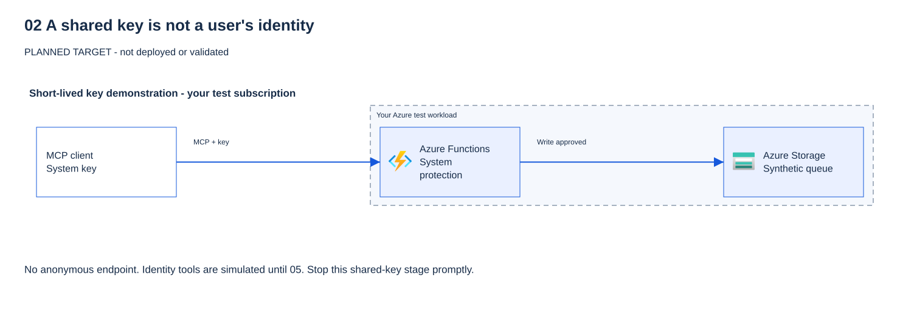
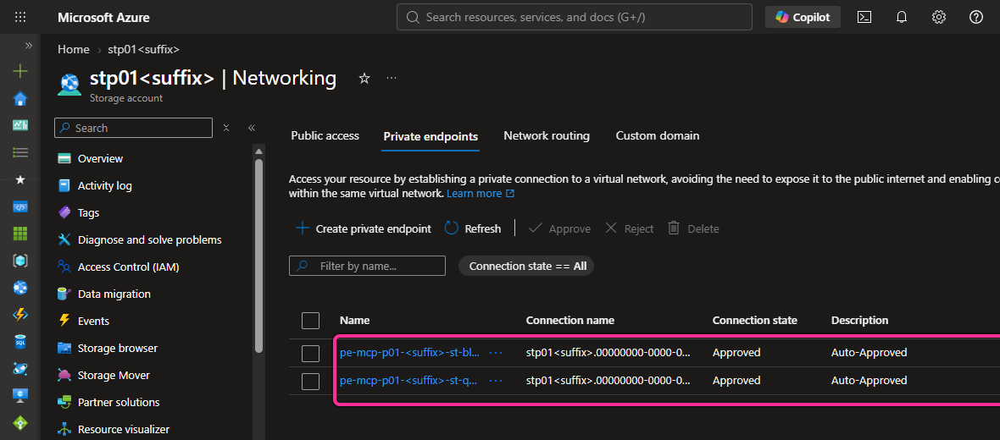

# 02 - An "open" MCP server (level 0)

[Français](README.fr.md)

## Goal

Deploy the workshop's Model Context Protocol (MCP) server to Azure Functions, protected only by a key.
Prove that a request without the key gets HTTP 401 and a request with the key gets HTTP 200.
Then see the risk: **anyone who holds the key can call the write tool `create_ticket`.**

> [!WARNING]
> Level 0 exists only to show this risk. Keep it short-lived, never make the endpoint anonymous,
> and move on to module 03 (Microsoft Entra ID) and module 04 (API Management) to fix it.

## Why it matters

A key is a shared secret, not an identity. The server cannot tell Alice from Bob or from Eve.
It cannot apply per-user roles, it cannot call a downstream API "as the user", and logs cannot say who did what.
A key can leak through a screenshot, a chat, a saved configuration file or a browser history.

The Azure Functions MCP extension protects `/runtime/webhooks/mcp` with the `mcp_extension` **system key**
when `host.json` sets `webhookAuthorizationLevel` to `System` (the default). The upstream sample sets
`Anonymous` because it adds Microsoft Entra authentication in front. This module has no Entra layer yet,
so it keeps `System`. Never copy `Anonymous` into a key-only server.

## What you deploy

All in your workshop resource group, from `infra/workload` with `enable_mcp_server = true`:

| Resource | Purpose | Security setting |
|---|---|---|
| Flex Consumption plan (`FC1`) and Function App | Hosts the .NET 10 isolated worker MCP server | HTTPS only, TLS 1.2, basic publishing disabled, optional IPv4 allow-list |
| User-assigned managed identity | The app's only identity | No secret; three role assignments below |
| Storage account | Host storage, deployment package and the `tickets` queue | Shared key access **disabled**, Entra authorization by default, no public blobs |
| Log Analytics workspace and Application Insights | Payload-free telemetry | Local authentication disabled; 1 GB/day workspace cap |
| *Optional, `mcp_private_storage = true`:* virtual network, Flex integration subnet, blob and queue private endpoints, two private DNS zones | For tenants where an Azure Policy forces Storage public network access to `Disabled` | Storage reachable only from the app's subnet; the MCP endpoint and its key gate are unchanged |

Role assignments, each on one exact resource:

| Role | Scope | Why |
|---|---|---|
| Storage Blob Data Owner | The workshop Storage account | Functions host storage and Flex deployment package (identity-based) |
| Storage Queue Data Message Sender | The `tickets` queue only | `create_ticket` sends one synthetic message |
| Monitoring Metrics Publisher | The Application Insights component | Entra-authenticated telemetry |

The five tools (all data is synthetic):

| Tool | Kind | What it does at level 0 |
|---|---|---|
| `get_service_health` | read | Fixed health for `workshop-api` or `ticket-queue` |
| `create_ticket` | **write** | Validates `service`, `severity` and a short `summary`, then queues one synthetic ticket |
| `whoami` | demonstration | Says the caller is unknown: a key identifies no user |
| `read_report_as_user` | demonstration | Labeled synthetic report; the real On-Behalf-Of call arrives in module 05 |
| `read_report_as_app` | demonstration | Labeled synthetic report; the real managed-identity call arrives in module 05 |

Every tool refuses unknown arguments. `create_ticket` writes nothing unless the exact argument shape is valid.
Logs contain the tool name, outcome, latency and invocation ID only: never arguments, results, keys or tokens.



No **Preview** feature is used. Code and infrastructure adapt
[Azure-Samples/remote-mcp-functions-dotnet](https://github.com/Azure-Samples/remote-mcp-functions-dotnet/tree/468c518c884ec318e3001b9573254c9e775409c9)
(MIT); see [THIRD-PARTY-NOTICES.md](../../THIRD-PARTY-NOTICES.md).

**Cost:** Flex Consumption bills per execution and memory time, plus Storage transactions and telemetry ingestion.
The plan scales to zero and is capped at 10 instances; there is no always-ready instance. Check current prices
for your region before approval. Clean up the same day. The optional private storage adds two private endpoints
(billed per hour and per GB processed) and two private DNS zones.

## Prerequisites and required roles

- Module 00 validated for your subscription and module 01 completed.
- Your private parameters and Terraform state from module 00 (`.workshop/participant.tfvars.json`). Do not regenerate them.
- Terraform 1.16.6 or later, Azure CLI, PowerShell 7.4+, the .NET 10 SDK.
- A non-production subscription where Flex Consumption supports .NET 10 in your region (example: `swedencentral`).

Azure roles on the workshop resource group (ask your administrator; do not request Owner):

- **Contributor** to create the resources, read the system key and publish code.
- **Role Based Access Control Administrator**, ideally with a condition that allows only the three roles above,
  to create the three role assignments. Contributor alone cannot assign roles.

No Microsoft Entra change is needed in this module.

## Steps

### PowerShell

Run from the repository root. Stop at any failed command. Steps 3 to 6 change Azure: do them only after approval.

**1. Offline checks (no Azure).**

```powershell
& .\modules\02-open-server\validate.ps1 -Offline
```

> **Real result** — offline capture on the authoring host, 2026-10-16 (no Azure call).
>
> ```text
> PASS host.json MCP webhook authorization level is System (expected HTTP 401 without the mcp_extension key).
> PASS no anonymous authorization level in server source (expected HTTP N/A).
> PASS no key, SAS, connection-string or client-secret pattern in module 02 files (expected HTTP N/A).
> PASS Terraform disables Storage shared keys, uses managed identity and outputs no key (expected HTTP N/A).
> PASS locked build and tool unit tests: synthetic results, strict inputs, no write without the exact shape (expected HTTP N/A).
> PASS Terraform format, schema and mock-only plans, including module 02 opt-in (expected HTTP N/A; no live plan/apply).
> NOT DEPLOYED CHECKS SKIPPED: supply -TenantId and -SubscriptionId after an approved deployment for HTTP checks.
> PASS offline checks only. Module 02 is NOT deployed or Azure-validated by this result.
> ```
>
> **What it means for you:** the code you are about to deploy is never anonymous and holds no secret.
> The last line is deliberate: nothing in Azure has been proven yet.

**2. Select your approved context.**

```powershell
& .\scripts\select-azure-context.ps1
```

> **Expected result** — from the selector's prompts and final message; not a capture.
>
> ```text
> Approved non-production Entra tenant ID (terminal only): <tenant-id>
> Your approved non-production Azure subscription ID: <subscription-id>
> Type NONPROD to confirm the approved test scope and interactive sign-in: NONPROD
> PASS context: tenant and subscription verified. ARM variables set in this process only. No resources created; this check does not validate module 00.
> ```
>
> **What it means for you:** a browser sign-in opens after you type `NONPROD`. Later commands read
> `$env:ARM_TENANT_ID` and `$env:ARM_SUBSCRIPTION_ID` from this terminal: keep it open for the whole module.

**3. Opt in privately, then plan.** The opt-in file is ignored by Git. Add your public IPv4 range to
`mcp_allowed_ip_ranges` (for example `"203.0.113.10/32"`) to restrict callers; keep the list empty to show the open level.

```powershell
'{ "enable_mcp_server": true, "mcp_allowed_ip_ranges": [] }' | Set-Content -LiteralPath .\.workshop\module02.tfvars.json
terraform -chdir=infra/workload init -lockfile=readonly
if ($LASTEXITCODE -ne 0) { throw 'Terraform init failed.' }
terraform '-chdir=infra\workload' plan '-var-file=..\..\.workshop\participant.tfvars.json' '-var-file=..\..\.workshop\module02.tfvars.json' '-out=..\..\.workshop\module02.tfplan'
if ($LASTEXITCODE -ne 0) { throw 'Terraform plan failed.' }
```

> **Real result** — saved plan summary in the author's test subscription, 2026-10-16. Names and IDs withheld.
>
> ```text
> Plan: 11 to add, 1 to change, 0 to destroy.
> ```
>
> The change is the existing optional portal receiving `WORKSHOP_MCP_ENDPOINT`. Without a portal, expect
> `11 to add, 0 to change, 0 to destroy`.
>
> **What it means for you:** a plan is a promise, not an action. **Any `to destroy` here is a stop signal.**
> Read the eleven additions: three role assignments, each on one exact resource, and no client secret.

Review the plan: expect **eleven new module 02 resources**, with no replacement or deletion.
If the optional public portal already exists, also expect an **in-place app settings update** to add
`WORKSHOP_MCP_ENDPOINT`, its non-secret connection hint. This can restart the portal; approve that interruption
separately. It does not publish a new guide bundle or the Function code. Stop and investigate any other change.
Keep passing both var files in every later plan, otherwise Terraform proposes to delete the server.

**Does your tenant force private Storage?** Some organizations assign an Azure Policy with a `modify` effect that sets
Storage public network access to `Disabled` at creation. Terraform then reads `Disabled` back, and code publishing
fails with HTTP 403 (see Troubleshooting). Ask your administrator, or check after apply:
`az storage account list -g $group --query "[].publicNetworkAccess" -o tsv`. In that case add
`"mcp_private_storage": true` to the private opt-in file and plan again. Expect **nine more resources** (virtual network,
two subnets, two private DNS zones and their links, blob and queue private endpoints) and an in-place Function App
update that adds virtual network integration. Never ask for a policy exemption or enable shared keys to work around it.

**4. Apply the reviewed plan (after approval).**

```powershell
terraform '-chdir=infra\workload' apply '..\..\.workshop\module02.tfplan'
if ($LASTEXITCODE -ne 0) { throw 'Terraform apply failed.' }
```

> **Real result** — apply summary in the author's test subscription, 2026-10-16. Names and IDs withheld.
>
> ```text
> ...
> Apply complete! Resources: 11 added, 1 changed, 0 destroyed.
> ```
>
> With `mcp_private_storage = true`, the second apply in that tenant reported
> `Apply complete! Resources: 9 added, 1 changed, 0 destroyed.`
>
> **What it means for you:** the numbers must match the plan you reviewed. The server exists, but runs no code yet.

If you set `mcp_private_storage = true`, check it in the Azure portal: open the storage account, then
**Security + networking → Networking** (real captures, 2026-10-19, author's test tenant; names pseudonymised, IDs replaced
by zeros; pink frames mark what to check). Select an image to open it full size.




Public network access is **Disabled**, and the Function App reaches blobs and queues only through the two approved private
endpoints. This protects the storage behind the server; the MCP endpoint itself is still open with a key.

**5. Publish the server code.** Azure CLI uses your Microsoft Entra sign-in; no publishing password exists.

```powershell
$group = terraform -chdir=infra/workload output -raw resource_group_name
$app = terraform -chdir=infra/workload output -raw mcp_function_app_name
dotnet publish .\src\FunctionsMcpServer --configuration Release --output .\.workshop\module02-publish
if ($LASTEXITCODE -ne 0) { throw 'Publish failed.' }
Compress-Archive -Path .\.workshop\module02-publish\* -DestinationPath .\.workshop\module02.zip -Force
az functionapp deployment source config-zip --resource-group $group --name $app --src .\.workshop\module02.zip --output none
if ($LASTEXITCODE -ne 0) { throw 'Code deployment failed.' }
```

> **Real result** — publish in the author's test subscription, 2026-10-16. Names and IDs withheld.
> `dotnet publish` prints its build lines; the upload itself prints nothing (`--output none`) and `$LASTEXITCODE` is 0.
> `az functionapp function list --resource-group $group --name $app --query "[].name" --output tsv` then listed:
>
> ```text
> func-mcp-p01-<suffix>/CreateTicket
> func-mcp-p01-<suffix>/GetServiceHealth
> func-mcp-p01-<suffix>/ReadReportAsApp
> func-mcp-p01-<suffix>/ReadReportAsUser
> func-mcp-p01-<suffix>/WhoAmI
> ```
>
> When a tenant policy disabled Storage public access and `mcp_private_storage` was not set, the upload failed with
> `ERROR: ... BlobUploadFailedException: Failed to upload blob to storage account: ... 403 (This request is not authorized to perform this operation.)`.
>
> **What it means for you:** five functions mean the code is live. A 403 here is a network rule, not a missing role
> (see Troubleshooting).

**6. Connect VS Code without saving the key.** Add this server to your **user** MCP configuration
(not to a committed file). VS Code prompts for the key and stores it in its secret storage.

```json
{
  "inputs": [
    { "type": "promptString", "id": "workshop-mcp-key", "description": "mcp_extension system key", "password": true }
  ],
  "servers": {
    "workshop-open": {
      "type": "http",
      "url": "https://<function-app-host>/runtime/webhooks/mcp",
      "headers": { "x-functions-key": "${input:workshop-mcp-key}" }
    }
  }
}
```

Get the endpoint with `terraform -chdir=infra/workload output -raw mcp_endpoint`.
Read the key only when VS Code asks, then clear the clipboard:

```powershell
az functionapp keys list --resource-group $group --name $app --query systemKeys.mcp_extension --output tsv | Set-Clipboard
```

> **Expected result** — no output. The key goes to the clipboard only, never to the screen.
> Success is a silent return with `$LASTEXITCODE` equal to 0. An empty clipboard means the host has not started yet
> (see Troubleshooting).

After pasting it into the VS Code prompt, run `Set-Clipboard -Value $null`.
Never put the key in a URL (`?code=`), a file, a chat or a screenshot.

**7. Validate and show the risk.**

```powershell
& .\modules\02-open-server\validate.ps1 -TenantId $env:ARM_TENANT_ID -SubscriptionId $env:ARM_SUBSCRIPTION_ID -DemonstrateWrite
```

> **Real result** — live run in the author's test subscription, 2026-10-16, with `mcp_private_storage = true`
> (a tenant policy forced private Storage). Names and IDs withheld.
>
> ```text
> PASS Function App is running and HTTPS-only (expected HTTP 200 from Azure Resource Manager).
> PASS MCP request without the mcp_extension key is refused (expected HTTP 401).
> PASS anonymous access disabled: a random wrong key is refused (expected HTTP 401).
> PASS MCP initialize with the key succeeds; negotiated protocol 2025-06-18 (expected HTTP 200).
> PASS tools/list with the key returns exactly the five workshop tools (expected HTTP 200).
> PASS RISK SHOWN: create_ticket succeeds with only the key; no user or role was checked (expected HTTP 200).
> PASS module 02 live checks complete. Rotate or remove the key after the exercise (see README).
> ```
>
> Your protocol version may differ.
>
> **What it means for you:** the server is not anonymous (401 without a key), **but the key is the only check**.
> Whoever holds it, colleague or attacker, can write. `whoami` answers `caller: unknown`: logs cannot say who acted.
> This is the problem modules 03 to 05 solve.

In VS Code, open Copilot Chat in **Agent** mode and paste this prompt. Approve the `create_ticket` call when VS Code asks.

```prompt
Use the workshop-open MCP server. Call create_ticket with service "workshop-api", severity "low" and summary "Synthetic test ticket - Contoso workshop". Then call whoami and tell me who the server thinks I am.
```

The ticket is created and `whoami` answers `caller: unknown`. It works for anyone who holds the key.

**Question:** the server answers HTTP 401 without the key. Does that mean it is protected per user?

<details>
<summary>Show answer</summary>

No. HTTP 401 only proves the endpoint is not anonymous. Everyone who holds the key gets the same full access,
including `create_ticket`. A key carries no identity and no app role, so the server cannot tell Alice from Eve
(`whoami` returns `caller: unknown`). Per-user authorization needs a Microsoft Entra token and app roles (modules 03 and 05).

</details>

**8. Rotate the key after the exercise.** This invalidates every copy that may have leaked.

```powershell
az functionapp keys set --resource-group $group --name $app --key-type systemKeys --key-name mcp_extension --output none
```

> **Real result** — key rotation in the author's test subscription, 2026-10-16.
> No output (`--output none`); `$LASTEXITCODE` was 0. The new key value is never printed.
>
> **What it means for you:** every old copy of the key now gets HTTP 401, including your VS Code session.

**Question:** after rotation, a colleague still has the old key in a saved configuration. What happens when they call
the server, and what does it tell you about keys?

<details>
<summary>Show answer</summary>

Their call gets HTTP 401. Rotation is the only way to revoke a leaked key, and it also breaks every legitimate client
at once. You cannot revoke one person without affecting everyone, because the key is shared. Entra tokens expire
on their own and are issued per user or app.

</details>

### Bash

```bash
bash ./modules/02-open-server/validate.sh -Offline
source ./scripts/select-azure-context.sh
printf '%s\n' '{ "enable_mcp_server": true, "mcp_allowed_ip_ranges": [] }' > .workshop/module02.tfvars.json
terraform -chdir=infra/workload init -lockfile=readonly &&
terraform -chdir=infra/workload plan -var-file=../../.workshop/participant.tfvars.json \
  -var-file=../../.workshop/module02.tfvars.json -out=../../.workshop/module02.tfplan
# Review, then after approval:
terraform -chdir=infra/workload apply ../../.workshop/module02.tfplan
group="$(terraform -chdir=infra/workload output -raw resource_group_name)"
app="$(terraform -chdir=infra/workload output -raw mcp_function_app_name)"
dotnet publish ./src/FunctionsMcpServer --configuration Release --output ./.workshop/module02-publish &&
(cd ./.workshop/module02-publish && zip -qr ../module02.zip .) &&
az functionapp deployment source config-zip --resource-group "$group" --name "$app" --src ./.workshop/module02.zip --output none
bash ./modules/02-open-server/validate.sh -TenantId "$ARM_TENANT_ID" -SubscriptionId "$ARM_SUBSCRIPTION_ID" -DemonstrateWrite
az functionapp keys set --resource-group "$group" --name "$app" --key-type systemKeys --key-name mcp_extension --output none
```

> **Expected result** — the same PASS lines, plan summary and silent publish and rotation as the PowerShell run above.
> `validate.sh -Offline` stops after the offline checks, like `validate.ps1 -Offline`.

Use the same VS Code configuration as in step 6.

## What you should see

| Action | Expected result | Meaning |
|---|---|---|
| MCP request without `x-functions-key` | HTTP 401 | The webhook is not anonymous. |
| Request with a wrong key | HTTP 401 | Only the system key works. |
| `initialize`, then `tools/list` with the key | HTTP 200, five tools | The server works over Streamable HTTP. |
| `create_ticket` with the key | HTTP 200, `status: queued`, a `warning` | **The risk:** no user, no role, no approval on the server. |
| `whoami` | `caller: unknown` | A key carries no identity. |
| `read_report_as_*` | `source: synthetic-demonstration` | Real downstream access is module 05. |

The live validator prints, among others:

```text
PASS MCP request without the mcp_extension key is refused (expected HTTP 401).
PASS anonymous access disabled: a random wrong key is refused (expected HTTP 401).
PASS MCP initialize with the key succeeds; negotiated protocol <version> (expected HTTP 200).
PASS tools/list with the key returns exactly the five workshop tools (expected HTTP 200).
PASS RISK SHOWN: create_ticket succeeds with only the key; no user or role was checked (expected HTTP 200).
```

### Read alongside the demonstration

Use these links when you run the matching check above. They explain the mechanism, not a result observed in your subscription.

| Demonstration | What to understand in Microsoft Learn | API or SDK reference |
|---|---|---|
| No key or wrong key: HTTP 401; correct `mcp_extension` key: HTTP 200 | [Functions access keys](https://learn.microsoft.com/azure/azure-functions/function-keys-how-to): a system key is a shared credential, not a user identity. | [MCP extension configuration](https://learn.microsoft.com/azure/azure-functions/functions-bindings-mcp): `webhookAuthorizationLevel` and the MCP endpoint. |
| Discover the five tools, then call one | [MCP tool trigger](https://learn.microsoft.com/azure/azure-functions/functions-bindings-mcp-tool-trigger): how a function becomes a callable tool. | The same reference describes `McpToolTrigger` and `ToolInvocationContext`, used by this server. |
| `create_ticket` returns `status: queued` | The ticket is synthetic, but publishing a message is a real side effect after deployment. [Authorize Queue Storage with Entra](https://learn.microsoft.com/azure/storage/queues/authorize-access-azure-active-directory) explains the separate downstream identity. | [QueueClient.SendMessageAsync](https://learn.microsoft.com/dotnet/api/azure.storage.queues.queueclient.sendmessageasync), called by the ticket queue adapter. |
| `whoami` is unknown; `read_report_as_*` is a demonstration only | [App Service MCP authorization](https://learn.microsoft.com/azure/app-service/configure-authentication-mcp) explains the authenticated server boundary introduced in module 03. Protected Resource Metadata is **Preview**. | No Graph or report Blob API is called at this stage. Module 05 adds those real calls; a function key does not prove user access. |

Reading these references does not approve deployment, disclose a key or enable anonymous access.
Documentation links last verified: 2026-10-16.

## Validate

`validate.ps1` (or `validate.sh`) always runs offline checks first: `host.json` webhook level is `System`,
no anonymous level in code, no key or secret pattern in module files, Terraform keeps shared keys disabled and
outputs no key, locked build and unit tests, and Terraform mock tests. With `-Offline`, or without a tenant and
subscription, it stops there and says the module is **not** deployed or validated.

With `-TenantId` and `-SubscriptionId`, it checks the context, reads the endpoint from your Terraform state and the key
from Azure CLI **in memory only**, and runs the HTTP checks above. Every check prints one PASS or FAIL line.
The module is done only when the live checks pass on a fresh subscription right after modules 00 and 01.

## Troubleshooting

| Symptom | Check |
|---|---|
| HTTP 401 with the key | Use the `mcp_extension` **system** key, in the `x-functions-key` header. A function or host key is different. |
| Key is empty | The code is not published yet, or the host has not started. Publish (step 5), wait one minute, retry. |
| HTTP 403 | Your IP is not in `mcp_allowed_ip_ranges`. Update the private file and plan again. |
| HTTP 404 on `/runtime/webhooks/mcp` | Publish failed or used the wrong package folder. Check the deployment status in the portal. |
| Host does not start / storage errors | Role assignments can take a few minutes. Check the three assignments; never enable shared keys. |
| Publish fails: `BlobUploadFailedException ... 403 (This request is not authorized)` | Storage public network access is `Disabled`, often forced by an Azure Policy. Set `mcp_private_storage = true`, plan, apply, publish again. |
| Plan proposes to delete the server | You forgot `-var-file=..\..\.workshop\module02.tfvars.json`. |
| `Unexpected argument` tool error | The tools accept only their documented arguments. This is intended. |

## Clean up

Run the clean-up after the exercise. It plans with the module disabled and refuses to continue unless every change
is a deletion of a module 02 resource (including the optional private storage network), or the removal of only the
portal's `WORKSHOP_MCP_ENDPOINT` hint. Run it once to review, then again with `-Apply`.
It is idempotent: when nothing remains, it says so and changes nothing.

```powershell
& .\modules\02-open-server\cleanup.ps1 -TenantId $env:ARM_TENANT_ID -SubscriptionId $env:ARM_SUBSCRIPTION_ID
& .\modules\02-open-server\cleanup.ps1 -TenantId $env:ARM_TENANT_ID -SubscriptionId $env:ARM_SUBSCRIPTION_ID -Apply
Remove-Item -LiteralPath .\.workshop\module02.tfvars.json, .\.workshop\module02.zip -ErrorAction SilentlyContinue
Remove-Item -LiteralPath .\.workshop\module02-publish -Recurse -ErrorAction SilentlyContinue
```

> **Real result** — clean-up report (first command, without `-Apply`) in the author's test subscription, 2026-10-16,
> with `mcp_private_storage = true` and the optional portal. Names and IDs withheld.
>
> ```text
> PASS explicit Azure context and private participant parameters (expected HTTP 200 from Azure Resource Manager).
> PLAN delete azurerm_application_insights.mcp[0]
> PLAN delete azurerm_function_app_flex_consumption.mcp[0]
> PLAN delete azurerm_log_analytics_workspace.mcp[0]
> PLAN delete azurerm_private_dns_zone.storage["blob"]
> PLAN delete azurerm_private_dns_zone.storage["queue"]
> PLAN delete azurerm_private_dns_zone_virtual_network_link.storage["blob"]
> PLAN delete azurerm_private_dns_zone_virtual_network_link.storage["queue"]
> PLAN delete azurerm_private_endpoint.storage["blob"]
> PLAN delete azurerm_private_endpoint.storage["queue"]
> PLAN delete azurerm_role_assignment.mcp_host_storage[0]
> PLAN delete azurerm_role_assignment.mcp_telemetry[0]
> PLAN delete azurerm_role_assignment.mcp_ticket_sender[0]
> PLAN delete azurerm_service_plan.mcp[0]
> PLAN delete azurerm_storage_account.mcp[0]
> PLAN delete azurerm_storage_container.mcp_package[0]
> PLAN delete azurerm_storage_queue.tickets[0]
> PLAN delete azurerm_subnet.gateway_private_endpoints[0]
> PLAN delete azurerm_subnet.mcp_integration[0]
> PLAN delete azurerm_user_assigned_identity.mcp[0]
> PLAN delete azurerm_virtual_network.gateway[0]
> PLAN update azurerm_linux_web_app.portal[0]: remove only the WORKSHOP_MCP_ENDPOINT hint (portal may restart)
> PASS cleanup plan deletes only 20 module 02 resource(s) and removes the portal endpoint hint. Review it, then rerun with -Apply.
> ```
>
> Without private storage, expect 11 module 02 deletions; without the portal, no `PLAN update` line.
> With `-Apply`, the script prints Terraform's apply output, then (script messages, not part of this capture)
> `PASS module 02 resources deleted; the system key was deleted with the Function App (expected HTTP 200 from Azure Resource Manager).`
> and `KEEP private participant parameters, Terraform state and the resource group for later modules.`
> The two `Remove-Item` lines print nothing.
>
> **What it means for you:** read every `PLAN` line before `-Apply`. A `FAIL cleanup plan contains ... change(s) outside module 02 deletions`
> line means something else would change: nothing is applied, investigate privately. A second run prints
> `PASS no module 02 resources remain in this state; nothing to delete`.

```bash
bash ./modules/02-open-server/cleanup.sh -TenantId "$ARM_TENANT_ID" -SubscriptionId "$ARM_SUBSCRIPTION_ID" -Apply
```

> **Expected result** — the same PASS, PLAN and KEEP lines as the PowerShell run above.

The resource group, your private parameters and state stay for the next modules. Remove the `workshop-open`
server from your VS Code user configuration. If you continue to module 03 immediately, you may keep the server and
skip clean-up; module 03 replaces the key with Microsoft Entra authentication.

## Go further

- Restrict callers with `mcp_allowed_ip_ranges` and observe HTTP 403 from another network.
- Rotate the key and watch the old VS Code session fail with HTTP 401.
- Read the [threat model](../../docs/concepts/mcp-threat-model.md): which threats does a key not address?
- Next: [module 03](../03-entra-authentication/README.md).

## Sources

- [Functions MCP bindings: host.json, endpoint, system key](https://learn.microsoft.com/azure/azure-functions/functions-bindings-mcp)
- [MCP tool trigger](https://learn.microsoft.com/azure/azure-functions/functions-bindings-mcp-tool-trigger)
- [Custom remote MCP server on Functions](https://learn.microsoft.com/azure/azure-functions/scenario-custom-remote-mcp-server)
- [Flex Consumption plan](https://learn.microsoft.com/azure/azure-functions/flex-consumption-plan)
- [Function access keys](https://learn.microsoft.com/azure/azure-functions/function-keys-how-to)
- [Identity-based connections and minimum host storage role](https://learn.microsoft.com/azure/azure-functions/functions-identity-based-connections-tutorial)
- [Azure-Samples/remote-mcp-functions-dotnet at 468c518](https://github.com/Azure-Samples/remote-mcp-functions-dotnet/tree/468c518c884ec318e3001b9573254c9e775409c9)
- [AzureRM 5.9.0 Flex Consumption resource](https://github.com/hashicorp/terraform-provider-azurerm/blob/v5.9.0/website/docs/r/function_app_flex_consumption.html.markdown)
- [VS Code MCP configuration and inputs](https://code.visualstudio.com/docs/agent-customization/mcp-servers)
- [Functions networking: Flex Consumption subnet size and `Microsoft.App/environments` delegation](https://learn.microsoft.com/azure/azure-functions/functions-networking-options)
- [Use a secured storage account with Azure Functions](https://learn.microsoft.com/azure/azure-functions/configure-networking-how-to#restrict-your-storage-account-to-a-virtual-network)
- [Use private endpoints for Azure Storage](https://learn.microsoft.com/azure/storage/common/storage-private-endpoints)
- [Default outbound access: not applicable to delegated subnets](https://learn.microsoft.com/azure/virtual-network/ip-services/default-outbound-access)

Last verified: 2026-10-16.
