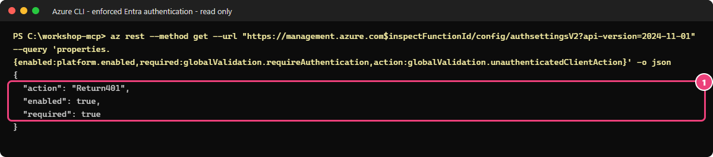

# 03 — Authentification Microsoft Entra : low-code, portail d'abord

[English](LOW-CODE.md)

## Objectif

[Guide Terraform + PowerShell](README.fr.md)

Au module 02, toute personne qui possède la clé peut utiliser votre serveur. Vous allez remplacer cette clé partagée
par une connexion Microsoft Entra ID, puis vérifier **qui peut entrer**. Le contrôle de **ce que chacun peut faire**
viendra au module 04.

Ce parcours utilise le portail et Azure CLI. Si vos ressources sont déjà gérées par Terraform,
suivez l'autre guide pour éviter que les deux méthodes modifient les mêmes réglages.

### Le scénario : Bob n'est pas Eve

Les trois comptes de test appartiennent au même tenant (annuaire Entra) Contoso et peuvent s'y connecter.
Leur accès à **l'application MCP** est différent :

| Compte | Rôles attribués dans l'application | Résultat attendu au module 03 |
|---|---|---|
| Alice | `Tools.Read` et `Tools.Write` | Obtient un jeton MCP, entre et voit les cinq outils |
| Bob | `Tools.Read` seulement | Entre lui aussi et voit les cinq outils ; il peut encore appeler `create_ticket` |
| Eve | Aucun | Peut se connecter au tenant, mais Entra refuse le jeton MCP avec `AADSTS50105` |

Bob sert à montrer qu'un rôle de lecture **déclaré** ne bloque pas encore une écriture.
Eve sert à montrer qu'un compte du bon tenant n'a pas automatiquement accès à l'application.
Votre exercice est terminé lorsque vos contrôles serveur et vos trois tests de comptes confirment ces résultats.

## Pourquoi c'est important

Un jeton d'accès est destiné à une API précise : c'est son **audience**.
Il indique aussi la permission déléguée obtenue par le client pour agir au nom de l'utilisateur (`scp`)
et les rôles attribués à cet utilisateur (`roles`).
Un jeton destiné à Microsoft Graph ne doit donc pas être accepté par votre serveur MCP.
Si le serveur appelle ensuite une autre API, il doit obtenir un autre jeton ; il ne doit jamais lui transmettre le jeton reçu du client.

Pour conserver une protection à chaque instant, activez d'abord Entra en gardant la clé.
Vérifiez ensuite la configuration et le refus sans jeton, puis retirez l'exigence de clé.
Ne faites jamais ces opérations dans l'ordre inverse.
Dans ce module, l'attribution à l'application détermine qui peut entrer ; le module 04 vérifiera les droits pour chaque outil.

Vous allez d'abord retrouver votre serveur (étape 1), recevoir la configuration de l'administrateur (2 et 3),
activer et vérifier Entra en gardant la clé (4), retirer l'exigence de clé (5), puis vous connecter et tester (6 et Valider).
La préautorisation de VS Code concerne le **logiciel client** ; l'attribution de rôle concerne la **personne**.
Autoriser VS Code ne donne donc pas accès à Eve.

> [!IMPORTANT]
> Un jeton authentique ne suffit pas : il doit être destiné à cette API MCP et avoir été émis par le tenant autorisé.
> Un jeton Microsoft Graph doit toujours être refusé.
> Ne retirez jamais l'exigence de clé avant d'avoir confirmé que l'authentification Entra est obligatoire.

## Ce que vous déployez

Avec l'administrateur des identités, vous préparez une inscription d'application limitée à votre tenant et son application d'entreprise.
Vous lui ajoutez la permission déléguée `user_impersonation`, les rôles utilisateur `Tools.Read` et `Tools.Write`,
ainsi que `Tools.Execute.All`, réservé aux applications.
Vous préautorisez VS Code et Azure CLI, puis attribuez deux rôles à Alice et un à Bob.
Vous ne créez ni secret, ni certificat, ni nouvel utilisateur.

Sur votre application Azure Functions, vous activez l'authentification intégrée et les métadonnées de ressource protégée
(**PRM**, en **Preview**, ou préversion). Ces métadonnées indiquent au client MCP où se connecter et quelle permission demander.
Vous n'ajoutez pas de ressource de calcul ; les coûts du module 02 continuent.

## Prérequis et rôles nécessaires

- Vous avez terminé le [module 02 avec le portail](../02-open-server/LOW-CODE.fr.md) et publié les cinq outils.
  Conservez le même fichier de paramètres et les mêmes noms de ressources.
- Vous disposez de PowerShell 7.4+, d'Azure CLI et de VS Code avec GitHub Copilot. Ouvrez le terminal à la racine du dépôt.
- Vous avez le rôle Contributor sur le groupe de ressources. Aucun nouveau rôle Azure n'est nécessaire.
- **L'administrateur des identités intervient dans une session distincte.** Il a le rôle Cloud Application Administrator
  ou Application Administrator pour configurer l'application, les préautorisations et les attributions.
  Le rôle Global Administrator et le consentement administrateur ne sont pas nécessaires dans ce module.
- Alice, Bob et Eve sont trois comptes de test dédiés qui existent déjà dans le tenant approuvé.
  Le rôle User Administrator n'est nécessaire que si une personne autorisée doit les créer avant l'exercice.
  Chaque compte doit enregistrer la méthode d'authentification multifacteur (**MFA**) demandée.
  Ne modifiez pas les règles d'accès conditionnel pour éviter cette étape.
- L'administrateur vous transmet en privé le Client ID de l'API, le Tenant ID et les Object ID des utilisateurs.
  Ne partagez aucun mot de passe ou jeton dans un fichier, une capture ou une conversation.
  Faites approuver les modifications d'identité et de l'application Azure Functions avant de commencer.

## Étapes

### 1. Participant : préparer le terminal de ce module

Dans le portail, ouvrez **Subscriptions → votre abonnement → Overview** pour relever le **Subscription ID**.
Ouvrez ensuite **Microsoft Entra ID → Overview** pour relever le **Tenant ID**.
Remplacez les valeurs entre chevrons par ces deux identifiants :

```powershell
$tenant = '<tenant-id>'
$sub = '<subscription-id>'
az login --tenant $tenant
az account set --subscription $sub
$p = Get-Content .\.workshop\participant.tfvars.json -Raw | ConvertFrom-Json
$id = "$($p.participant_prefix)lc"; $sfx = $p.resource_suffix.Substring(0, 10)
$rg = "rg-mcp-$id-$sfx"; $fn = "func-mcp-$id-$sfx"
if ($p.existing_resource_group_name) { $rg = $p.existing_resource_group_name }
$vscode = 'aebc6443-996d-45c2-90f0-388ff96faa56'
$azcli = '04b07795-8ddb-461a-bbee-02f9e1bf7b46'
"Workshop MCP API ($id-$sfx)"; $rg; $fn
```

> **Résultat attendu** — le nom prévu pour l'application Entra, puis les noms du groupe de ressources et de votre application Azure Functions.
> Transmettez le premier à l'administrateur des identités.
> Gardez ce terminal ouvert pour la suite ; ces commandes ont préparé toutes les variables nécessaires.

### 2. Administrateur : déclarer l'API, sa permission déléguée et ses rôles

Les étapes 2 et 3 sont à effectuer par l'administrateur des identités.
Si vous n'avez pas ce rôle, transmettez-lui ces instructions et reprenez à l'étape 4 une fois la préparation terminée.

1. Dans le bon annuaire, **Microsoft Entra ID → App registrations → New registration**. Nom `Workshop MCP API (<id>-<sfx>)` transmis par le participant, **Accounts in this organizational directory only**, aucune URI de redirection, **Register**.
2. **Overview** : copiez **Application (client) ID** et **Directory (tenant) ID**. Ne prenez pas l'Object ID de l'application. Transmettez ces identifiants non secrets en privé.
3. **Expose an API → Application ID URI → Add** : acceptez `api://<client-id-application>`, **Save**.
4. **Add a scope** : nom `user_impersonation`, consentement **Admins and users**, noms d'affichage administrateur et utilisateur `Access the workshop MCP server`, descriptions expliquant l'accès au serveur pour l'utilisateur connecté ; état **Enabled**, **Add scope**.
5. **App roles → Create app role**, trois fois :

| Nom d'affichage | Types de membres autorisés | Valeur | Description |
|---|---|---|---|
| Read workshop tools | Users/Groups | `Tools.Read` | Call read-only workshop MCP tools |
| Write with workshop tools | Users/Groups | `Tools.Write` | Call workshop tools that change synthetic data |
| Execute workshop tools as an application | Applications | `Tools.Execute.All` | App-only access for a separately approved client |

Activez chaque rôle. N'attribuez `Tools.Execute.All` à aucune application dans ce module.

6. **Manifest** : dans l'objet `api`, mettez `requestedAccessTokenVersion` à **2**, **Save**. Ne remplacez pas tout le manifeste et ne changez pas les identifiants. Vérifiez les trois rôles et la permission déléguée `user_impersonation`.


*Sur votre inscription d'application, vérifiez les valeurs des trois rôles et leurs types de membres, pas seulement leurs noms d'affichage.
La capture sert de repère ; les noms des ressources peuvent différer.*

### 3. Administrateur : préautoriser les clients et attribuer les rôles aux utilisateurs

1. Inscription → **Expose an API → Authorized client applications → Add a client application** : `aebc6443-996d-45c2-90f0-388ff96faa56` (VS Code), cochez `user_impersonation`, **Add application**.
2. Répétez pour Azure CLI : `04b07795-8ddb-461a-bbee-02f9e1bf7b46`, même étendue. Aucun client inconnu.
3. **Microsoft Entra ID → Enterprise applications → All applications** : recherchez l'API par son Application ID. **Properties → Assignment required? → Yes → Save**.
4. **Users and groups → Add user/group** : Alice, rôle **Read workshop tools**, **Assign**. Répétez pour Alice avec **Write with workshop tools**, puis Bob avec **Read workshop tools**. Aucune affectation pour Eve. Vérifiez trois affectations.
5. **Microsoft Entra ID → Users → All users → chaque compte de test → Overview** : copiez **Object ID**. Partagez ces identifiants en privé, jamais les informations de connexion.


*Sur l'application d'entreprise de votre API, vérifiez que Assignment required vaut Yes.
C'est ce réglage qui empêche Eve d'obtenir un jeton. Le nom de la ressource dans la capture n'est qu'un exemple.*

### 4. Participant : activer l'authentification sans retirer la clé

1. Ouvrez votre Function App, puis **Settings → Authentication**.
   Le résultat recherché est une authentification obligatoire, une réponse **HTTP 401** sans jeton et un magasin de jetons désactivé (**Off**).
   Ne validez pas l'assistant **Add identity provider → Microsoft** : ses valeurs par défaut peuvent créer un secret ou une autre inscription.
2. Utilisez plutôt la commande ci-dessous pour configurer le fournisseur sans secret.
   Elle reprend votre inscription existante et limite l'accès au bon tenant, à l'audience MCP et aux deux clients autorisés.
   Remplacez `$apiClientId` par l'**Application (client) ID** reçu à l'étape 2.
   Le fichier JSON contient uniquement la configuration et ses identifiants.

```powershell
$apiClientId = '<api-application-client-id>'
$authFile = Join-Path $PWD '.workshop\lowcode-authsettings.json'
@{ properties = @{
    platform = @{ enabled = $true; runtimeVersion = '~1' }
    globalValidation = @{ requireAuthentication = $true; unauthenticatedClientAction = 'Return401' }
    httpSettings = @{ requireHttps = $true; routes = @{ apiPrefix = '/.auth' }; forwardProxy = @{ convention = 'NoProxy' } }
    login = @{ tokenStore = @{ enabled = $false } }
    identityProviders = @{ azureActiveDirectory = @{ enabled = $true
        registration = @{ clientId = $apiClientId; openIdIssuer = "https://login.microsoftonline.com/$tenant/v2.0" }
        validation = @{ allowedAudiences = @("api://$apiClientId", $apiClientId)
            defaultAuthorizationPolicy = @{ allowedApplications = @($vscode, $azcli) } } } }
} } | ConvertTo-Json -Depth 8 | Set-Content $authFile
try {
    az rest --method put --url "https://management.azure.com/subscriptions/$sub/resourceGroups/$rg/providers/Microsoft.Web/sites/$fn/config/authsettingsV2?api-version=2024-04-01" --body "@$authFile" --headers 'Content-Type=application/json' -o none
    if ($LASTEXITCODE) { throw 'Authentication configuration failed; keep the key gate.' }
} finally { Remove-Item $authFile -ErrorAction SilentlyContinue }
```

> **Résultat attendu** — la commande se termine avec le code 0, sans rien afficher.
> L'authentification est obligatoire, avec votre tenant, l'audience MCP et les deux clients autorisés.
> La clé reste exigée à ce stade.

3. Function → **Settings → Environment variables → App settings → Add** :
   - `WEBSITE_AUTH_PRM_DEFAULT_WITH_SCOPES` = `api://<api-application-client-id>/user_impersonation` (**préversion**).
   - `WEBSITE_AUTH_AAD_ALLOWED_TENANTS` = Tenant ID.
   **Apply → Confirm**.
4. Vérifiez **Authentication** : Require authentication, HTTP 401, magasin de jetons désactivé.
   Vérifiez aussi l'ID client de votre API, l'émetteur de votre tenant et les audiences de cette API seulement.
   Ne changez pas encore la protection du webhook. Le 401 ci-dessous ne suffit pas seul :
   la clé du module 02 pouvait déjà produire cette réponse ; il faut aussi confirmer qu'Entra est obligatoire.


*Avant de continuer, vérifiez ces réglages sur votre propre application.
La capture vous aide à les repérer ; elle ne remplace pas cette vérification.*

```powershell
$r = Invoke-WebRequest "https://$fn.azurewebsites.net/runtime/webhooks/mcp" -Method Post -ContentType 'application/json' -SkipHttpErrorCheck `
    -Body '{"jsonrpc":"2.0","id":1,"method":"initialize","params":{"protocolVersion":"2025-06-18","capabilities":{},"clientInfo":{"name":"workshop","version":"1"}}}'
if ($r.StatusCode -ne 401) { throw "Expected HTTP 401 before replacing the key, got $($r.StatusCode)" }
$r.StatusCode
```

> **Résultat attendu** — **HTTP 401**.
> Si vous obtenez une autre réponse, arrêtez-vous et vérifiez l'authentification. Ne retirez pas l'exigence de clé pour poursuivre.

### 5. Participant : retirer l'exigence de clé après avoir vérifié Entra

Function → **Settings → Environment variables → App settings → Add** :

`AzureFunctionsJobHost__extensions__mcp__system__webhookAuthorizationLevel` = `Anonymous`.

Sélectionnez **Apply → Confirm**.
La valeur `Anonymous` indique seulement à l'extension MCP de ne plus demander la clé système.
**L'authentification Entra reste obligatoire avant tout accès au serveur** : un appel sans jeton doit toujours recevoir HTTP 401.
N'ajoutez jamais ce paramètre au paquet du module 02, qui serait alors déployé sans cette protection Entra.

### 6. Connecter VS Code avec le compte de test choisi

1. Function → **Overview → Default domain** : utilisez ce domaine pour `<function-host>`.
2. VS Code → **Ctrl+Shift+P → MCP: Open User Configuration**. Retirez `workshop-open` et son entrée de clé ; ajoutez :

```json
{
  "servers": {
    "workshop-entra": { "type": "http", "url": "https://<function-host>/runtime/webhooks/mcp" }
  }
}
```

3. **Start** au-dessus du serveur → **Allow** pour l'authentification Microsoft → compte **Alice**. Terminez l'inscription MFA normale si demandée.
4. **Chat → Agent → Configure Tools** : uniquement ce serveur. Demandez : `Liste les outils workshop-entra, puis appelle get_service_health avec service "workshop-api".` Lisez et approuvez une fois.
5. Attendu : **Running**, **Discovered 5 tools**, résultat de santé. Pour Bob ou Eve, **Profiles: New Profile...**, nom du compte, puis configuration et connexion dans cette fenêtre séparée. Eve doit être refusée avec `AADSTS50105` ; ne lui donnez pas d'affectation pour « corriger » ce refus.


*Vérifiez votre URL, l'état Running et le message Discovered 5 tools.
Les noms visibles dans la capture peuvent différer des vôtres.*

## Ce que vous devez voir

- Sans jeton, avec un jeton destiné à une autre API ou avec la seule ancienne clé, le serveur répond **HTTP 401**.
- La lecture des PRM renvoie **HTTP 200**, avec votre tenant et la permission déléguée de l'API.
- Alice et Bob obtiennent **HTTP 200** pour `initialize` et la liste des cinq outils.
- Entra refuse le jeton MCP à Eve avec `AADSTS50105` (**HTTP 400** lors de la demande de jeton).

Bob peut encore écrire dans ce module. Vous limiterez ses actions au module 04.

### Vérifier vous-même avec Azure CLI

**Pourquoi :** le refus sans jeton doit venir d'Entra, pas seulement de l'ancienne clé.
Dans PowerShell 7, à la racine du dépôt, préparez une lecture indépendante du portail :

```powershell
$ErrorActionPreference = 'Stop'
$inspectParticipant = Get-Content -LiteralPath .\.workshop\participant.tfvars.json -Raw | ConvertFrom-Json
$inspectId = "$($inspectParticipant.participant_prefix)lc"
$inspectSuffix = $inspectParticipant.resource_suffix.Substring(0, 10)
$inspectGroup = if ($inspectParticipant.existing_resource_group_name) { $inspectParticipant.existing_resource_group_name } else { "rg-mcp-$inspectId-$inspectSuffix" }
$inspectNames = [pscustomobject]@{ function_app = "func-mcp-$inspectId-$inspectSuffix" }
$inspectFunctionId = az resource show -g $inspectGroup -n $inspectNames.function_app --resource-type Microsoft.Web/sites --api-version 2024-11-01 --query id -o tsv
if ($LASTEXITCODE -ne 0 -or -not $inspectFunctionId) { throw "Identifiant de l'application indisponible." }
```

> **Résultat attendu** — aucune sortie : `$inspectFunctionId` contient l'identifiant de votre Function App.

Copiez ensuite ce `GET` en lecture seule :

```powershell
az rest --method get --url "https://management.azure.com$inspectFunctionId/config/authsettingsV2?api-version=2024-11-01" --query 'properties.{enabled:platform.enabled,required:globalValidation.requireAuthentication,action:globalValidation.unauthenticatedClientAction}' -o json
if ($LASTEXITCODE -ne 0) { throw "Lecture de la configuration d'authentification impossible." }
```

> **Résultat attendu** — `enabled: true`, `required: true`, `action: Return401`.



*Capture en lecture seule du 20 octobre 2026 ; les champs sont les mêmes dans les deux parcours.
Elle ne revalide pas le parcours portail complet. Le validateur vérifie aussi l'émetteur et l'audience ;
les essais avec Alice, Bob et Eve vérifient les attributions. Si un champ diffère, ne poursuivez pas en retirant la clé.*

## Valider

Dans VS Code, créez `.workshop/module03-personas.json` avec les **Object ID** des trois utilisateurs relevés à l'étape 3,
pas les Client ID des applications. Ce fichier privé est exclu du suivi Git. N'y mettez aucun mot de passe ni jeton :

```json
{
  "alice": "<alice-object-id>",
  "bob": "<bob-object-id>",
  "eve": "<eve-object-id>"
}
```

Dans le terminal où vous êtes connecté avec votre compte Azure habituel :

```powershell
$v = @{ TenantId = $tenant; ResourceGroup = $rg; FunctionApp = $fn; ApiClientId = $apiClientId; SkipBuild = $true
    PersonaObjectIdsPath = '.\.workshop\module03-personas.json' }
& .\modules\03-entra-authentication\validate.ps1 @v -SubscriptionId $sub
```

> **Résultat attendu** — le script confirme les refus sans jeton, avec une mauvaise audience et avec l'ancienne clé seule (**401**).
> Il vérifie aussi les PRM (**200**, **préversion**) et lit la configuration d'authentification déployée.
> `-SkipBuild` évite les tests Terraform du dépôt ; les paramètres qui nomment vos ressources remplacent la lecture d'un état Terraform.

**Vérification de ce parcours :** les étapes s'appuient sur le code et la documentation du dépôt.
Le parcours complet dans le portail reste à tester sur un environnement neuf.
Vous devez obtenir les résultats attendus sur votre propre déploiement, pas seulement lire les exemples.

Connectez ensuite les trois comptes de test. À **chaque** demande du navigateur, choisissez le compte indiqué dans le terminal,
pas votre compte Azure habituel. Le script utilise une configuration Azure CLI distincte pour chaque compte,
puis rétablit votre configuration initiale :

```powershell
$operatorConfig = $env:AZURE_CONFIG_DIR
try {
    foreach ($persona in 'Alice', 'Bob', 'Eve') {
        Write-Host "Sign in as $persona"
        $env:AZURE_CONFIG_DIR = Join-Path $PWD ".workshop\az-$($persona.ToLower())"
        az login --tenant $tenant --allow-no-subscriptions
        if ($LASTEXITCODE) { throw "Login failed for $persona" }
        & .\modules\03-entra-authentication\validate.ps1 @v -Persona $persona
        az logout
    }
} finally {
    if ($null -eq $operatorConfig) { Remove-Item Env:\AZURE_CONFIG_DIR -ErrorAction SilentlyContinue }
    else { $env:AZURE_CONFIG_DIR = $operatorConfig }
}
az account set --subscription $sub
```

> **Résultat attendu** — le script confirme l'identifiant du compte testé.
> Alice et Bob se connectent au serveur et obtiennent la liste des cinq outils (**HTTP 200**).
> Pour Eve, il doit confirmer le refus de jeton `AADSTS50105` : c'est ce refus précis qui fait réussir le contrôle.

## Dépannage

- **`AADSTS50105` pour Alice :** demandez à l'administrateur de vérifier ses attributions sur cette application,
  puis attendez leur propagation. N'attribuez pas de rôle à Eve : son refus est attendu.
- **`AADSTS65001`, consentement demandé :** faites vérifier les deux clients préautorisés et la permission sélectionnée.
  Aucun consentement administrateur global n'est nécessaire ici.
- **HTTP 401 pour Alice :** vérifiez le tenant, le Client ID de l'API, les jetons v2, les clients autorisés et le scope publié dans les PRM.
  Un jeton Graph doit, lui, toujours être refusé.
- **La clé est encore demandée après la connexion :** vérifiez le nom exact du paramètre de l'étape 5,
  après avoir confirmé qu'Entra est obligatoire.
- **Le mauvais compte est connecté dans Azure CLI :** le contrôle d'Object ID doit le signaler.
  Déconnectez ce compte dans sa configuration dédiée, puis connectez le bon.

## Nettoyer

Si vous continuez immédiatement au [module 04](../04-governed-gateway/LOW-CODE.fr.md), conservez les ressources.
Sinon, suivez le [nettoyage du parcours portail](../99-cleanup/LOW-CODE.fr.md).
Vérifiez les noms et les étiquettes avant de supprimer uniquement les ressources de votre exercice.
L'administrateur retire l'inscription créée pour cet atelier et son application d'entreprise.
Conservez les applications, utilisateurs et groupes qui vous ont été fournis.

N'utilisez pas les scripts de nettoyage Terraform pour des ressources créées dans le portail.
Retirez les entrées MCP de VS Code et déconnectez les comptes de test de leurs configurations Azure CLI dédiées.

## Pour aller plus loin

**Question :** pourquoi Bob entre-t-il alors qu'Eve est refusée, même s'ils appartiennent au même tenant ?

<details>
<summary>Afficher la réponse</summary>

L'application exige une attribution. Bob a reçu `Tools.Read`, Eve n'a reçu aucun rôle.
La connexion d'Eve au tenant peut réussir, mais sa demande de jeton pour l'API MCP doit échouer avec `AADSTS50105`.
Ce refus attendu prouve le contrôle ; un échec MFA ne le prouverait pas.

</details>

**Question :** Bob peut-il encore appeler `create_ticket` dans ce module ?

<details>
<summary>Afficher la réponse</summary>

Oui. Le rôle est défini et attribué, mais aucun contrôle par outil ne l'utilise encore.
Le module 04 exigera `Tools.Write` et refusera l'écriture à Bob avec HTTP 403.
Ne lui ajoutez pas ce rôle et ne confondez pas l'approbation humaine dans le client avec l'autorisation côté serveur.

</details>

**Question :** pourquoi faut-il vérifier la configuration Entra avant de retirer l'exigence de clé ?

<details>
<summary>Afficher la réponse</summary>

La clé doit protéger le serveur tant que le nouveau contrôle n'est pas en place.
Un HTTP 401 seul ne prouve pas qu'Entra fonctionne : le serveur le renvoyait déjà sans clé.
Vérifiez l'authentification obligatoire, le tenant, l'audience MCP et le refus avant de passer à l'étape 5.

</details>

**Question :** Alice possède un jeton Microsoft Graph valide de ce tenant. Le serveur MCP doit-il l'accepter ?

<details>
<summary>Afficher la réponse</summary>

Non : HTTP 401 est attendu. Son audience est Microsoft Graph, pas cette API MCP. Être connecté au bon tenant ne rend pas un jeton valide pour toutes les API.

</details>

Expliquez la différence entre la permission accordée au client pour agir au nom de l'utilisateur
et les rôles attribués à cette personne. Continuez avec [la passerelle](../04-governed-gateway/LOW-CODE.fr.md),
qui utilisera ces rôles pour autoriser ou refuser chaque outil.

## Sources

- [Lire les paramètres d'authentification V2](https://learn.microsoft.com/rest/api/appservice/web-apps/get-auth-settings-v-2?view=rest-appservice-2024-11-01), vérifié le 20 octobre 2026.

- [Authentification MCP et PRM (préversion)](https://learn.microsoft.com/azure/app-service/configure-authentication-mcp).
- [Connexion VS Code et App Service](https://learn.microsoft.com/azure/app-service/configure-authentication-mcp-server-vscode).
- [Tutoriel Functions MCP](https://learn.microsoft.com/azure/azure-functions/functions-mcp-tutorial).
- [Rôles applicatifs](https://learn.microsoft.com/entra/identity-platform/howto-add-app-roles-in-apps).

Dernière vérification : 2026-10-20. Le parcours complet dans le portail reste à tester sur un environnement neuf.
