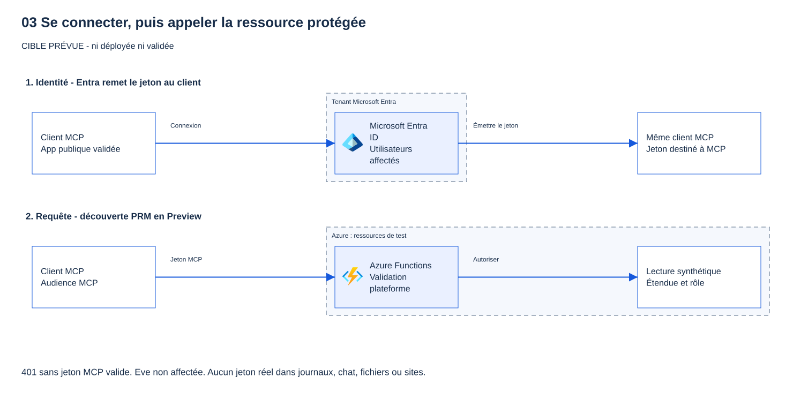

# 03 - Identité avec Microsoft Entra (niveau 1)

[English](README.md)

## Objectif

Remplacer la clé partagée du module 02 par une connexion **Microsoft Entra ID**. L'authentification intégrée de la
Function App contrôle chaque requête avant que le serveur MCP ne la voie. À la fin :

- une requête sans jeton reçoit **HTTP 401** ;
- un jeton valide pour **une autre audience** (Microsoft Graph) reçoit **HTTP 401** ;
- **Alice** et **Bob** (attribués) reçoivent **HTTP 200** ;
- **Eve** (non attribuée) **ne peut même pas obtenir de jeton**.

> [!WARNING]
> Ne collez jamais un vrai jeton dans un site web, une conversation, un fichier, une capture d'écran ou un journal.
> Utilisez les [exemples de revendications synthétiques](synthetic-claims/) pour apprendre ce que contient un jeton.

## Pourquoi cette étape compte

Une clé n'identifie personne. Un jeton d'accès Microsoft Entra indique **qui** appelle (`oid`), **depuis quel tenant**
(`tid`, `iss`), **avec quelle application** (`azp`), **pour quelle API** (`aud`), **ce que l'application peut faire pour
l'utilisateur** (`scp`) et **ce que l'utilisateur a le droit de faire** (`roles`). La plateforme vérifie tout cela ;
le code du serveur ne lit jamais le jeton lui-même.

| Revendication | Sens | Valeur synthétique (Alice, voir [alice.json](synthetic-claims/alice.json)) | Qui la vérifie au niveau 1 |
|---|---|---|---|
| `aud` | Audience : l'API à laquelle le jeton est destiné. Un jeton par saut, une audience par jeton. | `44444444-…` (ID client de l'API MCP) | Authentification intégrée : seulement l'API MCP |
| `iss`, `tid` | Émetteur et tenant | `https://login.microsoftonline.com/00000000-…/v2.0` | Authentification intégrée : seulement le tenant de l'atelier |
| `azp` | Application cliente appelante | `aebc6443-…` (Visual Studio Code) | Règle d'autorisation intégrée : seulement les clients autorisés |
| `scp` | **Étendue** (permission déléguée) : ce que *l'application cliente* peut faire *pour l'utilisateur* | `user_impersonation` | Pré-autorisation du client dans Entra |
| `roles` | **Rôles d'application** : ce que *cet utilisateur* a le droit de faire | `Tools.Read`, `Tools.Write` | Entra n'émet des rôles qu'aux utilisateurs attribués ; le contrôle par outil arrive au module 04 |
| `exp`, `nbf` | Période de validité | horodatages synthétiques | Authentification intégrée |

Bob a les mêmes `aud` et `scp`, mais seulement `Tools.Read` ([bob.json](synthetic-claims/bob.json)).
Eve n'obtient jamais de jeton : Entra refuse avec `AADSTS50105`, car **l'attribution est obligatoire** et elle n'a aucun rôle
([eve.json](synthetic-claims/eve.json)). Un jeton Graph détenu par Alice est valide, mais pour une autre audience :
le serveur MCP le refuse ([wrong-audience.json](synthetic-claims/wrong-audience.json)).

> [!IMPORTANT]
> L'authentification intégrée contrôle l'accès **au serveur**, pas à chaque outil. Au niveau 1, Bob peut encore appeler
> `create_ticket`. Le module 04 ajoute le contrôle de rôle par outil (`create_ticket` exige `Tools.Write`).

**Pourquoi la clé de fonction n'est plus la barrière.** L'authentification intégrée s'exécute devant l'hôte Functions et
renvoie HTTP 401 avant qu'aucun code MCP ne tourne. Le paramètre documenté
`AzureFunctionsJobHost__extensions__mcp__system__webhookAuthorizationLevel = Anonymous` indique alors à l'extension MCP de ne
plus demander la clé système : une clé est un secret partagé que les clients devraient aussi détenir, et elle n'apporte
aucune identité. Le webhook n'est anonyme *que pour l'hôte* ; rien d'anonyme ne l'atteint depuis Internet. `host.json`
conserve `System` : un paquet déployé sans authentification intégrée reste protégé par la clé. Terraform ne pose ce paramètre
que lorsque l'authentification intégrée est appliquée, et lors d'un **second apply** (deux étapes) : Azure écrit les
paramètres d'application et ceux d'authentification en deux appels distincts ; tout faire d'un coup pourrait ouvrir le
webhook un instant.

## Ce que vous déployez

**Microsoft Entra (`infra/entra`, exécuté une fois par un administrateur des identités) :**

| Objet | Réglages |
|---|---|
| Inscription d'application « Workshop MCP API (mcp-&lt;préfixe&gt;-&lt;suffixe&gt;) » | Un seul tenant, jetons d'accès v2, URI d'ID d'application `api://<client-id>`, aucune URI de redirection, **aucun secret, certificat ni mot de passe** |
| Étendue déléguée | `user_impersonation` |
| Rôles d'application | `Tools.Read`, `Tools.Write` (membres : utilisateurs) ; `Tools.Execute.All` (membres : applications, non attribué ici) |
| Application d'entreprise (principal de service) | **Attribution obligatoire** = oui |
| Clients pré-autorisés pour `user_impersonation` | Visual Studio Code `aebc6443-996d-45c2-90f0-388ff96faa56`, Azure CLI `04b07795-8ddb-461a-bbee-02f9e1bf7b46` |
| Attributions de rôles (comptes de test existants seulement) | Alice → `Tools.Read` + `Tools.Write` ; Bob → `Tools.Read` ; Eve → aucune |

Aucune permission Microsoft Graph ou Storage n'est encore demandée, donc **aucun consentement administrateur** n'est
nécessaire : les clients pré-autorisés obtiennent `user_impersonation` sans invite de consentement. Le module 05 ajoute les
permissions On-Behalf-Of et la fédération d'identité de l'identité managée (la sortie `module05_federated_credential`
en réserve les valeurs).

**Charge de travail (`infra/workload`, participant) :** une mise à jour en place de la Function App du module 02 :

| Réglage | Valeur |
|---|---|
| Authentification intégrée (authsettingsV2) | Activée, **authentification obligatoire**, non authentifié → **HTTP 401**, HTTPS seulement, magasin de jetons désactivé |
| Fournisseur Microsoft | ID client de l'API MCP, émetteur `https://login.microsoftonline.com/<tenant>/v2.0`, aucun paramètre de secret |
| Audiences autorisées | `api://<client-id>` et `<client-id>` seulement (la même API, formats de jeton v1 et v2) |
| Applications clientes autorisées | VS Code et Azure CLI |
| `WEBSITE_AUTH_PRM_DEFAULT_WITH_SCOPES` | `api://<client-id>/user_impersonation` (**Preview** : métadonnées de ressource protégée) |
| `WEBSITE_AUTH_AAD_ALLOWED_TENANTS` | Votre ID de tenant |
| `AzureFunctionsJobHost__extensions__mcp__system__webhookAuthorizationLevel` | `Anonymous`, **étape 2 seulement**, une fois l'authentification intégrée appliquée |



**Preview :** les métadonnées de ressource protégée (PRM, RFC 9728) de l'authentification App Service sont en **Preview** ;
leur configuration peut changer. Le bouton « authentification MCP » du portail (**Preview**) n'est pas utilisé : il crée un
secret client.

**Coût :** aucune nouvelle ressource Azure. L'authentification intégrée et les objets Entra n'entraînent pas de frais
supplémentaires. Modifier les paramètres d'application redémarre l'application.

## Prérequis et rôles nécessaires

- Module 02 déployé, avec les mêmes paramètres privés et le même état Terraform (`participant.tfvars.json`, `module02.tfvars.json`).
- Terraform 1.16.6 ou ultérieur, Azure CLI, PowerShell 7.4+. VS Code avec GitHub Copilot pour la démonstration de connexion.
- Trois comptes de test **existants, dédiés et hors production** dans le tenant : Alice, Bob et Eve. L'administrateur des
  identités les crée à part (par exemple avec un Temporary Access Pass) et ne transmet que leurs ID d'objet, en privé.
  Terraform ne crée jamais d'utilisateurs : le fournisseur AzureAD enregistrerait leur mot de passe initial dans l'état.

**Administrateur des identités** (personne ou session distincte, rôle limité dans le temps via Privileged Identity Management si possible) :

- **Administrateur d'applications cloud** (ou Administrateur d'applications) pour créer l'inscription, l'application
  d'entreprise, les pré-autorisations et les attributions de rôles. Pas d'Administrateur général, pas de consentement
  administrateur pour ce module.
- **Administrateur des utilisateurs** seulement pour créer les comptes de test, hors Terraform.

**Participant :** les rôles du module 02 sur le groupe de ressources de l'atelier (Contributeur). Aucune nouvelle attribution de rôle.

La demande complète à envoyer à l'administrateur des identités se trouve dans [identity-request.md](../../docs/requests/identity-request.md).

## Étapes

### PowerShell

Exécutez depuis la racine du dépôt. Les étapes 2 à 7 modifient Microsoft Entra ou Azure : faites-les seulement après approbation.

**1. Vérifications hors ligne (sans Azure ni Entra).**

```powershell
& .\modules\03-entra-authentication\validate.ps1 -Offline
```

**2. Administrateur des identités : connexion au tenant seulement.** Utilisez un terminal séparé.
`--allow-no-subscriptions` suffit.

```powershell
az login --tenant <tenant-id> --allow-no-subscriptions
```

**3. Administrateur des identités : paramètres privés.** Reprenez le préfixe, le suffixe, le propriétaire et l'expiration
du participant (reçus en privé) et les ID d'objet des trois comptes de test. Le fichier est ignoré par Git.

```powershell
$p = Get-Content -LiteralPath .\.workshop\participant.tfvars.json -Raw | ConvertFrom-Json
@{
    tenant_id = '<tenant-id>'; participant_prefix = $p.participant_prefix; resource_suffix = $p.resource_suffix
    owner = $p.owner; expiry = $p.expiry
    test_user_object_ids = @{ alice = '<alice-object-id>'; bob = '<bob-object-id>'; eve = '<eve-object-id>' }
} | ConvertTo-Json | Set-Content -LiteralPath .\.workshop\entra.tfvars.json
```

Pour réutiliser une application déjà créée par un administrateur, ajoutez `"create_application": false` et
`"existing_application_client_id": "<client-id>"`. Terraform se contente alors de la lire (et de vérifier son étendue,
ses rôles et l'attribution obligatoire) ; il ne la modifie ni ne la supprime jamais.

**4. Administrateur des identités : planifier, relire, appliquer.**

```powershell
terraform -chdir=infra/entra init -lockfile=readonly
if ($LASTEXITCODE -ne 0) { throw 'Terraform init failed.' }
terraform '-chdir=infra\entra' plan '-var-file=..\..\.workshop\entra.tfvars.json' '-out=..\..\.workshop\entra.tfplan'
if ($LASTEXITCODE -ne 0) { throw 'Terraform plan failed.' }
# Relire : 8 ajouts (application, URI, application d'entreprise, 2 pré-autorisations, 3 attributions). Puis, après approbation :
terraform '-chdir=infra\entra' apply '..\..\.workshop\entra.tfplan'
```

**5. Transmission au participant (ID non secrets seulement).**

```powershell
terraform -chdir=infra/entra output -json workload_module03_tfvars | Set-Content -LiteralPath .\.workshop\module03.tfvars.json
terraform -chdir=infra/entra output -json persona_object_ids | Set-Content -LiteralPath .\.workshop\module03-personas.json
```

**6. Participant, étape 1 : placer Entra devant la clé.** Sélectionnez d'abord votre contexte approuvé
(`& .\scripts\select-azure-context.ps1`). Passez désormais toujours les trois fichiers de variables.

```powershell
terraform '-chdir=infra\workload' plan '-var-file=..\..\.workshop\participant.tfvars.json' '-var-file=..\..\.workshop\module02.tfvars.json' '-var-file=..\..\.workshop\module03.tfvars.json' '-out=..\..\.workshop\module03.tfplan'
if ($LASTEXITCODE -ne 0) { throw 'Terraform plan failed.' }
# Relire : une mise à jour en place de la Function App (auth_settings_v2 et deux paramètres WEBSITE_AUTH_*). Après approbation :
terraform '-chdir=infra\workload' apply '..\..\.workshop\module03.tfplan'
```

Un appelant a maintenant besoin d'un jeton **et** de la clé : rien n'est anonyme.

**7. Participant, étape 2 : Entra remplace la clé.**

```powershell
$v = Get-Content -LiteralPath .\.workshop\module03.tfvars.json -Raw | ConvertFrom-Json
$v.entra_auth_replace_key_gate = $true
$v | ConvertTo-Json | Set-Content -LiteralPath .\.workshop\module03.tfvars.json
terraform '-chdir=infra\workload' plan '-var-file=..\..\.workshop\participant.tfvars.json' '-var-file=..\..\.workshop\module02.tfvars.json' '-var-file=..\..\.workshop\module03.tfvars.json' '-out=..\..\.workshop\module03.tfplan'
# Relire : une mise à jour en place qui ajoute le paramètre du webhook. Après approbation :
terraform '-chdir=infra\workload' apply '..\..\.workshop\module03.tfplan'
```

Aucun code n'est republié : `host.json` ne change pas.

**8. Vérifications opérateur (aucun compte de test nécessaire).**

```powershell
& .\modules\03-entra-authentication\validate.ps1 -TenantId $env:ARM_TENANT_ID -SubscriptionId $env:ARM_SUBSCRIPTION_ID
```

**9. Connecter VS Code avec une connexion.** Dans votre configuration MCP **utilisateur**, remplacez le serveur
`workshop-open` (et sa saisie de clé) par une simple URL. Aucun en-tête, rien de secret.

```json
{
  "servers": {
    "workshop-entra": { "type": "http", "url": "https://<function-app-host>/runtime/webhooks/mcp" }
  }
}
```

Démarrez le serveur. VS Code lit les métadonnées de ressource protégée et vous propose de vous **authentifier avec
Microsoft**. Connectez-vous en tant qu'Alice : les cinq outils apparaissent. Connectez-vous en tant qu'Eve (autre profil
VS Code) : Entra affiche `AADSTS50105`.

**10. Vérifications par personne.** Utilisez un profil Azure CLI séparé par compte de test pour ne pas remplacer votre session.

```powershell
foreach ($persona in 'Alice', 'Bob', 'Eve') {
    $env:AZURE_CONFIG_DIR = Join-Path $PWD ".workshop\az-$($persona.ToLower())"
    az login --tenant $env:ARM_TENANT_ID --allow-no-subscriptions   # connectez-vous en tant que $persona dans le navigateur
    & .\modules\03-entra-authentication\validate.ps1 -TenantId $env:ARM_TENANT_ID -Persona $persona
    az logout
}
Remove-Item Env:\AZURE_CONFIG_DIR
```

### Bash

```bash
bash ./modules/03-entra-authentication/validate.sh -Offline
# Administrateur des identités, terminal séparé :
az login --tenant "<tenant-id>" --allow-no-subscriptions
jq -n --slurpfile p .workshop/participant.tfvars.json --arg t "<tenant-id>" \
  '{tenant_id:$t, participant_prefix:$p[0].participant_prefix, resource_suffix:$p[0].resource_suffix, owner:$p[0].owner, expiry:$p[0].expiry,
    test_user_object_ids:{alice:"<alice-object-id>", bob:"<bob-object-id>", eve:"<eve-object-id>"}}' > .workshop/entra.tfvars.json
terraform -chdir=infra/entra init -lockfile=readonly &&
terraform -chdir=infra/entra plan -var-file=../../.workshop/entra.tfvars.json -out=../../.workshop/entra.tfplan
terraform -chdir=infra/entra apply ../../.workshop/entra.tfplan    # après relecture et approbation
terraform -chdir=infra/entra output -json workload_module03_tfvars > .workshop/module03.tfvars.json
terraform -chdir=infra/entra output -json persona_object_ids > .workshop/module03-personas.json
# Participant, étape 1 puis étape 2 (relire chaque plan, appliquer après approbation) :
source ./scripts/select-azure-context.sh
vars="-var-file=../../.workshop/participant.tfvars.json -var-file=../../.workshop/module02.tfvars.json -var-file=../../.workshop/module03.tfvars.json"
terraform -chdir=infra/workload plan $vars -out=../../.workshop/module03.tfplan && terraform -chdir=infra/workload apply ../../.workshop/module03.tfplan
jq '.entra_auth_replace_key_gate = true' .workshop/module03.tfvars.json > .workshop/m03.tmp && mv .workshop/m03.tmp .workshop/module03.tfvars.json
terraform -chdir=infra/workload plan $vars -out=../../.workshop/module03.tfplan && terraform -chdir=infra/workload apply ../../.workshop/module03.tfplan
bash ./modules/03-entra-authentication/validate.sh -TenantId "$ARM_TENANT_ID" -SubscriptionId "$ARM_SUBSCRIPTION_ID"
for persona in Alice Bob Eve; do
  export AZURE_CONFIG_DIR="$PWD/.workshop/az-${persona,,}"
  az login --tenant "$ARM_TENANT_ID" --allow-no-subscriptions
  bash ./modules/03-entra-authentication/validate.sh -TenantId "$ARM_TENANT_ID" -Persona "$persona"
  az logout
done
unset AZURE_CONFIG_DIR
```

## Ce que vous devez voir

| Action | Résultat attendu | Signification |
|---|---|---|
| Requête MCP sans jeton | HTTP 401 avec `WWW-Authenticate: Bearer … resource_metadata="…"` | L'authentification intégrée refuse avant l'exécution du code MCP. |
| `GET` sur l'URL `resource_metadata` | HTTP 200, `authorization_servers` = votre tenant, `scopes_supported` = `api://…/user_impersonation` | Les PRM (**Preview**) indiquent aux clients où se connecter. |
| Requête avec la seule clé du niveau 0 | HTTP 401 | La clé n'est plus la barrière. |
| Jeton Microsoft Graph d'Alice | HTTP 401 | Mauvaise audience : une audience par jeton. |
| Alice, puis Bob, avec un jeton pour `api://<client-id>` | HTTP 200, cinq outils | Les utilisateurs attribués atteignent le serveur. |
| Eve demande un jeton | `AADSTS50105`, aucun jeton | Attribution obligatoire : Eve n'atteint jamais le serveur. |
| Bob appelle `create_ticket` dans VS Code | Fonctionne encore au niveau 1 | Accès au serveur seulement ; le module 04 ajoute les rôles par outil. |

## Valider

`validate.ps1` (ou `validate.sh`) exécute toujours d'abord les vérifications hors ligne : `host.json` conserve `System` ;
le webhook anonyme n'existe qu'avec l'authentification intégrée appliquée et HTTP 401 ; `infra/entra` conserve un seul
tenant, `user_impersonation`, les trois rôles et l'attribution obligatoire, sans secret, mot de passe, certificat ni
utilisateur ; aucun motif de jeton ou de clé dans les fichiers du module ; les revendications synthétiques n'utilisent que
des ID synthétiques ; format, schéma et tests simulés Terraform pour les deux racines.

Sortie hors ligne (ce résultat **ne prouve pas** un déploiement) :

```text
PASS host.json keeps the level 0 System webhook level; the published package is never anonymous on its own (expected HTTP N/A).
PASS the key gate is removed only together with enforced built-in authentication and Return401 (expected HTTP 401 without a token).
PASS infra/entra: single tenant, user_impersonation, Tools.Read/Tools.Write/Tools.Execute.All, assignment required, no secret or user (expected HTTP N/A).
PASS no access token, key, SAS or client secret in module 03, infra/entra or workload files (expected HTTP N/A).
PASS synthetic claim examples use synthetic IDs only and contain no token (4 files, expected HTTP N/A).
PASS Terraform format, schema and mock-only plans for infra/entra and infra/workload (expected HTTP N/A; no live plan/apply).
PASS offline checks only. Module 03 is NOT deployed or Entra-validated by this result.
```

Modes en ligne, après un déploiement approuvé :

- **Opérateur** (`-TenantId -SubscriptionId`) : HTTP 401 sans jeton, métadonnées PRM, HTTP 401 pour un jeton Graph,
  authsettingsV2 et paramètres d'application lus dans Azure Resource Manager, HTTP 401 avec la seule clé.
- **Personne** (`-TenantId -Persona Alice|Bob|Eve`, connecté avec ce compte) : Alice et Bob obtiennent HTTP 200 pour
  `initialize` et `tools/list` ; Eve doit échouer à obtenir un jeton avec `AADSTS50105`. Si `.workshop/module03-personas.json`
  existe, l'ID d'objet connecté est contrôlé.

Les jetons et les clés restent en mémoire et ne sont jamais affichés. Le module n'est terminé que lorsque la vérification
opérateur et les trois vérifications par personne réussissent sur un abonnement neuf, juste après les modules 00 à 02.

## Dépannage

| Symptôme | À vérifier |
|---|---|
| VS Code ouvre `https://<app>/authorize` au lieu de la connexion Microsoft | Les PRM manquent : vérifiez `WEBSITE_AUTH_PRM_DEFAULT_WITH_SCOPES` et attendez le redémarrage. |
| HTTP 401 pour Alice après l'étape 1 | Normal : l'étape 1 exige encore la clé. Appliquez l'étape 2. |
| HTTP 403 avec un jeton valide | L'application cliente n'est pas autorisée. Utilisez VS Code ou Azure CLI. |
| `AADSTS65001` (consentement requis) | Le client n'est pas pré-autorisé pour `user_impersonation`. Vérifiez les deux pré-autorisations. |
| `AADSTS50105` pour Alice ou Bob | L'attribution de rôle manque ou n'est pas encore propagée. Attendez quelques minutes, reconnectez-vous. |
| `AADSTS500011` (ressource introuvable) | Mauvaise URI d'ID d'application ou mauvais tenant. Utilisez la sortie `mcp_auth_audience`. |
| Le plan propose de retirer l'authentification | Vous avez oublié `-var-file=..\..\.workshop\module03.tfvars.json`. |
| `entra_auth_replace_key_gate requires enable_entra_auth` | N'activez jamais l'étape 2 sans l'étape 1. |

## Nettoyer

Nettoyez dans l'ordre inverse. Chaque script planifie d'abord et refuse toute modification hors du module 03 ;
lancez-le une fois pour relire, puis avec `-Apply`. Les deux sont idempotents.

```powershell
# Participant : remettre la clé derrière Entra (phase 1), puis retirer l'authentification intégrée (phase 2).
& .\modules\03-entra-authentication\cleanup.ps1 -TenantId $env:ARM_TENANT_ID -SubscriptionId $env:ARM_SUBSCRIPTION_ID
& .\modules\03-entra-authentication\cleanup.ps1 -TenantId $env:ARM_TENANT_ID -SubscriptionId $env:ARM_SUBSCRIPTION_ID -Apply
Remove-Item -LiteralPath .\.workshop\module03.tfvars.json, .\.workshop\module03-personas.json -ErrorAction SilentlyContinue
Remove-Item -LiteralPath .\.workshop\az-alice, .\.workshop\az-bob, .\.workshop\az-eve -Recurse -ErrorAction SilentlyContinue
# Administrateur des identités : supprimer seulement les objets Entra créés par l'atelier (jamais les applications ni utilisateurs fournis).
& .\modules\03-entra-authentication\cleanup.ps1 -TenantId <tenant-id> -Scope Entra
& .\modules\03-entra-authentication\cleanup.ps1 -TenantId <tenant-id> -Scope Entra -Apply
```

```bash
bash ./modules/03-entra-authentication/cleanup.sh -TenantId "$ARM_TENANT_ID" -SubscriptionId "$ARM_SUBSCRIPTION_ID" -Apply
bash ./modules/03-entra-authentication/cleanup.sh -TenantId "<tenant-id>" -Scope Entra -Apply
```

Supprimez ensuite le serveur avec le nettoyage du module 02, retirez le serveur `workshop-entra` de VS Code et demandez à
l'administrateur des identités de supprimer les comptes de test s'ils n'ont été créés que pour cet atelier. Si vous
enchaînez tout de suite avec le module 04, gardez tout.

## Aller plus loin

- Ouvrez [alice.json](synthetic-claims/alice.json) et [bob.json](synthetic-claims/bob.json) : quelle revendication
  diffère, et quelle couche l'utilise ?
- En tant que Bob, appelez `create_ticket` dans VS Code. Cela fonctionne : pourquoi est-ce un problème, et quel module le corrige ?
- Lisez les concepts [étendues et rôles d'application](../../docs/fr/concepts/scopes-and-app-roles.md) et
  [chaîne de jetons](../../docs/fr/concepts/token-chain.md).
- Suite : [plan du module 04](../../docs/fr/BUILD-PLAN.md).

## Sources

- [Configurer l'autorisation d'un serveur MCP (App Service et Functions)](https://learn.microsoft.com/azure/app-service/configure-authentication-mcp)
- [Sécuriser des serveurs MCP avec Microsoft Entra et VS Code](https://learn.microsoft.com/azure/app-service/configure-authentication-mcp-server-vscode)
- [Tutoriel : héberger un serveur MCP sur Azure Functions (authentification intégrée, paramètre du webhook, ID client VS Code)](https://learn.microsoft.com/azure/azure-functions/functions-mcp-tutorial)
- [Métadonnées de ressource protégée (Preview) dans l'authentification App Service](https://learn.microsoft.com/azure/app-service/overview-authentication-authorization#protected-resource-metadata-preview)
- [Ajouter des rôles d'application et les recevoir dans un jeton](https://learn.microsoft.com/entra/identity-platform/howto-add-app-roles-in-apps)
- [Exiger l'attribution des utilisateurs pour une application d'entreprise](https://learn.microsoft.com/entra/identity/enterprise-apps/assign-user-or-group-access-portal)
- [Référence des revendications des jetons d'accès](https://learn.microsoft.com/entra/identity-platform/access-token-claims-reference)
- [Azure-Samples/remote-mcp-functions-dotnet au commit 468c518 (infra/app/entra.bicep, infra/app/api.bicep)](https://github.com/Azure-Samples/remote-mcp-functions-dotnet/tree/468c518c884ec318e3001b9573254c9e775409c9)
- [Fournisseur AzureAD 3.10.0](https://registry.terraform.io/providers/hashicorp/azuread/3.10.0/docs) et [AzureRM 5.9.0 Flex Consumption `auth_settings_v2`](https://github.com/hashicorp/terraform-provider-azurerm/blob/v5.9.0/website/docs/r/function_app_flex_consumption.html.markdown)
- [RFC 9728 OAuth 2.0 Protected Resource Metadata](https://www.rfc-editor.org/rfc/rfc9728)

Dernière vérification : 2026-10-14. Rédigé et vérifié hors ligne seulement ; pas encore déployé ni validé dans Azure ou Microsoft Entra.
