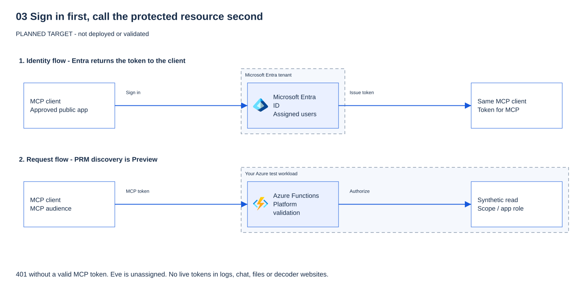
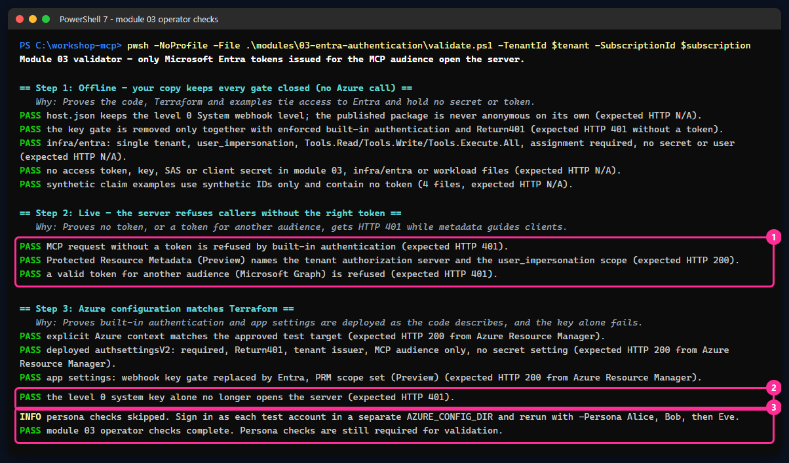
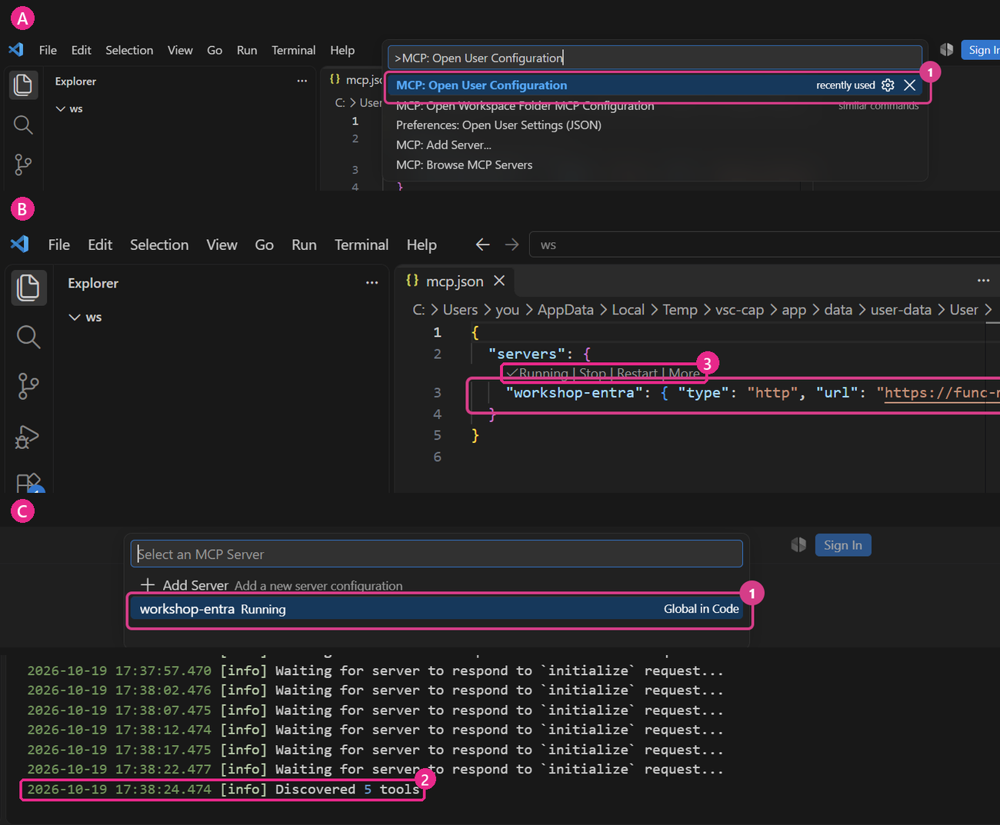
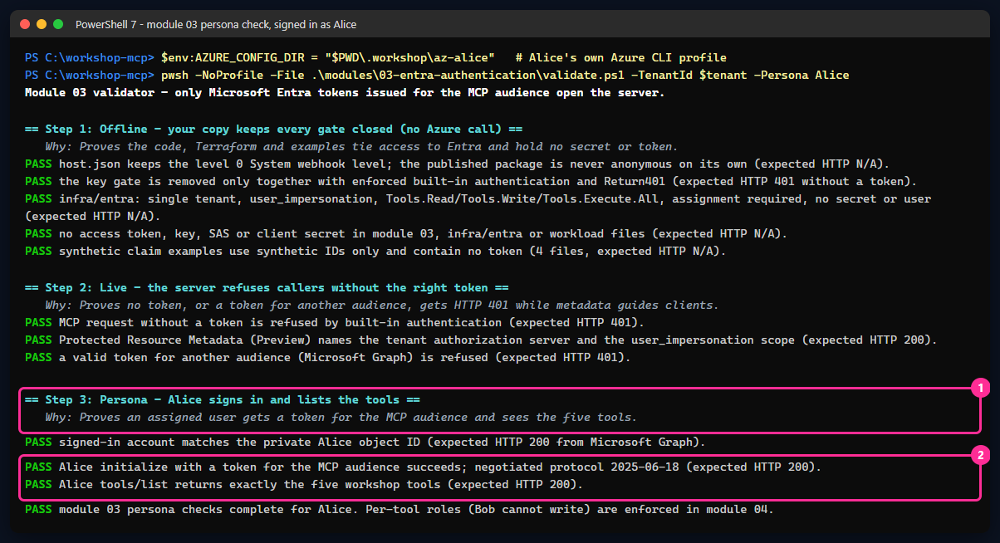
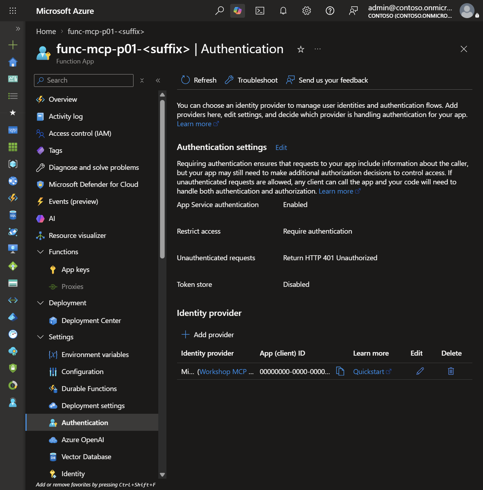
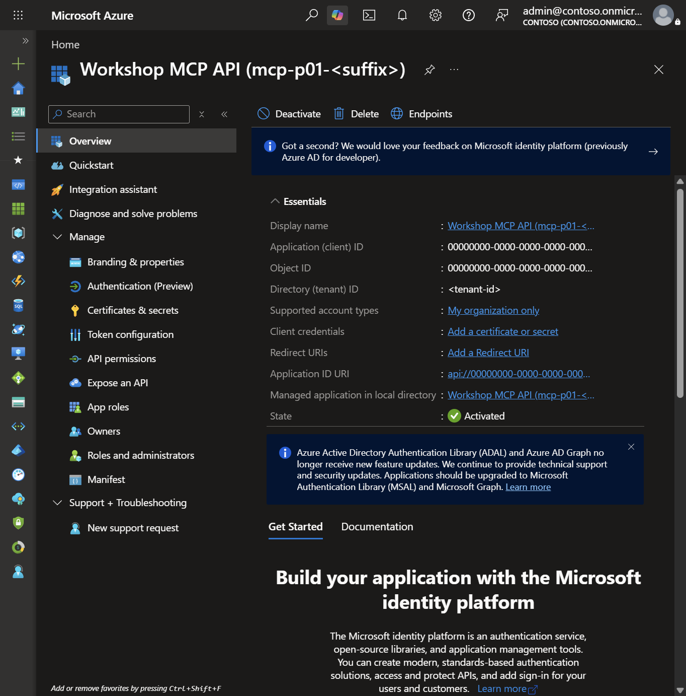
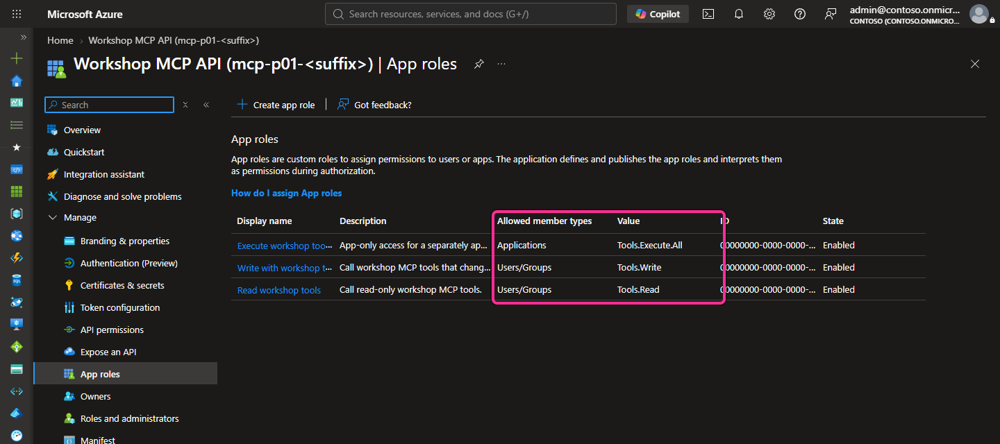
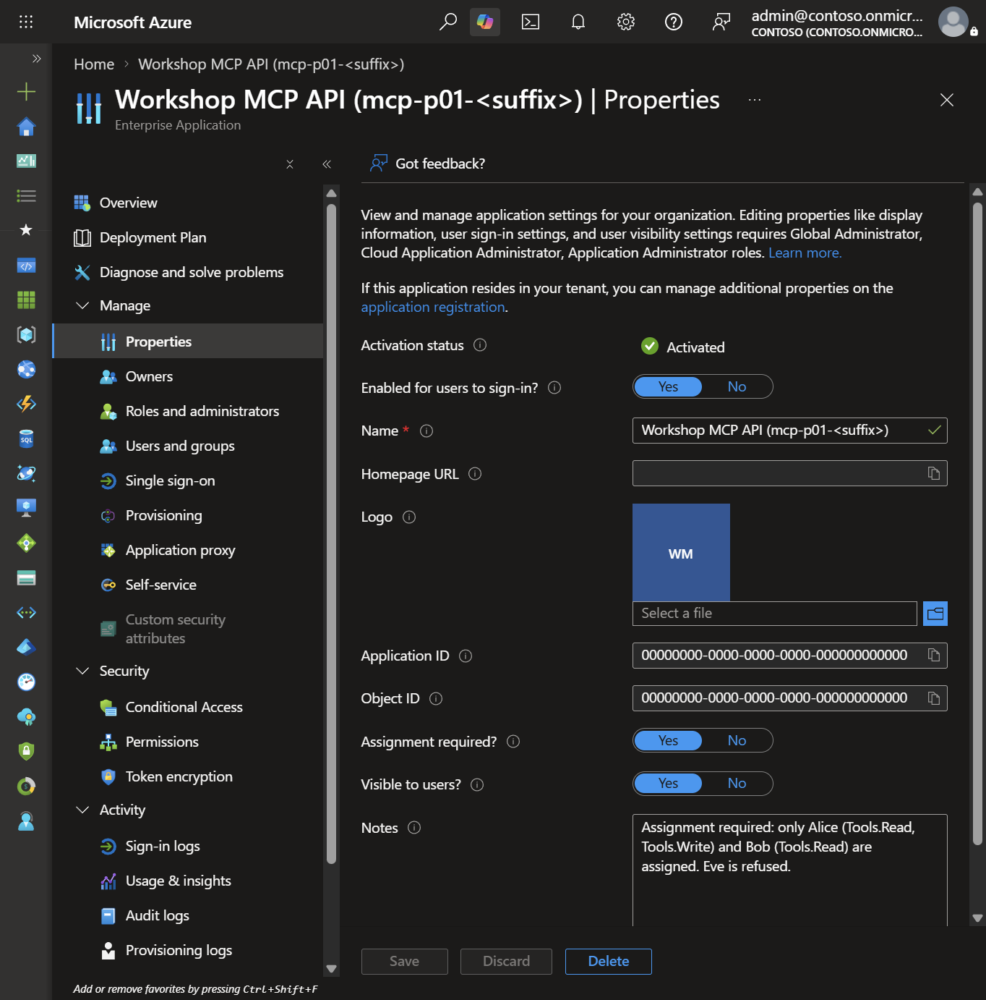

# 03 - Identity with Microsoft Entra (level 1)

[Français](README.fr.md)

## Goal

[Portal-first low-code guide](LOW-CODE.md)

**Terraform + PowerShell track.** The identity administrator manages `infra/entra`; the participant manages `infra/workload`. Keep the existing private parameters and state. Portal-first deployment is documented separately; do not mix resource ownership.

Replace the shared key of module 02 with **Microsoft Entra ID** sign-in. The Function App's built-in authentication
checks every request before the MCP server sees it. At the end:

- a request without a token gets **HTTP 401**;
- a valid token for **another audience** (Microsoft Graph) gets **HTTP 401**;
- **Alice** and **Bob** (assigned) get **HTTP 200**;
- **Eve** (not assigned) **cannot even get a token**.

> [!WARNING]
> Never paste a live token into a website, a chat, a file, a screenshot or a log. Use the
> [synthetic claim examples](synthetic-claims/) to learn what a token contains.

## Why it matters

A key identifies nobody. A Microsoft Entra access token says **who** calls (`oid`), **from which tenant** (`tid`, `iss`),
**with which app** (`azp`), **for which API** (`aud`), **what the app may do for the user** (`scp`) and
**what the user may do** (`roles`). The platform validates all of it; the server code never parses a token.

| Claim | Meaning | Synthetic value (Alice, see [alice.json](synthetic-claims/alice.json)) | Who checks it at level 1 |
|---|---|---|---|
| `aud` | Audience: the API this token is for. One token per hop, one audience per token. | `44444444-…` (the MCP API client ID) | Built-in authentication: only the MCP API |
| `iss`, `tid` | Issuer and tenant | `https://login.microsoftonline.com/00000000-…/v2.0` | Built-in authentication: only the workshop tenant |
| `azp` | Calling client application | `aebc6443-…` (Visual Studio Code) | Built-in authorization policy: only allowed clients |
| `scp` | **Scope** (delegated permission): what the *client app* may do *for the user* | `user_impersonation` | Pre-authorization of the client in Entra |
| `roles` | **App roles**: what *this user* may do | `Tools.Read`, `Tools.Write` | Entra issues roles only to assigned users; per-tool checks arrive in module 04 |
| `exp`, `nbf` | Validity window | synthetic timestamps | Built-in authentication |

### Predict Alice, Bob and Eve's access

Bob has the same `aud` and `scp` but only `Tools.Read` ([bob.json](synthetic-claims/bob.json)).
Eve never gets a token: Entra refuses with `AADSTS50105` because **assignment is required** and she has no role
([eve.json](synthetic-claims/eve.json)). A Graph token held by Alice is valid, but for another audience, so the
MCP server refuses it ([wrong-audience.json](synthetic-claims/wrong-audience.json)).

> [!IMPORTANT]
> Built-in authentication controls access **to the server**, not to individual tools. At level 1, Bob can still call
> `create_ticket`. Module 04 adds the per-tool role check (`create_ticket` requires `Tools.Write`).

### Understand the two-stage authentication change

**Why the function key is no longer the gate.** Built-in authentication runs in front of the Functions host and returns
HTTP 401 before any MCP code runs. The documented setting
`AzureFunctionsJobHost__extensions__mcp__system__webhookAuthorizationLevel = Anonymous` then tells the MCP extension to stop
asking for the system key: a key is a shared secret that clients would otherwise also have to hold, and it adds no identity.
The webhook is anonymous *to the host only*; nothing anonymous reaches it from the internet. `host.json` keeps `System`, so a
package deployed without built-in authentication is still key-protected. Terraform sets the override only when built-in
authentication is enforced, and in a **second apply** (two stages): Azure writes app settings and authentication settings in
separate calls, so doing both at once could open the webhook for a moment.

## What you deploy

**Microsoft Entra (`infra/entra`, run once by an identity administrator):**

| Object | Settings |
|---|---|
| App registration "Workshop MCP API (mcp-&lt;prefix&gt;-&lt;suffix&gt;)" | Single tenant, v2 access tokens, Application ID URI `api://<client-id>`, no redirect URI, **no secret, certificate or password** |
| Delegated scope | `user_impersonation` |
| App roles | `Tools.Read`, `Tools.Write` (members: users); `Tools.Execute.All` (members: applications, not assigned here) |
| Enterprise application (service principal) | **Assignment required** = yes |
| Pre-authorized clients for `user_impersonation` | Visual Studio Code `aebc6443-996d-45c2-90f0-388ff96faa56`, Azure CLI `04b07795-8ddb-461a-bbee-02f9e1bf7b46` |
| App role assignments (existing test accounts only) | Alice → `Tools.Read` + `Tools.Write`; Bob → `Tools.Read`; Eve → none |

No Microsoft Graph or Storage permission is requested yet, so **no admin consent** is needed: pre-authorized clients get
`user_impersonation` without a consent prompt. Module 05 adds the On-Behalf-Of permissions and the managed identity
federated credential (the `module05_federated_credential` output reserves its values).

**Workload (`infra/workload`, participant):** one in-place update of the module 02 Function App:

| Setting | Value |
|---|---|
| Built-in authentication (authsettingsV2) | Enabled, **require authentication**, unauthenticated → **HTTP 401**, HTTPS only, token store off |
| Microsoft provider | Client ID of the MCP API, issuer `https://login.microsoftonline.com/<tenant>/v2.0`, no secret setting |
| Allowed audiences | `api://<client-id>` and `<client-id>` only (the same API, v1 and v2 token formats) |
| Allowed client applications | VS Code and Azure CLI |
| `WEBSITE_AUTH_PRM_DEFAULT_WITH_SCOPES` | `api://<client-id>/user_impersonation` (**Preview**: Protected Resource Metadata) |
| `WEBSITE_AUTH_AAD_ALLOWED_TENANTS` | Your tenant ID |
| `AzureFunctionsJobHost__extensions__mcp__system__webhookAuthorizationLevel` | `Anonymous`, **stage 2 only**, after built-in authentication is enforced |


**Build it step by step.** Select **Next** to add one piece at a time; the full diagram follows.

```reveal
{
  "title": "From a shared key to a personal token",
  "audience": "attendee",
  "width": 760,
  "height": 380,
  "lanes": [
    {"x": 8, "width": 232, "label": "Users"},
    {"x": 264, "width": 232, "label": "Microsoft Entra ID"},
    {"x": 520, "width": 232, "label": "Azure Functions"}
  ],
  "nodes": [
    {"id":"entra","step":0,"x":286,"y":44,"width":188,"icon":"entra","title":"Workshop MCP API","detail":["app registration","roles: Tools.Read"]},
    {"id":"fn","step":0,"x":542,"y":164,"width":188,"icon":"functions","title":"Azure Functions","detail":["built-in auth first","then the MCP server"]},
    {"id":"key","step":0,"until":2,"tone":"morning","x":542,"y":284,"width":188,"title":"Function key","detail":["module 02"]},
    {"id":"alice","step":1,"x":30,"y":44,"width":188,"title":"Alice or Bob","detail":["assigned users"]},
    {"id":"bad","step":3,"tone":"risk","x":30,"y":164,"width":188,"title":"No or wrong token","detail":["e.g. Graph audience"]},
    {"id":"eve","step":4,"tone":"risk","x":30,"y":284,"width":188,"title":"Eve (not assigned)","detail":["no token at all"]}
  ],
  "edges": [
    {"from":"alice","to":"entra","step":1,"label":"sign in"},
    {"from":"alice","to":"fn","step":2,"tone":"governed","labelDy":16,"label":"token → 200"},
    {"from":"bad","to":"fn","step":3,"tone":"risk","label":"HTTP 401"},
    {"from":"eve","to":"entra","step":4,"tone":"risk","toSide":"bottom","label":"AADSTS50105"}
  ],
  "steps": [
    {"title": "Register the API in Entra", "simple": "The MCP server gets an identity in Microsoft Entra ID, with two app roles.", "say": "The app registration defines the audience `api://<client-id>` and the roles `Tools.Read` and `Tools.Write`. The function key from module 02 is still there for now."},
    {"title": "Sign in, get a token", "simple": "Alice signs in and receives a token made for this API only.", "say": "The token names the API as its audience and lists Alice's roles. The client never sees her password."},
    {"title": "The platform checks first", "simple": "Before your code runs, Azure checks the token. A valid token gets HTTP 200, and the key is gone.", "say": "Built-in authentication checks issuer, tenant, audience and expiry. Your code never parses a token."},
    {"title": "Wrong token, no entry", "simple": "No token, or a token for another API: the platform answers HTTP 401.", "say": "A valid Microsoft Graph token is still refused: its audience is Graph, not this API. One audience per token."},
    {"title": "Eve stays outside", "simple": "Eve is not assigned to the app, so Entra refuses to give her a token at all.", "say": "Assignment is required on the enterprise app. Eve stops at sign-in with `AADSTS50105`, before reaching Azure."}
  ]
}
```



**Preview:** Protected Resource Metadata (PRM, RFC 9728) in App Service authentication is **Preview**; its configuration may
change. The portal's one-click "MCP authentication" (**Preview**) is not used: it creates a client secret.

**Cost:** no new Azure resource. Built-in authentication and the Entra objects have no extra charge. Changing app settings
restarts the app.

## Prerequisites and required roles

- Module 02 deployed with the same private parameters and Terraform state (`participant.tfvars.json`, `module02.tfvars.json`).
- Terraform 1.16.6+, Azure CLI, PowerShell 7.4+. VS Code with GitHub Copilot for the sign-in demonstration.
- Three **existing, dedicated, non-production** test accounts in the tenant: Alice, Bob and Eve. The identity administrator
  creates them out of band (for example with a Temporary Access Pass) and shares only their object IDs privately.
  Terraform never creates users: the AzureAD provider would store their initial password in state.

**Identity administrator** (separate person or session, time-bound role through Privileged Identity Management where available):

- **Cloud Application Administrator** (or Application Administrator) to create the app registration, enterprise application,
  pre-authorizations and app role assignments. No Global Administrator, no admin consent for this module.
- **User Administrator** only to create the test accounts, outside Terraform.

**Participant:** the module 02 roles on the workshop resource group (Contributor). No new role assignment.

The full request to send to the identity administrator is in [identity-request.md](../../docs/requests/identity-request.md).

## Steps


### PowerShell

Run from the repository root. Steps 2 to 7 change Microsoft Entra or Azure: do them only after approval.

**1. Offline checks (no Azure, no Entra).**

```powershell
& .\modules\03-entra-authentication\validate.ps1 -Offline
```

> **Expected result** — from the validator messages; not yet a capture. No Azure or Entra call is made.
>
> ```text
> PASS host.json keeps the level 0 System webhook level; the published package is never anonymous on its own (expected HTTP N/A).
> PASS the key gate is removed only together with enforced built-in authentication and Return401 (expected HTTP 401 without a token).
> PASS infra/entra: single tenant, user_impersonation, Tools.Read/Tools.Write/Tools.Execute.All, assignment required, no secret or user (expected HTTP N/A).
> PASS no access token, key, SAS or client secret in module 03, infra/entra or workload files (expected HTTP N/A).
> PASS synthetic claim examples use synthetic IDs only and contain no token (4 files, expected HTTP N/A).
> PASS Terraform format, schema and mock-only plans for infra/entra and infra/workload (expected HTTP N/A; no live plan/apply).
> NOT DEPLOYED CHECKS SKIPPED: supply -TenantId with -SubscriptionId (operator) or -Persona (test account) after an approved deployment.
> PASS offline checks only. Module 03 is NOT deployed or Entra-validated by this result.
> ```
>
> **What it means for you:** the code and Terraform keep every gate closed and hold no secret. Nothing is deployed yet.

**2. Identity administrator: sign in to the tenant only.** Use a separate terminal. `--allow-no-subscriptions` is enough.

Your tenant ID is the one you entered in module 00 (`$env:ARM_TENANT_ID` in that terminal). You can also read it in
**Microsoft Entra admin center → Overview → Tenant ID**, or with `az account show --query tenantId -o tsv`.

```powershell
az login --tenant "<tenant-id>" --allow-no-subscriptions
```

> **Expected result** — Azure CLI output shape; not a capture. A browser sign-in opens. Azure CLI then lists the
> accounts it can use. A tenant without a subscription for this administrator appears as `N/A(tenant level account)`.
>
> **What it means for you:** the administrator works in the tenant only and needs no Azure subscription role.

**3. Identity administrator: private parameters.** Use the participant's prefix, suffix, owner and expiry (received
privately) and the three test account object IDs. The file is ignored by Git.

Get the three object IDs first. Replace `<your-domain>` with your tenant's domain (for example `contoso.onmicrosoft.com`),
or read each **Object ID** in **Microsoft Entra admin center → Users → (user) → Overview**:

```powershell
foreach ($name in 'alice', 'bob', 'eve') { az ad user show --id "$name@<your-domain>" --query "{user:userPrincipalName, id:id}" -o tsv }
```

> **Expected result** — three lines: the user principal name, then its object ID (a GUID). Paste each GUID below.

```powershell
$p = Get-Content -LiteralPath .\.workshop\participant.tfvars.json -Raw | ConvertFrom-Json
@{
    tenant_id = '<tenant-id>'; participant_prefix = $p.participant_prefix; resource_suffix = $p.resource_suffix
    owner = $p.owner; expiry = $p.expiry
    test_user_object_ids = @{ alice = '<alice-object-id>'; bob = '<bob-object-id>'; eve = '<eve-object-id>' }
} | ConvertTo-Json | Set-Content -LiteralPath .\.workshop\entra.tfvars.json
```

> **Expected result** — no output. Success is a silent return.
> Confirm with `Test-Path .\.workshop\entra.tfvars.json`, which prints `True`. The file holds IDs only, no secret.

To reuse an application that an administrator already created, add `"create_application": false` and
`"existing_application_client_id": "<client-id>"`. Terraform then only reads it (and checks its scope, roles and
assignment required) and never changes or deletes it.

**4. Identity administrator: plan, review, apply.**

```powershell
terraform -chdir=infra/entra init -lockfile=readonly
if ($LASTEXITCODE -ne 0) { throw 'Terraform init failed.' }
terraform '-chdir=infra\entra' plan '-var-file=..\..\.workshop\entra.tfvars.json' '-out=..\..\.workshop\entra.tfplan'
if ($LASTEXITCODE -ne 0) { throw 'Terraform plan failed.' }
# Review: 8 additions (application, identifier URI, enterprise application, 2 pre-authorizations, 3 assignments). Then, after approval:
terraform '-chdir=infra\entra' apply '..\..\.workshop\entra.tfplan'
```

> **Real result** — apply excerpt for the created path, 2026-10-17, author's test tenant. Names and IDs withheld.
>
> ```text
> azuread_application.mcp[0]: Creation complete after 6s [id=/applications/<guid>]
> ...
> azuread_application_pre_authorized.clients["<guid>"]: Creation complete after 1s [id=<guid>/preAuthorizedApplication/<guid>]
> azuread_service_principal.mcp[0]: Creation complete after 3s [id=/servicePrincipals/<guid>]
> ...
> Apply complete! Resources: 8 added, 0 changed, 0 destroyed.
>
> Outputs:
> ...
> identifier_uri = "api://<guid>"
> ...
> persona_assignments = {
>   "alice-read" = "Tools.Read"
>   "alice-write" = "Tools.Write"
>   "bob-read" = "Tools.Read"
> }
> ...
> user_impersonation_scope = "api://<guid>/user_impersonation"
> ```
>
> With `create_application = false`, Terraform only reads the existing application: expect the three assignments only.
>
> **What it means for you:** eight Entra objects, no password and no certificate: Eve has no assignment. Your plan
> should say `Plan: 8 to add, 0 to change, 0 to destroy.` Any `to destroy` or `to change` on a first run is a stop signal.

**5. Hand-off to the participant (non-secret IDs only).**

```powershell
terraform -chdir=infra/entra output -json workload_module03_tfvars | Set-Content -LiteralPath .\.workshop\module03.tfvars.json
terraform -chdir=infra/entra output -json persona_object_ids | Set-Content -LiteralPath .\.workshop\module03-personas.json
```

> **Expected result** — no output. Both files now exist in `.workshop` (ignored by Git) and contain only IDs:
> client ID, tenant ID, audience and object IDs. Confirm with `Test-Path .\.workshop\module03.tfvars.json`.

**6. Participant, stage 1: enforce Entra in front of the key.** Select your approved context first
(`& .\scripts\select-azure-context.ps1`). Always pass the three var files from now on.

```powershell
terraform '-chdir=infra\workload' plan '-var-file=..\..\.workshop\participant.tfvars.json' '-var-file=..\..\.workshop\module02.tfvars.json' '-var-file=..\..\.workshop\module03.tfvars.json' '-out=..\..\.workshop\module03.tfplan'
if ($LASTEXITCODE -ne 0) { throw 'Terraform plan failed.' }
# Review: one in-place update of the Function App (auth_settings_v2 and two WEBSITE_AUTH_* settings). After approval:
terraform '-chdir=infra\workload' apply '..\..\.workshop\module03.tfplan'
```

> **Real result** — stage 1 plan and apply excerpt, 2026-10-17, author's test tenant. Names and IDs withheld.
>
> ```text
> Plan: 0 to add, 2 to change, 0 to destroy.
> ...
> azurerm_function_app_flex_consumption.mcp[0]: Modifications complete after 53s [id=/subscriptions/<subscription-id>/resourceGroups/rg-mcp-p01-<suffix>/providers/Microsoft.Web/sites/func-mcp-p01-<suffix>]
> ...
> azurerm_linux_web_app.portal[0]: Modifications complete after 1m3s [id=/subscriptions/<subscription-id>/resourceGroups/rg-mcp-p01-<suffix>/providers/Microsoft.Web/sites/web-mcp-p01-<suffix>-portal]
> Apply complete! Resources: 0 added, 2 changed, 0 destroyed.
> ```
>
> **What it means for you:** the server is updated in place, not replaced. The app restarts once. The author's run
> changed **2** resources because the optional portal also received the `WORKSHOP_MCP_SCOPE` sign-in hint. Without a
> portal, expect `Plan: 0 to add, 1 to change, 0 to destroy.` (the Function App only).

Now a caller needs a token **and** the key: nothing is anonymous.

**7. Participant, stage 2: Entra replaces the key.**

```powershell
$v = Get-Content -LiteralPath .\.workshop\module03.tfvars.json -Raw | ConvertFrom-Json
$v.entra_auth_replace_key_gate = $true
$v | ConvertTo-Json | Set-Content -LiteralPath .\.workshop\module03.tfvars.json
terraform '-chdir=infra\workload' plan '-var-file=..\..\.workshop\participant.tfvars.json' '-var-file=..\..\.workshop\module02.tfvars.json' '-var-file=..\..\.workshop\module03.tfvars.json' '-out=..\..\.workshop\module03.tfplan'
# Review: one in-place update adding the webhook setting. After approval:
terraform '-chdir=infra\workload' apply '..\..\.workshop\module03.tfplan'
```

> **Real result** — stage 2 plan and apply excerpt, 2026-10-17, author's test tenant. Names and IDs withheld.
>
> ```text
> Plan: 0 to add, 1 to change, 0 to destroy.
> ...
> azurerm_function_app_flex_consumption.mcp[0]: Modifications complete after 49s [id=/subscriptions/<subscription-id>/resourceGroups/rg-mcp-p01-<suffix>/providers/Microsoft.Web/sites/func-mcp-p01-<suffix>]
> Apply complete! Resources: 0 added, 1 changed, 0 destroyed.
> ```
>
> **What it means for you:** the only change is the webhook setting. If the plan also removes `auth_settings_v2`,
> stop: a var file is missing.

No code is republished: `host.json` is unchanged.

**8. Operator checks (no test account needed).**

```powershell
& .\modules\03-entra-authentication\validate.ps1 -TenantId $env:ARM_TENANT_ID -SubscriptionId $env:ARM_SUBSCRIPTION_ID
```

> **Real result** — operator checks, 2026-10-19, author's test tenant. Names and IDs withheld.
>
> ```text
> Module 03 validator - only Microsoft Entra tokens issued for the MCP audience open the server.
>
> == Step 1: Offline - your copy keeps every gate closed (no Azure call) ==
>    Why: Proves the code, Terraform and examples tie access to Entra and hold no secret or token.
> PASS host.json keeps the level 0 System webhook level; the published package is never anonymous on its own (expected HTTP N/A).
> PASS the key gate is removed only together with enforced built-in authentication and Return401 (expected HTTP 401 without a token).
> PASS infra/entra: single tenant, user_impersonation, Tools.Read/Tools.Write/Tools.Execute.All, assignment required, no secret or user (expected HTTP N/A).
> PASS no access token, key, SAS or client secret in module 03, infra/entra or workload files (expected HTTP N/A).
> PASS synthetic claim examples use synthetic IDs only and contain no token (4 files, expected HTTP N/A).
>
> == Step 2: Live - the server refuses callers without the right token ==
>    Why: Proves no token, or a token for another audience, gets HTTP 401 while metadata guides clients.
> PASS MCP request without a token is refused by built-in authentication (expected HTTP 401).
> PASS Protected Resource Metadata (Preview) names the tenant authorization server and the user_impersonation scope (expected HTTP 200).
> PASS a valid token for another audience (Microsoft Graph) is refused (expected HTTP 401).
>
> == Step 3: Azure configuration matches Terraform ==
>    Why: Proves built-in authentication and app settings are deployed as the code describes, and the key alone fails.
> PASS explicit Azure context matches the approved test target (expected HTTP 200 from Azure Resource Manager).
> PASS deployed authsettingsV2: required, Return401, tenant issuer, MCP audience only, no secret setting (expected HTTP 200 from Azure Resource Manager).
> PASS app settings: webhook key gate replaced by Entra, PRM scope set (Preview) (expected HTTP 200 from Azure Resource Manager).
> PASS the level 0 system key alone no longer opens the server (expected HTTP 401).
> INFO persona checks skipped. Sign in as each test account in a separate AZURE_CONFIG_DIR and rerun with -Persona Alice, Bob, then Eve.
> PASS module 03 operator checks complete. Persona checks are still required for validation.
> ```
>
> **What it means for you:** the platform now refuses callers **before your code runs**. A real Microsoft token is
> not enough: it must be issued **for this server** (audience). The old shared key is useless on its own.

How to read it: each `== Step N ==` header names what is checked, and its `Why:` line says what the step proves.
Every check then prints one `PASS` (or `FAIL`) line with the HTTP status it expects. In the capture below, the
numbered frames mark what to look at first: (1) without the right token the server answers HTTP 401, (2) the old key
alone no longer opens it, (3) the operator part is done, but the test accounts still have to sign in.



**Question:** Alice holds a valid Microsoft Graph token from your tenant and sends it to the MCP server. Is it accepted?

<details>
<summary>Show answer</summary>

No, HTTP 401. The token is genuine, but its audience (`aud`) is Microsoft Graph, not the MCP API. One token per hop,
one audience per token: the server accepts only tokens issued for `api://<client-id>`. The reverse also holds: the server
must never forward Alice's token to Graph (no token passthrough); module 05 uses On-Behalf-Of instead.

</details>

**9. Connect VS Code with sign-in.** In your **user** MCP configuration, replace the `workshop-open` server (and its key
input) with a URL only. There is no header and nothing secret.

```json
{
  "servers": {
    "workshop-entra": { "type": "http", "url": "https://<function-app-host>/runtime/webhooks/mcp" }
  }
}
```

Start the server. VS Code reads the Protected Resource Metadata and asks you to **authenticate with Microsoft**.
Sign in as Alice: the five tools appear. Sign in as Eve (another VS Code profile): Entra shows `AADSTS50105`.

As Alice, check the connection with this prompt in Copilot Chat (**Agent** mode):

```prompt
Use the workshop-entra MCP server. List its tools, then call get_service_health with service "workshop-api" and show the result.
```

<details>
<summary>How to do it in VS Code, click by click</summary>



*Real capture, 2026-10-19, a clean VS Code signed in as Alice. A: open the user configuration (frame 1). B: the server entry and its **Running** status (frames 2 and 3). C: **MCP: List Servers** and the server output, which ends with **Discovered 5 tools**.*

1. Get the URL in your terminal: `terraform -chdir=infra/workload output -raw mcp_endpoint`.
2. Press **Ctrl+Shift+P** (macOS: **Cmd+Shift+P**) and run **MCP: Open User Configuration**. Paste the JSON above,
   replace the placeholder with your URL, then save the file.
3. Select **Start** just above `workshop-entra` in that file. You can also run **MCP: List Servers**, choose `workshop-entra`, then
   **Start Server**.
4. VS Code says the server wants to authenticate with Microsoft: select **Allow**, then sign in with your test
   account (for example Alice) in the browser window that opens.
5. Open Chat with **Ctrl+Alt+I** (macOS: **Ctrl+Cmd+I**). In the mode list under the chat box, choose **Agent**. Select
   the tools icon (**Configure Tools**) and keep only the `workshop-entra` tools.
6. Paste the prompt. When VS Code asks to run a tool, read its name and arguments, then select **Allow** once. Expand
   the tool call in the chat to read its input and output.

**Another test account (Bob, Eve):** run **Profiles: New Profile...**, name it after the account, and open it. In that
new window, repeat steps 2 to 6 and sign in as that account. Your own profile keeps its sign-in.

</details>

**10. Persona checks.** Use one separate Azure CLI profile per test account so your own session is not replaced.

Your tenant may require multifactor authentication (MFA). The first time each test account signs in, Microsoft Entra
asks it to register a method (for example an authenticator app). Do it in the browser that `az login` opens; never
weaken a Conditional Access policy to skip it.

```powershell
foreach ($persona in 'Alice', 'Bob', 'Eve') {
    $env:AZURE_CONFIG_DIR = Join-Path $PWD ".workshop\az-$($persona.ToLower())"
    az login --tenant $env:ARM_TENANT_ID --allow-no-subscriptions   # sign in as $persona in the browser
    & .\modules\03-entra-authentication\validate.ps1 -TenantId $env:ARM_TENANT_ID -Persona $persona
    az logout
}
Remove-Item Env:\AZURE_CONFIG_DIR
```

> **Real result** — Alice, 2026-10-19, author's test tenant, after her MFA registration. Names and IDs withheld.
>
> ```text
> == Step 3: Persona - Alice signs in and lists the tools ==
>    Why: Proves an assigned user gets a token for the MCP audience and sees the five tools.
> PASS signed-in account matches the private Alice object ID (expected HTTP 200 from Microsoft Graph).
> PASS Alice initialize with a token for the MCP audience succeeds; negotiated protocol 2025-06-18 (expected HTTP 200).
> PASS Alice tools/list returns exactly the five workshop tools (expected HTTP 200).
> PASS module 03 persona checks complete for Alice. Per-tool roles (Bob cannot write) are enforced in module 04.
> ```



> **Real result** — Bob and Eve, 2026-10-19, author's test tenant, after their MFA registration. Names and IDs withheld.
>
> ```text
> == Step 4: Persona - Bob signs in and lists the tools ==
> PASS signed-in account matches the private Bob object ID (expected HTTP 200 from Microsoft Graph).
> PASS Bob initialize with a token for the MCP audience succeeds; negotiated protocol 2025-06-18 (expected HTTP 200).
> PASS Bob tools/list returns exactly the five workshop tools (expected HTTP 200).
> PASS module 03 persona checks complete for Bob. Per-tool roles (Bob cannot write) are enforced in module 04.
>
> == Step 4: Persona - Eve is refused a token ==
> PASS signed-in account matches the private Eve object ID (expected HTTP 200 from Microsoft Graph).
> PASS Eve cannot obtain a token: she is not assigned to the enterprise application (expected HTTP 400 from the token endpoint, AADSTS50105).
> PASS module 03 persona check complete for Eve.
> ```
>
> Eve's check takes about two minutes. When Entra refuses her token, recent Azure CLI versions try to open a sign-in
> window and wait. The validator stops that request after 60 seconds and keeps only the `AADSTS50105` code. If you
> run `az account get-access-token` yourself as Eve, the same window appears: close it.
>
> **What it means for you:** you now know **who** is calling. Eve is stopped at sign-in and never reaches the server.
> But Alice and Bob see the same five tools, **including the write**: being signed in is not yet being authorized.
> Module 04 adds per-tool roles.

**Question:** Bob is signed in and gets HTTP 200. His token carries only `Tools.Read`. Can he call `create_ticket` at level 1?

<details>
<summary>Show answer</summary>

Yes. Built-in authentication decides who may reach the server, not which tool runs. The `roles` claim is in Bob's token,
but nothing checks it per tool yet. Module 04 makes `create_ticket` require `Tools.Write`. Human approval in VS Code does
not replace that role check.

</details>

### Bash

```bash
bash ./modules/03-entra-authentication/validate.sh -Offline
# Identity administrator, separate terminal:
az login --tenant "<tenant-id>" --allow-no-subscriptions
jq -n --slurpfile p .workshop/participant.tfvars.json --arg t "<tenant-id>" \
  '{tenant_id:$t, participant_prefix:$p[0].participant_prefix, resource_suffix:$p[0].resource_suffix, owner:$p[0].owner, expiry:$p[0].expiry,
    test_user_object_ids:{alice:"<alice-object-id>", bob:"<bob-object-id>", eve:"<eve-object-id>"}}' > .workshop/entra.tfvars.json
terraform -chdir=infra/entra init -lockfile=readonly &&
terraform -chdir=infra/entra plan -var-file=../../.workshop/entra.tfvars.json -out=../../.workshop/entra.tfplan
terraform -chdir=infra/entra apply ../../.workshop/entra.tfplan    # after review and approval
terraform -chdir=infra/entra output -json workload_module03_tfvars > .workshop/module03.tfvars.json
terraform -chdir=infra/entra output -json persona_object_ids > .workshop/module03-personas.json
# Participant, stage 1 then stage 2 (review each plan, apply after approval):
source ./scripts/select-azure-context.sh
vars="-var-file=../../.workshop/participant.tfvars.json -var-file=../../.workshop/module02.tfvars.json -var-file=../../.workshop/module03.tfvars.json"
terraform -chdir=infra/workload plan $vars -out=../../.workshop/module03.tfplan && terraform -chdir=infra/workload apply ../../.workshop/module03.tfplan
jq '.entra_auth_replace_key_gate = true' .workshop/module03.tfvars.json > .workshop/m03.tmp && mv .workshop/m03.tmp .workshop/module03.tfvars.json
terraform -chdir=infra/workload plan $vars -out=../../.workshop/module03.tfplan && terraform -chdir=infra/workload apply ../../.workshop/module03.tfplan
bash ./modules/03-entra-authentication/validate.sh -TenantId "$ARM_TENANT_ID" -SubscriptionId "$ARM_SUBSCRIPTION_ID"
for persona in Alice Bob Eve; do
  export AZURE_CONFIG_DIR="$PWD/.workshop/az-${persona,,}"
  az login --tenant "$ARM_TENANT_ID" --allow-no-subscriptions
  bash ./modules/03-entra-authentication/validate.sh -TenantId "$ARM_TENANT_ID" -Persona "$persona"
  az logout
done
unset AZURE_CONFIG_DIR
```

> **Expected result** — the same PASS lines, plan summaries and silent file writes as the PowerShell run above.

## What you should see

| Action | Expected result | Meaning |
|---|---|---|
| MCP request without a token | HTTP 401 with `WWW-Authenticate: Bearer … resource_metadata="…"` | Built-in authentication refuses before the MCP code runs. |
| `GET` the `resource_metadata` URL | HTTP 200, `authorization_servers` = your tenant, `scopes_supported` = `api://…/user_impersonation` | PRM (**Preview**) tells clients where to sign in. |
| Request with only the level 0 key | HTTP 401 | The key is no longer the gate. |
| Alice's Microsoft Graph token | HTTP 401 | Wrong audience: one audience per token. |
| Alice, then Bob, with a token for `api://<client-id>` | HTTP 200, five tools | Assigned users reach the server. |
| Eve asks for a token | `AADSTS50105`, no token | Assignment required: Eve never reaches the server. |
| Bob calls `create_ticket` in VS Code | Still works at level 1 | Server-level access only; module 04 adds per-tool roles. |

> **Real result** — MCP request without a token, 2026-10-17, author's test tenant. Names and IDs withheld.
>
> ```text
> HTTP 401
> WWW-Authenticate: Bearer ... resource_metadata="https://func-mcp-p01-<suffix>.azurewebsites.net/.well-known/oauth-protected-resource/runtime/webhooks/mcp", scope="api://<guid>/user_impersonation"
> ```
>
> **What it means for you:** the 401 is not a dead end. The challenge tells the client where to read the Protected
> Resource Metadata (**Preview**) and which scope to request, so VS Code can start the Microsoft sign-in by itself.

### Check the same result in the Azure portal

Real portal captures, 2026-10-19, author's test tenant. Names are pseudonymised and every ID is replaced by zeros.
Open the same blades in your own tenant to confirm what Terraform did. Pink frames mark what to check. Select an image to open it full size.

**1. Function App → Settings → Authentication.** App Service authentication is enabled, unauthenticated requests get
HTTP 401, and the token store is off: the platform checks the token, the server never keeps it.



**2. App registrations → Workshop MCP API → Overview.** One organisation only, and "Add a certificate or secret":
the application has no password at all.



**3. Same app → App roles.** `Tools.Read` and `Tools.Write` are for users, `Tools.Execute.All` for applications.
Module 04 enforces them per tool.



**4. Enterprise applications → Workshop MCP API → Properties.** "Assignment required?" is **Yes**: only assigned
users (Alice and Bob) can get a token. That is why Eve receives `AADSTS50105`.



**Question:** Eve is a member of the tenant. Which setting in capture 4 stops her before the MCP server is reached?

<details>
<summary>Show answer</summary>

"Assignment required?" = Yes. Microsoft Entra ID refuses to issue a token for this API to a user who has no assignment,
so Eve gets `AADSTS50105` at sign-in. The MCP server never sees her request.

</details>

### Read alongside the demonstration

Use these links when you run the matching check above. Authentication, consent and authorization are different decisions.

| Demonstration or choice | What to understand in Microsoft Learn | Configuration or API reference |
|---|---|---|
| No token or only the old function key: HTTP 401 | [App Service authentication](https://learn.microsoft.com/azure/app-service/overview-authentication-authorization): the platform checks identity before the tool runs. | [authsettingsV2 resource](https://learn.microsoft.com/azure/templates/microsoft.web/sites/config-authsettingsv2): `requireAuthentication`, `unauthenticatedClientAction` and `allowedAudiences`. |
| Client discovers where to sign in | [MCP authorization and Protected Resource Metadata (**Preview**)](https://learn.microsoft.com/azure/app-service/configure-authentication-mcp). This protects access to the server, not each tool. | The same page documents `WEBSITE_AUTH_PRM_DEFAULT_WITH_SCOPES` and the metadata challenge. |
| A Graph token is refused; an MCP token is accepted | [Access tokens](https://learn.microsoft.com/entra/identity-platform/access-tokens): the audience identifies the target API. | [authsettingsV2 allowed audiences](https://learn.microsoft.com/azure/templates/microsoft.web/sites/config-authsettingsv2), not a list of interchangeable API tokens. |
| Alice and Bob get access; Eve gets `AADSTS50105` | [Require user assignment](https://learn.microsoft.com/entra/identity-platform/howto-restrict-your-app-to-a-set-of-users): signing into the tenant alone is not enough. | [Assign application roles](https://learn.microsoft.com/entra/identity-platform/howto-add-app-roles-in-apps), used for the existing test accounts. |
| `user_impersonation` scope versus `Tools.Read` / `Tools.Write`; Bob can still write here | [Scopes and consent](https://learn.microsoft.com/entra/identity-platform/scopes-oidc) describe delegated permission granted to a client. [App roles](https://learn.microsoft.com/entra/identity-platform/howto-add-app-roles-in-apps) express the assigned user's rights. | Module 04 adds the per-tool role check. Defining a role does not enforce it automatically. |

Never paste a workshop token into an online decoder, even if a linked article uses one as an example.
Documentation links last verified: 2026-10-16.

## Validate

`validate.ps1` (or `validate.sh`) always runs the offline checks first: `host.json` keeps `System`; the anonymous webhook
override exists only together with enforced built-in authentication and HTTP 401; `infra/entra` keeps single tenant,
`user_impersonation`, the three app roles and assignment required, with no secret, password, certificate or user; no token or
key pattern in module files; synthetic claims use synthetic IDs only; Terraform format, schema and mock tests for both roots.

Offline output (this result is **not** deployment evidence):

```text
PASS host.json keeps the level 0 System webhook level; the published package is never anonymous on its own (expected HTTP N/A).
PASS the key gate is removed only together with enforced built-in authentication and Return401 (expected HTTP 401 without a token).
PASS infra/entra: single tenant, user_impersonation, Tools.Read/Tools.Write/Tools.Execute.All, assignment required, no secret or user (expected HTTP N/A).
PASS no access token, key, SAS or client secret in module 03, infra/entra or workload files (expected HTTP N/A).
PASS synthetic claim examples use synthetic IDs only and contain no token (4 files, expected HTTP N/A).
PASS Terraform format, schema and mock-only plans for infra/entra and infra/workload (expected HTTP N/A; no live plan/apply).
PASS offline checks only. Module 03 is NOT deployed or Entra-validated by this result.
```

Live modes, after an approved deployment:

- **Operator** (`-TenantId -SubscriptionId`): HTTP 401 without a token, PRM metadata, HTTP 401 for a Graph token,
  the deployed authsettingsV2 and app settings read from Azure Resource Manager, HTTP 401 with the key alone.
- **Persona** (`-TenantId -Persona Alice|Bob|Eve`, signed in as that account): Alice and Bob get HTTP 200 for `initialize` and
  `tools/list`; Eve must fail to get a token with `AADSTS50105`. If `.workshop/module03-personas.json` exists, the signed-in
  object ID is cross-checked.

Tokens and keys stay in memory and are never printed. The module is done only when the operator check and the three persona
checks pass on a fresh subscription right after modules 00 to 02.

**Question:** every offline check passes. Can you mark module 03 as done?

<details>
<summary>Show answer</summary>

No. The last line says so: `NOT deployed or Entra-validated`. Offline checks prove that **your files** keep the rules
(no secret, assignment required, three app roles). Only the live operator and persona checks prove that Azure and
Microsoft Entra behave as expected.

</details>


## Troubleshooting

| Symptom | Check |
|---|---|
| VS Code opens `https://<app>/authorize` instead of Microsoft sign-in | PRM is missing: check `WEBSITE_AUTH_PRM_DEFAULT_WITH_SCOPES` and wait for the restart. |
| HTTP 401 for Alice after stage 1 | Expected: stage 1 still needs the key. Apply stage 2. |
| HTTP 403 with a valid token | The client app is not in the allowed client applications. Use VS Code or Azure CLI. |
| `AADSTS65001` (consent required) | The client is not pre-authorized for `user_impersonation`. Check the two pre-authorizations. |
| `AADSTS50105` for Alice or Bob | The app role assignment is missing or not yet propagated. Wait a few minutes, sign in again. |
| `AADSTS500011` (resource not found) | Wrong Application ID URI or tenant. Use the `mcp_auth_audience` output. |
| Plan proposes to remove authentication | You forgot `-var-file=..\..\.workshop\module03.tfvars.json`. |
| `entra_auth_replace_key_gate requires enable_entra_auth` | Never set stage 2 without stage 1. |

## Clean up

Clean up in reverse order. Each script plans first and refuses any change outside module 03; run once to review, then with
`-Apply`. Both are idempotent.

```powershell
# Participant: restore the key behind Entra (phase 1), then remove built-in authentication (phase 2).
& .\modules\03-entra-authentication\cleanup.ps1 -TenantId $env:ARM_TENANT_ID -SubscriptionId $env:ARM_SUBSCRIPTION_ID
& .\modules\03-entra-authentication\cleanup.ps1 -TenantId $env:ARM_TENANT_ID -SubscriptionId $env:ARM_SUBSCRIPTION_ID -Apply
Remove-Item -LiteralPath .\.workshop\module03.tfvars.json, .\.workshop\module03-personas.json -ErrorAction SilentlyContinue
Remove-Item -LiteralPath .\.workshop\az-alice, .\.workshop\az-bob, .\.workshop\az-eve -Recurse -ErrorAction SilentlyContinue
# Identity administrator: delete only workshop-created Entra objects (never provided apps or users).
& .\modules\03-entra-authentication\cleanup.ps1 -TenantId $env:ARM_TENANT_ID -Scope Entra
& .\modules\03-entra-authentication\cleanup.ps1 -TenantId $env:ARM_TENANT_ID -Scope Entra -Apply
```

> **Expected result** — from the clean-up script messages; not yet a capture. Terraform's own apply lines are elided.
>
> ```text
> PASS explicit Azure context and private participant parameters (expected HTTP 200 from Azure Resource Manager).
> PLAN update azurerm_function_app_flex_consumption.mcp[0] (phase 1: restore the key gate behind Entra)
> PASS 'phase 1: restore the key gate behind Entra' plan changes only 1 module 03 object(s). Review it, then rerun with -Apply.
> ```
>
> The `-Apply` run then prints `PASS 'phase 1: restore the key gate behind Entra' applied (expected HTTP 200).`,
> plans phase 2 (`PLAN update ... (phase 2: remove built-in authentication)`), applies it and ends with
> `PASS the server is back to the level 0 key gate. Remove .workshop/module03.tfvars.json, then run modules/02-open-server/cleanup.ps1 to delete it.`
> The `Remove-Item` lines print nothing. The identity administrator's report lists the eight objects:
>
> ```text
> PASS explicit tenant and interactive identity administrator sign-in (expected HTTP 200 from Microsoft Graph).
> PLAN delete azuread_app_role_assignment.personas["alice-read"] (destroy workshop-created Entra objects)
> PLAN delete azuread_app_role_assignment.personas["alice-write"] (destroy workshop-created Entra objects)
> PLAN delete azuread_app_role_assignment.personas["bob-read"] (destroy workshop-created Entra objects)
> PLAN delete azuread_application.mcp[0] (destroy workshop-created Entra objects)
> ...
> PASS 'destroy workshop-created Entra objects' plan changes only 8 module 03 object(s). Review it, then rerun with -Apply.
> ```
>
> With `-Apply`, it ends with `PASS provided applications and existing test users were not touched. Deleted registrations stay restorable for 30 days in Microsoft Entra.`
>
> **What it means for you:** the key gate comes back **before** Entra is removed, so the server is never anonymous.
> A `FAIL ... change(s) outside module 03` line means nothing was applied. A second run prints
> `PASS '<phase>': nothing to do in this state (idempotent, expected HTTP N/A).`

```bash
bash ./modules/03-entra-authentication/cleanup.sh -TenantId "$ARM_TENANT_ID" -SubscriptionId "$ARM_SUBSCRIPTION_ID" -Apply
bash ./modules/03-entra-authentication/cleanup.sh -TenantId "$ARM_TENANT_ID" -Scope Entra -Apply
```

> **Expected result** — the same PASS and PLAN lines as the PowerShell `-Apply` runs above.

Then delete the server with module 02's clean-up, remove the `workshop-entra` server from VS Code and ask the identity
administrator to remove the test accounts if they were created only for this workshop. If you continue to module 04 now,
keep everything.

## Go further

- Open [alice.json](synthetic-claims/alice.json) and [bob.json](synthetic-claims/bob.json): which claim differs, and which
  layer uses it?
- As Bob, call `create_ticket` in VS Code. It works: why is that a problem, and which module fixes it?
- Read the [scopes and app roles](../../docs/concepts/scopes-and-app-roles.md) and [token chain](../../docs/concepts/token-chain.md) concepts.
- Next: [module 04](../04-governed-gateway/README.md).

## Sources

- [Configure MCP server authorization (App Service and Functions)](https://learn.microsoft.com/azure/app-service/configure-authentication-mcp)
- [Secure MCP servers with Microsoft Entra and VS Code](https://learn.microsoft.com/azure/app-service/configure-authentication-mcp-server-vscode)
- [Tutorial: host an MCP server on Azure Functions (built-in authentication, webhook setting, VS Code client ID)](https://learn.microsoft.com/azure/azure-functions/functions-mcp-tutorial)
- [Protected resource metadata (Preview) in App Service authentication](https://learn.microsoft.com/azure/app-service/overview-authentication-authorization#protected-resource-metadata-preview)
- [Add app roles and get them from a token](https://learn.microsoft.com/entra/identity-platform/howto-add-app-roles-in-apps)
- [Require user assignment for an enterprise application](https://learn.microsoft.com/entra/identity/enterprise-apps/assign-user-or-group-access-portal)
- [Access token claims reference](https://learn.microsoft.com/entra/identity-platform/access-token-claims-reference)
- [Azure-Samples/remote-mcp-functions-dotnet at 468c518 (infra/app/entra.bicep, infra/app/api.bicep)](https://github.com/Azure-Samples/remote-mcp-functions-dotnet/tree/468c518c884ec318e3001b9573254c9e775409c9)
- [AzureAD provider 3.10.0](https://registry.terraform.io/providers/hashicorp/azuread/3.10.0/docs) and [AzureRM 5.9.0 Flex Consumption `auth_settings_v2`](https://github.com/hashicorp/terraform-provider-azurerm/blob/v5.9.0/website/docs/r/function_app_flex_consumption.html.markdown)
- [RFC 9728 OAuth 2.0 Protected Resource Metadata](https://www.rfc-editor.org/rfc/rfc9728)

Last verified: 2026-10-18.
