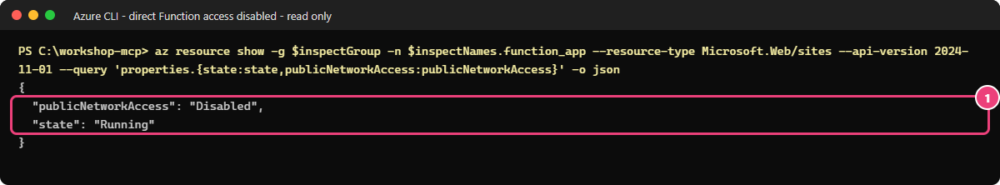

# 04 — Imposer le passage par API Management : low-code, portail d'abord

[English](LOW-CODE.md)

## Objectif

[Guide Terraform + PowerShell](README.fr.md)

Vous allez placer Azure API Management (APIM) devant votre serveur Model Context Protocol (MCP), puis bloquer
l'accès public direct à la Function. Vous vérifierez ensuite qu'Alice peut écrire, que Bob peut lire mais pas écrire
et qu'Eve ne peut pas obtenir de jeton.

## Pourquoi c'est important

L'authentification vérifie l'identité de l'appelant ; l'autorisation détermine ce qu'il peut faire.
La passerelle vérifie l'annuaire (tenant), l'audience du jeton, l'autorisation déléguée (scope) et le rôle d'application.
Elle limite ensuite le débit pour chaque identifiant d'objet utilisateur (Object ID).
Un point de terminaison privé empêche de contourner la passerelle en appelant la Function depuis Internet.
La passerelle et la Function valident le jeton pour la même audience MCP ; ce jeton n'est jamais transmis à Graph ou Storage.

> [!IMPORTANT]
> Publiez le code et vérifiez que la passerelle atteint la Function par le réseau privé avant de désactiver son accès public.
> Les adresses utilisées pour publier le code deviennent privées elles aussi. Ne les rouvrez pas pour contourner un échec.

## Ce que vous déployez

Vous créez une passerelle **Standard v2** d'une unité, et non une instance du niveau AI Gateway.
Vous configurez son intégration réseau sortante, un sous-réseau, un groupe de sécurité réseau, un point de terminaison
privé pour la Function et la résolution des noms (DNS). Vous ajoutez une identité managée, des diagnostics
Application Insights sans contenu, le serveur MCP et ses métadonnées de ressource protégée (PRM), accessibles publiquement.
L'API de gestion MCP `2025-09-01-preview` est en **Preview** (préversion).
La partie B facultative expose une API REST synthétique sous forme de serveur MCP.

**Coût :** Standard v2 est facturé même sans appel. Les points de terminaison privés, le DNS et la télémétrie
ajoutent des coûts. Vérifiez les tarifs et les quotas de la région, obtenez l'accord nécessaire et nettoyez le jour même.

## Prérequis et rôles nécessaires

- [Module 02](../02-open-server/LOW-CODE.fr.md) et [les deux étapes d'authentification du module 03](../03-entra-authentication/LOW-CODE.fr.md) terminés sur les ressources low-code.
- PowerShell 7.4+, Azure CLI, SDK .NET 10, VS Code/Copilot ; terminal à la racine du dépôt.
- Rôle Contributor sur le groupe, avec le droit de rejoindre les sous-réseaux ; autorisation limitée et temporaire
  d'attribuer Monitoring Metrics Publisher sur le seul composant Application Insights. Aucun nouveau rôle Entra.
- Fournisseurs `Microsoft.ApiManagement`, `Microsoft.Network`, `Microsoft.Web` inscrits au module 00. Disponibilité et quota Standard v2 en **Europe Ouest (`westeurope`)** confirmés.
- **Application (client) ID** : **Entra → App registrations → votre API → Overview**. Tenant ID et Subscription ID dans les vues d'ensemble du portail.
- Comptes de test du module 03 : Alice a `Tools.Read` et `Tools.Write`, Bob a seulement `Tools.Read` et Eve n'a aucune attribution.
  Le fichier privé de leurs identifiants d'objet (Object ID) est décrit dans la section Valider.
- Publiez le paquet actuel **avant de désactiver l'accès public de la Function**. Si elle est déjà privée, ne la rouvrez pas : attendez un environnement de publication approuvé dans son réseau privé.

## Étapes

### 1. Recréer le contexte du terminal

Remplacez les trois valeurs entre chevrons par les identifiants relevés dans le portail, pas par les noms des ressources :

```powershell
$tenant = '<tenant-id>'; $sub = '<subscription-id>'; $apiClientId = '<api-application-client-id>'
az login --tenant $tenant
az account set --subscription $sub
$p = Get-Content .\.workshop\participant.tfvars.json -Raw | ConvertFrom-Json
$id = "$($p.participant_prefix)lc"; $sfx = $p.resource_suffix.Substring(0, 10); $loc = 'westeurope'
$rg = "rg-mcp-$id-$sfx"
if ($p.existing_resource_group_name) { $rg = $p.existing_resource_group_name }
$fn = "func-mcp-$id-$sfx"; $ai = "appi-mcp-$id-$sfx"; $law = "log-mcp-$id-$sfx"; $vn = "vnet-mcp-$id-$sfx"
$apim = "apim-mcp-$id-$sfx"; $gwmi = "id-mcp-$id-$sfx-gateway"; $nsg = "nsg-mcp-$id-$sfx-apim"
$svcId = "/subscriptions/$sub/resourceGroups/$rg/providers/Microsoft.ApiManagement/service/$apim"
$rg; $fn; $apim; $vn; $gwmi; $nsg
```

> **Résultat attendu** — le terminal affiche les noms de votre groupe, de votre Function et de votre réseau,
> puis ceux des ressources à créer pour la passerelle. Conservez la convention `lc` ; ne reprenez pas les noms des captures.

### 2. Publier avant de verrouiller la Function

Le portail ne compile pas le projet .NET :

```powershell
dotnet publish .\src\FunctionsMcpServer --configuration Release --output .\.workshop\lowcode-publish
if ($LASTEXITCODE) { throw 'Build failed; stop.' }
Compress-Archive -Path .\.workshop\lowcode-publish\* -DestinationPath .\.workshop\lowcode.zip -Force
az functionapp deployment source config-zip -g $rg -n $fn --src .\.workshop\lowcode.zip -o none
if ($LASTEXITCODE) { throw 'Publish failed; do not lock public access.' }
```

> **Résultat attendu** — code de sortie 0 et cinq fonctions synchronisées. Le paquet contient déjà les outils aval du module 05, encore désactivés.

### 3. Préparer le réseau privé et l'identité dans le portail

1. **Virtual networks → `$vn` → IP addresses** : espace `10.52.0.0/23`. Si le module 02 n'avait pas besoin de réseau privé et que le réseau n'existe pas, **Create** dans votre groupe/West Europe avec cet espace ; retirez le sous-réseau par défaut et ajoutez `snet-private-endpoints`, `10.52.1.0/27`, sans délégation.
2. **Network security groups → Create** : `$nsg`, mêmes groupe/région. **Outbound security rules → Add** : source **VirtualNetwork**, ports source `*`, destination **Service Tag → AzureKeyVault**, port destination **443**, protocole **TCP**, action **Allow**, priorité **100**, nom `AllowKeyVaultOutbound`.
3. Réseau `$vn` → **Subnets → + Subnet** : `snet-apim`, `10.52.0.0/24`, délégation **Microsoft.Web/serverFarms**, groupe de sécurité `$nsg`. Ne réutilisez pas les sous-réseaux Function ou points privés.
4. Function `$fn` → **Networking → Private endpoints → + Add** : `pe-<nom-de-votre-function>`, mêmes groupe/région, sous-ressource **sites**, réseau `$vn`, `snet-private-endpoints`, intégration DNS privée **Yes**, zone `privatelink.azurewebsites.net`. Créez ; vérifiez **Approved**.
5. **Private DNS zones → privatelink.azurewebsites.net → Virtual network links** : lien vers `$vn`, inscription automatique désactivée. **Recordsets** : noms de la Function et de son hôte `scm` pointant vers le point privé.
6. **Managed Identities → Create** : `$gwmi`, mêmes groupe/région. Application Insights `$ai` → **Access control (IAM) → Add role assignment → Monitoring Metrics Publisher → Managed identity**, choisissez `$gwmi`, **Review + assign**, sur ce composant seulement.
7. Sur les nouvelles ressources, étiquettes `workshop=governed-mcp`, `owner`/`expiry` du fichier participant et `track=low-code`.

### 4. Créer Standard v2 et intégrer son réseau sortant

1. **API Management services → Create** : abonnement/groupe, nom `$apim`, **West Europe**, organisation `Governed MCP workshop`, votre contact administrateur approuvé, niveau **Standard v2**, capacité **1**. Pas AI Gateway (préversion).
2. **Managed identity → User assigned** : `$gwmi`. Si absent de l'assistant, ajoutez-la après création dans **Managed identities → User assigned → Add**.
3. Créez puis attendez **Overview → Status = Online** / provisionnement **Succeeded**. Plusieurs minutes sont normales.
4. Service → **Deployment + infrastructure → Network → Outbound traffic → Virtual network integration** : `$vn`, `snet-apim`, **Apply**. Gardez l'entrée publique de la passerelle active. Attendez la réussite.
5. URL affichée : `https://<votre-nom-apim>.azure-api.net`. L'accès public de la Function doit encore être activé.

### 5. Configurer les diagnostics, le backend MCP et les stratégies

Dans le portail, repérez **APIs → MCP Servers → + Create MCP server → Expose an existing MCP server** : source Function, transport **Streamable HTTP**, URL de base `https://<nom-function>.azurewebsites.net/runtime/webhooks`, suffixe `workshop-mcp`. Le bloc ci-dessous applique ensemble le schéma exact en préversion, le lien au backend, la stratégie et les métadonnées publiques. Il évite une API créée dans le portail avec **Source: API** et une liste d'outils vide, et configure les diagnostics par identité avec zéro octet de contenu. Ne créez pas un deuxième serveur sous un autre nom.

La fonction auxiliaire ci-dessous utilise uniquement des fichiers de configuration non secrets dans `.workshop`,
puis les supprime. Elle s'arrête si Azure CLI renvoie un code d'échec :

```powershell
function Put([string]$Path, $Body) {
    $f = Join-Path $PWD '.workshop\lowcode-apim-request.json'
    $reply = "$f.reply"
    [IO.File]::WriteAllText($f, ($Body | ConvertTo-Json -Depth 12 -Compress))
    try {
        az rest --method put --url "https://management.azure.com$svcId/$Path`?api-version=2025-09-01-preview" `
            --body "@$f" --headers 'Content-Type=application/json' --output-file $reply
        if ($LASTEXITCODE) { throw "PUT $Path failed; stop before locking the Function." }
    } finally { Remove-Item $f, $reply -ErrorAction SilentlyContinue }
}
& .\modules\04-governed-gateway\render-policies.ps1 -TenantId $tenant -ApiClientId $apiClientId -GatewayName $apim
$aiInfo = az monitor app-insights component show -g $rg -a $ai --query "{id:id,cs:connectionString}" -o json | ConvertFrom-Json
$gwCid = az identity show -g $rg -n $gwmi --query clientId -o tsv
Put 'loggers/appinsights' @{ properties = @{ loggerType = 'applicationInsights'; resourceId = $aiInfo.id; isBuffered = $true
    credentials = @{ connectionString = $aiInfo.cs; identityClientId = $gwCid } } }
$zero = @{ request = @{ headers = @(); body = @{ bytes = 0 } }; response = @{ headers = @(); body = @{ bytes = 0 } } }
$diag = @{ properties = @{ loggerId = '/loggers/appinsights'; alwaysLog = 'allErrors'; httpCorrelationProtocol = 'W3C'; logClientIp = $false
    verbosity = 'information'; metrics = $true; operationNameFormat = 'Name'; sampling = @{ samplingType = 'fixed'; percentage = 100 }; frontend = $zero; backend = $zero } }
Put 'diagnostics/applicationinsights' $diag
Put 'backends/workshop-mcp-function' @{ properties = @{ description = 'Workshop MCP server on Azure Functions (private endpoint).'
    url = "https://$fn.azurewebsites.net/runtime/webhooks"; protocol = 'http' } }
Put 'apis/workshop-mcp' @{ properties = @{ type = 'mcp'; displayName = 'Workshop MCP server (governed)'; path = 'workshop-mcp'; protocols = @('https')
    serviceUrl = "https://$fn.azurewebsites.net/runtime/webhooks"; backendId = 'workshop-mcp-function'; subscriptionRequired = $false
    mcpProperties = @{ transportType = 'streamable'; endpoints = @{ message = @{ uriTemplate = '/mcp' } } } } }
Put 'apis/workshop-mcp/policies/policy' @{ properties = @{ format = 'rawxml'; value = [IO.File]::ReadAllText("$PWD\.workshop\policy-mcp-server.xml") } }
Put 'apis/workshop-mcp/diagnostics/applicationinsights' $diag
Put 'apis/workshop-mcp-prm' @{ properties = @{ displayName = 'Workshop MCP protected resource metadata'; path = '.well-known/oauth-protected-resource'
    protocols = @('https'); subscriptionRequired = $false } }
Put 'apis/workshop-mcp-prm/operations/get-mcp-metadata' @{ properties = @{ displayName = 'Protected Resource Metadata'; method = 'GET'; urlTemplate = '/workshop-mcp/mcp' } }
Put 'apis/workshop-mcp-prm/operations/get-mcp-metadata/policies/policy' @{ properties = @{ format = 'rawxml'; value = [IO.File]::ReadAllText("$PWD\.workshop\policy-prm.xml") } }
$gw = "https://$apim.azure-api.net"
```

> **Résultat attendu** — cinq fichiers de stratégies générés, puis écritures réussies. **MCP Servers → workshop-mcp** : **Source: MCP server**, pas **API**. **Policies** : validation de jeton, `Tools.Write` pour `create_ticket`, limite par appelant de 30 appels/60 s. Aucune clé d'abonnement. **All APIs → Settings → Diagnostics** et **workshop-mcp → Settings → Diagnostics** : corps requête/réponse frontend/backend **0**, aucun en-tête journalisé. N'augmentez jamais ces valeurs pour diagnostiquer.


*Cette capture réelle provient de l'environnement de test de l'auteur. Sur votre passerelle, vérifiez
Source = MCP server pour workshop-mcp. La deuxième entrée, Source = API, n'apparaît que si vous réalisez la partie B.*

### 6. Vérifier le passage par la passerelle, puis désactiver l'accès public de la Function

Dans VS Code, créez ou vérifiez `.workshop/module03-personas.json` avec les Object ID exacts des utilisateurs Entra :
`{"alice":"<alice-object-id>","bob":"<bob-object-id>","eve":"<eve-object-id>"}`.
Connectez-vous avec **Alice**, pas avec votre compte habituel de déploiement, pour vérifier les cinq outils et l'accès à la Function
avant de désactiver l'accès public :

```powershell
$v = @{ TenantId = $tenant; ResourceGroup = $rg; FunctionApp = $fn; GatewayName = $apim; ApiClientId = $apiClientId
    PersonaObjectIdsPath = '.\.workshop\module03-personas.json'; SkipBuild = $true }
$operatorConfig = $env:AZURE_CONFIG_DIR
try {
    $env:AZURE_CONFIG_DIR = Join-Path $PWD '.workshop\az-alice'
    az login --tenant $tenant --allow-no-subscriptions
    if ($LASTEXITCODE) { throw 'Alice login failed; do not lock the Function.' }
    & .\modules\04-governed-gateway\validate.ps1 @v -Persona Alice
    az logout
} finally {
    if ($null -eq $operatorConfig) { Remove-Item Env:\AZURE_CONFIG_DIR -ErrorAction SilentlyContinue }
    else { $env:AZURE_CONFIG_DIR = $operatorConfig }
}
az account set --subscription $sub
```

> **Résultat attendu** — le validateur confirme le compte d'Alice, liste les cinq outils et affiche `PASS` pour
> la lecture et l'écriture via APIM (HTTP 200). L'écriture crée un ticket synthétique. Arrêtez-vous en cas d'échec.
> Le script rétablit ensuite votre session de déploiement, appelée « opérateur » dans ses messages. Le contrôle du refus d'accès direct ne peut
> réussir qu'**après** le verrouillage.

Quand les contrôles d'Alice réussissent, ouvrez la Function → **Networking → Public network access → Disabled → Save**.
Gardez l'authentification Entra obligatoire. Les points de terminaison de publication deviennent privés eux aussi.
Avant ce verrouillage, vérifiez que la publication a réussi et que le DNS privé et le routage fonctionnent.

### 7. Connecter VS Code uniquement à la passerelle

1. **Ctrl+Shift+P → MCP: Open User Configuration** : remplacez la Function directe et toute entrée de clé par :

```json
{
  "servers": {
    "workshop-governed": { "type": "http", "url": "https://<your-apim-name>.azure-api.net/workshop-mcp/mcp" }
  }
}
```

2. Remplacez la valeur entre chevrons par le nom contenu dans `$apim`. Sélectionnez **Start → Allow**,
   puis connectez-vous à Microsoft avec Alice. Dans **Chat → Agent → Configure Tools**, ne gardez que `workshop-governed`.
3. Demandez : `Appelle create_ticket avec service "ticket-queue", severity "medium", summary "Synthetic Contoso ticket".` Lisez et approuvez l'écriture **une fois**. Attendu : succès.
4. **Profiles: New Profile...** pour Bob, même configuration, connexion avec Bob. Même écriture : **403** ; lecture `get_service_health`, `service "workshop-api"` : **200**. Eve dans un profil séparé : `AADSTS50105`.

## Ce que vous devez voir

La passerelle renvoie **401** sans jeton ou avec une mauvaise audience ; les métadonnées publiques renvoient **200**.
Après verrouillage, l'accès direct à la Function renvoie **403**. L'écriture réussit pour Alice (**200**) et échoue
pour Bob (**403**). La rafale de Bob déclenche **429**. Eve ne peut pas obtenir de jeton (**400/AADSTS50105**).
Aux deux niveaux de diagnostic, vérifiez zéro octet de corps et aucun en-tête journalisé.
Le nombre de requêtes observées peut varier.

### Vérifier vous-même avec Azure CLI

**Pourquoi :** contrôlez le réglage appliqué dans Azure, pas seulement ce que vous avez sélectionné dans le portail.
Faites ce contrôle après avoir désactivé l'accès public à la Function.
Dans PowerShell 7, à la racine du dépôt :

```powershell
$ErrorActionPreference = 'Stop'
$inspectParticipant = Get-Content -LiteralPath .\.workshop\participant.tfvars.json -Raw | ConvertFrom-Json
$inspectId = "$($inspectParticipant.participant_prefix)lc"
$inspectSuffix = $inspectParticipant.resource_suffix.Substring(0, 10)
$inspectGroup = if ($inspectParticipant.existing_resource_group_name) { $inspectParticipant.existing_resource_group_name } else { "rg-mcp-$inspectId-$inspectSuffix" }
$inspectNames = [pscustomobject]@{
    function_app = "func-mcp-$inspectId-$inspectSuffix"
    api_management = "apim-mcp-$inspectId-$inspectSuffix"
}
```

> **Résultat attendu** — aucune sortie : les variables reçoivent les noms de votre déploiement. Vérifiez avec `$inspectNames`.

Copiez cette première commande en lecture seule :

```powershell
az resource show -g $inspectGroup -n $inspectNames.function_app --resource-type Microsoft.Web/sites --api-version 2024-11-01 --query 'properties.{state:state,publicNetworkAccess:publicNetworkAccess}' -o json
if ($LASTEXITCODE -ne 0) { throw "Lecture du réseau de l'application impossible." }
```

> **Résultat attendu** — `Running` et `Disabled`. L'application tourne toujours, sans entrée publique directe.



Vérifiez ensuite la passerelle :

```powershell
az apim show -g $inspectGroup -n $inspectNames.api_management --query '{name:name,sku:sku.name,provisioningState:provisioningState,gatewayUrl:gatewayUrl}' -o json
if ($LASTEXITCODE -ne 0) { throw 'Lecture de la passerelle impossible.' }
```

> **Résultat attendu** — `StandardV2`, `Succeeded` et votre URL de passerelle.


*Captures en lecture seule du 20 octobre 2026. Vos noms low-code comportent `lc` et diffèrent des noms masqués.
Ces propriétés ne prouvent pas le passage réseau ni l'autorisation par outil : poursuivez avec les vérifications HTTP.
Si la Function reste publique, revérifiez le réglage prévu ; ne réactivez pas son accès public pour dépanner la passerelle.*

## Valider

> **Note de validation :** ce guide low-code n'a pas encore été validé de bout en bout en conditions réelles.
> Les captures et résultats issus d'autres exécutions illustrent les contrôles ; ils ne valident pas cette procédure
> ni votre environnement. Exécutez tous les contrôles ci-dessous.

Dans VS Code, vérifiez `.workshop/module03-personas.json` : `{"alice":"<alice-object-id>","bob":"<bob-object-id>","eve":"<eve-object-id>"}`, avec **Entra → Users → chaque compte → Overview → Object ID**. Fichier privé ignoré, aucun mot de passe/jeton.

Dans le terminal où vous utilisez votre compte habituel de déploiement :

```powershell
$v = @{ TenantId = $tenant; ResourceGroup = $rg; FunctionApp = $fn; GatewayName = $apim; ApiClientId = $apiClientId
    PersonaObjectIdsPath = '.\.workshop\module03-personas.json'; SkipBuild = $true }
```

> **Résultat attendu** — aucune sortie : les variables contiennent les paramètres de vos ressources créées dans le portail.
> Aucun état Terraform n'est utilisé.

Après le verrouillage de l'étape 6, lancez les contrôles avec votre compte opérateur, puis avec chacun des comptes de test :

```powershell
& .\modules\04-governed-gateway\validate.ps1 @v -SubscriptionId $sub -LogAnalyticsWorkspace $law
$operatorConfig = $env:AZURE_CONFIG_DIR
try {
    foreach ($persona in 'Alice', 'Bob', 'Eve') {
        Write-Host "Sign in as $persona"
        $env:AZURE_CONFIG_DIR = Join-Path $PWD ".workshop\az-$($persona.ToLower())"
        az login --tenant $tenant --allow-no-subscriptions
        if ($LASTEXITCODE) { throw "Login failed for $persona" }
        & .\modules\04-governed-gateway\validate.ps1 @v -Persona $persona -Burst:($persona -eq 'Bob')
        az logout
    }
} finally {
    if ($null -eq $operatorConfig) { Remove-Item Env:\AZURE_CONFIG_DIR -ErrorAction SilentlyContinue }
    else { $env:AZURE_CONFIG_DIR = $operatorConfig }
}
az account set --subscription $sub
Start-Sleep -Seconds 300
& .\modules\04-governed-gateway\validate.ps1 @v -SubscriptionId $sub -LogAnalyticsWorkspace $law -CheckTelemetry
```

> **Résultat attendu** — tous les contrôles de statut, d'identité et de télémétrie sans contenu affichent `PASS`.
> À chaque connexion, choisissez le compte indiqué et terminez son authentification multifacteur (MFA).
> `-SkipBuild` ignore seulement les tests Terraform partagés. Alice crée un ticket synthétique ; Bob envoie 40 appels.
> Le script restaure votre profil opérateur avant de vérifier la télémétrie.


*Capture réelle existante, pas une preuve d'exécution de ce guide. Sur vos lignes PASS, vérifiez lecture 200, écriture 403 et rafale 429.*

### 8. Partie B facultative — API REST exposée en MCP (préversion)

Cette partie est indépendante du serveur à cinq outils requis pour la suite. Terminez d'abord les étapes 1 à 7,
puis gardez le même terminal, les stratégies générées et la fonction `Put`.
Vous allez créer une API simulée contenant trois tickets synthétiques, exposer deux outils MCP et publier leurs métadonnées.

1. **APIM → APIs → + Add API → HTTP** : nom d'affichage `Contoso Tickets REST API (synthetic, mocked)`, nom `contoso-tickets-api`, suffixe `contoso-tickets`, URL `https://contoso-tickets.invalid`, HTTPS. **Settings** : abonnement requis **Off**.
2. **Design → + Add operation** : ID `list-tickets`, GET `/tickets`, réponse **200**, représentation **application/json**, exemple :

```json
[
  {"id":"CT-1001","title":"VPN gateway reports intermittent timeouts","severity":"high","status":"open","service":"network"},
  {"id":"CT-1002","title":"Shared drive close to its quota","severity":"medium","status":"in-progress","service":"storage"},
  {"id":"CT-1003","title":"Expense app slow at month end","severity":"low","status":"resolved","service":"expense-app"}
]
```

3. Ajoutez `get-ticket`, GET `/tickets/{ticketId}`, paramètre de chemin `ticketId`, chaîne obligatoire. Réponse **200/application/json** : **premier objet uniquement**, pas le tableau. Sauvegardez. **All operations → Inbound processing → Code editor** : collez `.workshop/policy-rest-api.xml`, **Save**. La stratégie authentifie avant la réponse simulée ; le backend `.invalid` n'est pas appelé.
4. **MCP Servers → + Create MCP server → Expose an API as an MCP server** : API ci-dessus, les deux opérations, nom/suffixe `contoso-tickets-mcp`. Outils exactement `list_tickets` et `get_ticket`. Description de `ticketId` : `Ticket ID, for example CT-1001.` Appliquez le mappage et les métadonnées exacts pour éviter les noms générés par le portail :

```powershell
Put 'apis/contoso-tickets-mcp' @{ properties = @{ type = 'mcp'; displayName = 'Contoso Tickets (REST API exposed as MCP)'; path = 'contoso-tickets-mcp'
    protocols = @('https'); subscriptionRequired = $false } }
foreach ($m in @(@('list_tickets', 'list-tickets'), @('get_ticket', 'get-ticket'))) {
    Put "apis/contoso-tickets-mcp/tools/$($m[0])" @{ properties = @{ displayName = $m[0]; description = 'Read synthetic Contoso tickets.'
        operationId = "$svcId/apis/contoso-tickets-api/operations/$($m[1])" } }
}
Put 'apis/contoso-tickets-mcp/policies/policy' @{ properties = @{ format = 'rawxml'; value = [IO.File]::ReadAllText("$PWD\.workshop\policy-rest-mcp-server.xml") } }
Put 'apis/contoso-tickets-mcp/diagnostics/applicationinsights' $diag
Put 'apis/workshop-mcp-prm/operations/get-tickets-metadata' @{ properties = @{ displayName = 'Tickets MCP metadata'; method = 'GET'; urlTemplate = '/contoso-tickets-mcp/mcp' } }
Put 'apis/workshop-mcp-prm/operations/get-tickets-metadata/policies/policy' @{ properties = @{ format = 'rawxml'; value = [IO.File]::ReadAllText("$PWD\.workshop\policy-rest-prm.xml") } }
$b = @{ TenantId = $tenant; ResourceGroup = $rg; GatewayName = $apim; ApiClientId = $apiClientId
    PersonaObjectIdsPath = '.\.workshop\module03-personas.json'; SkipBuild = $true }
& .\modules\04-governed-gateway\validate-rest-mcp.ps1 @b -SubscriptionId $sub
```

> **Résultat attendu** — opérateur PASS : MCP/REST sans jeton 401, mauvaise audience 401, métadonnées 200, deux mappages d'opérations et diagnostics sans contenu.

5. Dans **Tools**, vérifiez qu'il reste exactement deux outils. Retirez toute entrée supplémentaire avant les contrôles
   avec les comptes de test. Connectez-vous successivement avec Alice et Bob :

```powershell
$operatorConfig = $env:AZURE_CONFIG_DIR
try {
    foreach ($persona in 'Alice', 'Bob') {
        Write-Host "Sign in as $persona"
        $env:AZURE_CONFIG_DIR = Join-Path $PWD ".workshop\az-$($persona.ToLower())"
        az login --tenant $tenant --allow-no-subscriptions
        if ($LASTEXITCODE) { throw "Login failed for $persona" }
        & .\modules\04-governed-gateway\validate-rest-mcp.ps1 @b -Persona $persona
        az logout
    }
} finally {
    if ($null -eq $operatorConfig) { Remove-Item Env:\AZURE_CONFIG_DIR -ErrorAction SilentlyContinue }
    else { $env:AZURE_CONFIG_DIR = $operatorConfig }
}
az account set --subscription $sub
```

> **Résultat attendu** — compte conforme à l'Object ID privé, exactement deux outils, trois tickets et lecture de CT-1001 PASS HTTP 200 pour chaque personne ; profil opérateur restauré.

6. Dans VS Code, serveur `contoso-tickets`, type `http`, URL `https://<votre-nom-apim>.azure-api.net/contoso-tickets-mcp/mcp`. Démarrez, connectez Alice/Bob et demandez `Liste les tickets, puis récupère CT-1001`. Attendu : exactement `list_tickets`/`get_ticket`, trois tickets puis CT-1001. REST sans jeton **401**, mauvaise audience **401**, PRM **200**, appels MCP valides **200**. Aucun outil d'écriture.


*Capture illustrative : noms différents. Vérifiez les deux opérations de votre serveur. Source = API en partie B, contrairement à la partie A.*

## Dépannage

- **Le générateur refuse les paramètres :** choisissez entre 5 et 1 000 appels sur une période de 10 à 300 secondes.
  API Management impose le plafond de 300 secondes. L'atelier limite aussi la liste IP facultative à 10 plages IPv4
  en notation CIDR, de `/8` à `/32`, sans zéros superflus dans les adresses. Une liste vide désactive seulement le filtre IP :
  les contrôles du tenant, de l'audience, du client et des rôles restent actifs. Les identifiants vides et une liste
  de clients vide sont refusés. Le débit reste approximatif : les passerelles v2 utilisent un mécanisme de jetons,
  pas un compteur exact des requêtes.
- **Liste d'outils vide :** partie A Source **MCP server**, backend `workshop-mcp-function` et `backendId`. Pas de mappage d'opérations REST pour ce serveur.
- **502/backend inaccessible :** vérifiez intégration sortante, délégation et sécurité du sous-réseau, approbation du point privé, liens et enregistrements DNS. Ne rouvrez pas la Function.
- **401 :** vérifiez tenant, audience, client autorisé et URL PRM de passerelle. Aucune clé d'abonnement ni jeton dans une URL.
- **Bob écrit avec 200 :** arrêtez-vous et vérifiez la stratégie de rôle. Ce n'est pas une réussite.
- **Télémétrie absente :** attendez l'ingestion et vérifiez rôle de l'identité sur le composant et diagnostics aux deux étendues. N'activez jamais le contenu ni les en-têtes.

## Nettoyer

Conservez les ressources uniquement si vous poursuivez immédiatement avec le [module 05 low-code](../05-delegated-and-app-only/LOW-CODE.fr.md).
Sinon, suivez le [module 99 low-code](../99-cleanup/LOW-CODE.fr.md), après avoir vérifié les étiquettes,
les propriétaires et l'accord de suppression. Si vous devez libérer le nom APIM, purgez uniquement votre instance
déjà supprimée. Ne supprimez ni le groupe fourni ni les utilisateurs. N'utilisez pas Terraform pour nettoyer
ces ressources créées dans le portail. Retirez les serveurs de votre configuration VS Code, y compris celui de la partie B.

## Pour aller plus loin

**Question :** APIM refuse l'écriture de Bob, mais il peut encore appeler directement la Function. La passerelle est-elle l'unique entrée ?

<details>
<summary>Afficher la réponse</summary>

Non. Le chemin direct contourne la stratégie de la passerelle. L'exercice est terminé seulement quand l'adresse publique de la Function refuse l'accès et que les appels valides fonctionnent encore via APIM et le point privé.

</details>

Au module 05, comparez deux situations : un appel refusé par la passerelle faute de rôle (HTTP 403)
et un appel accepté par la passerelle, mais refusé ensuite par Storage (erreur d'outil dans une réponse MCP HTTP 200).

## Sources

- [Lire les propriétés d'API Management avec Azure CLI](https://learn.microsoft.com/cli/azure/apim#az-apim-show), vérifié le 20 octobre 2026.

- [Exposer un serveur MCP existant](https://learn.microsoft.com/azure/api-management/expose-existing-mcp-server).
- [Sécuriser MCP](https://learn.microsoft.com/azure/api-management/secure-mcp-servers).
- [Vue d'ensemble et limites](https://learn.microsoft.com/azure/api-management/mcp-server-overview).
- [API de gestion MCP, préversion](https://learn.microsoft.com/azure/api-management/manage-mcp-servers-rest-api).
- [Stratégie de validation Entra](https://learn.microsoft.com/azure/api-management/validate-azure-ad-token-policy).
- [API REST en MCP](https://learn.microsoft.com/azure/api-management/export-rest-mcp-server).
- [Ateliers officiels AI Gateway](https://github.com/Azure-Samples/AI-Gateway).
- [Limites de débit et fonctionnement des passerelles v2](https://learn.microsoft.com/azure/api-management/rate-limit-by-key-policy).
- [Filtrage des adresses IP](https://learn.microsoft.com/azure/api-management/ip-filter-policy).

Dernière vérification : 2026-10-21 (limites relues dans Microsoft Learn et testées hors connexion).
La validation de bout en bout de ce guide low-code reste à effectuer.
