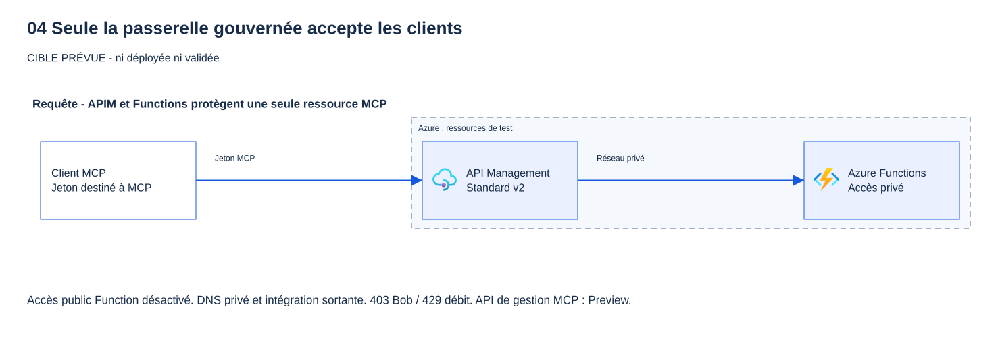
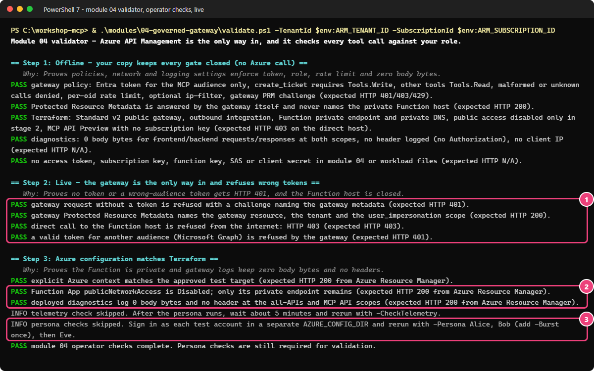
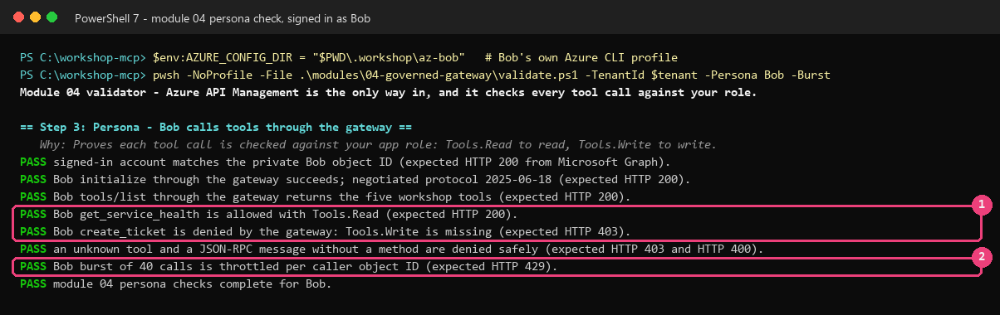
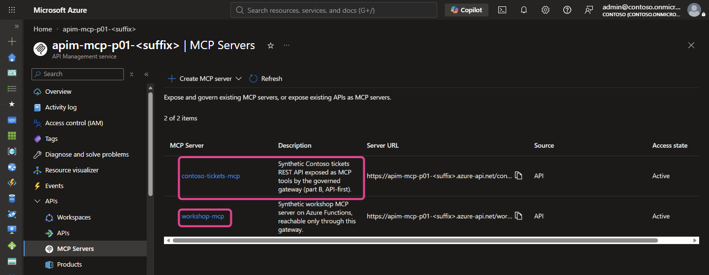
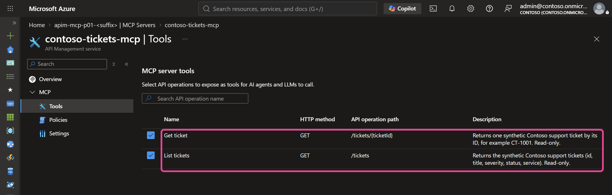
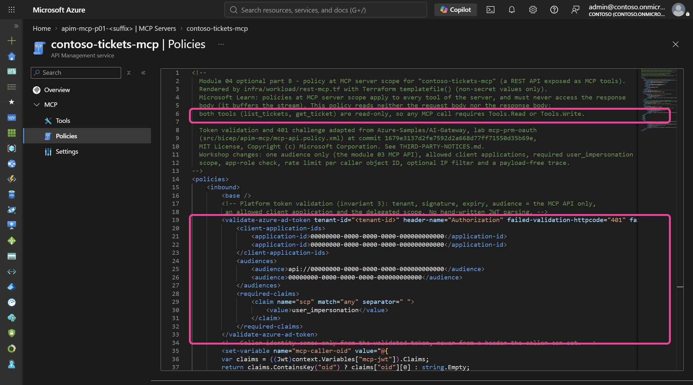
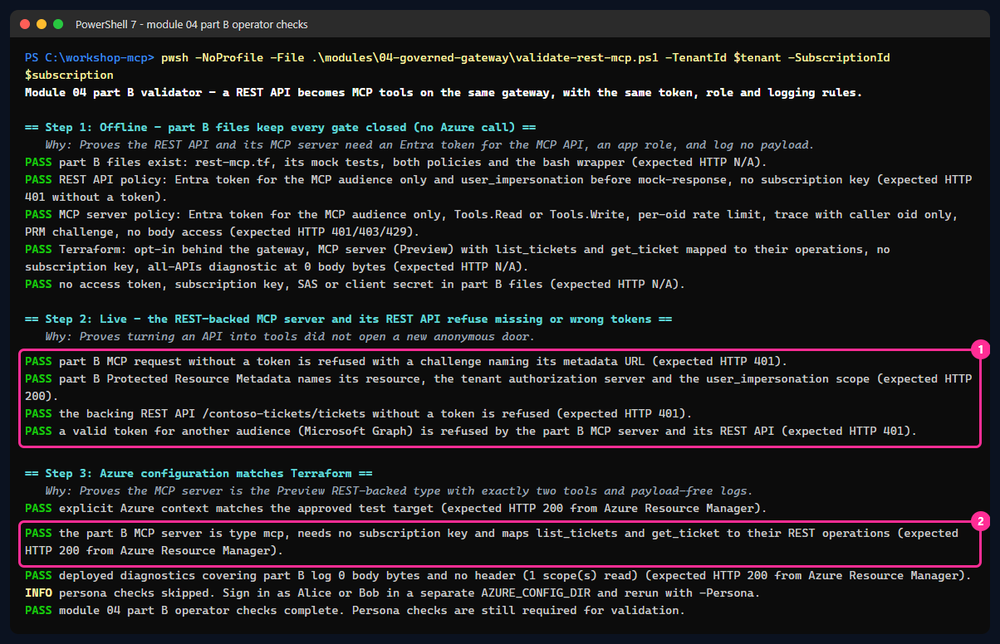
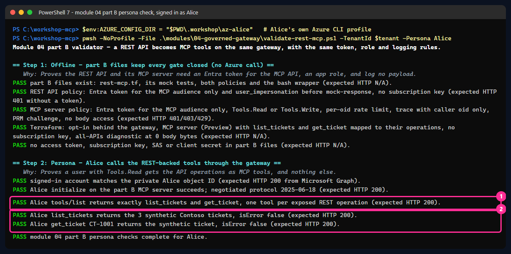

# 04 - API Management comme seule entrée (niveau 2)

[English](README.md)

## Objectif

Placer **Azure API Management** (APIM) devant le serveur MCP et en faire la **seule** porte d'entrée. À la fin :

- une requête sans jeton reçoit **HTTP 401** de la passerelle, avec un défi qui pointe vers les métadonnées de ressource
  protégée (PRM) de la passerelle elle-même ;
- **Bob** (`Tools.Read`) appelle `create_ticket` → **HTTP 403** ; **Alice** (`Tools.Read` + `Tools.Write`) → **HTTP 200** ;
- Bob appelle `get_service_health` → **HTTP 200** ;
- une rafale d'appels d'un même utilisateur → **HTTP 429** ;
- un appel direct à l'hôte de la Function depuis Internet → **HTTP 403** (accès public désactivé) ;
- Application Insights montre qui a appelé quel outil, **sans contenu** ni jeton.

> [!WARNING]
> Ne collez jamais un jeton réel dans un site web, une conversation, un fichier, une capture ou un journal. Le validateur ne garde
> les jetons qu'en mémoire.

## Pourquoi c'est important

Le niveau 1 (module 03) vérifie **qui** appelle le serveur, pas **ce qu'il a le droit de faire** : Bob peut encore créer des
tickets, rien ne limite le débit et la Function est joignable depuis n'importe où sur Internet. Une passerelle apporte les contrôles qu'un
serveur n'a pas à réimplémenter lui-même :

| Contrôle | Où | Pourquoi |
|---|---|---|
| `validate-azure-ad-token` | Entrée de la passerelle | La plateforme valide l'émetteur, le tenant, l'expiration, l'**audience = l'API MCP seulement**, le client autorisé et le scope `user_impersonation`. Aucun code JWT écrit à la main. |
| Contrôle de rôle par outil | Entrée de la passerelle, d'après le corps JSON-RPC | `tools/call` avec `create_ticket` exige le rôle d'application `Tools.Write` ; tout autre outil ou méthode MCP exige `Tools.Read`. La passerelle refuse les corps mal formés, les lots, les outils inconnus et les méthodes non prises en charge. |
| `rate-limit-by-key` | Entrée de la passerelle, clé = identifiant d'objet de l'appelant (`oid`) du jeton validé | Un utilisateur qui envoie trop d'appels reçoit HTTP 429 sans gêner les autres. |
| `ip-filter` | Entrée de la passerelle, facultatif | Limite les adresses sources autorisées si votre organisation l'exige (vide par défaut). |
| Chemin privé | Réseau | L'**accès réseau public** de la Function est **désactivé** et elle dispose d'un **point de terminaison privé** ; seule la passerelle l'atteint, grâce à l'intégration sortante au réseau virtuel de Standard v2. |
| Journaux sans contenu | Application Insights | **0 octet de corps** pour les requêtes et réponses frontend/backend, aucun en-tête journalisé, et une trace limitée au libellé de l'outil et à l'`oid` de l'appelant. |

### Suivre le jeton et le chemin réseau privé

**Scopes et rôles d'application.** La revendication `scp` (`user_impersonation`) indique ce que l'*application cliente* peut
faire pour l'utilisateur. La revendication `roles` (`Tools.Read`, `Tools.Write`) indique ce que *cet utilisateur* peut faire.
L'autorisation par outil utilise les **rôles d'application** ([concept](../../docs/fr/concepts/scopes-and-app-roles.md)).

**Frontière du jeton.** La passerelle et la Function protègent **une seule ressource MCP logique** avec **une seule audience**
(`api://<client-id>`, du module 03). La passerelle valide le jeton puis transmet la **même** requête à la Function, dont
l'authentification intégrée le valide à nouveau (défense en profondeur). Il ne s'agit pas de token passthrough vers une API en aval :
le jeton n'est jamais envoyé à Microsoft Graph, à Storage ni ailleurs, et la passerelle n'ajoute ni n'élargit aucune audience. Pour
les appels en aval, le module 05 obtient des jetons distincts par On-Behalf-Of ou par une identité managée
([chaîne de jetons](../../docs/fr/concepts/token-chain.md)).

**Choix réseau.** Standard v2 conserve une **passerelle publique** pour les clients et utilise l'**intégration sortante au réseau
virtuel** pour appeler un **point de terminaison privé de la Function**, résolu par la zone DNS privée
`privatelink.azurewebsites.net`. L'étape 2 désactive ensuite l'accès public de la Function. Basic v2 n'a pas d'intégration sortante,
et l'injection complète dans un réseau virtuel (Premium v2) dépasse les besoins de l'atelier. Les règles NSG entrantes ne
s'appliquent pas à l'intégration sortante : ce sont les stratégies de la passerelle qui contrôlent l'entrée.

## Ce que vous déployez

Toutes les ressources vont dans le groupe de ressources de l'atelier et reprennent les noms déterministes de vos paramètres
privés. Les variables d'activation valent false par défaut : tant que `enable_governed_gateway` vaut false, les modules 00 à 03 restent inchangés.

| Ressource | Paramètres |
|---|---|
| Réseau virtuel `vnet-mcp-<prefix>-<suffix>` | `10.42.0.0/23` par défaut (`gateway_vnet_address_space`). Déjà présent, avec son sous-réseau de points de terminaison privés, si le module 02 a utilisé `mcp_private_storage` ; le module 04 n'ajoute alors que son propre sous-réseau et son point de terminaison |
| Sous-réseau `snet-apim` + NSG | `/24`, **délégué à `Microsoft.Web/serverFarms`**, réservé à API Management ; NSG avec la règle sortante Key Vault documentée |
| Sous-réseau `snet-private-endpoints` | `/27`, pour le point de terminaison privé de la Function |
| Zone DNS privée `privatelink.azurewebsites.net` + lien | Résout le nom d'hôte de la Function en son adresse IP privée dans le réseau virtuel |
| Point de terminaison privé `pe-mcp-<prefix>-<suffix>-func` | Sous-ressource `sites` ; le groupe de zones écrit les enregistrements de l'application et de `scm` |
| API Management `apim-mcp-<prefix>-<suffix>` | **Standard v2** (`StandardV2_1`), passerelle publique, intégration sortante, identité managée attribuée par l'utilisateur |
| API de serveur MCP `workshop-mcp` | **Preview** (`Microsoft.ApiManagement/service/apis@2025-09-01-preview`, `type: mcp`, `transportType: streamable`), backend `https://<hôte-function>/runtime/webhooks` + `/mcp`, **aucune clé d'abonnement** |
| Stratégie du serveur MCP | [policies/mcp-server.xml](policies/mcp-server.xml) |
| API de métadonnées `.well-known/oauth-protected-resource` | [Métadonnées RFC 9728](policies/protected-resource-metadata.xml) anonymes : ressource de la passerelle, votre tenant, scope `api://<client-id>/user_impersonation` |
| Journaliseur + diagnostics | Application Insights (module 02) via une chaîne de connexion **et l'identité managée de la passerelle** (Monitoring Metrics Publisher sur ce seul composant), 0 octet de corps aux portées « toutes les API » et « API MCP » |
| Function App (module 02) | Étape 2 seulement : `public_network_access_enabled = false` |

La **partie B** facultative (`enable_rest_mcp_demo`, voir Étapes) ajoute une API REST fictive et un second serveur MCP adossé à
cette API REST (**Preview**) sur la même passerelle, avec les mêmes règles de jeton, de rôle, de débit et de journalisation.



L'URL client devient `https://apim-mcp-<prefix>-<suffix>.azure-api.net/workshop-mcp/mcp`. Les clients ne reçoivent
jamais l'URL privée de la Function (le portail facultatif, lui aussi, ne préremplit que l'URL de la passerelle).

**Preview :** le type de ressource « serveur MCP » d'API Management et la version d'API `2025-09-01-preview` sont en **Preview**,
comme les métadonnées de ressource protégée de la Function (module 03). La prise en charge des serveurs MCP est documentée
pour Standard v2 ; l'atelier n'utilise pas le niveau AI Gateway (Preview).

**Coût :** API Management **Standard v2 est une capacité provisionnée facturée à l'heure** tant qu'elle existe, que vous
l'appeliez ou non. Le point de terminaison privé, la zone DNS privée et l'ingestion de télémétrie sont aussi facturés.
**Obtenez l'approbation du coût avant l'étape 1** et nettoyez le jour même. Ce guide n'indique aucun prix : consultez la
calculatrice de prix Azure pour votre région.

## Prérequis et rôles nécessaires

- Modules 02 et 03 (**les deux étapes**) déployés avec les mêmes fichiers privés et le même état Terraform :
  `participant.tfvars.json`, `module02.tfvars.json`, `module03.tfvars.json` (avec `entra_auth_replace_key_gate = true`).
- Comptes de test Alice, Bob et Eve avec leurs attributions de rôles du module 03 ; `.workshop/module03-personas.json`
  (contrôle croisé facultatif).
- Terraform 1.16.6+, Azure CLI, PowerShell 7.4+. Fournisseurs de ressources `Microsoft.ApiManagement`, `Microsoft.Network` et
  `Microsoft.Web` inscrits (le contrôle préalable du module 00 vérifie l'inscription).
- La région doit proposer Standard v2 (exemple : `swedencentral`) ; vérifiez la disponibilité et les quotas avant de commencer.

**Participant :** Contributeur sur le groupe de ressources de l'atelier, plus le droit de créer une attribution de rôle limitée
au composant Application Insights (par exemple Role Based Access Control Administrator, restreint à Monitoring Metrics
Publisher, limité dans le temps). Le rôle Contributeur sur le groupe inclut déjà le droit de rejoindre le sous-réseau
(`Microsoft.Network/virtualNetworks/subnets/join/action`). Ce module ne modifie **rien dans Microsoft Entra**.

## Étapes

> [!TIP]
> **Deux parcours, même résultat.** Suivez le même parcours qu'aux modules 02 et 03 ([comment choisir](../../docs/fr/TRACKS.md)) : le **parcours low-code** ci-dessous, ou le **parcours full-code** (sections PowerShell et Bash).

### Parcours low-code (portail et commandes simples)

Standard v2 est facturé à l'heure : construisez, vérifiez et nettoyez le même jour. Un seul terminal de L1 à la fin.

**L1. Les noms, l'ID client de l'API du module 03, et une fonction d'aide.**

```powershell
$p = Get-Content .\.workshop\participant.tfvars.json -Raw | ConvertFrom-Json
$id = "$($p.participant_prefix)lc"; $sfx = $p.resource_suffix.Substring(0, 10); $loc = 'westeurope'
$rg = "rg-mcp-$id-$sfx"; $fn = "func-mcp-$id-$sfx"; $ai = "appi-mcp-$id-$sfx"; $law = "log-mcp-$id-$sfx"; $vn = "vnet-mcp-$id-$sfx"
$apim = "apim-mcp-$id-$sfx"; $gwmi = "id-mcp-$id-$sfx-gateway"; $nsg = "nsg-mcp-$id-$sfx-apim"
$tags = @('workshop=governed-mcp', "owner=$($p.owner)", "expiry=$($p.expiry)", 'track=low-code')
$tenant = az account show --query tenantId -o tsv; $sub = az account show --query id -o tsv
$apiClientId = az ad app list --display-name "Workshop MCP API ($id-$sfx)" --query "[0].appId" -o tsv
$svcId = "/subscriptions/$sub/resourceGroups/$rg/providers/Microsoft.ApiManagement/service/$apim"
# One helper for the API Management calls: it writes the reply to a file (API Management answers policies in XML).
function Put([string]$Path, $Body) {
    $f = New-TemporaryFile; [IO.File]::WriteAllText($f, ($Body | ConvertTo-Json -Depth 12 -Compress))
    az rest --method put --url "https://management.azure.com$svcId/$Path`?api-version=2025-09-01-preview" --body "@$f" `
        --headers 'Content-Type=application/json' --output-file "$f.reply" 2>&1 | Out-Null
    $code = $LASTEXITCODE; Remove-Item $f, "$f.reply" -ErrorAction SilentlyContinue; if ($code) { throw "PUT $Path failed" }
}
```

> **Résultat attendu** — aucune sortie. `$apiClientId` contient un GUID : s'il est vide, terminez d'abord le module 03.

**L2. Le réseau de la passerelle, le point de terminaison privé de la Function, l'identité de la passerelle.** Portail : réseau virtuel → **Sous-réseaux** → **+ Sous-réseau** `snet-apim` (délégué à *Microsoft.Web/serverFarms*, avec un NSG qui autorise TCP 443 sortant vers *AzureKeyVault*) ; Function App → **Mise en réseau** → **Points de terminaison privés** → **+ Ajouter** dans `snet-private-endpoints` avec DNS privé ; **Identités managées** → **Créer**, puis sur Application Insights **Contrôle d'accès (IAM)** → *Monitoring Metrics Publisher* pour elle.

```powershell
az network nsg create -g $rg -n $nsg --tags @tags -o none
az network nsg rule create -g $rg --nsg-name $nsg -n AllowKeyVaultOutbound --priority 100 --direction Outbound --access Allow --protocol Tcp `
    --source-address-prefixes VirtualNetwork --destination-address-prefixes AzureKeyVault --destination-port-ranges 443 -o none
az network vnet subnet create -g $rg --vnet-name $vn -n snet-apim --address-prefixes 10.52.0.0/24 --delegations Microsoft.Web/serverFarms --network-security-group $nsg -o none
az network private-dns zone create -g $rg -n privatelink.azurewebsites.net -o none
az network private-dns link vnet create -g $rg -z privatelink.azurewebsites.net -n link-sites -v $vn -e false -o none
$fnId = az functionapp show -g $rg -n $fn --query id -o tsv
az network private-endpoint create -g $rg -n "pe-$fn" --vnet-name $vn --subnet snet-private-endpoints --private-connection-resource-id $fnId --group-id sites --connection-name pe-sites -o none
az network private-endpoint dns-zone-group create -g $rg --endpoint-name "pe-$fn" -n default --private-dns-zone privatelink.azurewebsites.net --zone-name sites -o none
az identity create -g $rg -n $gwmi --tags @tags -o none
$aiId = az monitor app-insights component show -g $rg -a $ai --query id -o tsv; $gwPid = az identity show -g $rg -n $gwmi --query principalId -o tsv
az role assignment create --assignee-object-id $gwPid --assignee-principal-type ServicePrincipal --role 'Monitoring Metrics Publisher' --scope $aiId -o none
az network private-endpoint show -g $rg -n "pe-$fn" --query "privateLinkServiceConnections[0].privateLinkServiceConnectionState.status" -o tsv
```

> **Résultat réel** — parcours low-code, 2026-10-20, tenant de test de l'auteur.
>
> ```text
> Approved
> ```

**L3. API Management Standard v2.** Portail : **Créer une ressource** → **API Management** → niveau tarifaire **Standard v2** ; **Mise en réseau** : *Intégration au réseau virtuel*, sous-réseau `snet-apim` ; **Identité managée** : l'identité de la passerelle.

```powershell
$gwId = az identity show -g $rg -n $gwmi --query id -o tsv; $snet = az network vnet subnet show -g $rg --vnet-name $vn -n snet-apim --query id -o tsv
$f = New-TemporaryFile
@{ location = $loc; sku = @{ name = 'StandardV2'; capacity = 1 }; tags = @{ workshop = 'governed-mcp'; owner = $p.owner; expiry = $p.expiry; track = 'low-code' }
   identity = @{ type = 'UserAssigned'; userAssignedIdentities = @{ $gwId = @{} } }
   properties = @{ publisherName = 'Governed MCP workshop'; publisherEmail = 'mcp-workshop@example.com'; virtualNetworkType = 'External'
                   virtualNetworkConfiguration = @{ subnetResourceId = $snet } } } | ConvertTo-Json -Depth 6 | Set-Content $f
az rest --method put --url "https://management.azure.com$svcId`?api-version=2024-05-01" --body "@$f" --headers 'Content-Type=application/json' -o none; Remove-Item $f
do { Start-Sleep 20; $state = az apim show -g $rg -n $apim --query provisioningState -o tsv } while ($state -notin 'Succeeded', 'Failed')
$state
```

> **Résultat réel** — parcours low-code, 2026-10-20 : `Succeeded` après 126 secondes.

**L4. Une journalisation sans contenu.** Portail : API Management → **Supervision** → **Application Insights** → **+ Ajouter** (identité managée) ; **API** → **Toutes les API** → **Paramètres** → **Journaux de diagnostic** : Application Insights, échantillonnage 100 %, *Nombre d'octets de charge utile à journaliser* **0** en frontend et en backend, aucun en-tête.

```powershell
$aiInfo = az monitor app-insights component show -g $rg -a $ai --query "{id:id,cs:connectionString}" -o json | ConvertFrom-Json
$gwCid = az identity show -g $rg -n $gwmi --query clientId -o tsv
Put 'loggers/appinsights' @{ properties = @{ loggerType = 'applicationInsights'; resourceId = $aiInfo.id; isBuffered = $true
    credentials = @{ connectionString = $aiInfo.cs; identityClientId = $gwCid } } }
$zero = @{ request = @{ headers = @(); body = @{ bytes = 0 } }; response = @{ headers = @(); body = @{ bytes = 0 } } }
$diag = @{ properties = @{ loggerId = '/loggers/appinsights'; alwaysLog = 'allErrors'; httpCorrelationProtocol = 'W3C'; logClientIp = $false
    verbosity = 'information'; metrics = $true; operationNameFormat = 'Name'; sampling = @{ samplingType = 'fixed'; percentage = 100 }; frontend = $zero; backend = $zero } }
Put 'diagnostics/applicationinsights' $diag
```

> **Résultat attendu** — aucune sortie.

**L5. Le serveur MCP, sa stratégie et ses métadonnées.** Portail : **MCP Servers** → **+ Create MCP server** → **Expose an existing MCP server** : URL de base `https://<function>.azurewebsites.net/runtime/webhooks`, transport **Streamable HTTP**, nom `workshop-mcp`. Puis le serveur → **Policies** → collez `.workshop/policy-mcp-server.xml` (produit par `render-policies.ps1` à partir des mêmes modèles que Terraform). La commande ci-dessous fait les deux, plus l'API de métadonnées anonyme.

```powershell
& .\modules\04-governed-gateway\render-policies.ps1 -TenantId $tenant -ApiClientId $apiClientId -GatewayName $apim
Put 'backends/workshop-mcp-function' @{ properties = @{ description = 'Workshop MCP server on Azure Functions (private endpoint).'
    url = "https://$fn.azurewebsites.net/runtime/webhooks"; protocol = 'http' } }
Put 'apis/workshop-mcp' @{ properties = @{ type = 'mcp'; displayName = 'Workshop MCP server (governed)'; path = 'workshop-mcp'; protocols = @('https')
    serviceUrl = "https://$fn.azurewebsites.net/runtime/webhooks"; backendId = 'workshop-mcp-function'; subscriptionRequired = $false
    mcpProperties = @{ transportType = 'streamable'; endpoints = @{ message = @{ uriTemplate = '/mcp' } } } } }
Put 'apis/workshop-mcp/policies/policy' @{ properties = @{ format = 'rawxml'; value = [IO.File]::ReadAllText("$PWD\.workshop\policy-mcp-server.xml") } }
Put 'apis/workshop-mcp/diagnostics/applicationinsights' $diag
Put 'apis/workshop-mcp-prm' @{ properties = @{ displayName = 'Workshop MCP protected resource metadata'; path = '.well-known/oauth-protected-resource'
    protocols = @('https'); subscriptionRequired = $false } }
Put 'apis/workshop-mcp-prm/operations/get-mcp-metadata' @{ properties = @{ displayName = 'Protected Resource Metadata'; method = 'GET'; urlTemplate = '/workshop-mcp/mcp' } }
Put 'apis/workshop-mcp-prm/operations/get-mcp-metadata/policies/policy' @{ properties = @{ format = 'rawxml'; value = [IO.File]::ReadAllText("$PWD\.workshop\policy-prm.xml") } }
$gw = "https://$apim.azure-api.net"
$r = Invoke-WebRequest "$gw/workshop-mcp/mcp" -Method Post -ContentType 'application/json' -SkipHttpErrorCheck `
    -Body '{"jsonrpc":"2.0","id":1,"method":"initialize","params":{"protocolVersion":"2025-06-18","capabilities":{},"clientInfo":{"name":"t","version":"1"}}}'
"gateway no token: $($r.StatusCode)"; "metadata: $((Invoke-WebRequest "$gw/.well-known/oauth-protected-resource/workshop-mcp/mcp" -SkipHttpErrorCheck).StatusCode)"
```

> **Résultat réel** — parcours low-code, 2026-10-20, tenant de test de l'auteur.
>
> ```text
> PASS 5 policies rendered for https://apim-mcp-p01lc-<sfx>.azure-api.net with 2 allowed client(s) and 0 IP range(s) in .workshop/ ...
> gateway no token: 401
> metadata: 200
> ```
>
> Avec `az rest`, API Management répond en XML à l'écriture d'une stratégie, ce qui fait planter l'affichage d'Azure CLI sous Windows : la fonction `Put` écrit la réponse dans un fichier.

**L6. Fermer la Function, puis vérifier en opérateur, en tant qu'Alice, Bob et Eve, et les journaux.** Portail : Function App → **Mise en réseau** → **Accès réseau public** → **Désactivé**.

```powershell
az resource update -g $rg -n $fn --resource-type Microsoft.Web/sites --set properties.publicNetworkAccess=Disabled -o none
$v = @{ TenantId = $tenant; ResourceGroup = $rg; FunctionApp = $fn; GatewayName = $apim; ApiClientId = $apiClientId }
& .\modules\04-governed-gateway\validate.ps1 @v -SubscriptionId $sub -LogAnalyticsWorkspace $law
foreach ($persona in 'Alice', 'Bob', 'Eve') {
    $env:AZURE_CONFIG_DIR = Join-Path $PWD ".workshop\az-$($persona.ToLower())"
    az login --tenant $tenant --allow-no-subscriptions   # sign in as $persona in the browser
    & .\modules\04-governed-gateway\validate.ps1 @v -Persona $persona -Burst:($persona -eq 'Bob')
    az logout
}
Remove-Item Env:\AZURE_CONFIG_DIR
Start-Sleep -Seconds 300   # telemetry ingestion delay
& .\modules\04-governed-gateway\validate.ps1 @v -SubscriptionId $sub -LogAnalyticsWorkspace $law -CheckTelemetry
```

> **Résultat réel** — parcours low-code, 2026-10-20, tenant de test de l'auteur (extrait).
>
> ```text
> PASS gateway request without a token is refused with a challenge naming the gateway metadata (expected HTTP 401).
> PASS direct call to the Function host is refused from the internet: HTTP 403 (expected HTTP 403).
> PASS Function App publicNetworkAccess is Disabled; only its private endpoint remains (expected HTTP 200 from Azure Resource Manager).
> PASS deployed diagnostics log 0 body bytes and no header at the all-APIs and MCP API scopes (expected HTTP 200 from Azure Resource Manager).
> PASS Alice create_ticket is allowed with Tools.Write and queues one synthetic ticket (expected HTTP 200).
> PASS Bob create_ticket is denied by the gateway: Tools.Write is missing (expected HTTP 403).
> PASS Bob burst of 40 calls is throttled per caller object ID (expected HTTP 429).
> PASS Eve cannot obtain a token, so she never reaches the gateway (expected HTTP 400 from the token endpoint, AADSTS50105).
> PASS Application Insights: 89 gateway requests and 47 tool traces with tool label and caller oid, no body, argument or token (expected HTTP 200 from Log Analytics).
> ```

**L-B. Partie B facultative en low-code : une API REST exposée en MCP.** Portail : **API** → **+ Ajouter une API** → **HTTP**, deux opérations GET avec un exemple de réponse, stratégie depuis `.workshop/policy-rest-api.xml` ; puis **MCP Servers** → **+ Create MCP server** → **Expose an API as an MCP server**, choisissez les deux opérations, stratégie depuis `.workshop/policy-rest-mcp-server.xml`.

```powershell
$tickets = @(
    @{ id = 'CT-1001'; title = 'VPN gateway reports intermittent timeouts'; severity = 'high'; status = 'open'; service = 'network' },
    @{ id = 'CT-1002'; title = 'Shared drive close to its quota'; severity = 'medium'; status = 'in-progress'; service = 'storage' },
    @{ id = 'CT-1003'; title = 'Expense app slow at month end'; severity = 'low'; status = 'resolved'; service = 'expense-app' })
Put 'apis/contoso-tickets-api' @{ properties = @{ type = 'http'; displayName = 'Contoso Tickets REST API (synthetic, mocked)'; path = 'contoso-tickets'
    protocols = @('https'); serviceUrl = 'https://contoso-tickets.invalid'; subscriptionRequired = $false } }
$ops = @{
    'list-tickets' = @{ name = 'List tickets'; desc = 'Returns the synthetic Contoso support tickets (id, title, severity, status, service). Read-only.'; url = '/tickets'; params = @(); example = $tickets }
    'get-ticket' = @{ name = 'Get ticket'; desc = 'Returns one synthetic Contoso support ticket by its ID, for example CT-1001. Read-only.'; url = '/tickets/{ticketId}'
        params = @(@{ name = 'ticketId'; type = 'string'; required = $true; description = 'Ticket ID, for example CT-1001.' }); example = $tickets[0] } }
foreach ($k in $ops.Keys) {
    $o = $ops[$k]
    Put "apis/contoso-tickets-api/operations/$k" @{ properties = @{ displayName = $o.name; description = $o.desc; method = 'GET'; urlTemplate = $o.url; templateParameters = $o.params
        responses = @(@{ statusCode = 200; description = 'Synthetic tickets (mocked).'
            representations = @(@{ contentType = 'application/json'; examples = @{ default = @{ summary = 'Synthetic Contoso data'; value = $o.example } } }) }) } }
}
Put 'apis/contoso-tickets-api/policies/policy' @{ properties = @{ format = 'rawxml'; value = [IO.File]::ReadAllText("$PWD\.workshop\policy-rest-api.xml") } }
Put 'apis/contoso-tickets-mcp' @{ properties = @{ type = 'mcp'; displayName = 'Contoso Tickets (REST API exposed as MCP)'; path = 'contoso-tickets-mcp'
    protocols = @('https'); subscriptionRequired = $false } }
foreach ($m in @(@('list_tickets', 'list-tickets'), @('get_ticket', 'get-ticket'))) {
    Put "apis/contoso-tickets-mcp/tools/$($m[0])" @{ properties = @{ displayName = $m[0]; description = $ops[$m[1]].desc
        operationId = "$svcId/apis/contoso-tickets-api/operations/$($m[1])" } }
}
Put 'apis/contoso-tickets-mcp/policies/policy' @{ properties = @{ format = 'rawxml'; value = [IO.File]::ReadAllText("$PWD\.workshop\policy-rest-mcp-server.xml") } }
Put 'apis/workshop-mcp-prm/operations/get-rest-mcp-metadata' @{ properties = @{ displayName = 'Protected Resource Metadata (Contoso Tickets MCP)'; method = 'GET'; urlTemplate = '/contoso-tickets-mcp/mcp' } }
Put 'apis/workshop-mcp-prm/operations/get-rest-mcp-metadata/policies/policy' @{ properties = @{ format = 'rawxml'; value = [IO.File]::ReadAllText("$PWD\.workshop\policy-rest-prm.xml") } }
& .\modules\04-governed-gateway\validate-rest-mcp.ps1 -TenantId $tenant -SubscriptionId $sub -ResourceGroup $rg -GatewayName $apim -ApiClientId $apiClientId
```

> **Résultat réel** — parcours low-code, 2026-10-20 (extrait ; les vérifications par persona utilisent `-Persona Alice` ou `-Persona Bob` avec les mêmes paramètres).
>
> ```text
> PASS part B MCP request without a token is refused with a challenge naming its metadata URL (expected HTTP 401).
> PASS the backing REST API /contoso-tickets/tickets without a token is refused (expected HTTP 401).
> PASS the part B MCP server is type mcp, needs no subscription key and maps list_tickets and get_ticket to their REST operations (expected HTTP 200 from Azure Resource Manager).
> PASS module 04 part B operator checks complete. Persona checks are still required for validation.
> ...
> PASS Alice list_tickets returns the 3 synthetic Contoso tickets, isError false (expected HTTP 200).
> PASS Bob get_ticket CT-1001 returns the synthetic ticket, isError false (expected HTTP 200).
> ```
>
> **Ce que cela signifie pour vous :** la même passerelle gouvernée que dans le parcours full-code, construite à la main. Continuez avec le parcours low-code du module 05.

### PowerShell

Exécutez les commandes depuis la racine du dépôt. Les étapes 2 à 4 modifient Azure : ne les exécutez qu'après approbation du plan **et du coût**.

**1. Vérifications hors ligne (sans Azure).**

```powershell
& .\modules\04-governed-gateway\validate.ps1 -Offline
```

> **Résultat attendu** — d'après les messages du validateur ; pas encore capturé lors de l'exécution d'un participant.
>
> ```text
> PASS gateway policy: Entra token for the MCP audience only, create_ticket requires Tools.Write, other tools Tools.Read, malformed or unknown calls denied, per-oid rate limit, optional ip-filter, gateway PRM challenge (expected HTTP 401/403/429).
> PASS Protected Resource Metadata is answered by the gateway itself and never names the private Function host (expected HTTP 200).
> PASS Terraform: Standard v2 public gateway, outbound integration, Function private endpoint and private DNS, public access disabled only in stage 2, MCP API Preview with no subscription key (expected HTTP 403 on the direct host).
> PASS diagnostics: 0 body bytes for frontend/backend requests/responses at both scopes, no header logged (no Authorization), no client IP (expected HTTP N/A).
> PASS no access token, subscription key, function key, SAS or client secret in module 04 or workload files (expected HTTP N/A).
> PASS Terraform format, schema and mock-only plans for infra/entra and infra/workload (expected HTTP N/A; no live plan/apply).
> NOT DEPLOYED CHECKS SKIPPED: supply -TenantId with -SubscriptionId (operator) or -Persona (test account) after an approved deployment.
> PASS offline checks only. Module 04 is NOT deployed or validated by this result.
> ```
>
> **Ce que cela signifie pour vous :** les stratégies et le code Terraform de votre copie conservent les contrôles du module 04.
> Rien n'a été déployé ; une ligne `FAIL` indique le fichier ou la règle à corriger avant de payer Standard v2.

**2. Fichier d'activation privé (ignoré par Git).** Facultatif : ajoutez `gateway_allowed_ip_ranges` (liste CIDR) ou modifiez
`gateway_rate_limit_calls` / `gateway_rate_limit_period`. Pour `gateway_publisher_email`, utilisez une adresse d'équipe ou une
adresse d'exemple.

```powershell
@{ enable_governed_gateway = $true; gateway_lock_function = $false } | ConvertTo-Json | Set-Content -LiteralPath .\.workshop\module04.tfvars.json
```

> **Résultat attendu** — aucune sortie : `Set-Content` rend la main en silence en cas de succès.
> Vérifiez avec `Get-Content .\.workshop\module04.tfvars.json` : `enable_governed_gateway` vaut true et `gateway_lock_function` false.

**3. Étape 1 : passerelle, point de terminaison privé et DNS privé.** Sélectionnez d'abord votre contexte approuvé
(`& .\scripts\select-azure-context.ps1`). Désormais, passez toujours les quatre fichiers de variables.

```powershell
$vars = '-var-file=..\..\.workshop\participant.tfvars.json', '-var-file=..\..\.workshop\module02.tfvars.json',
        '-var-file=..\..\.workshop\module03.tfvars.json', '-var-file=..\..\.workshop\module04.tfvars.json'
terraform '-chdir=infra\workload' init -lockfile=readonly
terraform '-chdir=infra\workload' plan @vars '-out=..\..\.workshop\module04.tfplan'
if ($LASTEXITCODE -ne 0) { throw 'Terraform plan failed.' }
# Relire : environ 20 ajouts (réseau, DNS, point de terminaison privé, API Management, le backend de la Function, API,
# stratégies, journaliseur, diagnostics, identité et une attribution de rôle) et la mise à jour en place connue des app_settings. Puis, après approbation :
terraform '-chdir=infra\workload' apply '..\..\.workshop\module04.tfplan'
```

> **Résultat réel** — extraits du plan et de l'apply de l'étape 1, 2026-10-18, tenant de test de l'auteur. Noms et ID masqués.
> Le premier apply s'est arrêté sur une erreur de l'API Preview ; la seconde exécution a eu lieu après la correction Terraform.
>
> ```text
> Plan: 17 to add, 3 to change, 0 to destroy.
> ...
> azurerm_service_plan.portal[0]: Modifications complete after 25s [id=/subscriptions/<subscription-id>/resourceGroups/rg-mcp-p01-<suffix>/providers/Microsoft.Web/serverFarms/plan-mcp-p01-<suffix>-portal]
> ...
> azurerm_function_app_flex_consumption.mcp[0]: Modifications complete after 46s [id=/subscriptions/<subscription-id>/resourceGroups/rg-mcp-p01-<suffix>/providers/Microsoft.Web/sites/func-mcp-p01-<suffix>]
> ...
> azurerm_api_management.gateway[0]: Creation complete after 2m25s [id=/subscriptions/<subscription-id>/resourceGroups/rg-mcp-p01-<suffix>/providers/Microsoft.ApiManagement/service/apim-mcp-p01-<suffix>]
> ...
> azurerm_private_endpoint.function[0]: Creation complete after 2m6s [id=/subscriptions/<subscription-id>/resourceGroups/rg-mcp-p01-<suffix>/providers/Microsoft.Network/privateEndpoints/pe-mcp-p01-<suffix>-func]
> Error: Failed to create/update resource
> ERROR CODE: ValidationError
> ...
>         "message": "Parsing error(s): An error occured while parsing the input. Message: Cannot deserialize the current JSON array (e.g. [1,2,3]) into type 'System.Collections.Generic.Dictionary`2[System.String,Microsoft.Azure.ApiManagement.Management.Contracts.McpEndpointContract]' because the type requires a JSON object (e.g. {\"name\":\"value\"}) to deserialize correctly. ... Path 'mcpProperties.endpoints', line 5, position 18."
> ```
>
> ```text
> Plan: 3 to add, 2 to change, 0 to destroy.
> azapi_resource.prm_operation_policy[0]: Modifications complete after 2s [id=/subscriptions/<subscription-id>/resourceGroups/rg-mcp-p01-<suffix>/providers/Microsoft.ApiManagement/service/apim-mcp-p01-<suffix>/apis/workshop-mcp-prm/operations/get-mcp-metadata/policies/policy]
> azurerm_function_app_flex_consumption.mcp[0]: Modifications complete after 47s [id=/subscriptions/<subscription-id>/resourceGroups/rg-mcp-p01-<suffix>/providers/Microsoft.Web/sites/func-mcp-p01-<suffix>]
> azapi_resource.mcp_api[0]: Creation complete after 3s [id=/subscriptions/<subscription-id>/resourceGroups/rg-mcp-p01-<suffix>/providers/Microsoft.ApiManagement/service/apim-mcp-p01-<suffix>/apis/workshop-mcp]
> azapi_resource.mcp_api_policy[0]: Creation complete after 2s [id=/subscriptions/<subscription-id>/resourceGroups/rg-mcp-p01-<suffix>/providers/Microsoft.ApiManagement/service/apim-mcp-p01-<suffix>/apis/workshop-mcp/policies/policy]
> azapi_resource.mcp_api_diagnostic[0]: Creation complete after 2s [id=/subscriptions/<subscription-id>/resourceGroups/rg-mcp-p01-<suffix>/providers/Microsoft.ApiManagement/service/apim-mcp-p01-<suffix>/apis/workshop-mcp/diagnostics/applicationinsights]
> Apply complete! Resources: 3 added, 2 changed, 0 destroyed.
> ```
>
> **Ce que cela signifie pour vous :** la passerelle, son chemin privé et sa journalisation sans contenu sont en place.
> La création de l'instance Standard v2 a pris environ 2 min 30. Le premier apply de l'auteur a échoué sur
> `mcpProperties.endpoints` : le service Preview attend une table indexée par nom, et non le tableau de la référence publiée.
> Votre copie de `infra/workload/gateway.tf` envoie déjà cette table : un seul apply doit suffire. Si vous voyez cette
> erreur, consultez Dépannage. Le plan de l'auteur comptait 17 ajouts, car le module 02 avait déjà créé le réseau virtuel,
> et **3** modifications : les paramètres de la Function App, plus deux sur le portail facultatif (son plan est revenu en
> B1 et son paramètre `WORKSHOP_MCP_ENDPOINT` pointe désormais vers la passerelle). Sans portail, attendez-vous à
> 1 modification. Si votre plan affiche aussi le plan du portail, consultez Dépannage. La mise à jour en place répétée de
> `prm_operation_policy` est une normalisation connue des espaces dans la stratégie azapi (aucun changement fonctionnel).
> Si le plan affiche `to destroy`, il manque un fichier de variables : n'appliquez pas.

La création d'une instance Standard v2 prend plusieurs minutes. La Function est encore publique mais exige toujours un jeton
Entra (module 03) : rien n'est anonyme pendant l'étape 1. Testez l'URL de la passerelle
(`terraform -chdir=infra/workload output gateway_mcp_endpoint`) dans VS Code avant l'étape 2.

**4. Étape 2 : verrouiller la Function.** Seul le point de terminaison privé subsiste.

```powershell
$v = Get-Content -LiteralPath .\.workshop\module04.tfvars.json -Raw | ConvertFrom-Json
$v.gateway_lock_function = $true
$v | ConvertTo-Json | Set-Content -LiteralPath .\.workshop\module04.tfvars.json
terraform '-chdir=infra\workload' plan @vars '-out=..\..\.workshop\module04.tfplan'
# Relire : une mise à jour en place de la Function App (public_network_access_enabled = false). Après approbation :
terraform '-chdir=infra\workload' apply '..\..\.workshop\module04.tfplan'
```

> **Résultat réel** — extrait du plan et de l'apply de l'étape 2, 2026-10-18, tenant de test de l'auteur. Noms et ID masqués.
>
> ```text
> Plan: 0 to add, 3 to change, 0 to destroy.
> ...
> azapi_resource.prm_operation_policy[0]: Modifications complete after 1s [id=/subscriptions/<subscription-id>/resourceGroups/rg-mcp-p01-<suffix>/providers/Microsoft.ApiManagement/service/apim-mcp-p01-<suffix>/apis/workshop-mcp-prm/operations/get-mcp-metadata/policies/policy]
> azurerm_function_app_flex_consumption.mcp[0]: Modifications complete after 48s [id=/subscriptions/<subscription-id>/resourceGroups/rg-mcp-p01-<suffix>/providers/Microsoft.Web/sites/func-mcp-p01-<suffix>]
> azapi_resource.mcp_api_policy[0]: Modifications complete after 1s [id=/subscriptions/<subscription-id>/resourceGroups/rg-mcp-p01-<suffix>/providers/Microsoft.ApiManagement/service/apim-mcp-p01-<suffix>/apis/workshop-mcp/policies/policy]
> Apply complete! Resources: 0 added, 3 changed, 0 destroyed.
> ```
>
> **Ce que cela signifie pour vous :** la Function ne répond plus depuis Internet. Désormais, seule la passerelle l'atteint
> par le point de terminaison privé. Le seul changement fonctionnel porte sur la Function App
> (`public_network_access_enabled = false`). Les deux mises à jour des stratégies azapi sont une normalisation connue des
> espaces (aucun changement fonctionnel) : votre plan peut donc afficher 1 ou 3 modifications.

Publiez vos modifications de code **avant** l'étape 2 : une fois l'accès public désactivé, les points de terminaison de déploiement deviennent eux aussi privés.
Pour publier, relancez les commandes de [l'étape 5 du module 02](../02-open-server/README.fr.md#étapes) (`dotnet publish`, puis
`az functionapp deployment source config-zip`), et attendez qu'elles réussissent avant d'appliquer l'étape 2.

**5. Connecter VS Code à la passerelle.** Dans votre configuration MCP **utilisateur**, remplacez le serveur `workshop-entra` par
l'URL de la passerelle. Ni en-tête ni clé : VS Code lit les PRM de la passerelle et vous connecte.

```json
{
  "servers": {
    "workshop-governed": { "type": "http", "url": "https://apim-mcp-<prefix>-<suffix>.azure-api.net/workshop-mcp/mcp" }
  }
}
```

Connecté en tant qu'Alice, collez ce prompt dans Copilot Chat (mode **Agent**). VS Code demande votre **approbation** avant
d'exécuter l'outil d'écriture, puis l'appel réussit. Avec le compte de Bob (dans un autre profil VS Code), le même prompt échoue avec HTTP 403.

```prompt
Utilise le serveur MCP workshop-governed. Appelle create_ticket avec service "ticket-queue", severity "medium" et summary "Synthetic ticket - Contoso workshop". Montre le résultat de l'outil, ou l'erreur exacte si l'appel est refusé.
```

<details>
<summary>Comment faire dans VS Code, clic par clic</summary>

1. Récupérez l'URL dans votre terminal : `terraform -chdir=infra/workload output -raw gateway_mcp_endpoint`.
2. Appuyez sur **Ctrl+Maj+P** (macOS : **Cmd+Maj+P**) et lancez **MCP: Open User Configuration**. Collez le JSON
   ci-dessus, remplacez l'espace réservé par votre URL, puis enregistrez le fichier.
3. Sélectionnez **Start** juste au-dessus de `workshop-governed` dans ce fichier. Vous pouvez aussi lancer **MCP: List Servers**,
   choisir `workshop-governed`, puis **Start Server**.
4. VS Code indique que le serveur veut s'authentifier auprès de Microsoft : sélectionnez **Allow**, puis connectez-vous
   avec votre compte de test (par exemple Alice) dans la fenêtre de navigateur qui s'ouvre.
5. Ouvrez le Chat avec **Ctrl+Alt+I** (macOS : **Ctrl+Cmd+I**). Dans la liste des modes sous la zone de saisie, choisissez
   **Agent**. Sélectionnez l'icône des outils (**Configure Tools**) et ne gardez que les outils de `workshop-governed`.
6. Collez le prompt. Quand VS Code demande d'exécuter un outil, lisez son nom et ses arguments, puis sélectionnez
   **Allow** une seule fois. Dépliez l'appel d'outil dans le Chat pour lire son entrée et sa sortie.

**Autre compte de test (Bob, Eve) :** lancez **Profiles: New Profile...**, donnez-lui le nom du compte et ouvrez-le.
Dans cette nouvelle fenêtre, refaites les étapes 2 à 6 en vous connectant avec ce compte. Votre propre profil garde sa connexion.

</details>

**Question :** Bob clique sur **Autoriser** quand VS Code lui demande d'approuver `create_ticket`, mais il n'a que `Tools.Read`.
Que renvoie la passerelle, et la Function voit-elle l'appel ?

<details>
<summary>Afficher la réponse</summary>

HTTP 403 de la passerelle. En approuvant dans le client, Bob accepte seulement que l'outil s'exécute : cela n'ajoute aucun rôle
d'application à son jeton. La passerelle cherche `Tools.Write` dans la revendication `roles` et refuse l'appel sans le
transmettre : la Function ne le voit jamais. Approbation et rôle sont deux contrôles distincts : aucun ne remplace l'autre.

</details>

**6. Contrôles opérateur, puis contrôles par persona.**

```powershell
& .\modules\04-governed-gateway\validate.ps1 -TenantId $env:ARM_TENANT_ID -SubscriptionId $env:ARM_SUBSCRIPTION_ID
foreach ($persona in 'Alice', 'Bob', 'Eve') {
    $env:AZURE_CONFIG_DIR = Join-Path $PWD ".workshop\az-$($persona.ToLower())"
    az login --tenant $env:ARM_TENANT_ID --allow-no-subscriptions   # se connecter en tant que $persona dans le navigateur
    & .\modules\04-governed-gateway\validate.ps1 -TenantId $env:ARM_TENANT_ID -Persona $persona -Burst:($persona -eq 'Bob')
    az logout
}
Remove-Item Env:\AZURE_CONFIG_DIR
Start-Sleep -Seconds 300   # délai d'ingestion de la télémétrie
& .\modules\04-governed-gateway\validate.ps1 -TenantId $env:ARM_TENANT_ID -SubscriptionId $env:ARM_SUBSCRIPTION_ID -CheckTelemetry
```

> **Résultat réel** — contrôles opérateur (la première commande), 2026-10-18, tenant de test de l'auteur. Noms et ID masqués.
>
> ```text
> PASS gateway policy: Entra token for the MCP audience only, create_ticket requires Tools.Write, other tools Tools.Read, malformed or unknown calls denied, per-oid rate limit, optional ip-filter, gateway PRM challenge (expected HTTP 401/403/429).
> PASS Protected Resource Metadata is answered by the gateway itself and never names the private Function host (expected HTTP 200).
> PASS Terraform: Standard v2 public gateway, outbound integration, Function private endpoint and private DNS, public access disabled only in stage 2, MCP API Preview with no subscription key (expected HTTP 403 on the direct host).
> PASS diagnostics: 0 body bytes for frontend/backend requests/responses at both scopes, no header logged (no Authorization), no client IP (expected HTTP N/A).
> PASS no access token, subscription key, function key, SAS or client secret in module 04 or workload files (expected HTTP N/A).
> PASS gateway request without a token is refused with a challenge naming the gateway metadata (expected HTTP 401).
> PASS gateway Protected Resource Metadata names the gateway resource, the tenant and the user_impersonation scope (expected HTTP 200).
> PASS direct call to the Function host is refused from the internet: HTTP 403 (expected HTTP 403).
> PASS a valid token for another audience (Microsoft Graph) is refused by the gateway (expected HTTP 401).
> PASS explicit Azure context matches the approved test target (expected HTTP 200 from Azure Resource Manager).
> PASS Function App publicNetworkAccess is Disabled; only its private endpoint remains (expected HTTP 200 from Azure Resource Manager).
> PASS deployed diagnostics log 0 body bytes and no header at the all-APIs and MCP API scopes (expected HTTP 200 from Azure Resource Manager).
> INFO telemetry check skipped. After the persona runs, wait about 5 minutes and rerun with -CheckTelemetry.
> INFO persona checks skipped. Sign in as each test account in a separate AZURE_CONFIG_DIR and rerun with -Persona Alice, Bob (add -Burst once), then Eve.
> PASS module 04 operator checks complete. Persona checks are still required for validation.
> ```
>
> **Ce que cela signifie pour vous :** il n'y a plus qu'**une seule porte**, et la Function derrière elle est
> injoignable depuis Internet. La passerelle refuse un jeton émis pour une autre audience, et les journaux
> ne contiennent aucun octet de corps ni aucun en-tête.



> **Résultat réel** — contrôles par persona, `-Burst` et `-CheckTelemetry`, 2026-10-20, tenant de test de l'auteur ; chaque
> compte de test est connecté dans son propre profil Azure CLI. Noms et ID masqués (extrait).
>
> ```text
> PASS Alice get_service_health is allowed with Tools.Read (expected HTTP 200).
> PASS Alice create_ticket is allowed with Tools.Write and queues one synthetic ticket (expected HTTP 200).
> PASS Bob create_ticket is denied by the gateway: Tools.Write is missing (expected HTTP 403).
> PASS an unknown tool and a JSON-RPC message without a method are denied safely (expected HTTP 403 and HTTP 400).
> PASS Bob burst of 40 calls is throttled per caller object ID (expected HTTP 429).
> PASS Eve cannot obtain a token, so she never reaches the gateway (expected HTTP 400 from the token endpoint, AADSTS50105).
> PASS Application Insights: 103 gateway requests and 60 tool traces with tool label and caller oid, no body, argument or token (expected HTTP 200 from Log Analytics).
> ```
>
> **Ce que cela signifie pour vous :** être connecté ne veut plus dire « tout faire » : Bob lit, seule Alice écrit, et
> personne ne peut saturer le serveur. Les journaux indiquent **qui** a appelé **quel outil**, jamais ce qu'il a envoyé.



### Partie B facultative - Exposer une API REST en serveur MCP (approche API-first)

Facultative, après l'étape 6. La partie B n'ajoute **aucune ressource facturée** : elle ajoute deux API à l'instance Standard v2
que vous payez déjà. Le type de serveur MCP et la version d'API `2025-09-01-preview` sont en **Preview** (préversion).

**Pourquoi.** API Management peut fournir des outils aux agents de deux façons. Dans la **partie A** (étapes 1 à 6), le serveur MCP
existe déjà (la Function) et la passerelle se place devant lui. Dans la **partie B** (approche API-first), vous avez déjà une API
REST gérée par API Management : la passerelle transforme elle-même certaines opérations en outils MCP. Personne n'écrit de code MCP.

| | Partie A - serveur MCP existant derrière la passerelle | Partie B - API REST exposée en serveur MCP |
|---|---|---|
| Qui écrit le code MCP | Vous (extension MCP d'Azure Functions) | Personne : API Management construit le serveur MCP à partir des opérations de l'API |
| Transport | Streamable HTTP fourni par votre serveur, relayé par la passerelle | Streamable HTTP fourni par API Management ; derrière, de simples appels HTTP REST |
| Capacités MCP | Outils, ressources et prompts, selon ce que votre serveur implémente | **Outils uniquement** : ni ressources, ni prompts |
| Où l'autorisation s'applique | Stratégie de la passerelle, puis authentification intégrée de la Function (même audience) | Stratégies de la passerelle sur le serveur MCP et sur l'API REST (même audience) |
| Quand la choisir | Logique en plusieurs étapes, streaming, choix d'identité côté serveur (On-Behalf-Of), outils pensés pour les agents | Accès rapide, surtout en lecture, à des API bien décrites que vous gouvernez déjà |

**Ce que la partie B déploie** ([infra/workload/rest-mcp.tf](../../infra/workload/rest-mcp.tf), activée par `enable_rest_mcp_demo`) :

- l'API REST `contoso-tickets-api` sur `/contoso-tickets`, avec `GET /tickets` (opération `list-tickets`) et
  `GET /tickets/{ticketId}` (opération `get-ticket`). Elle répond avec `mock-response` à partir de l'exemple JSON de chaque
  opération : trois tickets Contoso fictifs (`CT-1001` à `CT-1003`), sans backend ni donnée personnelle ;
- le serveur MCP `contoso-tickets-mcp` (**Preview**, `type: mcp`, sans endpoint de backend) avec deux outils, `list_tickets` et
  `get_ticket`, chacun relié à son opération par `operationId` (l'ID de ressource complet de l'opération) ;
- [policies/rest-mcp-server.xml](policies/rest-mcp-server.xml) sur le serveur MCP : le même `validate-azure-ad-token` que dans la
  partie A (audience de l'API MCP uniquement, clients autorisés, `user_impersonation`), le `oid` de l'appelant lu dans le jeton
  validé, `rate-limit-by-key` par `oid`, le rôle d'application `Tools.Read` ou `Tools.Write` (les deux outils ne font que lire),
  une trace limitée au `oid` de l'appelant et une réponse 401 qui désigne ses propres métadonnées de ressource protégée ;
- [policies/rest-api.xml](policies/rest-api.xml) sur l'API REST : le même contrôle du jeton **avant** `mock-response`. L'API REST
  n'est donc jamais anonyme, même appelée directement ;
- une opération de plus sur l'API de métadonnées existante, pour `/.well-known/oauth-protected-resource/contoso-tickets-mcp/mcp`.

Aucune clé d'abonnement nulle part. Le diagnostic de niveau « toutes les API » (0 octet de corps, aucun en-tête) couvre aussi les
deux API de la partie B, et la partie B n'ajoute aucun diagnostic au niveau d'une API qui pourrait le remplacer. Comme l'exige
Microsoft Learn pour les serveurs MCP, aucune stratégie ne lit le corps de la réponse.

**B1. Contrôles hors ligne (sans Azure).**

```powershell
& .\modules\04-governed-gateway\validate-rest-mcp.ps1 -Offline
```

> **Résultat attendu** — lignes du validateur hors ligne, exécution de l'auteur du 2026-10-19 ; rien n'est déployé.
>
> ```text
> PASS part B files exist: rest-mcp.tf, its mock tests, both policies and the bash wrapper (expected HTTP N/A).
> PASS REST API policy: Entra token for the MCP audience only and user_impersonation before mock-response, no subscription key (expected HTTP 401 without a token).
> PASS MCP server policy: Entra token for the MCP audience only, Tools.Read or Tools.Write, per-oid rate limit, trace with caller oid only, PRM challenge, no body access (expected HTTP 401/403/429).
> PASS Terraform: opt-in behind the gateway, MCP server (Preview) with list_tickets and get_ticket mapped to their operations, no subscription key, all-APIs diagnostic at 0 body bytes (expected HTTP N/A).
> PASS no access token, subscription key, SAS or client secret in part B files (expected HTTP N/A).
> PASS Terraform format, schema and part B mock-only plans for infra/workload (expected HTTP N/A; no live plan/apply).
> NOT DEPLOYED CHECKS SKIPPED: supply -TenantId (and -SubscriptionId) as operator, or -TenantId -Persona as a test account, after an approved deployment.
> PASS offline checks only. Module 04 part B is NOT deployed or validated by this result.
> ```
>
> **Ce que cela signifie pour vous :** votre copie applique à la partie B les mêmes contrôles qu'à la partie A. Rien n'a été déployé.

**B2. Fichier d'activation privé (ignoré par Git), puis plan, relecture et application après approbation.** Gardez `$vars` de l'étape 3.

```powershell
@{ enable_rest_mcp_demo = $true } | ConvertTo-Json | Set-Content -LiteralPath .\.workshop\module04b.tfvars.json
$varsB = $vars + '-var-file=..\..\.workshop\module04b.tfvars.json'
terraform '-chdir=infra\workload' plan @varsB '-out=..\..\.workshop\module04b.tfplan'
if ($LASTEXITCODE -ne 0) { throw 'Terraform plan failed.' }
# Relecture : 10 ajouts (API REST, 2 opérations, stratégie d'API, serveur MCP, 2 outils, stratégie du serveur MCP, opération de
# métadonnées et sa stratégie), 0 suppression ; les mises à jour connues de l'étape 4 peuvent apparaître. Puis, après approbation :
terraform '-chdir=infra\workload' apply '..\..\.workshop\module04b.tfplan'
```

> **Résultat réel** — apply du module 04 (étape 1) et de la partie B ensemble, 2026-10-19, tenant de test de l'auteur. Noms et ID masqués.
>
> ```text
> Plan: 27 to add, 3 to change, 0 to destroy.
> ...
> azurerm_api_management.gateway[0]: Creation complete after 5m57s [id=/subscriptions/<subscription-id>/.../service/apim-mcp-p01-<suffix>]
> azapi_resource.rest_api[0]: Creation complete after 4s [id=.../apis/contoso-tickets-api]
> azapi_resource.rest_mcp_api[0]: Creation complete after 5s [id=.../apis/contoso-tickets-mcp]
> azapi_resource.rest_mcp_tool["get_ticket"]: Creation complete after 2s [id=.../apis/contoso-tickets-mcp/tools/get_ticket]
> azapi_resource.rest_mcp_tool["list_tickets"]: Creation complete after 3s [id=.../apis/contoso-tickets-mcp/tools/list_tickets]
> ...
> Apply complete! Resources: 27 added, 3 changed, 0 destroyed.
> ```
>
> Seule, sur une passerelle déjà en place, la partie B ajoute **10** ressources : 27 = 17 pour l'étape 1 du module 04 + 10 pour la partie B.
>
> **Ce que cela signifie pour vous :** un second serveur MCP existe maintenant sur la même passerelle. Si le plan affiche
> `to destroy`, il manque un fichier de variables : n'appliquez pas. Tant que la partie B existe, **passez toujours**
> `module04b.tfvars.json` à chaque plan de la charge de travail, sinon le plan la supprime.

En bash, créez le fichier avec `printf '%s\n' '{"enable_rest_mcp_demo": true}' > .workshop/module04b.tfvars.json`, ajoutez
`-var-file=../../.workshop/module04b.tfvars.json` à `$vars`, puis lancez `validate-rest-mcp.sh` avec les mêmes arguments que ci-dessous.

**B3. Contrôles opérateur, puis contrôles par persona.**

```powershell
& .\modules\04-governed-gateway\validate-rest-mcp.ps1 -TenantId $env:ARM_TENANT_ID -SubscriptionId $env:ARM_SUBSCRIPTION_ID
foreach ($persona in 'Alice', 'Bob') {
    $env:AZURE_CONFIG_DIR = Join-Path $PWD ".workshop\az-$($persona.ToLower())"
    az login --tenant $env:ARM_TENANT_ID --allow-no-subscriptions   # se connecter en tant que $persona dans le navigateur
    & .\modules\04-governed-gateway\validate-rest-mcp.ps1 -TenantId $env:ARM_TENANT_ID -Persona $persona
    az logout
}
Remove-Item Env:\AZURE_CONFIG_DIR
```

> **Résultat réel** — contrôles opérateur, 2026-10-19, tenant de test de l'auteur. Noms et ID masqués (extrait).
>
> ```text
> PASS part B MCP request without a token is refused with a challenge naming its metadata URL (expected HTTP 401).
> PASS part B Protected Resource Metadata names its resource, the tenant authorization server and the user_impersonation scope (expected HTTP 200).
> PASS the backing REST API /contoso-tickets/tickets without a token is refused (expected HTTP 401).
> PASS a valid token for another audience (Microsoft Graph) is refused by the part B MCP server and its REST API (expected HTTP 401).
> PASS explicit Azure context matches the approved test target (expected HTTP 200 from Azure Resource Manager).
> PASS the part B MCP server is type mcp, needs no subscription key and maps list_tickets and get_ticket to their REST operations (expected HTTP 200 from Azure Resource Manager).
> PASS deployed diagnostics covering part B log 0 body bytes and no header (1 scope(s) read) (expected HTTP 200 from Azure Resource Manager).
> PASS module 04 part B operator checks complete. Persona checks are still required for validation.
> ```
>
> **Ce que cela signifie pour vous :** transformer une API en outils n'a pas ouvert de nouvelle porte. Le serveur MCP et l'API REST
> refusent tous deux une requête sans jeton et un jeton émis pour une autre audience.

> **Résultat réel** — contrôles par persona pour Alice, 2026-10-19, tenant de test de l'auteur, après l'enregistrement de sa MFA (extrait).
>
> ```text
> PASS Alice initialize on the part B MCP server succeeds; negotiated protocol 2025-06-18 (expected HTTP 200).
> PASS Alice tools/list returns exactly list_tickets and get_ticket, one tool per exposed REST operation (expected HTTP 200).
> PASS Alice list_tickets returns the 3 synthetic Contoso tickets, isError false (expected HTTP 200).
> PASS Alice get_ticket CT-1001 returns the synthetic ticket, isError false (expected HTTP 200).
> PASS module 04 part B persona checks complete for Alice.
> ```
>
> **Ce que cela signifie pour vous :** chaque opération exposée est devenue un outil. Bob obtient les mêmes résultats : les deux
> outils ne font que lire, `Tools.Read` suffit donc. Eve n'obtient toujours aucun jeton.

Vérifiez-le dans le portail Azure (captures réelles, 2026-10-19, tenant de test de l'auteur ; noms pseudonymisés, ID
remplacés par des zéros ; portail en anglais ; les cadres roses indiquent ce qu'il faut vérifier). Cliquez sur une image
pour l'agrandir.

**API Management → MCP Servers.** Deux serveurs sur la même passerelle : `contoso-tickets-mcp` (partie B, construit à
partir d'une API REST) et `workshop-mcp` (partie A, le serveur Azure Functions).



**contoso-tickets-mcp → Tools.** Chaque opération cochée devient un outil MCP : `GET /tickets` et `GET /tickets/{ticketId}`.



**contoso-tickets-mcp → Policies.** Le même contrôle de jeton Microsoft Entra que la partie A, et un contrôle de rôle pour
les deux outils en lecture seule.



**Terminal : contrôles opérateur.** Cadre 1 : une requête sans jeton, ou avec un jeton émis pour une autre audience, est
refusée. Cadre 2 : Azure montre exactement les deux outils associés.



**Terminal : connecté en tant qu'Alice.** Cadre 1 : les deux outils. Cadre 2 : les deux appels d'outil réussis.



**B4. L'utiliser depuis VS Code.** Ajoutez un second serveur à votre configuration MCP **utilisateur**. Ni en-tête ni clé : VS Code
lit les métadonnées de la partie B et vous connecte.

```json
{
  "servers": {
    "workshop-governed": { "type": "http", "url": "https://apim-mcp-<prefix>-<suffix>.azure-api.net/workshop-mcp/mcp" },
    "contoso-tickets": { "type": "http", "url": "https://apim-mcp-<prefix>-<suffix>.azure-api.net/contoso-tickets-mcp/mcp" }
  }
}
```

Connecté en tant qu'Alice ou Bob, collez ce prompt dans Copilot Chat (mode **Agent**) :

```prompt
Utilise le serveur MCP contoso-tickets. Appelle list_tickets et présente les tickets dans un tableau. Appelle ensuite get_ticket avec ticketId "CT-1001" et résume son statut et sa gravité.
```

<details>
<summary>Comment faire dans VS Code, clic par clic</summary>

1. Récupérez l'URL dans votre terminal : `terraform -chdir=infra/workload output -raw rest_mcp_endpoint`.
2. Appuyez sur **Ctrl+Maj+P** (macOS : **Cmd+Maj+P**) et lancez **MCP: Open User Configuration**. Collez le JSON
   ci-dessus, remplacez l'espace réservé par votre URL, puis enregistrez le fichier.
3. Sélectionnez **Start** juste au-dessus de `contoso-tickets` dans ce fichier. Vous pouvez aussi lancer **MCP: List Servers**,
   choisir `contoso-tickets`, puis **Start Server**.
4. VS Code indique que le serveur veut s'authentifier auprès de Microsoft : sélectionnez **Allow**, puis connectez-vous
   avec votre compte de test (par exemple Alice) dans la fenêtre de navigateur qui s'ouvre.
5. Ouvrez le Chat avec **Ctrl+Alt+I** (macOS : **Ctrl+Cmd+I**). Dans la liste des modes sous la zone de saisie, choisissez
   **Agent**. Sélectionnez l'icône des outils (**Configure Tools**) et ne gardez que les outils de `contoso-tickets`.
6. Collez le prompt. Quand VS Code demande d'exécuter un outil, lisez son nom et ses arguments, puis sélectionnez
   **Allow** une seule fois. Dépliez l'appel d'outil dans le Chat pour lire son entrée et sa sortie.

**Autre compte de test (Bob, Eve) :** lancez **Profiles: New Profile...**, donnez-lui le nom du compte et ouvrez-le.
Dans cette nouvelle fenêtre, refaites les étapes 2 à 6 en vous connectant avec ce compte. Votre propre profil garde sa connexion.

</details>

**Question :** pourquoi garder un vrai serveur MCP (partie A) alors qu'API Management sait transformer n'importe quelle API REST en outils ?

<details>
<summary>Afficher la réponse</summary>

La partie B n'expose que des **outils** : ni ressources MCP, ni prompts. Chaque outil correspond à une seule opération REST : une
logique en plusieurs étapes, une progression en streaming ou le choix d'une identité en aval pour chaque outil (On-Behalf-Of ou
identité managée, module 05) demandent du code côté serveur. La conception des outils compte aussi : un point de terminaison CRUD est pensé
pour des programmes, alors qu'un outil pensé pour un agent a un but clair, des valeurs par défaut sûres et des résultats courts et
ciblés. Utilisez la partie B pour un accès rapide, surtout en lecture, à des API que vous gouvernez déjà ; gardez un vrai serveur
MCP quand l'outil a besoin de sa propre logique ou de ses propres choix d'identité.

</details>

### Bash

```bash
bash ./modules/04-governed-gateway/validate.sh -Offline
printf '%s\n' '{"enable_governed_gateway": true, "gateway_lock_function": false}' > .workshop/module04.tfvars.json
source ./scripts/select-azure-context.sh
vars="-var-file=../../.workshop/participant.tfvars.json -var-file=../../.workshop/module02.tfvars.json -var-file=../../.workshop/module03.tfvars.json -var-file=../../.workshop/module04.tfvars.json"
terraform -chdir=infra/workload init -lockfile=readonly
terraform -chdir=infra/workload plan $vars -out=../../.workshop/module04.tfplan     # relire, approuver le coût
terraform -chdir=infra/workload apply ../../.workshop/module04.tfplan
jq '.gateway_lock_function = true' .workshop/module04.tfvars.json > .workshop/m04.tmp && mv .workshop/m04.tmp .workshop/module04.tfvars.json
terraform -chdir=infra/workload plan $vars -out=../../.workshop/module04.tfplan     # relire : une mise à jour en place
terraform -chdir=infra/workload apply ../../.workshop/module04.tfplan
bash ./modules/04-governed-gateway/validate.sh -TenantId "$ARM_TENANT_ID" -SubscriptionId "$ARM_SUBSCRIPTION_ID"
for persona in Alice Bob Eve; do
  export AZURE_CONFIG_DIR="$PWD/.workshop/az-${persona,,}"
  az login --tenant "$ARM_TENANT_ID" --allow-no-subscriptions
  extra=""; [ "$persona" = "Bob" ] && extra="-Burst"
  bash ./modules/04-governed-gateway/validate.sh -TenantId "$ARM_TENANT_ID" -Persona "$persona" $extra
  az logout
done
unset AZURE_CONFIG_DIR
sleep 300
bash ./modules/04-governed-gateway/validate.sh -TenantId "$ARM_TENANT_ID" -SubscriptionId "$ARM_SUBSCRIPTION_ID" -CheckTelemetry
```

> **Résultat attendu** — les mêmes résumés Terraform et lignes PASS/FAIL que les étapes PowerShell ci-dessus.

## Ce que vous devez voir

| Action (via la passerelle, sauf mention contraire) | Résultat attendu | Signification |
|---|---|---|
| Requête MCP sans jeton | HTTP 401, `WWW-Authenticate: Bearer resource_metadata="https://apim-…/.well-known/oauth-protected-resource/workshop-mcp/mcp"` | La passerelle refuse en premier et renvoie vers ses propres métadonnées. |
| `GET` sur cette URL de métadonnées | HTTP 200 : `resource` = URL de la passerelle, votre tenant, `api://…/user_impersonation` | L'hôte privé de la Function n'apparaît jamais. |
| Jeton Microsoft Graph d'Alice | HTTP 401 | Mauvaise audience. |
| Bob : `tools/list`, `get_service_health` | HTTP 200 | `Tools.Read` suffit. |
| Bob : `create_ticket` | **HTTP 403** | `Tools.Write` manque. La Function ne voit jamais l'appel. |
| Alice : `create_ticket` | **HTTP 200**, un ticket synthétique | `Tools.Write` présent ; VS Code demande toujours d'approuver l'écriture. |
| Outil inconnu / message sans `method` | HTTP 403 / HTTP 400 | La passerelle refuse les formats non pris en charge sans chercher à les interpréter. |
| Un utilisateur dépasse la limite d'appels | **HTTP 429** avec `Retry-After` | Limite par `oid` de l'appelant. Les limites sont approximatives. |
| Appel direct à `https://func-…azurewebsites.net/runtime/webhooks/mcp` | **HTTP 403** (ou pas de connexion) | Accès réseau public désactivé. |
| Application Insights | Requêtes avec statut et durée, traces `mcp-request` avec `mcp-tool` et `caller-oid` | Ni corps, ni argument, ni résultat, ni jeton. |

**Question :** la rafale de Bob reçoit HTTP 429. Si Alice appelle un outil au même moment, est-elle limitée elle aussi ?

<details>
<summary>Afficher la réponse</summary>

Non. La clé du compteur de `rate-limit-by-key` est l'identifiant d'objet de l'appelant (`oid`) tiré du jeton validé : chaque
utilisateur a son propre compteur. La rafale de Bob ne consomme que le quota de Bob. (Les limites sont approximatives entre
instances de la passerelle.)

</details>

### Lire la documentation au moment de la démonstration

Ouvrez chaque lien quand vous obtenez le résultat correspondant ci-dessus. C'est API Management (APIM) qui applique ces contrôles : la connexion du client ne suffit pas.

| Démonstration ou choix | Ce qu'il faut comprendre dans Microsoft Learn | Référence de stratégie ou d'API |
|---|---|---|
| Sans jeton ou avec une mauvaise audience : HTTP 401 | [Sécuriser les serveurs MCP](https://learn.microsoft.com/azure/api-management/secure-mcp-servers) : protéger le point d'entrée gouverné. | [validate-azure-ad-token](https://learn.microsoft.com/azure/api-management/validate-azure-ad-token-policy) : tenant, audience, client autorisé et revendications requises. |
| Les métadonnées indiquent la passerelle, pas la Function privée | [Autorisation MCP App Service et métadonnées de ressource protégée (**Preview**)](https://learn.microsoft.com/azure/app-service/configure-authentication-mcp) explique la découverte de la ressource. | [Gérer les serveurs MCP par programmation (**Preview**)](https://learn.microsoft.com/azure/api-management/manage-mcp-servers-rest-api) décrit l'API de gestion MCP utilisée par Terraform. Les métadonnées seules n'accordent aucun accès. |
| Bob lit mais reçoit HTTP 403 pour `create_ticket` ; Alice peut écrire après approbation du client | Les [rôles d'application](https://learn.microsoft.com/entra/identity-platform/howto-add-app-roles-in-apps) fournissent `Tools.Read` / `Tools.Write`. L'atelier les vérifie explicitement par outil. | [choose](https://learn.microsoft.com/azure/api-management/choose-policy) et les [expressions de stratégie](https://learn.microsoft.com/azure/api-management/api-management-policy-expressions) appliquent la décision dans `policies/mcp-server.xml`. Un outil inconnu ou un message mal formé est aussi refusé. |
| Une rafale d'un appelant reçoit HTTP 429 | [rate-limit-by-key](https://learn.microsoft.com/azure/api-management/rate-limit-by-key-policy) : la clé est ici l'`oid` validé de l'appelant, pas une clé d'abonnement. Les limites distribuées sont approximatives. | La même référence décrit `calls`, `renewal-period` et `counter-key`. |
| L'accès direct à la Function est bloqué | Les [options réseau Functions](https://learn.microsoft.com/azure/azure-functions/functions-networking-options) expliquent les points de terminaison privés et leur prise en charge par Flex Consumption. | [Exposer un serveur MCP existant](https://learn.microsoft.com/azure/api-management/expose-existing-mcp-server) décrit le proxy de passerelle. Conservez l'architecture réseau Standard v2 de ce guide. |
| La télémétrie montre statuts et latence, jamais les contenus | [Télémétrie MCP par défaut](https://learn.microsoft.com/azure/api-management/monitor-mcp-servers) : lisez les sections sur la télémétrie par défaut et les requêtes. | La [stratégie trace](https://learn.microsoft.com/azure/api-management/trace-policy) ajoute le nom fixe de l'outil et l'ID de l'appelant. Conservez zéro octet de corps ; ne suivez pas les étapes facultatives d'activation des journaux de contenu de la page liée. |

Approuver une écriture dans le client et contrôler le rôle dans la passerelle sont deux choses distinctes. Aucune ne remplace l'autre.
Liens vérifiés le 2026-10-16.

## Valider

`validate.ps1` (ou `validate.sh`) commence toujours par les vérifications hors ligne. Il contrôle que la stratégie valide le jeton
Entra pour la seule audience MCP (et non pour l'URL de la passerelle), exige `user_impersonation`, associe `create_ticket` à `Tools.Write`
et les autres outils à `Tools.Read` à partir du corps lu avec `preserveContent: true`, refuse les appels mal formés ou inconnus,
limite le débit par `oid`, n'ajoute le filtre IP que s'il est configuré, répond avec le défi PRM de la passerelle et ne lit
jamais le corps de la réponse. Il vérifie aussi que Terraform garde Standard v2, l'intégration sortante, le point de terminaison
privé, le verrouillage à l'étape 2 et l'absence de clé d'abonnement, et que les diagnostics gardent 0 octet de corps et aucun
en-tête aux deux portées. Enfin, il recherche les motifs de secret et lance le format, le schéma et les tests Terraform simulés
des deux modules racines.

Sortie hors ligne (ce résultat ne prouve **pas** le déploiement) :

```text
PASS gateway policy: Entra token for the MCP audience only, create_ticket requires Tools.Write, other tools Tools.Read, malformed or unknown calls denied, per-oid rate limit, optional ip-filter, gateway PRM challenge (expected HTTP 401/403/429).
PASS Protected Resource Metadata is answered by the gateway itself and never names the private Function host (expected HTTP 200).
PASS Terraform: Standard v2 public gateway, outbound integration, Function private endpoint and private DNS, public access disabled only in stage 2, MCP API Preview with no subscription key (expected HTTP 403 on the direct host).
PASS diagnostics: 0 body bytes for frontend/backend requests/responses at both scopes, no header logged (no Authorization), no client IP (expected HTTP N/A).
PASS no access token, subscription key, function key, SAS or client secret in module 04 or workload files (expected HTTP N/A).
PASS Terraform format, schema and mock-only plans for infra/entra and infra/workload (expected HTTP N/A; no live plan/apply).
PASS offline checks only. Module 04 is NOT deployed or validated by this result.
```

### Vérifier la passerelle réelle après déploiement

Modes en ligne, après un déploiement approuvé des deux étapes :

- **Opérateur** (`-TenantId -SubscriptionId`) : HTTP 401 de la passerelle avec son défi, PRM de la passerelle HTTP 200,
  HTTP 401 pour un jeton Graph, hôte direct de la Function HTTP 403, `publicNetworkAccess = Disabled` et diagnostics à 0 octet
  lus dans Azure Resource Manager. `-CheckTelemetry` interroge ensuite Log Analytics : les requêtes de la passerelle et les
  traces `mcp-request` existent, sans corps, argument ni valeur Authorization.
- **Persona** (`-TenantId -Persona Alice|Bob|Eve`) : initialize et `tools/list` HTTP 200 ; `get_service_health` HTTP 200 ;
  `create_ticket` HTTP 403 pour Bob et HTTP 200 pour Alice ; outil inconnu HTTP 403 et méthode absente HTTP 400 ; Eve n'obtient
  pas de jeton (`AADSTS50105`). `-Burst` envoie 10 appels de plus que la limite et attend HTTP 429.

Le module n'est `validated` que lorsque tout cela réussit sur un abonnement neuf, juste après les modules 00 à 03.

**Question :** dans les contrôles persona, Bob reçoit HTTP 403 sur `create_ticket`. Le validateur affiche-t-il `PASS` ou `FAIL` ?

<details>
<summary>Afficher la réponse</summary>

`PASS`. Le contrôle attend 403 pour Bob, qui n'a que `Tools.Read`, et 200 pour Alice, qui a `Tools.Write`. Un validateur
compare chaque réponse au statut attendu : un refus prévu est une réussite. C'est un 200 pour Bob qui serait l'échec.

</details>


## Dépannage

| Symptôme | Vérification |
|---|---|
| `enable_governed_gateway needs ... entra_auth_replace_key_gate` | Terminez les deux étapes du module 03 et passez `module03.tfvars.json`. |
| Le plan prévoit de détruire la passerelle ou l'authentification | Il manque un fichier de variables. Passez toujours les quatre fichiers. |
| HTTP 500/502 de la passerelle après l'étape 2 | DNS : le lien de zone DNS privée et le groupe de zones du point de terminaison privé doivent exister ; attendez quelques minutes. |
| HTTP 401 pour Alice via la passerelle, alors que les PRM fonctionnent | Le jeton a été demandé pour une autre ressource. Utilisez la sortie `mcp_auth_audience` ; la passerelle n'accepte que l'audience de l'API MCP. |
| HTTP 403 pour Alice sur chaque appel | Son application cliente n'est pas autorisée (`mcp_allowed_client_ids`), ou le jeton n'a pas le scope `user_impersonation`. |
| Le streaming s'interrompt ou les outils se bloquent | Quelqu'un a activé la journalisation des corps ou une stratégie lit le corps de la réponse. Gardez 0 octet à chaque portée. |
| Pas de HTTP 429 pendant la rafale | Les limites sont approximatives dans une passerelle distribuée ; relancez `-Burst` ou baissez `gateway_rate_limit_calls` pour l'exercice. |
| La publication du code échoue après l'étape 2 | Normal : les points de terminaison de déploiement sont désormais privés. Publiez avant l'étape 2, ou depuis le réseau virtuel. |
| Nom déjà utilisé après un nettoyage | Suppression réversible d'API Management : purgez l'instance (voir Nettoyer). |
| `ValidationError` ... `mcpProperties.endpoints` ... `JSON array` | Votre copie est antérieure à la correction : le service 2025-09-01-preview attend `endpoints` sous forme de table indexée par nom ; `infra/workload/gateway.tf` envoie désormais `{ message = { uriTemplate = "/mcp" } }` (API Preview ; la référence REST publiée montre encore un tableau). |
| Le `tools/list` d'Alice par la passerelle est vide (`{"tools":[]}`), alors que la Function liste cinq outils en direct | Le serveur MCP n'a pas d'entité backend : API Management le traite alors comme un serveur MCP construit à partir d'une API REST et répond lui-même à `tools/list`. `infra/workload/gateway.tf` crée `azapi_resource.mcp_backend` et renseigne `backendId` (API Preview ; la référence publiée ne montre que `serviceUrl`). Dans le portail, **MCP Servers** doit afficher **Source : MCP server** pour `workshop-mcp`. |
| Le challenge 401 indique `.../workshop-mcp/.well-known/oauth-protected-resource/workshop-mcp/mcp` | Normal en mode passthrough : API Management réécrit l'URL des métadonnées sous le chemin du serveur MCP. La stratégie du serveur MCP répond à ce GET anonyme précis avec le même document de métadonnées ; l'URL à la racine fonctionne toujours. |
| Foundry (module 07) reçoit `Access denied ... while enumerating tools (HTTP 403)` | Les clients récents appellent `server/discover` (MCP 2026-07-28) avant `initialize`. La stratégie l'accepte avec `Tools.Read` (lecture seule : versions et capacités, aucun outil ne s'exécute). Une ancienne copie de `policies/mcp-server.xml` renvoie 403 `unsupported-method`. |
| Le plan affiche le plan de service du portail `F1` -> `B1` | Un élément extérieur à Terraform a modifié le plan du portail facultatif (dans le tenant de l'auteur, une automatisation de réduction des coûts le fait chaque nuit). N'approuvez que si vous voulez revenir en B1 ; sinon, laissez ce changement de côté. |

## Nettoyer

Nettoyez dans l'ordre inverse. Le script commence par un plan et refuse toute modification hors du module 04.
Lancez-le une première fois pour relire le plan, puis une seconde fois avec `-Apply`. Il est idempotent. L'auteur ne l'a pas exécuté : aucun déploiement n'existe.

**Partie B seulement** (la partie A et la passerelle restent en place). La phase 0 n'accepte que la suppression des ressources de la partie B :

```powershell
& .\modules\04-governed-gateway\cleanup.ps1 -TenantId $env:ARM_TENANT_ID -SubscriptionId $env:ARM_SUBSCRIPTION_ID -Scope RestDemo
& .\modules\04-governed-gateway\cleanup.ps1 -TenantId $env:ARM_TENANT_ID -SubscriptionId $env:ARM_SUBSCRIPTION_ID -Scope RestDemo -Apply
Remove-Item -LiteralPath .\.workshop\module04b.tfvars.json -ErrorAction SilentlyContinue
```

> **Résultat attendu** — d'après les messages du script de nettoyage ; non exécuté par l'auteur (extrait).
>
> ```text
> PASS explicit Azure context and private participant parameters (expected HTTP 200 from Azure Resource Manager).
> PLAN delete azapi_resource.rest_mcp_api[0] (phase 0: remove optional part B (REST API exposed as MCP))
> PLAN delete azapi_resource.rest_mcp_tool["list_tickets"] (phase 0: remove optional part B (REST API exposed as MCP))
> ...
> PASS 'phase 0: remove optional part B (REST API exposed as MCP)' applied (expected HTTP 200).
> PASS part B is removed; part A and the gateway are unchanged. Remove .workshop/module04b.tfvars.json and stop passing it to Terraform.
> ```
>
> **Ce que cela signifie pour vous :** seuls les 10 objets de la partie B disparaissent. La partie A, la passerelle et le
> verrouillage de la Function restent tels quels.

**Module complet.** Sans `-Scope`, le script exécute la phase 0 (partie B, si elle existe), puis les phases 1 et 2 :

```powershell
& .\modules\04-governed-gateway\cleanup.ps1 -TenantId $env:ARM_TENANT_ID -SubscriptionId $env:ARM_SUBSCRIPTION_ID
& .\modules\04-governed-gateway\cleanup.ps1 -TenantId $env:ARM_TENANT_ID -SubscriptionId $env:ARM_SUBSCRIPTION_ID -Apply
Remove-Item -LiteralPath .\.workshop\module04.tfvars.json -ErrorAction SilentlyContinue
Remove-Item -LiteralPath .\.workshop\module04b.tfvars.json -ErrorAction SilentlyContinue
# Facultatif, pour réutiliser le nom sous 48 heures (suppression réversible d'API Management) :
$p = Get-Content -LiteralPath .\.workshop\participant.tfvars.json -Raw | ConvertFrom-Json
az apim deletedservice purge --service-name "apim-mcp-$($p.participant_prefix)-$($p.resource_suffix)" --location $p.location
```

> **Résultat attendu** — d'après les messages du script de nettoyage et la forme de sortie Terraform ; non exécuté par l'auteur (extrait).
>
> ```text
> PASS explicit Azure context and private participant parameters (expected HTTP 200 from Azure Resource Manager).
> PASS 'phase 0: remove optional part B (REST API exposed as MCP)': nothing to do in this state (idempotent, expected HTTP N/A).
> PLAN update azurerm_function_app_flex_consumption.mcp[0] (phase 1: reopen the Function behind Entra (stage 2 to stage 1))
> PASS 'phase 1: reopen the Function behind Entra (stage 2 to stage 1)' plan changes only 1 module 04 object(s). Review it, then rerun with -Apply.
> ```
>
> **Résultat réel** — `-Apply` avec la partie B et l'étape 1 déployées (étape 2 non appliquée), 2026-10-19, tenant de test
> de l'auteur. `...` masque des lignes `PLAN delete` semblables. Noms et ID masqués.
>
> ```text
> PLAN delete azapi_resource.rest_mcp_tool["list_tickets"] (phase 0: remove optional part B (REST API exposed as MCP))
> ...
> Apply complete! Resources: 0 added, 3 changed, 10 destroyed.
> PASS 'phase 0: remove optional part B (REST API exposed as MCP)' applied (expected HTTP 200).
> PASS 'phase 1: reopen the Function behind Entra (stage 2 to stage 1)': nothing to do in this state (idempotent, expected HTTP N/A).
> PLAN delete azapi_resource.mcp_api[0] (phase 2: remove the governed gateway)
> PLAN delete azurerm_api_management.gateway[0] (phase 2: remove the governed gateway)
> ...
> Apply complete! Resources: 0 added, 2 changed, 17 destroyed.
> PASS 'phase 2: remove the governed gateway' applied (expected HTTP 200).
> PASS the Function is back at level 1 (Entra only). Remove .workshop/module04.tfvars.json; use modules/03-entra-authentication/cleanup.ps1 next if you continue cleaning up.
> ```
>
> Le nombre de `changed` inclut le retour du portail présentateur facultatif à son niveau validé (lignes `NOTE`, non montrées).
>
> Avec `-Apply` après l'étape 2 (attendu, d'après les messages du script) :
>
> ```text
> PASS explicit Azure context and private participant parameters (expected HTTP 200 from Azure Resource Manager).
> PASS 'phase 0: remove optional part B (REST API exposed as MCP)': nothing to do in this state (idempotent, expected HTTP N/A).
> PLAN update azurerm_function_app_flex_consumption.mcp[0] (phase 1: reopen the Function behind Entra (stage 2 to stage 1))
> Apply complete! Resources: 0 added, 1 changed, 0 destroyed.
> PASS 'phase 1: reopen the Function behind Entra (stage 2 to stage 1)' applied (expected HTTP 200).
> PLAN delete azapi_resource.mcp_api[0] (phase 2: remove the governed gateway)
> PLAN delete azurerm_api_management.gateway[0] (phase 2: remove the governed gateway)
> ...
> Apply complete! Resources: 0 added, 1 changed, 19 destroyed.
> PASS 'phase 2: remove the governed gateway' applied (expected HTTP 200).
> INFO API Management keeps a soft-deleted copy for 48 hours. To reuse the name sooner: az apim deletedservice purge --service-name apim-mcp-p01-<suffix> --location <region>
> PASS the Function is back at level 1 (Entra only). Remove .workshop/module04.tfvars.json; use modules/03-entra-authentication/cleanup.ps1 next if you continue cleaning up.
> ```
>
> `Remove-Item` et `az apim deletedservice purge` n'affichent rien en cas de succès.
>
> **Ce que cela signifie pour vous :** la première exécution affiche seulement le plan : rien ne change. Une nouvelle exécution affiche
> `nothing to do in this state` pour une phase déjà terminée. Une ligne `FAIL ... outside module 04` signifie que le plan toucherait
> d'autres modules : rien n'a été appliqué.

```bash
bash ./modules/04-governed-gateway/cleanup.sh -TenantId "$ARM_TENANT_ID" -SubscriptionId "$ARM_SUBSCRIPTION_ID" -Apply
rm -f .workshop/module04.tfvars.json .workshop/module04b.tfvars.json
```

> **Résultat attendu** — les mêmes lignes PASS/PLAN que l'exécution PowerShell avec `-Apply` ci-dessus ; `rm` n'affiche rien.

La phase 0 supprime la partie B facultative, si vous l'avez déployée. La phase 1 remet la Function dans son état du module 03 (toujours protégée par Entra, jamais anonyme). La phase 2 supprime la
passerelle, les API, les stratégies, les diagnostics, le journaliseur, l'identité et le rôle de la passerelle, le point de terminaison
privé, le DNS privé, les sous-réseaux, le NSG et le réseau virtuel. Si vous avez terminé, nettoyez ensuite les modules 03
et 02. Remplacez `workshop-governed` dans VS Code. Si vous enchaînez avec le module 05, conservez tout.

## Aller plus loin

- Lisez [policies/mcp-server.xml](policies/mcp-server.xml) : quelle ligne transforme le `create_ticket` de Bob en HTTP 403, et
  pourquoi faut-il lire le corps avec `preserveContent: true` ?
- Pourquoi la passerelle transmet-elle le même jeton à la Function, et pourquoi n'est-ce pas du « token passthrough » ? Comparez
  avec le module 05.
- Renseignez `gateway_allowed_ip_ranges` avec votre plage d'adresses sortantes, puis constatez le HTTP 403 depuis un autre réseau.
- **04b facultatif, désormais pratique :** la partie B des Étapes expose une **API REST gérée comme serveur MCP**, où chaque
  opération devient un outil ([Exposer une API REST comme serveur MCP](https://learn.microsoft.com/azure/api-management/export-rest-mcp-server),
  lab AI-Gateway `mcp-from-api`). Exposez une troisième opération comme outil, puis expliquez pourquoi une opération d'écriture
  exigerait `Tools.Write` et une approbation dans le client.

## Sources

- [Exposer et gouverner un serveur MCP existant](https://learn.microsoft.com/azure/api-management/expose-existing-mcp-server)
- [Sécuriser l'accès aux serveurs MCP dans API Management](https://learn.microsoft.com/azure/api-management/secure-mcp-servers)
- [Serveurs MCP dans Azure API Management](https://learn.microsoft.com/azure/api-management/mcp-server-overview)
- [Gérer les serveurs MCP par programmation (REST, Bicep, Azure CLI, Terraform ; 2025-09-01-preview)](https://learn.microsoft.com/azure/api-management/manage-mcp-servers-rest-api)
  (la partie B suit « ARM and Bicep templates > REST API-backed MCP server » ; dernière vérification le 2026-10-19)
- [Exposer une API REST d'API Management comme serveur MCP](https://learn.microsoft.com/azure/api-management/export-rest-mcp-server)
  (partie B : outils uniquement, pas d'espaces de travail, ne jamais lire le corps de la réponse, 0 octet de contenu pour la
  réponse frontale ; dernière vérification le 2026-10-19)
- [Stratégie mock-response](https://learn.microsoft.com/azure/api-management/mock-response-policy)
- [Stratégie validate-azure-ad-token](https://learn.microsoft.com/azure/api-management/validate-azure-ad-token-policy),
  [stratégie rate-limit-by-key](https://learn.microsoft.com/azure/api-management/rate-limit-by-key-policy),
  [stratégie ip-filter](https://learn.microsoft.com/azure/api-management/ip-filter-policy)
- [Intégrer API Management à Application Insights (chaîne de connexion + identité managée, octets de contenu)](https://learn.microsoft.com/azure/api-management/api-management-howto-app-insights)
- [Intégration sortante de Standard v2 à un réseau virtuel](https://learn.microsoft.com/azure/api-management/integrate-vnet-outbound)
- [Points de terminaison privés pour les applications App Service et Functions](https://learn.microsoft.com/azure/app-service/overview-private-endpoint)
- [Options réseau d'Azure Functions](https://learn.microsoft.com/azure/azure-functions/functions-networking-options)
- [Azure-Samples/AI-Gateway, labs mcp-prm-oauth et mcp-client-authorization à 1679e31](https://github.com/Azure-Samples/AI-Gateway/tree/1679e3137d2fe7592d2a668d77ff71550d35b69e/labs)
- [RFC 9728 OAuth 2.0 Protected Resource Metadata](https://www.rfc-editor.org/rfc/rfc9728)
- [Fournisseur AzAPI 2.13.0](https://registry.terraform.io/providers/Azure/azapi/2.13.0/docs) et [AzureRM 5.9.0 API Management](https://github.com/hashicorp/terraform-provider-azurerm/blob/v5.9.0/website/docs/r/api_management.html.markdown)

Dernière vérification : 2026-10-18.
