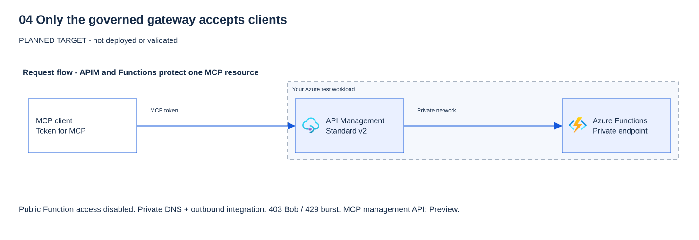

# 04 - API Management as the only entry point (level 2)

[Français](README.fr.md)

## Goal

Put **Azure API Management** (APIM) in front of the MCP server and make it the **only** way in. At the end:

- a request without a token gets **HTTP 401** from the gateway, with a challenge that points to the gateway's own
  Protected Resource Metadata (PRM);
- **Bob** (`Tools.Read`) calls `create_ticket` → **HTTP 403**; **Alice** (`Tools.Read` + `Tools.Write`) → **HTTP 200**;
- Bob calls `get_service_health` → **HTTP 200**;
- a burst of calls from one user → **HTTP 429**;
- a direct call to the Function host from the internet → **HTTP 403** (public access disabled);
- Application Insights shows who called which tool, with **no payload** and no token.

> [!WARNING]
> Never paste a live token into a website, a chat, a file, a screenshot or a log. The validator keeps tokens in memory only.

## Why it matters

Level 1 (module 03) checks **who** calls the server, not **what** they may do: Bob can still create tickets, nobody limits
call rates, and the Function is reachable from anywhere on the internet. A gateway adds the controls a server should not
re-implement:

| Control | Where | Why |
|---|---|---|
| `validate-azure-ad-token` | Gateway inbound | Platform validation of issuer, tenant, expiry, **audience = the MCP API only**, allowed client and the `user_impersonation` scope. No hand-written JWT code. |
| Per-tool role check | Gateway inbound, from the JSON-RPC body | `tools/call` with `create_ticket` requires the app role `Tools.Write`; every other tool and MCP method requires `Tools.Read`. Malformed bodies, batches, unknown tools and unsupported methods are denied. |
| `rate-limit-by-key` | Gateway inbound, key = caller object ID (`oid`) from the validated token | One noisy user gets HTTP 429 without affecting others. |
| `ip-filter` | Gateway inbound, optional | Restrict sources when your organisation needs it (empty by default). |
| Private path | Network | The Function has **public network access disabled** and a **private endpoint**; only the gateway reaches it through Standard v2 outbound virtual network integration. |
| Payload-free logs | Application Insights | **0 body bytes** for frontend/backend requests and responses, no header logged, and a trace with the tool label and the caller `oid` only. |

### Follow the token and the private network path

**Scopes vs app roles.** The `scp` claim (`user_impersonation`) says what the *client app* may do for the user. The `roles`
claim (`Tools.Read`, `Tools.Write`) says what *this user* may do. Per-tool authorization uses **app roles**
([concept](../../docs/concepts/scopes-and-app-roles.md)).

**Token boundary.** The gateway and the Function protect **one logical MCP resource** with **one audience**
(`api://<client-id>`, from module 03). The gateway validates the token, then forwards the **same** request to the Function,
whose built-in authentication validates it again (defence in depth). This is not token passthrough to a downstream API:
the token is never sent to Microsoft Graph, Storage or anything else, and no audience is added or broadened. Module 05 gets
separate downstream tokens through On-Behalf-Of or a managed identity ([token chain](../../docs/concepts/token-chain.md)).

**Network choice.** Standard v2 keeps a **public gateway** for clients and uses **outbound virtual network integration** to
call a **Function private endpoint** resolved by the private DNS zone `privatelink.azurewebsites.net`. Public access on the
Function is then disabled. Basic v2 has no outbound integration, and full virtual network injection (Premium v2) is more
than this workshop needs. Inbound NSG rules do not apply to outbound integration; the gateway policies are the inbound control.

## What you deploy

All in your workshop resource group, with the deterministic names from your private parameters. Opt-in variables, default off:
modules 00 to 03 are unchanged when `enable_governed_gateway` is false.

| Resource | Settings |
|---|---|
| Virtual network `vnet-mcp-<prefix>-<suffix>` | `10.42.0.0/23` by default (`gateway_vnet_address_space`). Already present, with its private endpoint subnet, if module 02 used `mcp_private_storage`; module 04 then adds only its own subnet and endpoint |
| Subnet `snet-apim` + NSG | `/24`, **delegated to `Microsoft.Web/serverFarms`**, only for API Management; NSG with the documented outbound Key Vault rule |
| Subnet `snet-private-endpoints` | `/27`, for the Function private endpoint |
| Private DNS zone `privatelink.azurewebsites.net` + link | Resolves the Function host to its private IP inside the virtual network |
| Private endpoint `pe-mcp-<prefix>-<suffix>-func` | Sub-resource `sites`; the zone group writes the app and `scm` records |
| API Management `apim-mcp-<prefix>-<suffix>` | **Standard v2** (`StandardV2_1`), public gateway, outbound integration, user-assigned managed identity |
| MCP server API `workshop-mcp` | **Preview** (`Microsoft.ApiManagement/service/apis@2025-09-01-preview`, `type: mcp`, `transportType: streamable`), backend `https://<function-host>/runtime/webhooks` + `/mcp`, **no subscription key** |
| MCP server policy | [policies/mcp-server.xml](policies/mcp-server.xml) |
| Metadata API `.well-known/oauth-protected-resource` | Anonymous [RFC 9728 metadata](policies/protected-resource-metadata.xml): gateway resource, your tenant, scope `api://<client-id>/user_impersonation` |
| Logger + diagnostics | Application Insights (module 02) through a connection string **and the gateway managed identity** (Monitoring Metrics Publisher on that one component), 0 body bytes at the all-APIs and MCP API scopes |
| Function App (module 02) | Stage 2 only: `public_network_access_enabled = false` |



The client URL becomes `https://apim-mcp-<prefix>-<suffix>.azure-api.net/workshop-mcp/mcp`. The private Function URL is
never given to clients (the optional portal also prefills the gateway URL only).

**Preview:** the API Management MCP server resource type and API version `2025-09-01-preview` are **Preview**, as is Protected
Resource Metadata on the Function (module 03). MCP server support is documented for Standard v2; the AI Gateway tier (Preview)
is not used.

**Cost:** API Management **Standard v2 is provisioned capacity billed per hour** while it exists, whether you call it or not.
The private endpoint, the private DNS zone and telemetry ingestion are also billed. **Get cost approval before stage 1** and
clean up the same day. No price is assumed here: check the Azure pricing calculator for your region.

## Prerequisites and required roles

- Modules 02 and 03 **both stages** deployed with the same private files and Terraform state: `participant.tfvars.json`,
  `module02.tfvars.json`, `module03.tfvars.json` (with `entra_auth_replace_key_gate = true`).
- Test accounts Alice, Bob and Eve with their module 03 app role assignments; `.workshop/module03-personas.json` (optional cross-check).
- Terraform 1.16.6+, Azure CLI, PowerShell 7.4+. The `Microsoft.ApiManagement`, `Microsoft.Network` and `Microsoft.Web` resource
  providers registered (module 00 preflight checks registration).
- The region must offer Standard v2 (example: `swedencentral`); check availability and quota before you start.

**Participant:** Contributor on the workshop resource group, plus permission to create one role assignment scoped to the
Application Insights component (for example Role Based Access Control Administrator, constrained to Monitoring Metrics
Publisher, time-bound). The subnet join permission (`Microsoft.Network/virtualNetworks/subnets/join/action`) is included in
Contributor on the group. **No Microsoft Entra change** in this module.

## Steps

### PowerShell

Run from the repository root. Steps 2 to 4 change Azure: do them only after approval of the plan **and of the cost**.

**1. Offline checks (no Azure).**

```powershell
& .\modules\04-governed-gateway\validate.ps1 -Offline
```

> **Expected result** — from the validator messages; not yet a capture from a participant run.
>
> ```text
> PASS gateway policy: Entra token for the MCP audience only, create_ticket requires Tools.Write, other tools Tools.Read, malformed or unknown calls denied, per-oid rate limit, optional ip-filter, gateway PRM challenge (expected HTTP 401/403/429).
> PASS Protected Resource Metadata is answered by the gateway itself and never names the private Function host (expected HTTP 200).
> PASS Terraform: Standard v2 public gateway, outbound integration, Function private endpoint and private DNS, public access disabled only in stage 2, MCP API Preview with no subscription key (expected HTTP 403 on the direct host).
> PASS diagnostics: 0 body bytes for frontend/backend requests/responses at both scopes, no header logged (no Authorization), no client IP (expected HTTP N/A).
> PASS no access token, subscription key, function key, SAS or client secret in module 04 or workload files (expected HTTP N/A).
> PASS Terraform format, schema and mock-only plans for infra/entra and infra/workload (expected HTTP N/A; no live plan/apply).
> NOT DEPLOYED CHECKS SKIPPED: supply -TenantId with -SubscriptionId (operator) or -Persona (test account) after an approved deployment.
> PASS offline checks only. Module 04 is NOT deployed or validated by this result.
> ```
>
> **What it means for you:** the policies and Terraform in your copy keep the module 04 controls. Nothing was deployed;
> a `FAIL` line names the file or rule to fix before you spend money on Standard v2.

**2. Private opt-in file (ignored by Git).** Optional: add `gateway_allowed_ip_ranges` (CIDR list) or change
`gateway_rate_limit_calls` / `gateway_rate_limit_period`. Keep `gateway_publisher_email` a team or example address.

```powershell
@{ enable_governed_gateway = $true; gateway_lock_function = $false } | ConvertTo-Json | Set-Content -LiteralPath .\.workshop\module04.tfvars.json
```

> **Expected result** — no output: `Set-Content` returns silently on success.
> Confirm with `Get-Content .\.workshop\module04.tfvars.json`: it shows `enable_governed_gateway` true and `gateway_lock_function` false.

**3. Stage 1: gateway, private endpoint and private DNS.** Select your approved context first
(`& .\scripts\select-azure-context.ps1`). From now on, always pass the four var files.

```powershell
$vars = '-var-file=..\..\.workshop\participant.tfvars.json', '-var-file=..\..\.workshop\module02.tfvars.json',
        '-var-file=..\..\.workshop\module03.tfvars.json', '-var-file=..\..\.workshop\module04.tfvars.json'
terraform '-chdir=infra\workload' init -lockfile=readonly
terraform '-chdir=infra\workload' plan @vars '-out=..\..\.workshop\module04.tfplan'
if ($LASTEXITCODE -ne 0) { throw 'Terraform plan failed.' }
# Review: about 19 additions (network, DNS, private endpoint, API Management, APIs, policies, logger, diagnostics,
# identity and one role assignment) and the known in-place Function App app_settings update. Then, after approval:
terraform '-chdir=infra\workload' apply '..\..\.workshop\module04.tfplan'
```

> **Real result** — stage 1 plan and apply excerpts, 2026-10-18, author's test tenant. Names and IDs withheld.
> The first apply stopped on a Preview API error; the second run is after the Terraform fix.
>
> ```text
> Plan: 17 to add, 3 to change, 0 to destroy.
> ...
> azurerm_service_plan.portal[0]: Modifications complete after 25s [id=/subscriptions/<subscription-id>/resourceGroups/rg-mcp-p01-<suffix>/providers/Microsoft.Web/serverFarms/plan-mcp-p01-<suffix>-portal]
> ...
> azurerm_function_app_flex_consumption.mcp[0]: Modifications complete after 46s [id=/subscriptions/<subscription-id>/resourceGroups/rg-mcp-p01-<suffix>/providers/Microsoft.Web/sites/func-mcp-p01-<suffix>]
> ...
> azurerm_api_management.gateway[0]: Creation complete after 2m25s [id=/subscriptions/<subscription-id>/resourceGroups/rg-mcp-p01-<suffix>/providers/Microsoft.ApiManagement/service/apim-mcp-p01-<suffix>]
> ...
> azurerm_private_endpoint.function[0]: Creation complete after 2m6s [id=/subscriptions/<subscription-id>/resourceGroups/rg-mcp-p01-<suffix>/providers/Microsoft.Network/privateEndpoints/pe-mcp-p01-<suffix>-func]
> Error: Failed to create/update resource
> ERROR CODE: ValidationError
> ...
>         "message": "Parsing error(s): An error occured while parsing the input. Message: Cannot deserialize the current JSON array (e.g. [1,2,3]) into type 'System.Collections.Generic.Dictionary`2[System.String,Microsoft.Azure.ApiManagement.Management.Contracts.McpEndpointContract]' because the type requires a JSON object (e.g. {\"name\":\"value\"}) to deserialize correctly. ... Path 'mcpProperties.endpoints', line 5, position 18."
> ```
>
> ```text
> Plan: 3 to add, 2 to change, 0 to destroy.
> azapi_resource.prm_operation_policy[0]: Modifications complete after 2s [id=/subscriptions/<subscription-id>/resourceGroups/rg-mcp-p01-<suffix>/providers/Microsoft.ApiManagement/service/apim-mcp-p01-<suffix>/apis/workshop-mcp-prm/operations/get-mcp-metadata/policies/policy]
> azurerm_function_app_flex_consumption.mcp[0]: Modifications complete after 47s [id=/subscriptions/<subscription-id>/resourceGroups/rg-mcp-p01-<suffix>/providers/Microsoft.Web/sites/func-mcp-p01-<suffix>]
> azapi_resource.mcp_api[0]: Creation complete after 3s [id=/subscriptions/<subscription-id>/resourceGroups/rg-mcp-p01-<suffix>/providers/Microsoft.ApiManagement/service/apim-mcp-p01-<suffix>/apis/workshop-mcp]
> azapi_resource.mcp_api_policy[0]: Creation complete after 2s [id=/subscriptions/<subscription-id>/resourceGroups/rg-mcp-p01-<suffix>/providers/Microsoft.ApiManagement/service/apim-mcp-p01-<suffix>/apis/workshop-mcp/policies/policy]
> azapi_resource.mcp_api_diagnostic[0]: Creation complete after 2s [id=/subscriptions/<subscription-id>/resourceGroups/rg-mcp-p01-<suffix>/providers/Microsoft.ApiManagement/service/apim-mcp-p01-<suffix>/apis/workshop-mcp/diagnostics/applicationinsights]
> Apply complete! Resources: 3 added, 2 changed, 0 destroyed.
> ```
>
> **What it means for you:** the gateway, its private path and its payload-free logging exist. The Standard v2 instance
> took about 2.5 minutes. The author's first apply failed on `mcpProperties.endpoints`: the Preview service expects a map,
> not the array shown in the published reference. Your copy of `infra/workload/gateway.tf` already sends the map, so one
> apply should finish; if you see this error, see Troubleshooting. The author's plan had 17 additions because module 02
> already created the virtual network, and **3** changes: the Function App settings, plus two on the optional portal
> (its plan was restored to B1 and its `WORKSHOP_MCP_ENDPOINT` hint now points to the gateway). Without a portal, expect 1 change. If your plan
> also shows the portal plan, see Troubleshooting. The repeated in-place update of `prm_operation_policy` is a known
> whitespace normalisation of the azapi policy (no functional change). Any `to destroy` in the plan means a var file is
> missing: do not apply.

Creating a Standard v2 instance takes several minutes. The Function is still public but still requires an Entra token
(module 03), so nothing is anonymous during stage 1. Try the gateway URL (`terraform -chdir=infra/workload output gateway_mcp_endpoint`)
in VS Code before stage 2.

**4. Stage 2: lock the Function.** Only the private endpoint remains.

```powershell
$v = Get-Content -LiteralPath .\.workshop\module04.tfvars.json -Raw | ConvertFrom-Json
$v.gateway_lock_function = $true
$v | ConvertTo-Json | Set-Content -LiteralPath .\.workshop\module04.tfvars.json
terraform '-chdir=infra\workload' plan @vars '-out=..\..\.workshop\module04.tfplan'
# Review: one in-place update of the Function App (public_network_access_enabled = false). After approval:
terraform '-chdir=infra\workload' apply '..\..\.workshop\module04.tfplan'
```

> **Real result** — stage 2 plan and apply excerpt, 2026-10-18, author's test tenant. Names and IDs withheld.
>
> ```text
> Plan: 0 to add, 3 to change, 0 to destroy.
> ...
> azapi_resource.prm_operation_policy[0]: Modifications complete after 1s [id=/subscriptions/<subscription-id>/resourceGroups/rg-mcp-p01-<suffix>/providers/Microsoft.ApiManagement/service/apim-mcp-p01-<suffix>/apis/workshop-mcp-prm/operations/get-mcp-metadata/policies/policy]
> azurerm_function_app_flex_consumption.mcp[0]: Modifications complete after 48s [id=/subscriptions/<subscription-id>/resourceGroups/rg-mcp-p01-<suffix>/providers/Microsoft.Web/sites/func-mcp-p01-<suffix>]
> azapi_resource.mcp_api_policy[0]: Modifications complete after 1s [id=/subscriptions/<subscription-id>/resourceGroups/rg-mcp-p01-<suffix>/providers/Microsoft.ApiManagement/service/apim-mcp-p01-<suffix>/apis/workshop-mcp/policies/policy]
> Apply complete! Resources: 0 added, 3 changed, 0 destroyed.
> ```
>
> **What it means for you:** the Function no longer answers from the internet. From now on, only the gateway reaches it
> through the private endpoint. The only functional change is on the Function App (`public_network_access_enabled = false`).
> The two azapi policy updates are a known whitespace normalisation (no functional change), so your plan may show 1 or 3 changes.

Publish code changes **before** stage 2: once public access is disabled, deployment endpoints are private too.

**5. Connect VS Code to the gateway.** In your **user** MCP configuration, replace the `workshop-entra` server with the
gateway URL. No header, no key: VS Code reads the gateway PRM and signs you in.

```json
{
  "servers": {
    "workshop-governed": { "type": "http", "url": "https://apim-mcp-<prefix>-<suffix>.azure-api.net/workshop-mcp/mcp" }
  }
}
```

As Alice, ask Copilot to create a synthetic ticket: VS Code asks for **approval** before the write tool runs, then it works.
As Bob (another VS Code profile), the same request fails with HTTP 403.

**Question:** Bob clicks **Allow** when VS Code asks him to approve `create_ticket`, but he has only `Tools.Read`. What does the
gateway return, and does the Function see the call?

<details>
<summary>Show answer</summary>

HTTP 403 from the gateway. Client approval is Bob's consent to run the tool; it does not add an app role to his token. The
gateway checks the `roles` claim for `Tools.Write`, refuses the call and never forwards it, so the Function never sees it.
Approval and role are two separate controls: neither replaces the other.

</details>

**6. Operator checks, then persona checks.**

```powershell
& .\modules\04-governed-gateway\validate.ps1 -TenantId $env:ARM_TENANT_ID -SubscriptionId $env:ARM_SUBSCRIPTION_ID
foreach ($persona in 'Alice', 'Bob', 'Eve') {
    $env:AZURE_CONFIG_DIR = Join-Path $PWD ".workshop\az-$($persona.ToLower())"
    az login --tenant $env:ARM_TENANT_ID --allow-no-subscriptions   # sign in as $persona in the browser
    & .\modules\04-governed-gateway\validate.ps1 -TenantId $env:ARM_TENANT_ID -Persona $persona -Burst:($persona -eq 'Bob')
    az logout
}
Remove-Item Env:\AZURE_CONFIG_DIR
Start-Sleep -Seconds 300   # telemetry ingestion delay
& .\modules\04-governed-gateway\validate.ps1 -TenantId $env:ARM_TENANT_ID -SubscriptionId $env:ARM_SUBSCRIPTION_ID -CheckTelemetry
```

> **Real result** — operator checks (the first command), 2026-10-18, author's test tenant. Names and IDs withheld.
>
> ```text
> PASS gateway policy: Entra token for the MCP audience only, create_ticket requires Tools.Write, other tools Tools.Read, malformed or unknown calls denied, per-oid rate limit, optional ip-filter, gateway PRM challenge (expected HTTP 401/403/429).
> PASS Protected Resource Metadata is answered by the gateway itself and never names the private Function host (expected HTTP 200).
> PASS Terraform: Standard v2 public gateway, outbound integration, Function private endpoint and private DNS, public access disabled only in stage 2, MCP API Preview with no subscription key (expected HTTP 403 on the direct host).
> PASS diagnostics: 0 body bytes for frontend/backend requests/responses at both scopes, no header logged (no Authorization), no client IP (expected HTTP N/A).
> PASS no access token, subscription key, function key, SAS or client secret in module 04 or workload files (expected HTTP N/A).
> PASS gateway request without a token is refused with a challenge naming the gateway metadata (expected HTTP 401).
> PASS gateway Protected Resource Metadata names the gateway resource, the tenant and the user_impersonation scope (expected HTTP 200).
> PASS direct call to the Function host is refused from the internet: HTTP 403 (expected HTTP 403).
> PASS a valid token for another audience (Microsoft Graph) is refused by the gateway (expected HTTP 401).
> PASS explicit Azure context matches the approved test target (expected HTTP 200 from Azure Resource Manager).
> PASS Function App publicNetworkAccess is Disabled; only its private endpoint remains (expected HTTP 200 from Azure Resource Manager).
> PASS deployed diagnostics log 0 body bytes and no header at the all-APIs and MCP API scopes (expected HTTP 200 from Azure Resource Manager).
> INFO telemetry check skipped. After the persona runs, wait about 5 minutes and rerun with -CheckTelemetry.
> INFO persona checks skipped. Sign in as each test account in a separate AZURE_CONFIG_DIR and rerun with -Persona Alice, Bob (add -Burst once), then Eve.
> PASS module 04 operator checks complete. Persona checks are still required for validation.
> ```
>
> **What it means for you:** there is now **one door**, and the Function behind it is unreachable from the internet.
> A token for another audience is refused at the gateway, and the logs keep zero body bytes and no header.

> **Expected result** — persona, `-Burst` and `-CheckTelemetry` messages; not captured: the test tenant requires MFA
> registration for the test accounts (excerpt).
>
> ```text
> PASS Alice get_service_health is allowed with Tools.Read (expected HTTP 200).
> PASS Bob create_ticket is denied by the gateway: Tools.Write is missing (expected HTTP 403).
> PASS Alice create_ticket is allowed with Tools.Write and queues one synthetic ticket (expected HTTP 200).
> PASS an unknown tool and a JSON-RPC message without a method are denied safely (expected HTTP 403 and HTTP 400).
> PASS Bob burst of <count> calls is throttled per caller object ID (expected HTTP 429).
> PASS Application Insights: <n> gateway requests and <n> tool traces with tool label and caller oid, no body, argument or token (expected HTTP 200 from Log Analytics).
> ```
>
> **What it means for you:** being signed in no longer means "can do everything": Bob reads, only Alice writes, and
> nobody can flood the server. The logs say **who** called **which tool**, never what they sent.

### Bash

```bash
bash ./modules/04-governed-gateway/validate.sh -Offline
printf '%s\n' '{"enable_governed_gateway": true, "gateway_lock_function": false}' > .workshop/module04.tfvars.json
source ./scripts/select-azure-context.sh
vars="-var-file=../../.workshop/participant.tfvars.json -var-file=../../.workshop/module02.tfvars.json -var-file=../../.workshop/module03.tfvars.json -var-file=../../.workshop/module04.tfvars.json"
terraform -chdir=infra/workload init -lockfile=readonly
terraform -chdir=infra/workload plan $vars -out=../../.workshop/module04.tfplan     # review, approve cost
terraform -chdir=infra/workload apply ../../.workshop/module04.tfplan
jq '.gateway_lock_function = true' .workshop/module04.tfvars.json > .workshop/m04.tmp && mv .workshop/m04.tmp .workshop/module04.tfvars.json
terraform -chdir=infra/workload plan $vars -out=../../.workshop/module04.tfplan     # review: one in-place update
terraform -chdir=infra/workload apply ../../.workshop/module04.tfplan
bash ./modules/04-governed-gateway/validate.sh -TenantId "$ARM_TENANT_ID" -SubscriptionId "$ARM_SUBSCRIPTION_ID"
for persona in Alice Bob Eve; do
  export AZURE_CONFIG_DIR="$PWD/.workshop/az-${persona,,}"
  az login --tenant "$ARM_TENANT_ID" --allow-no-subscriptions
  extra=""; [ "$persona" = "Bob" ] && extra="-Burst"
  bash ./modules/04-governed-gateway/validate.sh -TenantId "$ARM_TENANT_ID" -Persona "$persona" $extra
  az logout
done
unset AZURE_CONFIG_DIR
sleep 300
bash ./modules/04-governed-gateway/validate.sh -TenantId "$ARM_TENANT_ID" -SubscriptionId "$ARM_SUBSCRIPTION_ID" -CheckTelemetry
```

> **Expected result** — the same Terraform summaries and PASS/FAIL lines as the PowerShell steps above.

## What you should see

| Action (through the gateway unless stated) | Expected result | Meaning |
|---|---|---|
| MCP request without a token | HTTP 401, `WWW-Authenticate: Bearer resource_metadata="https://apim-…/.well-known/oauth-protected-resource/workshop-mcp/mcp"` | The gateway refuses first and points to its own metadata. |
| `GET` that metadata URL | HTTP 200: `resource` = gateway URL, your tenant, `api://…/user_impersonation` | The private Function host never appears. |
| Alice's Microsoft Graph token | HTTP 401 | Wrong audience. |
| Bob: `tools/list`, `get_service_health` | HTTP 200 | `Tools.Read` is enough. |
| Bob: `create_ticket` | **HTTP 403** | `Tools.Write` is missing. The Function never sees the call. |
| Alice: `create_ticket` | **HTTP 200**, one synthetic ticket | `Tools.Write` present; VS Code still asks you to approve the write. |
| Unknown tool / message without `method` | HTTP 403 / HTTP 400 | Unsupported shapes are denied, never guessed. |
| More calls than the limit from one user | **HTTP 429** with `Retry-After` | Rate limit per caller `oid`. Rate limits are approximate. |
| Direct call to `https://func-…azurewebsites.net/runtime/webhooks/mcp` | **HTTP 403** (or no connection) | Public network access disabled. |
| Application Insights | Requests with status and duration, traces `mcp-request` with `mcp-tool` and `caller-oid` | No body, argument, result or token. |

**Question:** Bob's burst gets HTTP 429. If Alice calls a tool at the same moment, is she throttled too?

<details>
<summary>Show answer</summary>

No. The `rate-limit-by-key` counter key is the caller object ID (`oid`) from the validated token, so each user has their own
counter. Bob's burst uses only Bob's quota. (Limits are approximate across gateway instances.)

</details>

### Read alongside the demonstration

Use these links for the matching gateway result above. API Management (APIM) enforces these controls; client sign-in alone does not.

| Demonstration or choice | What to understand in Microsoft Learn | Policy or API reference |
|---|---|---|
| No token or wrong audience: HTTP 401 | [Secure MCP servers](https://learn.microsoft.com/azure/api-management/secure-mcp-servers): protect the governed entry point. | [validate-azure-ad-token](https://learn.microsoft.com/azure/api-management/validate-azure-ad-token-policy): tenant, audience, allowed client and required claims. |
| Metadata points to the gateway, not the private Function | [App Service MCP authorization and Protected Resource Metadata (**Preview**)](https://learn.microsoft.com/azure/app-service/configure-authentication-mcp) explains resource discovery. | [Manage MCP servers programmatically (**Preview**)](https://learn.microsoft.com/azure/api-management/manage-mcp-servers-rest-api) describes the MCP management API used by Terraform. Metadata alone grants no access. |
| Bob reads but gets HTTP 403 for `create_ticket`; Alice can write after client approval | [App roles](https://learn.microsoft.com/entra/identity-platform/howto-add-app-roles-in-apps) supply `Tools.Read` / `Tools.Write`. The workshop explicitly enforces them per tool. | [choose](https://learn.microsoft.com/azure/api-management/choose-policy) and [policy expressions](https://learn.microsoft.com/azure/api-management/api-management-policy-expressions) implement the decision in `policies/mcp-server.xml`. An unknown tool or malformed message is also refused. |
| A burst from one caller gets HTTP 429 | [rate-limit-by-key](https://learn.microsoft.com/azure/api-management/rate-limit-by-key-policy): the key here is validated caller `oid`, not a subscription key. Distributed limits are approximate. | The same reference documents `calls`, `renewal-period` and `counter-key`. |
| Direct Function access is blocked | [Functions networking options](https://learn.microsoft.com/azure/azure-functions/functions-networking-options) explains private endpoints and Flex Consumption support. | [Expose an existing MCP server](https://learn.microsoft.com/azure/api-management/expose-existing-mcp-server) describes the gateway proxy. Keep the Standard v2 network design in this guide. |
| Telemetry shows status and latency, never payloads | [Default MCP telemetry](https://learn.microsoft.com/azure/api-management/monitor-mcp-servers): read the default telemetry and query sections. | [trace policy](https://learn.microsoft.com/azure/api-management/trace-policy) adds the fixed tool name and caller ID. Keep body logging at zero bytes; do not follow the linked page's optional payload-logging steps. |

Client approval for a write is separate from the gateway's role check. Neither replaces the other.
Documentation links last verified: 2026-10-16; expected results still require an approved live deployment.

## Validate

`validate.ps1` (or `validate.sh`) always runs the offline checks first: the policy validates the Entra token for the MCP
audience only (no gateway-URL audience), requires `user_impersonation`, maps `create_ticket` to `Tools.Write` and other tools
to `Tools.Read` from the body read with `preserveContent: true`, denies malformed or unknown calls, rate-limits by `oid`,
renders the IP filter only when configured, challenges with the gateway PRM and never reads the response body; Terraform keeps
Standard v2, outbound integration, the private endpoint, the stage 2 lock and no subscription key; diagnostics keep 0 body
bytes and no header at both scopes; no secret pattern; Terraform format, schema and mock tests for both roots.

Offline output (this result is **not** deployment evidence):

```text
PASS gateway policy: Entra token for the MCP audience only, create_ticket requires Tools.Write, other tools Tools.Read, malformed or unknown calls denied, per-oid rate limit, optional ip-filter, gateway PRM challenge (expected HTTP 401/403/429).
PASS Protected Resource Metadata is answered by the gateway itself and never names the private Function host (expected HTTP 200).
PASS Terraform: Standard v2 public gateway, outbound integration, Function private endpoint and private DNS, public access disabled only in stage 2, MCP API Preview with no subscription key (expected HTTP 403 on the direct host).
PASS diagnostics: 0 body bytes for frontend/backend requests/responses at both scopes, no header logged (no Authorization), no client IP (expected HTTP N/A).
PASS no access token, subscription key, function key, SAS or client secret in module 04 or workload files (expected HTTP N/A).
PASS Terraform format, schema and mock-only plans for infra/entra and infra/workload (expected HTTP N/A; no live plan/apply).
PASS offline checks only. Module 04 is NOT deployed or validated by this result.
```

### Verify the real gateway after deployment

Live modes, after an approved deployment of both stages:

- **Operator** (`-TenantId -SubscriptionId`): gateway HTTP 401 with the gateway challenge, gateway PRM HTTP 200, HTTP 401 for a
  Graph token, direct Function host HTTP 403, `publicNetworkAccess = Disabled` and 0-byte diagnostics read from Azure Resource
  Manager. `-CheckTelemetry` then queries Log Analytics: gateway requests and `mcp-request` traces exist, with no body,
  argument or Authorization value.
- **Persona** (`-TenantId -Persona Alice|Bob|Eve`): initialize and `tools/list` HTTP 200; `get_service_health` HTTP 200;
  `create_ticket` HTTP 403 for Bob and HTTP 200 for Alice; unknown tool HTTP 403 and missing method HTTP 400; Eve gets no token
  (`AADSTS50105`). `-Burst` sends the limit plus 10 calls and expects HTTP 429.

The module is `validated` only when all of these pass on a fresh subscription right after modules 00 to 03.

## Troubleshooting

| Symptom | Check |
|---|---|
| `enable_governed_gateway needs ... entra_auth_replace_key_gate` | Finish both stages of module 03 first and pass `module03.tfvars.json`. |
| Plan wants to destroy the gateway or authentication | A var file is missing. Always pass the four files. |
| HTTP 500/502 from the gateway after stage 2 | DNS: the private DNS zone link and the private endpoint zone group must exist; wait a few minutes for propagation. |
| HTTP 401 for Alice through the gateway, but PRM works | The token was requested for another resource. Use the `mcp_auth_audience` output; the gateway accepts only the MCP API audience. |
| HTTP 403 for Alice on every call | Her client app is not allowed (`mcp_allowed_client_ids`), or the token has no `user_impersonation` scope. |
| Streaming stops or tools hang | Someone enabled body logging or a policy reads the response body. Keep 0 bytes at every scope. |
| No HTTP 429 in the burst | Rate limits are approximate in distributed gateways; rerun `-Burst`, or lower `gateway_rate_limit_calls` for the exercise. |
| Code publish fails after stage 2 | Expected: deployment endpoints are private now. Publish before stage 2, or from inside the virtual network. |
| Name already in use after a clean-up | API Management soft-delete: purge it (see Clean up). |
| `ValidationError` ... `mcpProperties.endpoints` ... `JSON array` | Your copy predates the fix: the 2025-09-01-preview service expects `endpoints` as a map keyed by name; `infra/workload/gateway.tf` now sends `{ message = { uriTemplate = "/mcp" } }` (Preview API; the published REST reference still shows an array). |
| Plan shows the portal service plan `F1` -> `B1` | Something outside Terraform changed the optional portal plan (in the author's tenant a cost automation does this nightly). Approve only if you want B1 back; otherwise keep the change out of scope. |

## Clean up

Clean up in reverse order. The script plans first and refuses any change outside module 04; run once to review, then with
`-Apply`. It is idempotent. Not run by the author: no deployment exists.

```powershell
& .\modules\04-governed-gateway\cleanup.ps1 -TenantId $env:ARM_TENANT_ID -SubscriptionId $env:ARM_SUBSCRIPTION_ID
& .\modules\04-governed-gateway\cleanup.ps1 -TenantId $env:ARM_TENANT_ID -SubscriptionId $env:ARM_SUBSCRIPTION_ID -Apply
Remove-Item -LiteralPath .\.workshop\module04.tfvars.json -ErrorAction SilentlyContinue
# Optional, to reuse the name within 48 hours (API Management soft-delete):
az apim deletedservice purge --service-name apim-mcp-<prefix>-<suffix> --location <region>
```

> **Expected result** — from the clean-up script messages and Terraform output shape; not run by the author (excerpt).
>
> ```text
> PASS explicit Azure context and private participant parameters (expected HTTP 200 from Azure Resource Manager).
> PLAN update azurerm_function_app_flex_consumption.mcp[0] (phase 1: reopen the Function behind Entra (stage 2 to stage 1))
> PASS 'phase 1: reopen the Function behind Entra (stage 2 to stage 1)' plan changes only 1 module 04 object(s). Review it, then rerun with -Apply.
> ```
>
> With `-Apply`:
>
> ```text
> PASS explicit Azure context and private participant parameters (expected HTTP 200 from Azure Resource Manager).
> PLAN update azurerm_function_app_flex_consumption.mcp[0] (phase 1: reopen the Function behind Entra (stage 2 to stage 1))
> Apply complete! Resources: 0 added, 1 changed, 0 destroyed.
> PASS 'phase 1: reopen the Function behind Entra (stage 2 to stage 1)' applied (expected HTTP 200).
> PLAN delete azapi_resource.mcp_api[0] (phase 2: remove the governed gateway)
> PLAN delete azurerm_api_management.gateway[0] (phase 2: remove the governed gateway)
> ...
> Apply complete! Resources: 0 added, 1 changed, 19 destroyed.
> PASS 'phase 2: remove the governed gateway' applied (expected HTTP 200).
> INFO API Management keeps a soft-deleted copy for 48 hours. To reuse the name sooner: az apim deletedservice purge --service-name apim-mcp-p01-<suffix> --location <region>
> PASS the Function is back at level 1 (Entra only). Remove .workshop/module04.tfvars.json; use modules/03-entra-authentication/cleanup.ps1 next if you continue cleaning up.
> ```
>
> `Remove-Item` and `az apim deletedservice purge` print nothing on success.
>
> **What it means for you:** the first run only reviews; nothing changes. A rerun prints `nothing to do in this state`
> for a phase that is already done. A `FAIL ... outside module 04` line means the plan would touch other modules: nothing was applied.

```bash
bash ./modules/04-governed-gateway/cleanup.sh -TenantId "$ARM_TENANT_ID" -SubscriptionId "$ARM_SUBSCRIPTION_ID" -Apply
rm -f .workshop/module04.tfvars.json
```

> **Expected result** — the same PASS/PLAN lines as the PowerShell `-Apply` run above; `rm` prints nothing.

Phase 1 reopens the Function to its module 03 state (still Entra-protected, never anonymous). Phase 2 deletes the gateway,
APIs, policies, diagnostics, logger, gateway identity and role, private endpoint, private DNS, subnets, NSG and virtual network.
Then continue with module 03's and module 02's clean-up if you are done. Replace `workshop-governed` in VS Code. If you continue
to module 05 now, keep everything.

## Go further

- Read [policies/mcp-server.xml](policies/mcp-server.xml): which line turns Bob's `create_ticket` into HTTP 403, and why must
  the body be read with `preserveContent: true`?
- Why does the gateway forward the same token to the Function, and why is that not "token passthrough"? Compare with module 05.
- Set `gateway_allowed_ip_ranges` to your egress range and observe HTTP 403 from another network.
- **Optional 04b (documentation only):** API Management can also expose a managed **REST API as an MCP server**, where each
  operation becomes a tool ([Expose a REST API as an MCP server](https://learn.microsoft.com/azure/api-management/export-rest-mcp-server),
  AI-Gateway lab `mcp-from-api`). The same `validate-azure-ad-token`, role and rate-limit policies apply. Not part of the core path
  and not deployed by this repository.

## Sources

- [Expose and govern an existing MCP server](https://learn.microsoft.com/azure/api-management/expose-existing-mcp-server)
- [Secure access to MCP servers in API Management](https://learn.microsoft.com/azure/api-management/secure-mcp-servers)
- [About MCP servers in Azure API Management](https://learn.microsoft.com/azure/api-management/mcp-server-overview)
- [Manage MCP servers programmatically (REST, Bicep, Azure CLI, Terraform; 2025-09-01-preview)](https://learn.microsoft.com/azure/api-management/manage-mcp-servers-rest-api)
- [validate-azure-ad-token policy](https://learn.microsoft.com/azure/api-management/validate-azure-ad-token-policy),
  [rate-limit-by-key policy](https://learn.microsoft.com/azure/api-management/rate-limit-by-key-policy),
  [ip-filter policy](https://learn.microsoft.com/azure/api-management/ip-filter-policy)
- [Integrate API Management with Application Insights (connection string + managed identity, payload bytes)](https://learn.microsoft.com/azure/api-management/api-management-howto-app-insights)
- [Standard v2 outbound virtual network integration](https://learn.microsoft.com/azure/api-management/integrate-vnet-outbound)
- [Use private endpoints for App Service and Functions apps](https://learn.microsoft.com/azure/app-service/overview-private-endpoint)
- [Azure Functions networking options](https://learn.microsoft.com/azure/azure-functions/functions-networking-options)
- [Azure-Samples/AI-Gateway labs mcp-prm-oauth and mcp-client-authorization at 1679e31](https://github.com/Azure-Samples/AI-Gateway/tree/1679e3137d2fe7592d2a668d77ff71550d35b69e/labs)
- [RFC 9728 OAuth 2.0 Protected Resource Metadata](https://www.rfc-editor.org/rfc/rfc9728)
- [AzAPI provider 2.13.0](https://registry.terraform.io/providers/Azure/azapi/2.13.0/docs) and [AzureRM 5.9.0 API Management](https://github.com/hashicorp/terraform-provider-azurerm/blob/v5.9.0/website/docs/r/api_management.html.markdown)

Last verified: 2026-10-18. Operator checks validated live in the author's test tenant on 2026-10-18; persona checks not yet run (MFA registration required).
