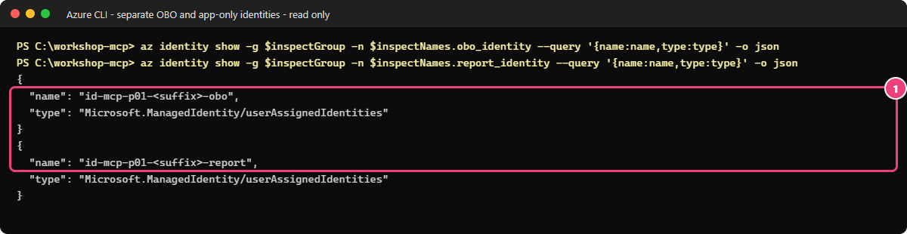

# 05 — Droits délégués ou applicatifs : low-code, portail d'abord

[English](LOW-CODE.md)

## Objectif

[Guide Terraform + PowerShell](README.fr.md)

Vous allez lire le même rapport fictif en utilisant d'abord les droits de l'utilisateur, puis ceux d'une application.
Vous comparerez les résultats avec Alice et Bob : en mode délégué, Alice obtient le rapport et Bob est refusé ;
en mode applicatif, les deux obtiennent le même rapport.

## Pourquoi c'est important

Le flux On-Behalf-Of (OBO, « pour le compte de ») permet au serveur d'obtenir un nouveau jeton pour le service
qu'il appelle, tout en agissant au nom de l'utilisateur. Azure Storage vérifie alors le rôle Azure de cet utilisateur.
En mode applicatif, le serveur utilise une autre identité managée et les droits de celle-ci, indépendamment de l'appelant.
Ne transmettez jamais le jeton MCP initial à Graph ou Storage.

> [!NOTE]
> Lisez à la fois le statut HTTP et le résultat de l'outil Model Context Protocol (MCP).
> Pour Bob, la lecture en mode délégué peut renvoyer HTTP 200 tout en signalant une erreur d'outil :
> c'est Storage qui a refusé l'accès en aval avec HTTP 403.

## Ce que vous déployez

Vous créez deux identités managées affectées par l'utilisateur : `…-obo` prouve l'identité de l'API pendant
l'échange OBO, **sans rôle Azure sur les données** ; `…-report` reçoit Storage Blob Data Reader sur **le seul
conteneur reports**. Alice reçoit aussi ce rôle de lecture ; Bob ne le reçoit pas.
Le compte utilisé pour publier le rapport reçoit Storage Blob Data Contributor sur ce conteneur.
Sur l'inscription d'application, l'administrateur configure une information d'identification fédérée,
les autorisations déléguées Graph `User.Read` et Storage `user_impersonation`, puis accorde le consentement approuvé.
Vous ne créez aucun secret client.

Les outils ne renvoient plus les démonstrations du module 02 : `whoami` appelle Graph et ne retourne que le libellé
de test autorisé (`alice` ou `bob`) ; `read_report_as_user` utilise OBO ; `read_report_as_app` utilise l'identité de rapport.
Chaque nouveau jeton cible l'audience du service appelé. Les applications agissant sans utilisateur ne peuvent pas
utiliser les outils en contexte utilisateur.

**Coût :** la facturation d'Azure API Management (APIM), de Functions, de Storage et de la télémétrie continue.
La publication dans le réseau privé crée temporairement une instance de conteneur, une identité, un rôle,
un sous-réseau et un groupe de sécurité, puis les supprime. Obtenez aussi l'accord pour ces ressources temporaires.
Aucune nouvelle dépendance en préversion n'est ajoutée ; la gestion MCP du module 04 reste en **Preview** (préversion).

## Prérequis et rôles nécessaires

- [Module 02](../02-open-server/LOW-CODE.fr.md), [module 03](../03-entra-authentication/LOW-CODE.fr.md) et [passerelle low-code du module 04](../04-governed-gateway/LOW-CODE.fr.md) terminés.
- Paquet actuel du dépôt publié **avant** la fermeture de l'accès public au module 04. Ne rouvrez pas les points de publication. Si le code est ancien, attendez un environnement de publication approuvé dans le réseau privé.
- PowerShell 7.4+, Azure CLI, VS Code/Copilot ; terminal à la racine du dépôt, fichier participant conservé.
- Participant : Contributor sur le groupe et autorisation limitée d'attribuer Storage Blob Data Reader/Contributor sur le conteneur reports uniquement. Contributor seul ne peut pas attribuer ces rôles.
- Administrateur d'identité : Application Administrator ou Cloud Application Administrator, ou propriétaire de l'application pour la configuration ; administrateur approuvé disposant d'Application Administrator/Cloud Application Administrator pour le consentement délégué. Pas de demande Global Administrator.
- **Object ID** des utilisateurs Alice/Bob, **Application (client) ID** de l'API, Tenant ID et Subscription ID depuis le portail. Eve reste non affectée.
- Pour publier dans le réseau privé : enregistrement approuvé du fournisseur `Microsoft.ContainerInstance`,
  quota de conteneurs Linux disponible et plage `10.52.1.64/28` libre dans le réseau de l'atelier.
  Le script choisit le premier réseau du groupe : vérifiez que le groupe ne contient que le réseau prévu.
  Sinon, arrêtez-vous plutôt que de publier dans un autre réseau.

## Étapes

### 1. Recréer le contexte du terminal

Relevez les identifiants dans le portail : **Subscriptions → abonnement → Overview** pour le Subscription ID,
**Entra → Overview** pour le Tenant ID, et **App registrations → API de l'atelier → Overview** pour
l'Application (client) ID. Remplacez les valeurs entre chevrons :

```powershell
$tenant = '<tenant-id>'; $sub = '<subscription-id>'; $apiClientId = '<api-application-client-id>'
az login --tenant $tenant
az account set --subscription $sub
$p = Get-Content .\.workshop\participant.tfvars.json -Raw | ConvertFrom-Json
$id = "$($p.participant_prefix)lc"; $sfx = $p.resource_suffix.Substring(0, 10)
$rg = "rg-mcp-$id-$sfx"
if ($p.existing_resource_group_name) { $rg = $p.existing_resource_group_name }
$st = "st$id$sfx"; $fn = "func-mcp-$id-$sfx"; $apim = "apim-mcp-$id-$sfx"; $mi = "id-mcp-$id-$sfx"
$obo = "$mi-obo"; $rep = "$mi-report"
$rg; $st; $fn; $apim; $obo; $rep
```

> **Résultat attendu** — le terminal affiche les noms de vos ressources low-code et les deux noms d'identité à créer.
> Les commandes reconstruisent les variables sans dépendre d'un ancien terminal. Vous conservez le même suffixe
> de participant et la même région, Europe Ouest.

### 2. Participant : créer les identités et les rôles dans le portail

1. **Managed Identities → Create**, deux fois, mêmes groupe/abonnement, **West Europe**, noms `$obo` et `$rep`. Étiquettes `workshop=governed-mcp`, `owner`/`expiry` du fichier participant, `track=low-code`.
2. Pour chaque identité, ouvrez **Overview** et relevez **Client ID** et **Principal ID** en privé.
   Le code utilise le Client ID pour sélectionner l'identité. Le Principal ID identifie celle-ci dans les attributions
   de rôle et dans la relation de confiance fédérée. Ces deux identifiants ne sont pas interchangeables.
3. Function → **Settings → Identity → User assigned → + Add** : ajoutez les deux. Gardez `$mi` d'origine ; trois identités doivent rester attachées.
4. Dans Storage `$st` → **Data storage → Containers**, repérez le conteneur `reports`, dont l'accès doit rester **Private**.
   Pour le créer, utilisez la commande de gestion ci-dessous : le réseau privé ou les autorisations de données peuvent
   bloquer l'explorateur du portail. Ne réactivez ni l'accès réseau public ni les clés et ne demandez pas de rôle
   de données sur tout le compte.

```powershell
az storage container-rm create -g $rg --storage-account $st -n reports -o none
```

> **Résultat attendu** — aucun affichage, code 0 ; conteneur privé `reports` présent. Cette commande ne publie pas les données et n'exige aucune clé Storage.

5. **Containers → reports → Access control (IAM) → Add role assignment** : **Storage Blob Data Reader**, **Managed identity**, `$rep`, **Review + assign**. L'étendue doit finir par `/blobServices/default/containers/reports`, pas viser tout le compte.
6. Répétez **Storage Blob Data Reader**, type **User, group, or service principal**, **Alice** sélectionnée par son Object ID. Attribuez **Storage Blob Data Contributor** à **votre opérateur de publication**, même conteneur.
7. Dans **Role assignments**, vérifiez les deux lecteurs (Alice et `$rep`) et le compte de publication.
   Bob et `$obo` ne doivent avoir aucun rôle sur les données. S'ils en héritent, les résultats ne permettront pas
   la comparaison attendue : demandez au propriétaire de corriger l'environnement de test, sans ajouter de droits.

### 3. Administrateur : configurer confiance et consentement délégué

1. **Microsoft Entra ID → App registrations → API de l'atelier** : vérifiez l'Application (client) ID du participant.
2. **Certificates & secrets → Federated credentials → Add credential**, scénario **Managed identity** : abonnement/groupe du participant et identité **`…-obo`**, pas `…-report`.
3. Nom `workshop-obo-lowcode`, description `Module 05 OBO managed identity, no secret`. Vérifiez émetteur `https://login.microsoftonline.com/<tenant-id>/v2.0`, sujet = **Principal ID OBO**, audience `api://AzureADTokenExchange`. **Add**. Si une identité fédérée existe, inspectez-la au lieu de la dupliquer. Une seule est attendue.
4. **API permissions → Add a permission → Microsoft Graph → Delegated permissions → User.Read → Add permissions**.
5. **Add a permission → APIs my organization uses** : cherchez **Azure Storage**, Application ID `e406a681-f3d4-42a8-90b6-c2b029497af1` ; **Delegated permissions → user_impersonation → Add permissions**.
6. Après accord explicite, **Grant admin consent for votre tenant de test → Yes**. Vérifiez seulement ces deux autorisations déléguées accordées. Pas d'autorisation applicative, de droit Graph élargi ou de secret client.


*Capture réelle illustrative d'une application de l'auteur ; le nom diffère. Vérifiez les deux autorisations Delegated, Graph User.Read et Storage user_impersonation, et le consentement sur votre API.*


*Capture illustrative. Sur votre API, zéro secret/certificat et une identité fédérée faisant confiance à l'identité OBO. Son nom peut différer de la capture.*

### 4. Participant : choisir les identités utilisées pour appeler Graph et Storage

**Entra → Users → Alice/Bob → Overview** : copiez les **Object ID**. Function → **Settings → Environment variables → App settings**, ajoutez ces sept paramètres puis **Apply → Confirm**. Remplacez tous les chevrons. Pour la dernière valeur, collez le JSON compact avec ses guillemets doubles littéraux.

| Nom | Valeur |
|---|---|
| `WORKSHOP_DELEGATED_ACCESS` | `enabled` |
| `WORKSHOP_TENANT_ID` | `<tenant-id>` |
| `WORKSHOP_MCP_API_CLIENT_ID` | `<api-application-client-id>` |
| `WORKSHOP_OBO_ASSERTION_CLIENT_ID` | `<obo-identity-client-id>` |
| `WORKSHOP_REPORT_IDENTITY_CLIENT_ID` | `<report-identity-client-id>` |
| `WORKSHOP_REPORT_CONTAINER_URL` | `https://<votre-nom-stockage>.blob.core.windows.net/reports` |
| `WORKSHOP_PERSONA_OBJECT_IDS` | `{"alice":"<alice-object-id>","bob":"<bob-object-id>"}` |

Conservez les paramètres d'identité du stockage hôte et de la file, l'authentification Entra obligatoire
et l'accès réseau public désactivé. N'ajoutez aucun secret pour les services en aval.

### 5. Publier le rapport synthétique — terminal nécessaire

Ouvrez Storage → **Networking → Public access** pour déterminer laquelle des deux procédures s'applique
à votre configuration actuelle. Ne modifiez pas la protection réseau pour choisir la procédure la plus simple.

**Accès public désactivé :** après accord pour l'infrastructure temporaire, utilisez le script existant dans le réseau :

```powershell
& .\modules\05-delegated-and-app-only\publish-report.ps1 -TenantId $tenant -SubscriptionId $sub -StorageAccount $st -InsideVirtualNetwork -ResourceGroup $rg -SubnetPrefix 10.52.1.64/28
```

> **Résultat attendu** — contexte PASS ; sous-réseau/identité/rôle sur le conteneur créés ; `reports/monthly-usage.json` publié par identité managée (**HTTP 201**), sans clé ni signature d'accès partagé (SAS) ; conteneur temporaire, identité, rôle, sous-réseau et groupe de sécurité supprimés. Vérifiez le message final de nettoyage. Un échec n'autorise pas l'accès public.

**Seulement si Storage est déjà accessible selon sa stratégie réseau publique approuvée :** publication directe avec votre rôle sur le conteneur :

```powershell
& .\modules\05-delegated-and-app-only\publish-report.ps1 -TenantId $tenant -SubscriptionId $sub -StorageAccount $st
```

> **Résultat attendu** — rapport synthétique publié avec autorisation Entra, HTTP 201. N'exécutez pas les deux cas et ne publiez aucune donnée réelle.

### 6. Connecter VS Code et comparer les identités

1. **Ctrl+Shift+P → MCP: Open User Configuration** : URL de passerelle uniquement, jamais la Function privée :

```json
{
  "servers": {
    "workshop-governed": { "type": "http", "url": "https://<your-apim-name>.azure-api.net/workshop-mcp/mcp" }
  }
}
```

2. Remplacez la valeur entre chevrons par le nom contenu dans `$apim`. Sélectionnez **Start → Allow** et
   connectez-vous à Microsoft avec **Alice**. Dans **Chat → Agent → Configure Tools**, ne gardez que ce serveur.
3. Demandez `Appelle whoami, read_report_as_user puis read_report_as_app. Compare l'identité utilisée par chaque outil.` Approuvez uniquement l'appel affiché, sans approbation automatique.
4. Créez un profil **Bob** avec **Profiles: New Profile...**, reprenez la même configuration, connectez-vous avec Bob
   et posez la même question. Terminez l'authentification multifacteur (MFA) demandée.
5. Comparez les résultats : la lecture déléguée réussit pour Alice et est refusée en aval pour Bob ;
   la lecture applicative renvoie le même rapport aux deux. Aucun résultat ne doit exposer de nom réel, d'adresse ou de jeton.

## Ce que vous devez voir

| Appel | Alice | Bob |
|---|---|---|
| `whoami` | HTTP 200, personne `alice` | HTTP 200, personne `bob` |
| `read_report_as_user` | HTTP 200, `isError: false` | HTTP 200, `isError: true`, Storage aval 403 |
| `read_report_as_app` | HTTP 200, rapport partagé | HTTP 200, même rapport |

Le statut HTTP 200 reçu par le client ne signifie pas que l'outil a réussi. Eve ne peut toujours pas obtenir de jeton
(modules 03/04) ; vous n'avez pas de contrôle supplémentaire à exécuter avec son compte dans ce module.


*Capture réelle illustrative, pas preuve d'exécution de ce guide. Vérifiez chez vous whoami via OBO, erreur Bob à l'intérieur de HTTP 200, puis résultat applicatif identique. Les noms diffèrent.*

### Vérifier vous-même avec Azure CLI

**Pourquoi :** vous devez retrouver deux identités distinctes : l'une sert à OBO, l'autre à la lecture applicative.
Dans PowerShell 7, à la racine du dépôt, préparez les noms de votre parcours :

```powershell
$ErrorActionPreference = 'Stop'
$inspectParticipant = Get-Content -LiteralPath .\.workshop\participant.tfvars.json -Raw | ConvertFrom-Json
$inspectId = "$($inspectParticipant.participant_prefix)lc"
$inspectSuffix = $inspectParticipant.resource_suffix.Substring(0, 10)
$inspectGroup = if ($inspectParticipant.existing_resource_group_name) { $inspectParticipant.existing_resource_group_name } else { "rg-mcp-$inspectId-$inspectSuffix" }
$inspectNames = [pscustomobject]@{
    obo_identity = "id-mcp-$inspectId-$inspectSuffix-obo"
    report_identity = "id-mcp-$inspectId-$inspectSuffix-report"
}
```

> **Résultat attendu** — aucune sortie : les variables reçoivent les noms de votre déploiement. Vérifiez avec `$inspectNames`.

Copiez les deux commandes en lecture seule :

```powershell
az identity show -g $inspectGroup -n $inspectNames.obo_identity --query '{name:name,type:type}' -o json
if ($LASTEXITCODE -ne 0) { throw 'Identité OBO introuvable.' }
az identity show -g $inspectGroup -n $inspectNames.report_identity --query '{name:name,type:type}' -o json
if ($LASTEXITCODE -ne 0) { throw 'Identité applicative du rapport introuvable.' }
```

> **Résultat attendu** — deux identités managées, l'une en `-obo`, l'autre en `-report`.



*Capture en lecture seule du 20 octobre 2026. Vos noms low-code comportent `lc`.
Cette lecture ne vérifie ni la fédération ni les droits sur le conteneur : poursuivez avec le validateur et les essais Alice/Bob.
Si une identité manque, revérifiez les créations du portail. N'élargissez pas les droits de Bob ou de l'identité OBO.*

## Valider

> **Note de validation :** ce guide low-code n'a pas encore été validé de bout en bout en conditions réelles.
> Les captures réelles illustrent d'autres exécutions et ne prouvent pas que cette procédure a été suivie.
> Vérifiez votre propre configuration, puis les résultats d'Alice et de Bob.

Dans VS Code, créez ou vérifiez le fichier `.workshop/module03-personas.json`, ignoré par Git :
`{"alice":"<alice-object-id>","bob":"<bob-object-id>","eve":"<eve-object-id>"}`.
Utilisez les Object ID Entra, jamais des jetons. Les identifiants d'Alice et de Bob doivent correspondre aux paramètres de la Function.

Vérifiez d'abord la configuration avec votre compte habituel de déploiement (mode « opérateur » du script) :

```powershell
$v = @{ TenantId = $tenant; ResourceGroup = $rg; FunctionApp = $fn; GatewayName = $apim; ApiClientId = $apiClientId
    StorageAccount = $st; OboIdentityName = $obo; PersonaObjectIdsPath = '.\.workshop\module03-personas.json'; SkipBuild = $true }
& .\modules\05-delegated-and-app-only\validate.ps1 @v -SubscriptionId $sub
```

> **Résultat attendu** — les contrôles affichent `PASS` pour les paramètres des deux identités sans secret,
> l'API sans secret avec une seule information d'identification fédérée OBO, et les deux lecteurs du conteneur,
> sans rôle pour Bob ni pour l'identité OBO. Ces lectures de configuration attendent HTTP 200 ; elles ne vérifient
> pas encore les accès des utilisateurs. `-SkipBuild` évite la compilation et les simulations Terraform partagées.
> Les noms des ressources sont fournis explicitement ; aucun état Terraform n'est utilisé.

Connectez-vous ensuite avec le compte de test demandé dans sa session dédiée, pas avec votre compte de déploiement :

```powershell
$operatorConfig = $env:AZURE_CONFIG_DIR
try {
    foreach ($persona in 'Alice', 'Bob') {
        Write-Host "Sign in as $persona"
        $env:AZURE_CONFIG_DIR = Join-Path $PWD ".workshop\az-$($persona.ToLower())"
        az login --tenant $tenant --allow-no-subscriptions
        if ($LASTEXITCODE) { throw "Login failed for $persona" }
        & .\modules\05-delegated-and-app-only\validate.ps1 @v -Persona $persona
        az logout
    }
} finally {
    if ($null -eq $operatorConfig) { Remove-Item Env:\AZURE_CONFIG_DIR -ErrorAction SilentlyContinue }
    else { $env:AZURE_CONFIG_DIR = $operatorConfig }
}
az account set --subscription $sub
```

> **Résultat attendu** — le contrôle de chaque Object ID et les six résultats du tableau affichent `PASS`.
> Après le passage du second compte, le validateur compare les empreintes des rapports pour confirmer que le résultat
> applicatif est identique. Il conserve des empreintes, jamais de jetons ni de corps de rapport.
> Le script restaure ensuite votre profil opérateur pour le nettoyage.

## Dépannage

- **Erreur OBO :** vérifiez tenant/émetteur v2 exacts, sujet = Principal ID OBO, paramètre d'assertion = Client ID OBO, audience `api://AzureADTokenExchange`, deux consentements délégués. Aucun secret.
- **Alice Storage 403 :** rôle sur le conteneur, propagation, réseau/DNS et existence du rapport.
- **Lecture utilisateur Bob réussie :** cherchez un rôle Storage hérité. Ne retirez pas de droits de production sans rapport ; corrigez le contexte de test dédié avec son propriétaire.
- **Lecture applicative échoue pour les deux :** rôle lecteur pour l'identité de rapport, pas OBO ; URL exacte.
- **Publication privée échoue :** vérifiez nettoyage temporaire, plage du sous-réseau et quota. Gardez le réseau privé et respectez la stratégie.
- **Anciens résultats de démonstration :** vérifiez paquet actuel et `WORKSHOP_DELEGATED_ACCESS=enabled`. L'accès public reste désactivé.

## Nettoyer

Conservez les ressources uniquement si vous poursuivez immédiatement avec le [module 06 low-code](../06-observe-inventory/LOW-CODE.fr.md).
Sinon, suivez le [module 99 low-code](../99-cleanup/LOW-CODE.fr.md) après vérification et accord.
Vérifiez que les ressources temporaires de publication ont disparu. Supprimez uniquement vos ressources et
l'inscription API créée pour l'atelier, y compris sa relation de confiance et ses consentements.
Conservez les utilisateurs, applications et groupes fournis. N'utilisez pas Terraform pour nettoyer les ressources
créées dans le portail. Retirez les entrées VS Code et déconnectez les profils de test.

## Pour aller plus loin

**Question :** Bob ne peut pas lire le rapport avec ses propres droits, mais le lit avec `read_report_as_app`.
Quelle identité permet cette seconde lecture ?

<details>
<summary>Afficher la réponse</summary>

L'identité managée `-report` possède le rôle de lecture sur le conteneur. L'outil utilise ses droits,
pas ceux de Bob. Il faut donc décider explicitement qui peut appeler cet outil : les droits de l'utilisateur
sur Storage ne limiteront pas ce qu'il peut lire par ce moyen.

</details>

Pour chaque outil, identifiez l'identité que Storage reçoit. Retirer à Bob un rôle de lecture sur la passerelle
ne retire pas un rôle Storage : ces contrôles interviennent à des étapes différentes de la chaîne d'appels.

## Sources

- [Lire une identité managée avec Azure CLI](https://learn.microsoft.com/cli/azure/identity#az-identity-show), vérifié le 20 octobre 2026.

- [Flux On-Behalf-Of](https://learn.microsoft.com/entra/identity-platform/v2-oauth2-on-behalf-of-flow).
- [Faire confiance à une identité managée](https://learn.microsoft.com/entra/workload-id/workload-identity-federation-config-app-trust-managed-identity).
- [Exemple amont épinglé](https://github.com/Azure-Samples/remote-mcp-functions-dotnet/tree/468c518c884ec318e3001b9573254c9e775409c9) et [mentions de licence](../../THIRD-PARTY-NOTICES.md).

Dernière vérification : 2026-10-20 (configuration existante et documentation).
La validation de bout en bout de ce guide low-code reste à effectuer.
