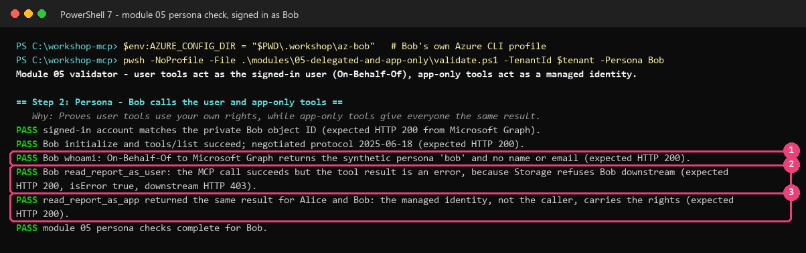

# 05 — Delegated versus app-only rights: portal-first low-code

[Français](LOW-CODE.fr.md)

## Goal

[Terraform + PowerShell guide](README.md)

Read one synthetic report through two different identities. As user: Alice succeeds, Bob is refused. As app: both get the same report. This separated guide has not been live-validated end to end.

## Why it matters

On-Behalf-Of (OBO) exchanges the MCP token for a new downstream token carrying the user's context. Storage checks that user's Azure role. App-only access uses a separate managed identity and its role, independent of the caller. Never forward the original MCP token to Graph or Storage.

> [!NOTE]
> Read both the HTTP status and the MCP tool result. Bob's user-context report call can return HTTP 200 while the tool reports an error caused by downstream Storage HTTP 403.

## What you deploy

Two user-assigned managed identities: `…-obo` proves the API's identity in OBO and has **no Azure data role**; `…-report` gets Storage Blob Data Reader on **only the reports container**. Alice is also a reader there; Bob is not. The publisher gets container-scoped Storage Blob Data Contributor. The app registration gets one federated credential, delegated Graph `User.Read` and Storage `user_impersonation`, with approved consent. No client secret.

The existing tools become real: `whoami` calls Graph and returns only the allowlisted persona label; `read_report_as_user` uses OBO; `read_report_as_app` uses the report identity. New tokens have the downstream audience. App-only callers cannot use user-context tools.

**Cost:** existing APIM/Functions/Storage/telemetry charges continue. Private report publication briefly creates a container instance, identity, role, subnet and network security group, then removes them. Obtain approval for those transient resources too. No new Preview dependency; module 04 MCP management remains **Preview**.

## Prerequisites and required roles

- [Module 02](../02-open-server/LOW-CODE.md), [module 03](../03-entra-authentication/LOW-CODE.md), and the [module 04 low-code gateway](../04-governed-gateway/LOW-CODE.md) complete.
- The current repository server package was published **before** module 04 disabled public access. Do not reopen public deployment endpoints. If the code is older, stop and obtain an approved private-network publishing environment.
- PowerShell 7.4+, Azure CLI, VS Code/Copilot. Terminal at repository root, participant file retained.
- Participant: Contributor on the group; constrained role-assignment permission for Storage Blob Data Reader and Storage Blob Data Contributor at the reports container only. Contributor cannot grant these roles alone.
- Identity administrator: Application Administrator or Cloud Application Administrator (or app owner for configuration); approved administrator with Application Administrator/Cloud Application Administrator for delegated admin consent. No Global Administrator request.
- Alice/Bob user **Object IDs**, API **Application (client) ID**, Tenant ID and Subscription ID from the portal. Eve remains unassigned.
- For private Storage publication: approved `Microsoft.ContainerInstance` provider registration and available Linux container quota; a free `10.52.1.64/28` in the workshop network. The existing publisher selects the first virtual network in the resource group: verify the group has only the intended workshop network. If not, stop rather than uploading into an unrelated network.

## Steps

### 1. Recreate this module's terminal context

Portal → **Subscriptions → subscription → Overview**: Subscription ID; **Entra → Overview**: Tenant ID; **App registrations → workshop API → Overview**: Application (client) ID. Replace placeholders:

```powershell
$tenant = '<tenant-id>'; $sub = '<subscription-id>'; $apiClientId = '<api-application-client-id>'
az login --tenant $tenant
az account set --subscription $sub
$p = Get-Content .\.workshop\participant.tfvars.json -Raw | ConvertFrom-Json
$id = "$($p.participant_prefix)lc"; $sfx = $p.resource_suffix.Substring(0, 10)
$rg = "rg-mcp-$id-$sfx"
if ($p.existing_resource_group_name) { $rg = $p.existing_resource_group_name }
$st = "st$id$sfx"; $fn = "func-mcp-$id-$sfx"; $apim = "apim-mcp-$id-$sfx"; $mi = "id-mcp-$id-$sfx"
$obo = "$mi-obo"; $rep = "$mi-report"
$rg; $st; $fn; $apim; $obo; $rep
```

> **Expected result** — existing low-code resource names and the two new identity names. No previous terminal variables are assumed. Retain the same participant suffix and region, West Europe.

### 2. Participant: create the two identities and container roles in the portal

1. **Managed Identities → Create** twice, same group/subscription and **West Europe**, names `$obo` and `$rep`. Tags: `workshop=governed-mcp`, `owner`/`expiry` from participant file, `track=low-code`.
2. Each identity → **Overview**: copy its **Client ID** and **Principal ID** privately. Client ID configures code; Principal ID identifies the role/federation subject. They are not interchangeable.
3. Function → **Settings → Identity → User assigned → + Add**: add both. Keep the original `$mi`; three identities must remain attached.
4. Storage `$st` → **Data storage → Containers** is where you inspect `reports`, public access **Private**. Create it with the management-plane command below because private networking or data-plane permissions can block the browser. Never turn public access or keys on, or request an account-wide data role.

```powershell
az storage container-rm create -g $rg --storage-account $st -n reports -o none
```

> **Expected result** — no output, exit code 0; the private `reports` container exists. This command does not upload data or require a Storage key.

5. **Containers → reports → Access control (IAM) → Add role assignment**: **Storage Blob Data Reader**, **Managed identity**, choose `$rep`, **Review + assign**. Scope must end in `/blobServices/default/containers/reports`, not the whole account.
6. Repeat **Storage Blob Data Reader**, member **User, group, or service principal**, choose **Alice** by her Object ID. Assign **Storage Blob Data Contributor** to **your publishing operator** at the same container scope.
7. Verify **Role assignments**: two readers (Alice and `$rep`), one publisher. No role for Bob or `$obo`. Inherited roles for Bob or the OBO identity can invalidate the experiment: stop and ask the resource owner to resolve the test setup, do not add more roles.

### 3. Identity administrator: configure trust and delegated consent

1. **Microsoft Entra ID → App registrations → workshop API**: verify the participant's Application (client) ID.
2. **Certificates & secrets → Federated credentials → Add credential**: scenario **Managed identity**, select the participant subscription, group and **`…-obo`** identity, not `…-report`.
3. Name `workshop-obo-lowcode`, description `Module 05 OBO managed identity, no secret`. Verify issuer `https://login.microsoftonline.com/<tenant-id>/v2.0`, subject = OBO **Principal ID**, audience `api://AzureADTokenExchange`. **Add**. If a credential already exists, inspect it rather than adding a duplicate. Exactly one is expected.
4. **API permissions → Add a permission → Microsoft Graph → Delegated permissions → User.Read → Add permissions**.
5. **Add a permission → APIs my organization uses**: search **Azure Storage**, Application ID `e406a681-f3d4-42a8-90b6-c2b029497af1`; **Delegated permissions → user_impersonation → Add permissions**.
6. After explicit approval, **Grant admin consent for your test tenant → Yes**. Verify only these two requested delegated permissions are granted. Do not grant application permissions, broad Graph permissions or a client secret.


*Illustrative real capture on the author's app; your name differs. Verify two Delegated permissions, Graph User.Read and Storage user_impersonation, and consent status on your own API.*


*Illustrative real capture. Verify your API has zero client secrets/certificates and one credential trusting the OBO identity. The credential name in the capture may differ.*

### 4. Participant: configure the downstream identity settings

In **Entra → Users → Alice/Bob → Overview**, copy their **Object IDs**. In Function → **Settings → Environment variables → App settings**, add these seven values, then **Apply → Confirm**. Replace every placeholder; do not include angle brackets. For the last value paste compact JSON with literal double quotes.

| Name | Value |
|---|---|
| `WORKSHOP_DELEGATED_ACCESS` | `enabled` |
| `WORKSHOP_TENANT_ID` | `<tenant-id>` |
| `WORKSHOP_MCP_API_CLIENT_ID` | `<api-application-client-id>` |
| `WORKSHOP_OBO_ASSERTION_CLIENT_ID` | `<obo-identity-client-id>` |
| `WORKSHOP_REPORT_IDENTITY_CLIENT_ID` | `<report-identity-client-id>` |
| `WORKSHOP_REPORT_CONTAINER_URL` | `https://<your-storage-name>.blob.core.windows.net/reports` |
| `WORKSHOP_PERSONA_OBJECT_IDS` | `{"alice":"<alice-object-id>","bob":"<bob-object-id>"}` |

Keep the original host-storage/queue identity settings, required Entra authentication and private-network lock unchanged. There is no downstream client secret setting.

### 5. Publish the synthetic report — terminal required

Storage → **Networking → Public access** determines which one of the following network cases applies. This is not a choice to weaken the network.

**Public network disabled:** after approval for transient infrastructure, run the existing in-network publisher:

```powershell
& .\modules\05-delegated-and-app-only\publish-report.ps1 -TenantId $tenant -SubscriptionId $sub -StorageAccount $st -InsideVirtualNetwork -ResourceGroup $rg -SubnetPrefix 10.52.1.64/28
```

> **Expected result** — PASS explicit context; temporary subnet/identity/container-scoped role created; report `reports/monthly-usage.json` uploaded with managed identity (**HTTP 201**), no key or shared access signature (SAS); temporary container, identity, role, subnet and its security group deleted. Check the final cleanup message. A failure is not permission to enable public access.

**Only if Storage is already reachable under its approved public-network policy:** the direct publisher needs your container-scoped data role:

```powershell
& .\modules\05-delegated-and-app-only\publish-report.ps1 -TenantId $tenant -SubscriptionId $sub -StorageAccount $st
```

> **Expected result** — synthetic report uploaded with Entra authorization, HTTP 201. Do not execute both paths or upload real data.

### 6. Connect VS Code and compare identities

1. **Ctrl+Shift+P → MCP: Open User Configuration**: configure the gateway URL, never the private Function:

```json
{
  "servers": {
    "workshop-governed": { "type": "http", "url": "https://<your-apim-name>.azure-api.net/workshop-mcp/mcp" }
  }
}
```

2. Replace the placeholder with `$apim`. **Start → Allow** Microsoft authentication → sign in as **Alice**. **Chat → Agent → Configure Tools**: only this server.
3. Ask `Call whoami, read_report_as_user, then read_report_as_app. Compare the identity used by each tool.` Approve only the displayed tool call, not automatic approval.
4. **Profiles: New Profile...** for **Bob**; repeat the server configuration and sign in as Bob. Ask the same question. Complete any required MFA normally.
5. Alice's user read succeeds; Bob's tool returns a downstream refusal; app-only report is identical. Neither result should expose name/email or a token.

## What you should see

| Call | Alice | Bob |
|---|---|---|
| `whoami` | HTTP 200, persona `alice` | HTTP 200, persona `bob` |
| `read_report_as_user` | HTTP 200, `isError: false` | HTTP 200, `isError: true`, downstream Storage 403 |
| `read_report_as_app` | HTTP 200, shared report | HTTP 200, same shared report |

An outer HTTP 200 does not mean the tool succeeded. Eve remains blocked by assignment at the token endpoint (module 03/04); she is not a module 05 persona.



*Illustrative real capture, not evidence of running this separated guide. On your output verify whoami through OBO, Bob's error inside HTTP 200, then the identical app-only result. Resource names differ.*

## Validate

In VS Code create/check ignored `.workshop/module03-personas.json`: `{"alice":"<alice-object-id>","bob":"<bob-object-id>","eve":"<eve-object-id>"}` with user Object IDs from Entra, no tokens. Use the same Alice/Bob IDs as the Function settings.

Operator checks:

```powershell
$v = @{ TenantId = $tenant; ResourceGroup = $rg; FunctionApp = $fn; GatewayName = $apim; ApiClientId = $apiClientId
    StorageAccount = $st; OboIdentityName = $obo; PersonaObjectIdsPath = '.\.workshop\module03-personas.json'; SkipBuild = $true }
& .\modules\05-delegated-and-app-only\validate.ps1 @v -SubscriptionId $sub
```

> **Expected result** — PASS settings name two downstream identities without secrets; API has no secret and exactly one OBO federated credential; report container has two readers, none for Bob/OBO. These are management HTTP 200 checks; persona checks remain necessary. `-SkipBuild` avoids the shared Terraform mock/build suite; explicit names avoid state.

Sign in separately as each named user, never as the operator:

```powershell
$operatorConfig = $env:AZURE_CONFIG_DIR
try {
    foreach ($persona in 'Alice', 'Bob') {
        Write-Host "Sign in as $persona"
        $env:AZURE_CONFIG_DIR = Join-Path $PWD ".workshop\az-$($persona.ToLower())"
        az login --tenant $tenant --allow-no-subscriptions
        if ($LASTEXITCODE) { throw "Login failed for $persona" }
        & .\modules\05-delegated-and-app-only\validate.ps1 @v -Persona $persona
        az logout
    }
} finally {
    if ($null -eq $operatorConfig) { Remove-Item Env:\AZURE_CONFIG_DIR -ErrorAction SilentlyContinue }
    else { $env:AZURE_CONFIG_DIR = $operatorConfig }
}
az account set --subscription $sub
```

> **Expected result** — private Object ID cross-check PASS, all six table results PASS. After the second persona, the validator compares report hashes and confirms identical app-only output. Evidence contains hashes, not tokens or report bodies. Your original operator profile is restored for cleanup.

## Troubleshooting

- **OBO exchange error:** check exact tenant v2 issuer, subject = OBO Principal ID, assertion setting = OBO Client ID, audience `api://AzureADTokenExchange`, and two delegated consents. Do not create a secret.
- **Alice Storage 403:** verify container-scoped role and propagation, account network/DNS, and the report's existence.
- **Bob user read succeeds:** check for inherited Storage roles. Do not remove unrelated production roles; use the dedicated test setup with its owner.
- **App read fails for both:** verify the report identity, not OBO, has container reader; verify the report URL.
- **Private upload fails:** inspect temporary-resource cleanup, subnet availability and container quota. Keep the network private; do not bypass policy.
- **Code still returns demonstrations:** verify the current package was published and `WORKSHOP_DELEGATED_ACCESS=enabled`. Public access stays disabled.

## Clean up

If continuing immediately, retain resources for [module 06 low-code](../06-observe-inventory/LOW-CODE.md). Otherwise follow [module 99 low-code cleanup](../99-cleanup/LOW-CODE.md) after review and approval. Verify transient publisher resources were removed; delete only workshop-owned group resources and the workshop API registration (including trust and consent). Keep supplied users/apps/groups. Never invoke Terraform cleanup for portal resources. Remove VS Code entries and sign out persona profiles.

## Go further

**Question:** Bob cannot read the report as a user, but can read it through the app-only tool. Which identity's rights permit that second read?

<details>
<summary>Show answer</summary>

The report managed identity's container-scoped reader role permits it. The app-only tool does not use Bob's Storage rights. This is why exposing an app-only tool requires its own deliberate authorization design.

</details>

Explain which identity Storage sees for each report tool. Removing Bob's gateway read role is not the same as removing his Storage role: the controls run at different hops.

## Sources

- [On-Behalf-Of flow](https://learn.microsoft.com/entra/identity-platform/v2-oauth2-on-behalf-of-flow).
- [Trust a managed identity](https://learn.microsoft.com/entra/workload-id/workload-identity-federation-config-app-trust-managed-identity).
- [Pinned upstream sample](https://github.com/Azure-Samples/remote-mcp-functions-dotnet/tree/468c518c884ec318e3001b9573254c9e775409c9) and [license notices](../../THIRD-PARTY-NOTICES.md).

Last verified: 2026-10-20 (existing implementation and documentation; this separated guide not live-validated).
