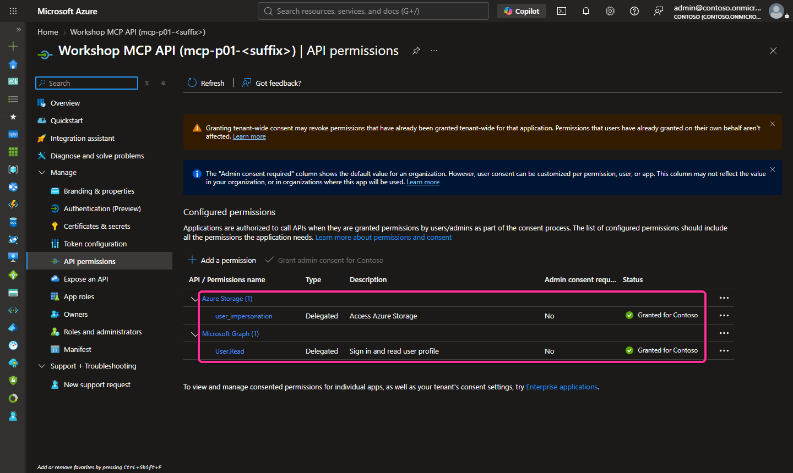
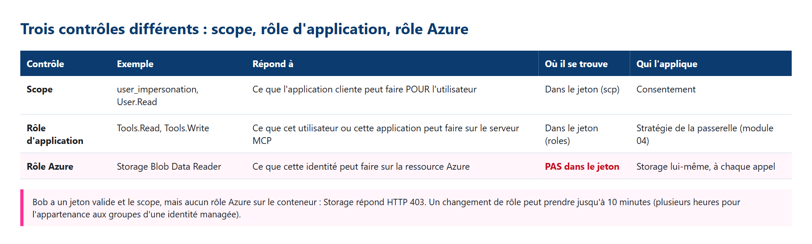

# 05 - Qui porte les droits ? On-Behalf-Of ou application seule (niveau 3)

[English](README.md)

## Objectif

Poser **la même question** sous l'identité de deux utilisateurs différents et voir **qui porte les droits** en aval. À la fin :

- `whoami` appelle Microsoft Graph **au nom de** l'utilisateur connecté et ne renvoie qu'une étiquette de persona synthétique
  (`alice` ou `bob`) ;
- `read_report_as_user` lit un rapport synthétique dans Azure Storage **en tant qu'utilisateur** (On-Behalf-Of, OBO) : **Alice**
  obtient le rapport, **Bob** obtient une **erreur d'outil MCP dans une réponse HTTP 200**, car Storage lui répond HTTP 403 ;
- `read_report_as_app` lit le même rapport **en tant qu'application** (une identité managée) : **Alice et Bob obtiennent le même
  résultat** ;
- **il n'existe aucun secret client, nulle part** : l'API MCP prouve son identité avec une identité managée via des informations d'identification fédérées.

> [!WARNING]
> Ne collez jamais un jeton réel dans un site web, une conversation, un fichier, une capture ou un journal. Le validateur ne
> conserve les jetons qu'en mémoire, et `whoami` ne renvoie jamais ni vrai nom ni adresse e-mail.

## Pourquoi cette étape compte

Jusqu'ici, les outils n'appelaient aucun service en aval (démonstrations synthétiques) ou utilisaient l'identité du serveur. Les
outils réels appellent d'autres API. La question de conception devient alors : **avec les droits de qui** l'appel part-il ?

| | Contexte utilisateur : **On-Behalf-Of** | Contexte application : **identité managée** |
|---|---|---|
| Outils | `whoami`, `read_report_as_user` | `read_report_as_app` |
| Jeton en aval | Un **nouveau** jeton pour Graph (`User.Read`) ou Storage (`user_impersonation`), émis pour l'utilisateur connecté | Un jeton propre à l'application, émis pour l'identité managée affectée par l'utilisateur |
| Qui décide de l'accès | Le rôle **de l'utilisateur** sur les données (Alice : Storage Blob Data Reader ; Bob : aucun) | Le rôle **de l'identité** (Storage Blob Data Reader sur un conteneur) |
| Résultat | Différent selon l'utilisateur | **Identique pour tout appelant** que la passerelle laisse passer |
| Risque en cas d'abus | Faible : le serveur ne peut pas dépasser les droits de l'utilisateur | « Confused deputy » (mandataire abusé) : quiconque peut appeler l'outil lit ce que l'application peut lire |

### Suivre l'identité en aval, pas seulement HTTP

**Un jeton par appel, une audience par jeton.** Le jeton du client MCP a pour audience l'API MCP. Le serveur ne le transmet jamais
à Graph ni à Storage (pas de token passthrough). Pour les outils en contexte utilisateur, il présente ce jeton **uniquement à
Microsoft Entra ID**, comme *assertion* OBO, et reçoit en échange un jeton distinct par ressource en aval. L'outil en mode application
seule, lui, n'utilise pas du tout le jeton de l'appelant.

**OBO sans secret.** OBO exige que l'API MCP s'authentifie comme client confidentiel. Au lieu d'un secret client ou d'un
certificat, l'inscription de l'API fait confiance à **une identité managée affectée par l'utilisateur** de la charge de travail,
via un **identifiant d'identité fédérée** (émetteur `https://login.microsoftonline.com/<tenant>/v2.0`, sujet = l'ID de principal
de l'identité, audience `api://AzureADTokenExchange`). Le serveur demande à cette identité un jeton dont l'audience est
`api://AzureADTokenExchange` et l'utilise comme assertion client ([concept](../../docs/fr/concepts/obo-and-managed-identity.md)).

**OBO est réservé aux utilisateurs.** Les outils en contexte utilisateur refusent un jeton d'application (sans revendication `scp`,
`idtyp=app`) avant tout appel en aval. Sinon, OBO produirait un jeton qui ne représente pas l'appelant d'origine.

**Statut HTTP externe ou résultat de l'outil.** MCP transporte les erreurs d'outil dans une réponse JSON-RPC réussie : l'appel de
Bob renvoie **HTTP 200** avec `result.isError: true`. Le HTTP 403 de la passerelle (module 04) signifie « vous ne pouvez pas
appeler cet outil » ; une erreur d'outil avec HTTP 200 signifie « l'outil s'est exécuté, et l'API en aval a refusé l'identité
qu'il a utilisée ».

## Ce que vous déployez

Tout s'active par des variables explicites, désactivées par défaut. Tant que `enable_delegated_access` vaut false, les modules 00 à 04
ne changent pas et le serveur garde les démonstrations du module 02 pour `whoami` et `read_report_*`.

### Examiner les identités de la charge de travail

**Charge de travail** (`infra/workload/delegated-access.tf`, participant) :

| Ressource | Paramètres |
|---|---|
| Identité affectée par l'utilisateur `id-mcp-<prefix>-<suffix>-obo` | Approuvée par les informations d'identification fédérées de l'API MCP. **Aucun rôle Azure.** Sert uniquement à obtenir l'assertion client OBO. |
| Identité affectée par l'utilisateur `id-mcp-<prefix>-<suffix>-report` | Identité application seule de `read_report_as_app` |
| Conteneur blob `reports` (compte de stockage du module 02, clés partagées désactivées) | Privé ; contient le fichier synthétique `monthly-usage.json` ([synthetic-data](synthetic-data/monthly-usage.json)) |
| Attribution de rôle | **Storage Blob Data Reader** pour l'identité `-report`, portée limitée au seul conteneur `reports` |
| Attribution de rôle | **Storage Blob Data Reader** pour Alice (`delegated_persona_object_ids.alice`), même portée. **Bob n'a rien.** |
| Attribution de rôle | Storage Blob Data Contributor sur le conteneur pour la personne qui publie le rapport (par défaut : l'utilisateur Terraform connecté) |
| Function App (module 02) | Les deux identités attachées ; paramètres `WORKSHOP_*` non secrets : tenant, ID client de l'API MCP, ID client des deux identités, URL du conteneur, table des personas |

**Pourquoi deux nouvelles identités ?** L'identité OBO peut agir au nom de l'inscription de l'API MCP. C'est pourquoi elle n'a aucun
rôle sur les données : un appel en contexte utilisateur ne dispose que des droits délégués de l'utilisateur. Une autre identité porte
les droits application seule. Aucun outil n'utilise l'identité d'hébergement du module 02 (Blob Data Owner sur tout le compte, pour
l'hôte Functions).

### Examiner la confiance et le consentement Entra

**Microsoft Entra** (`infra/entra/delegation.tf`, administrateur des identités, application créée uniquement) :

| Variable | Ressource | Effet |
|---|---|---|
| `enable_delegated_access` | `azuread_application_api_access` | L'API MCP demande les autorisations déléguées Microsoft Graph `User.Read` et Azure Storage `user_impersonation`. Terraform lit les ID de scope dans les principaux de service du tenant. Aucune autorisation d'application. |
| `obo_identity_principal_id` | `azuread_application_federated_identity_credential` | Fait confiance à l'identité `-obo` (sujet = son ID de principal). |
| `grant_downstream_admin_consent` | `azuread_service_principal_delegated_permission_grant` | Consentement administrateur à l'échelle du tenant pour ces deux scopes exactement (décision de l'administrateur des identités). |


**Preview :** aucun nouvel élément en Preview dans ce module. Les métadonnées de ressource protégée sur la Function (module 03) et l'API de serveur
MCP d'API Management `2025-09-01-preview` (module 04) restent en **Preview** si vous les utilisez.

**Coût :** deux identités managées et un conteneur ne coûtent rien en eux-mêmes ; les transactions Storage et les appels Graph
supplémentaires sont négligeables. La passerelle du module 04 reste facturée tant qu'elle existe.

**Code :** les outils se trouvent dans [src/FunctionsMcpServer](../../src/FunctionsMcpServer) (`Logic/DelegatedTools.cs`,
`Identity/DownstreamCredentials.cs`, `Logic/CallerContext.cs`). Ils reprennent `HelloToolWithAuth.cs` de l'exemple épinglé
(`Azure-Samples/remote-mcp-functions-dotnet`, commit `468c518c884ec318e3001b9573254c9e775409c9`, MIT), avec ces modifications : pas de
repli sur l'identité du développeur, l'assertion utilisateur vient de la requête validée par la plateforme (authentification
intégrée), seul l'ID d'objet Graph est demandé (`/me?$select=id`), et une seconde identité managée porte les droits application seule.

## Prérequis et rôles nécessaires

- Modules 02 et 03 déployés (module 04 recommandé) avec les mêmes fichiers privés et le même état Terraform. Publiez le code du
  serveur issu de cette version du dépôt (elle contient le module 05) **avant** l'étape 2 du module 04, qui rend privés les points de
  déploiement.
- Les comptes de test existants Alice et Bob du module 03 (ID d'objet uniquement) ; Eve reste sans affectation.
- Terraform 1.16.6+, Azure CLI, PowerShell 7.4+. Exemple de région : `swedencentral`.

**Participant :** rôle Contributeur sur le groupe de ressources de l'atelier, ainsi que le droit de créer trois attributions de rôle limitées
au conteneur `reports` (par exemple Role Based Access Control Administrator, restreint à Storage Blob Data Reader et Contributor,
limité dans le temps).

**Administrateur des identités :** Application Administrator ou Cloud Application Administrator (ou propriétaire de l'application
de l'atelier) pour ajouter les informations d'identification fédérées et les autorisations demandées. Pour accorder le consentement administrateur
à l'échelle du tenant sur des autorisations déléguées, il faut le rôle Cloud Application Administrator ou Application Administrator. Voir la
[demande d'identité](../../docs/requests/identity-request.md).

## Étapes

### PowerShell

Exécutez les commandes depuis la racine du dépôt. Les étapes 2 à 5 modifient Azure ou Microsoft Entra : ne les exécutez qu'après approbation du plan.

**1. Vérifications hors ligne (sans Azure).**

```powershell
& .\modules\05-delegated-and-app-only\validate.ps1 -Offline
```

> **Résultat attendu** — d'après les messages du validateur ; pas encore une capture d'une exécution participant. Le nombre de fichiers dépend de votre copie.
>
> ```text
> PASS server: On-Behalf-Of with a managed-identity assertion, one token per downstream (Graph User.Read, Storage user_impersonation), app-only identity for read_report_as_app, app-only callers refused, no developer-credential fallback, no token parsing (expected HTTP N/A).
> PASS infra/entra: federated credential (tenant v2.0 issuer, managed identity principal ID subject, api://AzureADTokenExchange), delegated Graph User.Read + Storage user_impersonation only, admin consent opt-in, no password or certificate (expected HTTP N/A).
> PASS infra/workload: separate OBO assertion and app-only identities, every module 05 role on the one report container, no role for the OBO or host identity, Bob none, opt-in only (expected HTTP N/A).
> PASS synthetic report and expected results are labelled synthetic and contain no address, ID or token (<n> files, expected HTTP N/A).
> PASS no client secret, key, SAS or token in module 05, server, infra/entra or infra/workload files (<n> files, expected HTTP N/A).
> PASS locked build and unit tests: Alice reads, Bob denied downstream, app-only identical for everyone, app-only callers refused, Graph gets only its own token (expected HTTP N/A).
> PASS Terraform format, schema and mock-only plans for infra/entra and infra/workload (expected HTTP N/A; no live plan/apply).
> NOT DEPLOYED CHECKS SKIPPED: supply -TenantId with -SubscriptionId (operator) or -Persona (test account) after an approved deployment.
> PASS offline checks only. Module 05 is NOT deployed or validated by this result.
> ```
>
> **Ce que cela signifie pour vous :** le code et le Terraform de votre copie conservent la conception On-Behalf-Of sans secret
> et les rôles limités au conteneur. Rien n'a été déployé.

**2. Fichier privé d'activation de la charge de travail (ignoré par Git).** Demandez les ID d'objet d'Alice et de Bob à
l'administrateur des identités (sortie `workload_module05_tfvars` de `infra/entra`).

```powershell
@{ enable_delegated_access = $true; delegated_persona_object_ids = @{ alice = '<alice-object-id>'; bob = '<bob-object-id>' } } |
    ConvertTo-Json | Set-Content -LiteralPath .\.workshop\module05.tfvars.json
```

> **Résultat attendu** — aucune sortie : `Set-Content` rend la main en silence en cas de succès.
> Vérifiez avec `Test-Path .\.workshop\module05.tfvars.json` (`True`). Le fichier ne contient que des ID d'objet, jamais de secret.

**3. Planifier les modifications de la charge de travail.** Sélectionnez d'abord votre contexte approuvé (`& .\scripts\select-azure-context.ps1`).
Passez tous les fichiers de variables déjà utilisés, ainsi que celui du module 05 (retirez `module04.tfvars.json` si vous n'avez pas
fait le module 04).

```powershell
$vars = '-var-file=..\..\.workshop\participant.tfvars.json', '-var-file=..\..\.workshop\module02.tfvars.json',
        '-var-file=..\..\.workshop\module03.tfvars.json', '-var-file=..\..\.workshop\module04.tfvars.json',
        '-var-file=..\..\.workshop\module05.tfvars.json'
terraform '-chdir=infra\workload' plan @vars '-out=..\..\.workshop\module05.tfplan'
if ($LASTEXITCODE -ne 0) { throw 'Terraform plan failed.' }
```

> **Résultat réel** — résumé du plan sauvegardé, 2026-10-18, tenant de test de l'auteur. Noms et ID masqués.
>
> ```text
> Plan: 6 to add, 3 to change, 0 to destroy.
> ```
>
> **Ce que cela signifie pour vous :** six ajouts : deux identités, un conteneur et trois attributions de rôle (un rôle de
> lecteur pour Alice, aucun pour Bob, et aucun rôle pour l'identité `-obo`). Le plan de l'auteur comptait **3**
> modifications : la mise à jour de la Function App, plus les deux stratégies azapi du module 04, une normalisation connue
> des espaces (aucun changement fonctionnel). Sans module 04, attendez-vous à 1 modification.
> Un `to destroy` signifie qu'il manque un fichier de variables : n'appliquez pas.

**Observez :** deux identités, un conteneur, trois attributions limitées au conteneur et une mise à jour en place de la Function App.
Rien n'est encore appliqué. Expliquez quelle identité porte les droits applicatifs.

### Appliquer le plan de charge de travail seulement après accord

**STOP :** faites approuver exactement ce plan sauvegardé avant de lancer cette commande.

```powershell
terraform '-chdir=infra\workload' apply '..\..\.workshop\module05.tfplan'
if ($LASTEXITCODE -ne 0) { throw 'Terraform apply failed.' }
```

> **Résultat réel** — extrait de l'apply, 2026-10-18, tenant de test de l'auteur. Noms et ID masqués.
>
> ```text
> azapi_resource.prm_operation_policy[0]: Modifications complete after 2s [id=/subscriptions/<subscription-id>/resourceGroups/rg-mcp-p01-<suffix>/providers/Microsoft.ApiManagement/service/apim-mcp-p01-<suffix>/apis/workshop-mcp-prm/operations/get-mcp-metadata/policies/policy]
> azurerm_storage_container.reports[0]: Creation complete after 19s [id=/subscriptions/<subscription-id>/resourceGroups/rg-mcp-p01-<suffix>/providers/Microsoft.Storage/storageAccounts/stp01<suffix>/blobServices/default/containers/reports]
> azurerm_user_assigned_identity.delegated_obo[0]: Creation complete after 38s [id=/subscriptions/<subscription-id>/resourceGroups/rg-mcp-p01-<suffix>/providers/Microsoft.ManagedIdentity/userAssignedIdentities/id-mcp-p01-<suffix>-obo]
> azurerm_user_assigned_identity.delegated_report[0]: Creation complete after 41s [id=/subscriptions/<subscription-id>/resourceGroups/rg-mcp-p01-<suffix>/providers/Microsoft.ManagedIdentity/userAssignedIdentities/id-mcp-p01-<suffix>-report]
> azurerm_role_assignment.report_publisher[0]: Creation complete after 39s [id=/subscriptions/<subscription-id>/resourceGroups/rg-mcp-p01-<suffix>/providers/Microsoft.Storage/storageAccounts/stp01<suffix>/blobServices/default/containers/reports/providers/Microsoft.Authorization/roleAssignments/<guid>]
> azurerm_role_assignment.report_persona_reader["alice"]: Creation complete after 39s [id=/subscriptions/<subscription-id>/resourceGroups/rg-mcp-p01-<suffix>/providers/Microsoft.Storage/storageAccounts/stp01<suffix>/blobServices/default/containers/reports/providers/Microsoft.Authorization/roleAssignments/<guid>]
> azurerm_role_assignment.report_app_reader[0]: Creation complete after 42s [id=/subscriptions/<subscription-id>/resourceGroups/rg-mcp-p01-<suffix>/providers/Microsoft.Storage/storageAccounts/stp01<suffix>/blobServices/default/containers/reports/providers/Microsoft.Authorization/roleAssignments/<guid>]
> azurerm_function_app_flex_consumption.mcp[0]: Modifications complete after 43s [id=/subscriptions/<subscription-id>/resourceGroups/rg-mcp-p01-<suffix>/providers/Microsoft.Web/sites/func-mcp-p01-<suffix>]
> azapi_resource.mcp_api_policy[0]: Modifications complete after 0s [id=/subscriptions/<subscription-id>/resourceGroups/rg-mcp-p01-<suffix>/providers/Microsoft.ApiManagement/service/apim-mcp-p01-<suffix>/apis/workshop-mcp/policies/policy]
> Apply complete! Resources: 6 added, 3 changed, 0 destroyed.
> ```
>
> **Ce que cela signifie pour vous :** les identités, le conteneur et les rôles existent. Chaque attribution de rôle est
> limitée au seul conteneur `reports`. Les attributions de rôle peuvent mettre quelques minutes à prendre effet.

**Observez :** les ressources approuvées existent. L'API attend encore que l'administrateur des identités configure la confiance.

### Lire uniquement la sortie requise par l'administrateur

**Action :** transmettez cette référence en privé à l'administrateur, jamais dans l'interface partagée ni dans le dépôt.

```powershell
terraform '-chdir=infra\workload' output -json entra_module05_tfvars   # à envoyer à l'administrateur des identités
if ($LASTEXITCODE -ne 0) { throw 'Cannot read the administrator handoff.' }
```

> **Résultat attendu** — forme de sortie Terraform ; la valeur est ici un espace réservé.
>
> ```text
> {
>   "enable_delegated_access": true,
>   "obo_identity_principal_id": "<obo-principal-id>"
> }
> ```
>
> **Ce que cela signifie pour vous :** c'est un ID de principal, pas un secret, mais gardez-le dans des canaux privés.
> L'administrateur n'a besoin de rien d'autre de votre part.

Tant que l'étape 4 n'est pas terminée, `whoami` et `read_report_as_user` échouent sans risque (erreur d'outil) : l'API ne fait pas
encore confiance à l'identité.

**4. Administrateur des identités : informations d'identification fédérées, autorisations, consentement.** Dans son propre terminal, avec son propre état :

```powershell
@{ enable_delegated_access = $true; obo_identity_principal_id = '<principal-id-from-step-3>'; grant_downstream_admin_consent = $true } |
    ConvertTo-Json | Set-Content -LiteralPath .\.workshop\entra-module05.tfvars.json
terraform '-chdir=infra\entra' plan '-var-file=..\..\.workshop\entra.tfvars.json' '-var-file=..\..\.workshop\entra-module05.tfvars.json' '-out=..\..\.workshop\entra05.tfplan'
if ($LASTEXITCODE -ne 0) { throw 'Entra plan failed.' }
```

> **Résultat réel** — résumé du plan sauvegardé lors de l'exécution de l'administrateur des identités, 2026-10-18, tenant de test de l'auteur. Noms et ID masqués.
>
> ```text
> Plan: 5 to add, 0 to change, 0 to destroy.
> ```
>
> **Ce que cela signifie pour vous :** cinq ajouts, tous des objets du module 05, sans mot de passe ni certificat. Toute
> modification d'objets du module 03 signifie que les mauvais fichiers de variables ont été passés : n'appliquez pas.

**Observez :** le plan propose deux accès d'API, des informations d'identification fédérées et deux consentements. Aucun consentement n'est encore accordé.

### Administrateur des identités : approuver la confiance et le consentement

**STOP :** examinez les autorisations déléguées exactes et le plan sauvegardé. Seul l'administrateur des identités exécute cette commande, dans son propre contexte.

```powershell
terraform '-chdir=infra\entra' apply '..\..\.workshop\entra05.tfplan'
if ($LASTEXITCODE -ne 0) { throw 'Entra apply failed.' }
```

> **Résultat réel** — extrait de l'apply, 2026-10-18, tenant de test de l'auteur. Noms et ID masqués.
>
> ```text
> azuread_service_principal_delegated_permission_grant.downstream["graph"]: Creation complete after 3s [id=/oauth2PermissionGrants/<grant-id>]
> azuread_service_principal_delegated_permission_grant.downstream["storage"]: Creation complete after 3s [id=/oauth2PermissionGrants/<grant-id>]
> azuread_application_federated_identity_credential.obo[0]: Creation complete after 8s [id=<guid>/federatedIdentityCredential/<guid>]
> azuread_application_api_access.downstream["storage"]: Creation complete after 11s [id=/applications/<guid>/apiAccess/<guid>]
> azuread_application_api_access.downstream["graph"]: Creation complete after 12s [id=/applications/<guid>/apiAccess/<guid>]
> Apply complete! Resources: 5 added, 0 changed, 0 destroyed.
> ```
>
> **Ce que cela signifie pour vous :** l'API MCP fait désormais confiance à l'identité `-obo` et dispose du consentement pour
> exactement deux scopes délégués. `whoami` et `read_report_as_user` peuvent maintenant échanger des jetons.

Vérifiez-le dans le centre d'administration Microsoft Entra (captures réelles, 2026-10-19, tenant de test de l'auteur ;
noms pseudonymisés, ID remplacés par des zéros ; portail affiché en anglais). Les cadres roses montrent quoi vérifier. Sélectionnez une image pour l'ouvrir en grand.

**App registrations → Workshop MCP API → API permissions.** Exactement deux autorisations déléguées : Azure Storage
`user_impersonation` (pour `read_report_as_user`) et Microsoft Graph `User.Read` (pour `whoami`). Aucune autorisation d'application.



**Même application → Certificates & secrets.** Certificates (0), Client secrets (0), Federated credentials (1) : l'échange
OBO prouve l'identité de l'API avec l'identité managée `-obo`, jamais avec un mot de passe.


**Question :** la documentation générale d'On-Behalf-Of montre un secret client. Où est-il ici ?

<details>
<summary>Voir la réponse</summary>

Il n'y en a pas : la capture affiche Client secrets (0). L'information d'identification fédérée permet à l'identité
managée `-obo` de signer l'échange de jetons à sa place. Aucun secret n'existe, donc rien à divulguer, à renouveler ni à commiter.

</details>

**5. Publier le rapport synthétique** (authentification Microsoft Entra, sans clé ; le script réessaie pendant la propagation du rôle) :

```powershell
& .\modules\05-delegated-and-app-only\publish-report.ps1 -TenantId $env:ARM_TENANT_ID -SubscriptionId $env:ARM_SUBSCRIPTION_ID
```

> **Résultat attendu** — d'après les messages du script ; pas encore une capture. La ligne `INFO` n'apparaît que pendant la propagation de votre rôle.
>
> ```text
> PASS explicit Azure context (expected HTTP 200 from Azure Resource Manager).
> INFO upload attempt 1 refused; the Storage Blob Data Contributor role may still be propagating. Retrying in <n> s.
> PASS synthetic report published as reports/monthly-usage.json with Microsoft Entra authentication, no key or SAS (expected HTTP 201).
> ```
>
> **Ce que cela signifie pour vous :** le rapport synthétique est dans le conteneur privé, déposé avec votre identité Entra, sans clé.

> [!NOTE]
> Si le module 02 a utilisé `mcp_private_storage = true`, l'accès réseau public du compte de stockage est désactivé et ce
> dépôt échoue depuis l'extérieur du réseau virtuel. C'est ce qui s'est produit dans le tenant de test de l'auteur le
> 2026-10-18. Lancez alors le même dépôt **depuis** le réseau virtuel, jamais en activant l'accès public ou les clés
> partagées. L'auteur a utilisé une Azure Container Instance de courte durée dans un sous-réseau délégué, avec une identité
> managée attribuée par l'utilisateur qui détenait le rôle Storage Blob Data Contributor sur le seul conteneur `reports`.
> Le conteneur a affiché `UPLOADED`. Supprimez l'instance de conteneur, son identité temporaire et son attribution de rôle
> juste après le dépôt.

**6. Essayer dans VS Code.** Avec le serveur `workshop-governed` du module 04, connecté en tant qu'Alice, collez ce prompt
dans Copilot Chat (mode **Agent**). Recommencez en tant que Bob dans un autre profil VS Code et comparez.

```prompt
Utilise le serveur MCP workshop-governed. Appelle whoami. Appelle ensuite read_report_as_user avec report "monthly-usage", puis read_report_as_app avec report "monthly-usage". Pour chaque appel, montre le résultat de l'outil et indique si isError vaut true.
```

Alice obtient deux rapports identiques. Bob obtient `isError: true` pour `read_report_as_user`, et le même rapport qu'Alice
pour `read_report_as_app`.

**7. Vérifications opérateur, puis vérifications par persona.**

```powershell
& .\modules\05-delegated-and-app-only\validate.ps1 -TenantId $env:ARM_TENANT_ID -SubscriptionId $env:ARM_SUBSCRIPTION_ID
foreach ($persona in 'Alice', 'Bob') {
    $env:AZURE_CONFIG_DIR = Join-Path $PWD ".workshop\az-$($persona.ToLower())"
    az login --tenant $env:ARM_TENANT_ID --allow-no-subscriptions   # se connecter en tant que $persona dans le navigateur
    & .\modules\05-delegated-and-app-only\validate.ps1 -TenantId $env:ARM_TENANT_ID -Persona $persona
    az logout
}
Remove-Item Env:\AZURE_CONFIG_DIR
```

> **Résultat réel** — vérifications opérateur (la première commande), 2026-10-18, tenant de test de l'auteur. Noms et ID masqués.
>
> ```text
> PASS server: On-Behalf-Of with a managed-identity assertion, one token per downstream (Graph User.Read, Storage user_impersonation), app-only identity for read_report_as_app, app-only callers refused, no developer-credential fallback, no token parsing (expected HTTP N/A).
> PASS infra/entra: federated credential (tenant v2.0 issuer, managed identity principal ID subject, api://AzureADTokenExchange), delegated Graph User.Read + Storage user_impersonation only, admin consent opt-in, no password or certificate (expected HTTP N/A).
> PASS infra/workload: separate OBO assertion and app-only identities, every module 05 role on the one report container, no role for the OBO or host identity, Bob none, opt-in only (expected HTTP N/A).
> PASS synthetic report and expected results are labelled synthetic and contain no address, ID or token (2 files, expected HTTP N/A).
> PASS no client secret, key, SAS or token in module 05, server, infra/entra or infra/workload files (47 files, expected HTTP N/A).
> PASS explicit Azure context matches the approved test target (expected HTTP 200 from Azure Resource Manager).
> PASS Function App settings name both module 05 identities and hold no secret setting (expected HTTP 200 from Azure Resource Manager).
> PASS MCP API registration: no client secret, exactly one federated credential trusting the OBO managed identity (expected HTTP 200 from Microsoft Graph).
> PASS report container: 2 Storage Blob Data Reader assignment(s) (app-only identity, Alice), none for the OBO identity or Bob (expected HTTP 200 from Azure Resource Manager).
> INFO persona checks skipped. Sign in as each test account in a separate AZURE_CONFIG_DIR and rerun with -Persona Alice, then -Persona Bob.
> PASS module 05 operator checks complete. Persona checks are still required for validation.
> ```
>
> **Ce que cela signifie pour vous :** la confiance est en place sans aucun secret : une seule information d'identification
> fédérée, deux identités distinctes, et des rôles de lecteur sur l'unique conteneur pour l'identité applicative et pour
> Alice seulement. Le nombre de fichiers dépend de votre copie.

> **Résultat attendu** — messages du validateur par persona ; non capturé : le tenant de test exige l'enregistrement MFA des comptes de test (extrait).
>
> ```text
> PASS Alice whoami: On-Behalf-Of to Microsoft Graph returns the synthetic persona 'alice' and no name or email (expected HTTP 200).
> PASS Alice read_report_as_user returns the synthetic report with her own Storage role (expected HTTP 200, isError false).
> PASS Bob read_report_as_user: the MCP call succeeds but the tool result is an error, because Storage refuses Bob downstream (expected HTTP 200, isError true, downstream HTTP 403).
> PASS read_report_as_app returned the same result for Alice and Bob: the managed identity, not the caller, carries the rights (expected HTTP 200).
> ```
>
> **Ce que cela signifie pour vous :** même question, deux utilisateurs, deux réponses **avec On-Behalf-Of** : ce sont
> les droits de l'utilisateur sur la donnée qui décident. Avec l'identité de l'application, tout le monde obtient la même réponse :
> ce sont les droits **de l'application** qui décident. L'« erreur dans un HTTP 200 » de Bob n'est pas un bug : la
> passerelle l'a laissé appeler l'outil, c'est Storage qui **le** refuse. Choisissez par outil le comportement voulu
> ([OBO expliqué simplement](../../docs/fr/MCP-CONCEPTS.md)).

### Bash

```bash
bash ./modules/05-delegated-and-app-only/validate.sh -Offline
printf '%s\n' '{"enable_delegated_access": true, "delegated_persona_object_ids": {"alice": "<alice-object-id>", "bob": "<bob-object-id>"}}' > .workshop/module05.tfvars.json
source ./scripts/select-azure-context.sh
vars="-var-file=../../.workshop/participant.tfvars.json -var-file=../../.workshop/module02.tfvars.json -var-file=../../.workshop/module03.tfvars.json -var-file=../../.workshop/module04.tfvars.json -var-file=../../.workshop/module05.tfvars.json"
terraform -chdir=infra/workload plan $vars -out=../../.workshop/module05.tfplan      # relire, approuver
terraform -chdir=infra/workload apply ../../.workshop/module05.tfplan
terraform -chdir=infra/workload output -json entra_module05_tfvars                    # pour l'administrateur des identités
# administrateur des identités, son terminal et son état :
printf '%s\n' '{"enable_delegated_access": true, "obo_identity_principal_id": "<principal-id>", "grant_downstream_admin_consent": true}' > .workshop/entra-module05.tfvars.json
terraform -chdir=infra/entra plan -var-file=../../.workshop/entra.tfvars.json -var-file=../../.workshop/entra-module05.tfvars.json -out=../../.workshop/entra05.tfplan
terraform -chdir=infra/entra apply ../../.workshop/entra05.tfplan
# de nouveau le participant :
bash ./modules/05-delegated-and-app-only/publish-report.sh -TenantId "$ARM_TENANT_ID" -SubscriptionId "$ARM_SUBSCRIPTION_ID"
bash ./modules/05-delegated-and-app-only/validate.sh -TenantId "$ARM_TENANT_ID" -SubscriptionId "$ARM_SUBSCRIPTION_ID"
for persona in Alice Bob; do
  export AZURE_CONFIG_DIR="$PWD/.workshop/az-${persona,,}"
  az login --tenant "$ARM_TENANT_ID" --allow-no-subscriptions
  bash ./modules/05-delegated-and-app-only/validate.sh -TenantId "$ARM_TENANT_ID" -Persona "$persona"
  az logout
done
unset AZURE_CONFIG_DIR
```

> **Résultat attendu** — les mêmes résumés Terraform et lignes PASS/FAIL que les étapes PowerShell ci-dessus.

## Ce que vous devez voir

Même question, deux personas. D'abord le statut HTTP externe, puis le résultat de l'outil MCP
([exemples synthétiques](synthetic-data/expected-tool-results.json)).

| Persona | Outil | HTTP externe | Résultat de l'outil | Pourquoi |
|---|---|---|---|---|
| Alice | `whoami` | HTTP 200 | `isError: false`, `persona: "alice"` | Jeton OBO pour Graph `User.Read` ; seul l'ID d'objet est lu puis associé à une étiquette |
| Bob | `whoami` | HTTP 200 | `isError: false`, `persona: "bob"` | Même flux, avec le jeton de Bob |
| Alice | `read_report_as_user` | HTTP 200 | `isError: false`, les deux lignes synthétiques | Jeton OBO pour Storage ; Alice a Storage Blob Data Reader sur `reports` |
| Bob | `read_report_as_user` | **HTTP 200** | **`isError: true`** | Jeton OBO pour Storage ; Bob n'a aucun rôle, Storage répond **HTTP 403** en aval |
| Alice | `read_report_as_app` | HTTP 200 | `isError: false`, les deux lignes synthétiques | L'identité managée `-report` lit le conteneur |
| Bob | `read_report_as_app` | HTTP 200 | `isError: false`, lignes **identiques** | Même identité, mêmes droits : l'appelant ne compte pas |
| Tout appelant application seule | `whoami` / `read_report_as_user` | HTTP 200 (ou 403 à la passerelle) | `isError: true` | OBO est réservé aux utilisateurs ; refus avant tout appel en aval |

Les journaux du serveur contiennent une ligne par appel : nom de l'outil, ID d'objet de l'appelant, résultat (`success`,
`denied-downstream:403`, `rejected-caller`), latence et ID d'invocation. Ils ne contiennent jamais les arguments, le rapport, un nom ni un jeton.

**Question :** pourquoi `read_report_as_app` donne-t-il le même résultat à Alice et à Bob, alors que `read_report_as_user` non ?

<details>
<summary>Afficher la réponse</summary>

`read_report_as_app` n'utilise jamais l'identité de l'appelant en aval. Il lit Storage avec l'identité managée `-report`, qui
détient Storage Blob Data Reader sur le conteneur : tout appelant admis par la passerelle obtient les mêmes lignes.
`read_report_as_user` utilise On-Behalf-Of : Storage vérifie alors le rôle propre de l'utilisateur. Alice en a un, Bob non. C'est
pourquoi les outils en mode application exigent une autorisation soignée par outil (risque de « confused deputy »).

</details>

**Question :** `read_report_as_user` renvoie HTTP 200 à Bob. A-t-il lu le rapport ?

<details>
<summary>Afficher la réponse</summary>

Non. HTTP 200 est la réponse MCP externe : la passerelle l'a autorisé à appeler l'outil et l'outil s'est exécuté. Le résultat de
l'outil contient `isError: true`, car Storage a refusé le jeton OBO de Bob avec HTTP 403. Lisez toujours le résultat de l'outil,
pas seulement le statut HTTP.

</details>

### Lire la documentation au moment de la démonstration

Suivez l'identité utilisée pour chaque appel, pas seulement le statut HTTP externe. Le choix est fixé pour chaque outil ;
après un refus en mode délégué, l'utilisateur ne peut pas se replier sur l'accès applicatif.

| Démonstration ou choix | Ce qu'il faut comprendre dans Microsoft Learn | Référence API ou SDK |
|---|---|---|
| Alice et Bob appellent `whoami` | [On-Behalf-Of (OBO)](https://learn.microsoft.com/entra/identity-platform/v2-oauth2-on-behalf-of-flow) échange le jeton utilisateur MCP contre un jeton Graph distinct. | [Graph GET /me](https://learn.microsoft.com/graph/api/user-get?view=graph-rest-1.0) avec `User.Read` et `$select=id` ; [OnBehalfOfCredential](https://learn.microsoft.com/dotnet/api/azure.identity.onbehalfofcredential). Le serveur associe l'ID à un persona fictif, pas à un vrai profil. |
| Alice lit en mode utilisateur ; Bob est refusé | [Autoriser Blob Storage avec Entra](https://learn.microsoft.com/azure/storage/blobs/authorize-access-azure-active-directory) : Storage contrôle le rôle de l'appelant sur la ressource, pas seulement le scope MCP. | [Autorisation de Get Blob](https://learn.microsoft.com/rest/api/storageservices/get-blob#authorization) et [DownloadContentAsync](https://learn.microsoft.com/dotnet/api/azure.storage.blobs.specialized.blobbaseclient.downloadcontentasync), hérité par `BlobClient`. Le HTTP 403 renvoyé en aval à Bob devient une erreur d'outil MCP dans une réponse HTTP 200 externe. |
| Alice et Bob lisent le même rapport en mode application | [Identités managées](https://learn.microsoft.com/entra/identity/managed-identities-azure-resources/overview) : les droits en aval appartiennent à l'identité de l'application. Le contrôle d'accès de l'appelant MCP reste appliqué. | [ManagedIdentityCredential](https://learn.microsoft.com/dotnet/api/azure.identity.managedidentitycredential), puis la même [API Get Blob](https://learn.microsoft.com/rest/api/storageservices/get-blob#authorization) avec le rôle de l'identité managée limité au conteneur. |
| Aucun secret client, y compris pour OBO | [Faire approuver une identité managée par une application](https://learn.microsoft.com/entra/workload-id/workload-identity-federation-config-app-trust-managed-identity) : les informations d'identification fédérées prouvent l'identité de l'application API lors de l'échange de jeton. | La surcharge avec fonction de rappel d'[OnBehalfOfCredential](https://learn.microsoft.com/dotnet/api/azure.identity.onbehalfofcredential) fournit une assertion d'identité managée. Ne recopiez pas les exemples à secret client de la documentation OBO générale. |
| Un appelant applicatif tente `whoami` ou `read_report_as_user` | [Flux OBO](https://learn.microsoft.com/entra/identity-platform/v2-oauth2-on-behalf-of-flow) : la délégation nécessite une assertion utilisateur. | Le serveur refuse l'appel avant de contacter Graph ou Storage ; aucun basculement silencieux vers [ManagedIdentityCredential](https://learn.microsoft.com/dotnet/api/azure.identity.managedidentitycredential). |

Les données du rapport sont fictives, mais l'autorisation déployée, elle, n'est pas simulée. À l'inverse, les clients simulés des
tests hors ligne ne prouvent pas l'autorisation Azure. Seuls les contrôles réels avec les personas ci-dessus prouvent les différences attendues.
Liens documentaires vérifiés le 2026-10-16.

## Valider

`validate.ps1` (ou `validate.sh`) exécute toujours d'abord les vérifications hors ligne : On-Behalf-Of avec une assertion
d'identité managée et un jeton par ressource en aval ; appelants application seule refusés ; pas de repli sur l'identité du
développeur ni d'analyse de jeton dans le serveur ; informations d'identification fédérées Entra et scopes délégués exacts, consentement
activé explicitement, sans mot de passe ; tous les rôles du module 05 sur le seul conteneur du rapport, aucun pour l'identité OBO
ni pour Bob ; données synthétiques uniquement ; aucun motif de secret ; tests unitaires ; format, schéma et tests simulés Terraform
pour les deux modules racines.

Sortie hors ligne (ce résultat **n'est pas** une preuve de déploiement) :

```text
PASS server: On-Behalf-Of with a managed-identity assertion, one token per downstream (Graph User.Read, Storage user_impersonation), app-only identity for read_report_as_app, app-only callers refused, no developer-credential fallback, no token parsing (expected HTTP N/A).
PASS infra/entra: federated credential (tenant v2.0 issuer, managed identity principal ID subject, api://AzureADTokenExchange), delegated Graph User.Read + Storage user_impersonation only, admin consent opt-in, no password or certificate (expected HTTP N/A).
PASS infra/workload: separate OBO assertion and app-only identities, every module 05 role on the one report container, no role for the OBO or host identity, Bob none, opt-in only (expected HTTP N/A).
PASS synthetic report and expected results are labelled synthetic and contain no address, ID or token (2 files, expected HTTP N/A).
PASS no client secret, key, SAS or token in module 05, server, infra/entra or infra/workload files (46 files, expected HTTP N/A).
PASS locked build and unit tests: Alice reads, Bob denied downstream, app-only identical for everyone, app-only callers refused, Graph gets only its own token (expected HTTP N/A).
PASS Terraform format, schema and mock-only plans for infra/entra and infra/workload (expected HTTP N/A; no live plan/apply).
PASS offline checks only. Module 05 is NOT deployed or validated by this result.
```

### Vérifier les accès réels, délégués et applicatifs

Modes réels, après un déploiement approuvé :

- **Opérateur** (`-TenantId -SubscriptionId`) : les paramètres de la Function référencent les deux identités et ne contiennent aucun
  paramètre secret ; l'inscription de l'API MCP n'a **aucun identifiant de mot de passe** et exactement un jeu d'informations d'identification fédérées qui
  fait confiance à l'identité OBO ; sur le conteneur `reports`, seuls l'identité application seule et Alice ont Storage Blob Data
  Reader ; l'identité OBO et Bob n'ont rien.
- **Persona** (`-TenantId -Persona Alice|Bob`) : `whoami` renvoie l'étiquette du persona, sans nom ni adresse e-mail ;
  `read_report_as_user` d'Alice renvoie le rapport (HTTP 200, `isError: false`) ; celui de Bob renvoie **HTTP 200 avec
  `isError: true`** ; `read_report_as_app` renvoie les mêmes lignes synthétiques aux deux (le second passage compare une empreinte
  enregistrée par le premier, dans `.workshop/`).

Le module n'est `validated` que lorsque tout cela réussit sur un abonnement neuf, juste après les modules 00 à 04.

## Dépannage

| Symptôme | Vérification |
|---|---|
| `whoami` / `read_report_as_user` renvoient `isError: true`, même pour Alice | Étape 4 non effectuée (ni informations d'identification fédérées ni consentement), ou le sujet n'est pas l'ID de **principal** de l'identité `-obo`. Entra accepte un émetteur, un sujet ou une audience erronés à la création ; l'erreur n'apparaît qu'à l'échange de jeton. |
| Idem, et le journal du serveur indique `failed:AuthenticationFailedException` | L'échange de jeton a échoué. Vérifiez dans l'ordre : les valeurs des informations d'identification fédérées, le consentement administrateur (`grant_downstream_admin_consent = true` ou le portail), et que l'identité `-obo` est attachée à la Function. Le serveur ne journalise jamais le texte d'erreur d'Entra. |
| Alice obtient `isError: true` seulement sur `read_report_as_user` | Son rôle Storage est encore en cours de propagation (quelques minutes), ou `delegated_persona_object_ids.alice` est faux. |
| `read_report_as_app` renvoie `isError: true` | Rapport non publié (étape 5), ou rôle de l'identité `-report` encore en propagation. |
| `publish-report.ps1` échoue systématiquement | Vous avez besoin du rôle Storage Blob Data Contributor sur `reports` ; renseignez `delegated_report_publisher_object_id` si Terraform a été exécuté par quelqu'un d'autre. |
| `publish-report.ps1` échoue alors que vous avez le rôle, et le module 02 a utilisé `mcp_private_storage = true` | L'accès réseau public du compte de stockage est désactivé : un dépôt depuis l'extérieur du réseau virtuel est refusé. Lancez le même dépôt depuis le réseau virtuel (par exemple une Azure Container Instance de courte durée dans un sous-réseau délégué, avec une identité managée attribuée par l'utilisateur qui détient Storage Blob Data Contributor sur le seul conteneur `reports`), puis supprimez-la. N'activez jamais l'accès public ni les clés partagées. L'auteur l'a fait le 2026-10-18 (le conteneur a affiché `UPLOADED`). |
| `Invalid index` sur `oauth2_permission_scope_ids` dans `infra/entra` | Le principal de service Azure Storage est absent du tenant ; un administrateur doit le créer (`az ad sp create --id e406a681-f3d4-42a8-90b6-c2b029497af1`). |
| Les outils renvoient encore des résultats de « démonstration » | Le code déployé est antérieur au module 05, ou `WORKSHOP_DELEGATED_ACCESS` ne vaut pas `enabled`. Publiez le code (avant l'étape 2 du module 04). |
| HTTP 403 de la passerelle pour chaque appel | Le refus vient du module 04 (rôle ou scope). Un refus en aval n'est jamais un HTTP 403 externe. |

## Nettoyer

Le script est idempotent : il établit d'abord un plan et refuse toute modification hors du module 05. Lancez-le une fois pour relire
le plan, puis avec `-Apply`. L'auteur ne l'a pas exécuté, faute de déploiement.

```powershell
# Participant : identités, conteneur (et rapport), attributions de rôle, paramètres
& .\modules\05-delegated-and-app-only\cleanup.ps1 -TenantId $env:ARM_TENANT_ID -SubscriptionId $env:ARM_SUBSCRIPTION_ID
& .\modules\05-delegated-and-app-only\cleanup.ps1 -TenantId $env:ARM_TENANT_ID -SubscriptionId $env:ARM_SUBSCRIPTION_ID -Apply
Remove-Item -LiteralPath .\.workshop\module05.tfvars.json, .\.workshop\module05-as-app-*.sha256 -ErrorAction SilentlyContinue
# Administrateur des identités : informations d'identification fédérées, autorisations demandées, consentements
& .\modules\05-delegated-and-app-only\cleanup.ps1 -TenantId $env:ARM_TENANT_ID -Scope Entra -Apply
Remove-Item -LiteralPath .\.workshop\entra-module05.tfvars.json -ErrorAction SilentlyContinue
```

> **Résultat attendu** — d'après les messages du script de nettoyage ; non exécuté par l'auteur (extrait). Première exécution, charge de travail, sans `-Apply` :
>
> ```text
> PASS explicit Azure context and private participant parameters (expected HTTP 200 from Azure Resource Manager).
> PLAN delete azurerm_role_assignment.report_app_reader[0] (remove module 05 workload resources)
> PLAN delete azurerm_role_assignment.report_persona_reader["alice"] (remove module 05 workload resources)
> PLAN delete azurerm_storage_container.reports[0] (remove module 05 workload resources)
> ...
> PASS 'remove module 05 workload resources' plan changes only 6 module 05 object(s). Review it, then rerun with -Apply.
> ```
>
> Avec `-Apply`, puis `-Scope Entra -Apply` par l'administrateur des identités :
>
> ```text
> Apply complete! Resources: 0 added, 1 changed, 6 destroyed.
> PASS 'remove module 05 workload resources' applied (expected HTTP 200).
> PASS whoami and read_report_* are back to the module 02 demonstrations. Remove .workshop/module05.tfvars.json. The identity administrator runs -Scope Entra next.
> PASS explicit tenant and interactive identity administrator sign-in (expected HTTP 200 from Microsoft Graph).
> PLAN delete azuread_application_federated_identity_credential.obo[0] (remove module 05 Entra delegation)
> ...
> Apply complete! Resources: 0 added, 0 changed, 5 destroyed.
> PASS 'remove module 05 Entra delegation' applied (expected HTTP 200).
> PASS the MCP API no longer trusts the workload identity or requests downstream permissions. Module 03 objects stay; use modules/03-entra-authentication/cleanup.ps1 -Scope Entra next if you continue.
> ```
>
> `Remove-Item` n'affiche rien.
>
> **Ce que cela signifie pour vous :** une nouvelle exécution affiche `nothing to do in this state`. Une ligne
> `FAIL ... outside module 05` signifie que le plan toucherait d'autres modules : rien n'a été appliqué.

```bash
bash ./modules/05-delegated-and-app-only/cleanup.sh -TenantId "$ARM_TENANT_ID" -SubscriptionId "$ARM_SUBSCRIPTION_ID" -Apply
bash ./modules/05-delegated-and-app-only/cleanup.sh -TenantId "$ARM_TENANT_ID" -Scope Entra -Apply
rm -f .workshop/module05.tfvars.json .workshop/module05-as-app-*.sha256 .workshop/entra-module05.tfvars.json
```

> **Résultat attendu** — les mêmes lignes PASS/PLAN que les exécutions PowerShell avec `-Apply` ci-dessus ; `rm` n'affiche rien.

Lancez le nettoyage Entra **avant** celui du module 03, qui n'accepte que les objets du module 03. Les modules 02 à 04 restent en place.
Si vous passez directement au module 06, conservez tout.

## Aller plus loin

- Lisez [DelegatedTools.cs](../../src/FunctionsMcpServer/Logic/DelegatedTools.cs) : où se fait le choix de l'identité pour chaque
  outil, et pourquoi ce choix ne peut-il jamais changer à l'exécution ?
- Pourquoi l'identité OBO n'a-t-elle aucun rôle Azure, et que se passerait-il si `read_report_as_app` l'utilisait ?
- Attribuez à Bob le rôle Storage Blob Data Reader sur `reports` pendant quelques minutes : quel résultat change, et lequel ne change jamais ?
- Microsoft.Identity.Web propose le même modèle sans secret pour les API ASP.NET Core (`SignedAssertionFromManagedIdentity`) ; ce
  module utilise Azure.Identity, car l'authentification intégrée valide déjà le jeton.

### Bon à savoir : OBO sur plusieurs sauts, et RBAC

**On-Behalf-Of (OBO) peut-il traverser trois sauts ?** Oui. Microsoft Entra ID n'impose pas de limite fixe : OBO est conçu
pour transmettre l'identité de l'utilisateur « tout au long de la chaîne de requêtes ». Mais chaque saut change ce que voit
le service suivant : plus la chaîne est longue, plus elle est difficile à exploiter et à auditer.


<details>
<summary>Version texte : ce que chaque saut conserve, et ce qu'il perd</summary>

| | Conservé | Modifié ou perdu |
|---|---|---|
| Jeton | — | Un **nouveau** jeton à chaque saut. Un service ne peut échanger qu'un jeton émis **pour lui-même** (`aud`) ; il ne réutilise ni ne transmet jamais celui qu'il a reçu. |
| Utilisateur | L'utilisateur (`oid`) et ses scopes délégués | — |
| Application appelante | — | `azp` (`appid` dans les jetons v1.0) désigne l'application qui a fait le dernier échange. Au 3ᵉ saut, l'API C voit l'API B, **pas** VS Code. Journalisez le client d'origine dès le premier saut si vous en avez besoin. |
| Droits | Les scopes délégués qui ont été consentis | Les rôles d'application restent attachés à l'utilisateur, **jamais** à l'application qui agit pour lui : un service intermédiaire ne peut pas ajouter ses propres droits à ceux de l'utilisateur. |
| Consentement | — | Les services intermédiaires ne peuvent pas afficher d'écran de consentement. Le consentement doit exister **à l'avance** pour chaque saut (ici, consentement administrateur). |
| MFA et accès conditionnel | — | Si une API en aval exige la MFA, le point de terminaison de jeton renvoie un challenge de revendications. **Chaque** service intermédiaire doit le renvoyer au client (HTTP 401 avec `WWW-Authenticate`). Un seul relais manquant casse la chaîne. |
| Appelant applicatif | — | OBO ne fonctionne que pour des **utilisateurs**. Un jeton applicatif ne peut pas être échangé : utilisez alors l'identité propre de l'application (client credentials ou identité managée). |

</details>

Dans cet atelier, la chaîne reste volontairement courte : un seul saut OBO, du serveur MCP vers Graph ou Storage.

**Le RBAC Azure est une décision distincte des scopes et des rôles d'application.**



En détail :

- `user_impersonation` (un scope) indique que l'API MCP **peut agir pour** Alice. Storage Blob Data Reader (un rôle Azure)
  indique qu'Alice **peut lire** ce conteneur. Storage vérifie le rôle de l'utilisateur : Bob est donc refusé, même avec un
  jeton valide.
- Les rôles d'application (`Tools.Read`, `Tools.Write`) sont définis dans Microsoft Entra ID et figurent dans la revendication
  `roles` du jeton. Les rôles Azure sont vérifiés par la ressource Azure elle-même et n'apparaissent jamais dans le jeton.
- L'ajout ou le retrait d'une attribution de rôle Azure peut prendre **jusqu'à 10 minutes**. Pour une identité managée, un
  changement d'appartenance à un groupe ou à un rôle peut prendre **plusieurs heures**. C'est pourquoi `publish-report.ps1`
  réessaie, et pourquoi le test avec Bob de cette section peut prendre du retard.
- Attribuez les rôles au périmètre le plus étroit (ici, le conteneur `reports`) et limitez-les dans le temps quand c'est possible.

**Question :** au 3ᵉ saut, l'API C journalise l'appelant. Quel utilisateur et quel client voit-elle ?

<details>
<summary>Voir la réponse</summary>

Utilisateur : Alice, avec le même identifiant d'objet (`oid`) qu'au départ. Client : l'API B, car `azp` désigne l'application
qui a fait le dernier échange. VS Code n'est plus visible au 3ᵉ saut. Pour suivre toute la chaîne, journalisez le client dès
le premier saut et transmettez un identifiant de corrélation, jamais le jeton.

</details>

## Sources

- [Plateforme d'identités Microsoft et flux On-Behalf-Of OAuth 2.0](https://learn.microsoft.com/entra/identity-platform/v2-oauth2-on-behalf-of-flow)
- [Référence des revendications des jetons d'accès (`azp`, `appid`, `roles`)](https://learn.microsoft.com/entra/identity-platform/access-token-claims-reference) et
  [Résoudre les problèmes de RBAC Azure (délais de propagation)](https://learn.microsoft.com/azure/role-based-access-control/troubleshooting)
- [Configurer une application pour faire confiance à une identité managée](https://learn.microsoft.com/entra/workload-id/workload-identity-federation-config-app-trust-managed-identity)
- [Authentification sans certificat avec Microsoft.Identity.Web](https://learn.microsoft.com/entra/msidweb/authentication/certificateless)
- [Accorder un consentement administrateur à l'échelle du tenant](https://learn.microsoft.com/entra/identity/enterprise-apps/grant-admin-consent)
- [Autoriser l'accès aux blobs avec Microsoft Entra ID](https://learn.microsoft.com/azure/storage/blobs/authorize-access-azure-active-directory) et
  [attribuer un rôle Azure pour l'accès aux données blob](https://learn.microsoft.com/azure/storage/blobs/assign-azure-role-data-access)
- [Microsoft Graph user : get (`/me`, `User.Read`)](https://learn.microsoft.com/graph/api/user-get)
- [Identités utilisateur dans l'authentification App Service (`X-MS-CLIENT-PRINCIPAL`)](https://learn.microsoft.com/azure/app-service/configure-authentication-user-identities)
- [`HelloToolWithAuth.cs` de l'exemple épinglé](https://github.com/Azure-Samples/remote-mcp-functions-dotnet/blob/468c518c884ec318e3001b9573254c9e775409c9/src/FunctionsMcpTool/HelloToolWithAuth.cs)
  et [`infra/app/entra.bicep`](https://github.com/Azure-Samples/remote-mcp-functions-dotnet/blob/468c518c884ec318e3001b9573254c9e775409c9/infra/app/entra.bicep) (MIT)
- [Extension MCP Azure Functions 1.5.0 (en-têtes `HttpTransport`)](https://github.com/Azure/azure-functions-mcp-extension/tree/worker-1.5.0) et
  [erreurs d'outil du SDK MCP C# (`isError`)](https://github.com/modelcontextprotocol/csharp-sdk)
- [AzureAD 3.10.0](https://registry.terraform.io/providers/hashicorp/azuread/3.10.0/docs) (`azuread_application_api_access`,
  `azuread_application_federated_identity_credential`, `azuread_service_principal_delegated_permission_grant`) et
  [AzureRM 5.9.0](https://registry.terraform.io/providers/hashicorp/azurerm/5.9.0/docs)

Dernière vérification : 2026-10-18.
