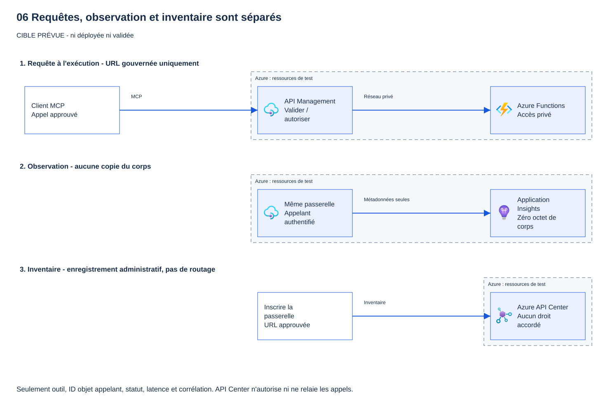
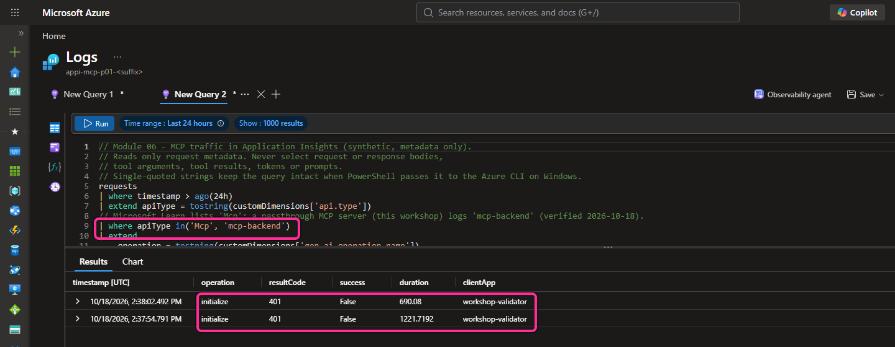
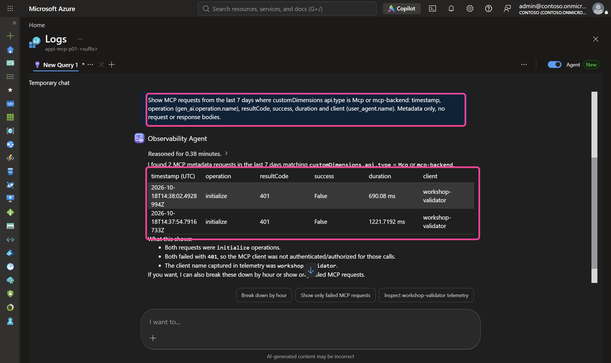
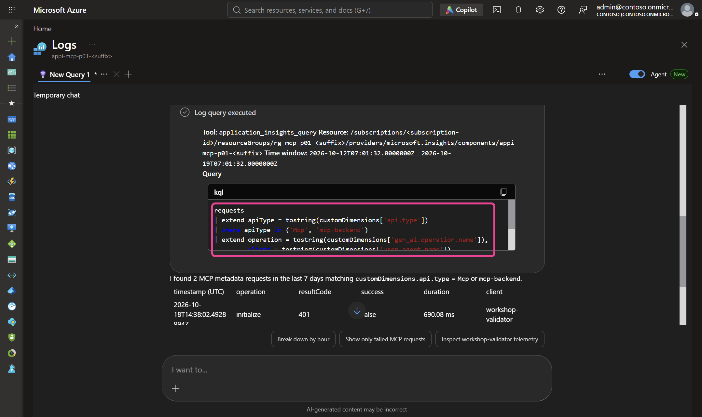
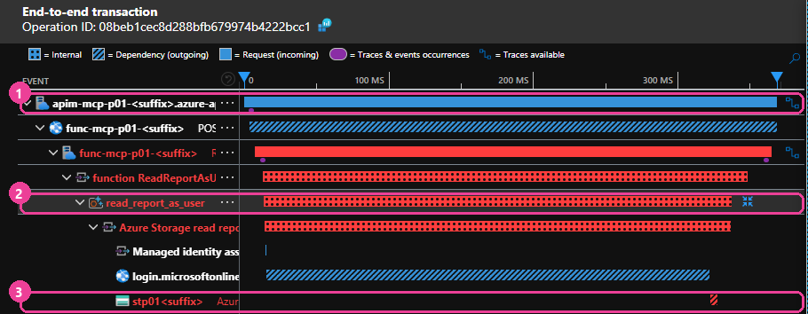
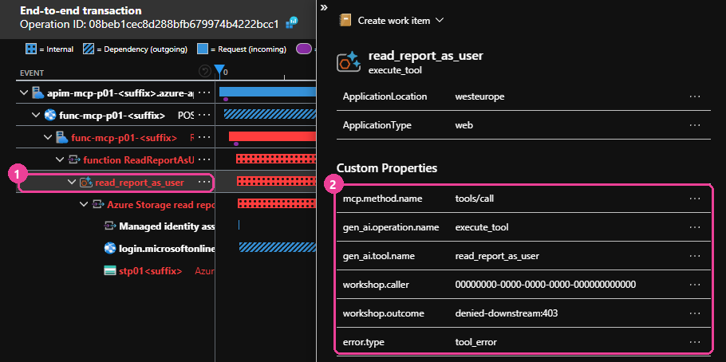
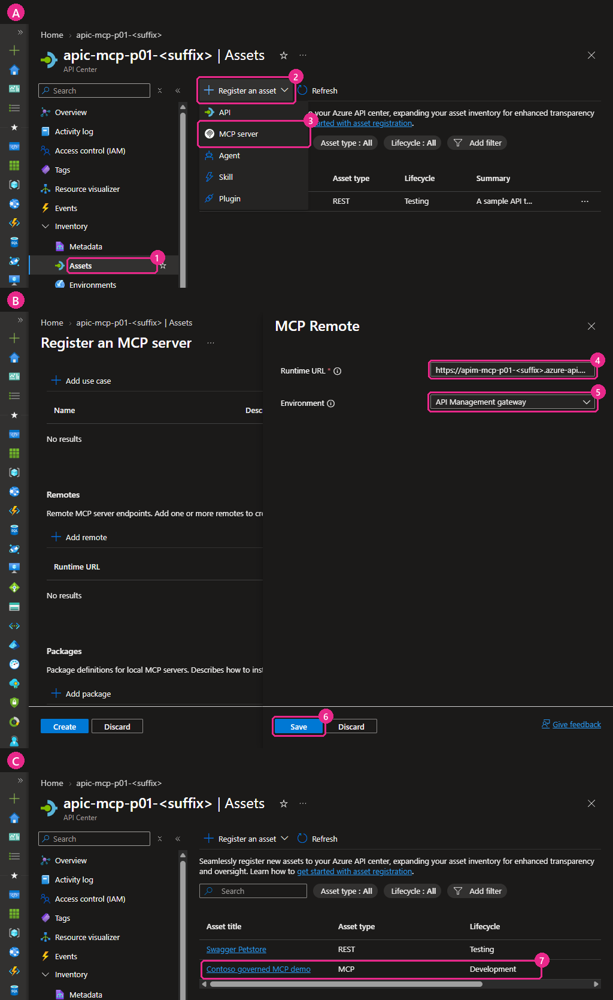
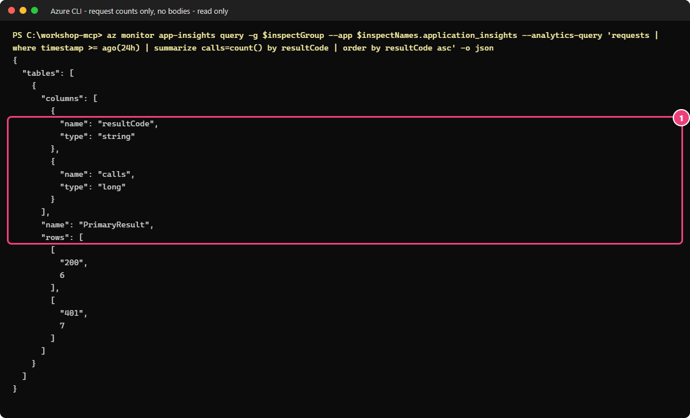

# 06 - Observer et inventorier (niveau 4)

[English](LOW-CODE.md)

## Objectif

**Parcours low-code, portail d'abord.** Vous allez observer les appels et créer une fiche de catalogue sans Terraform.

Après le [module 05 low-code](../05-delegated-and-app-only/LOW-CODE.fr.md), suivez ce guide autonome.
Exécutez les blocs dans PowerShell 7 à la racine du dépôt. Les clics dans le portail sont le parcours principal.
Utilisez vos propres ressources, dont les noms comportent `lc`.

Microsoft Entra ID protège votre serveur Model Context Protocol (MCP, module 03).
Les appels passent obligatoirement par Azure API Management (APIM, module 04).
Le serveur utilise ensuite l'identité prévue pour chaque outil afin d'accéder aux données (module 05).
Reste une question : **voyez-vous ce qui se passe, et les autres équipes trouvent-elles ce serveur ?**

Vous allez examiner les appels au serveur, puis enregistrer son adresse dans un catalogue :

- **Observer :** vous allez retrouver l'outil appelé, l'appelant, l'heure, le statut et la durée. Vous lirez ces métadonnées dans
  Application Insights avec une requête KQL (Kusto Query Language).
- **Inventorier :** vous allez créer une fiche qui indique le responsable du serveur et son adresse dans
  Azure API Center (**Preview**). Un administrateur peut aussi le déclarer dans le centre d'administration
  Microsoft 365 comme serveur MCP fourni par votre organisation (BYO, Bring Your Own) (**Preview**).

Vous utiliserez la télémétrie existante et ne créerez un centre API Free que si nécessaire.
Vous distinguerez ensuite ce qu'un journal, une fiche de catalogue et une déclaration BYO permettent réellement de vérifier.

## Pourquoi c'est important

Les contrôles d'accès ne suffisent pas : vous devez aussi connaître les serveurs disponibles et leur utilisation.
Sans métadonnées, impossible de répondre à « qui a utilisé l'outil
d'écriture hier ? ». Sans inventaire, les équipes créent des serveurs en double ou utilisent des serveurs inconnus
(« shadow MCP »).

Deux pièges à éviter :

- **Trop journaliser.** Stocker les prompts, les arguments ou les résultats d'outils fait fuiter des données.
  Cet atelier ne journalise que des métadonnées.
- **Trop faire confiance.** Une ligne de journal ou une entrée de catalogue fournit une information, pas un contrôle d'accès. HTTP 200 ne
  prouve pas que l'outil a réussi, et une entrée d'inventaire n'autorise personne.

> [!WARNING]
> **Règles de journalisation de ce module :** zéro octet de corps, aucun jeton, aucun prompt et aucun argument ou résultat d'outil dans un journal, une requête, un classeur, un ticket ou une diapositive. Ne journalisez que les métadonnées : opération, nom de l'outil, statut, durée et type d'erreur.

## Ce que vous déployez

Ce module réutilise API Management et Application Insights. Sans centre API existant, vous en créez un avec l'offre
Free après accord. Conservez tout centre fourni par l'administrateur. Voici les éléments utilisés ou ajoutés :

| Élément | Type | Emplacement | Statut |
|---|---|---|---|
| Requête KQL du trafic MCP | Fichier KQL (`queries/mcp-traffic.kql`) | Dossier de ce module | Stable |
| Spans des appels d'outils et leur requête | OpenTelemetry dans le code du serveur, fichier KQL (`queries/tool-spans.kql`) | Publiés avec le serveur au module 02 ; dossier de ce module | Stable (conventions MCP : Development) |
| Enregistrement du serveur MCP dans API Center | Fiche de catalogue (asset) | Portail Azure (étapes manuelles) | **Préversion** |
| Entrée de serveur MCP BYO | Entrée dans le centre d'administration Microsoft 365 | Centre d'administration Microsoft 365 | **Préversion** |
| Agent 365 avec API Management (hors exercice pratique) | Présentation des possibilités, voir « Aller plus loin » | Configuration réservée aux administrateurs | **Préversion** |

Vous n'exécutez aucun déploiement Terraform dans ce module. L'entrée BYO et la stratégie Agent 365 sont des
démonstrations facultatives de l'administrateur, jamais des prérequis du participant.

## Prérequis et rôles requis

- Modules 00 à 05 terminés ; le point de terminaison MCP d'APIM doit répondre.
- PowerShell 7.4 ou version ultérieure (`pwsh`) et, pour les étapes Linux ou macOS, bash.
- Azure CLI, connecté à l'abonnement hors production approuvé pour votre atelier. Travaillez uniquement dans votre propre environnement de test.
- **Lecteur** sur le composant Application Insights, pour exécuter les requêtes KQL.
- Pour API Center : un rôle qui autorise l'enregistrement de fiches (**Assets**) dans le centre API. Avec l'administrateur, confirmez le rôle requis dans la liste des rôles intégrés du contrôle d'accès Azure (RBAC) avant toute attribution.
- Pour l'entrée BYO : un administrateur informatique dans le centre d'administration Microsoft 365. Le participant n'a pas besoin de ce rôle et ne doit pas le demander.
- Pour Agent 365 (démo facultative) : un administrateur du tenant qui détient le rôle Agent 365 MCP Gateway Policy Operator. Ce rôle n'est jamais attribué à un participant.

## Étapes

### Distinguer les appels, les journaux et l'inventaire

Initialisez ce module sans réutiliser de variables d'une autre session. Gardez le fichier privé et le même suffixe.
Vérifiez l'abonnement approuvé dans **Portail Azure → Abonnements**, puis exécutez :

```powershell
$p = Get-Content .\.workshop\participant.tfvars.json -Raw | ConvertFrom-Json
$id = "$($p.participant_prefix)lc"; $sfx = $p.resource_suffix.Substring(0, 10)
$group = if ($p.existing_resource_group_name) { $p.existing_resource_group_name } else { "rg-mcp-$id-$sfx" }
$ai = "appi-mcp-$id-$sfx"; $apim = "apim-mcp-$id-$sfx"; $apic = "apic-mcp-$id-$sfx"
az account show --query '{subscription:name,tenant:tenantId}' -o table
az resource list -g $group --query '[].{name:name,type:type}' -o table
$gateway = az apim show -g $group -n $apim --query gatewayUrl -o tsv
$mcpEndpoint = "$gateway/workshop-mcp/mcp"
"Application Insights: $ai; groupe: $group; MCP: $mcpEndpoint"
```

> **Résultat attendu** — votre composant Application Insights et votre passerelle `lc`.

Arrêtez-vous si l'abonnement, le tenant ou les ressources ne correspondent pas à votre déploiement approuvé.
Ce bloc ne lit que les métadonnées.



> [!NOTE]
> Application Insights ne contrôle pas les droits. API Center ne relaie pas les appels.
> Ni une inscription ni un statut HTTP réussi ne prouvent la réussite d'un outil.

### Que peut-on réellement tracer ?

Kusto Query Language (KQL) est le langage de requête des journaux. Il lit les traces enregistrées, pas le raisonnement de l'agent.
Une trace regroupe les étapes d'un appel. Chaque étape est représentée par un segment de trace, ou *span*.

| Preuve | Présente ici | Limite |
|---|---|---|
| Heure, opération, statut HTTP, durée | Sélectionnés par la requête fournie | Délai d'ingestion, échantillonnage et limite de 200 lignes : ce n'est pas un audit exhaustif |
| Nom de l'outil et type d'erreur | Sélectionnés si les diagnostics MCP les émettent | Un champ vide ne signifie pas qu'aucun outil n'a été exécuté |
| ID d'objet de l'appelant et corrélation | La stratégie du module 04 émet `caller-oid` dans les traces `workshop-mcp-gateway` ; le span de l'outil enregistre `workshop.caller` ; un même ID d'opération relie la passerelle, la Function et les appels en aval (étape 3b) | La requête du trafic ne sélectionne pas l'appelant : utilisez la requête des spans |
| Refus du service en aval | Le span de l'outil (`error.type = tool_error`) et l'appel en aval refusé (étape 3b) | HTTP 200 peut contenir `isError: true` ; un succès HTTP n'est pas un succès de l'outil |
| Confirmation humaine, prompt, arguments, résultat | Non collectés ici | La passerelle ne prouve pas la confirmation et ne conserve pas la conversation |

En accès applicatif (app-only), les journaux en aval identifient l'application, pas Alice ou Bob.
Le flux On-Behalf-Of (OBO, au nom de l'utilisateur) peut conserver l'identité utilisateur, mais l'audit en aval exige sa propre configuration et ses propres droits.
Recoupez les métadonnées disponibles d'un service à l'autre ; n'ajoutez jamais de jeton ni de corps pour combler un manque.

**Question :** l'appel de Bob renvoie HTTP 200. Cela prouve-t-il qu'il a lu le rapport ?

<details>
<summary>Afficher la réponse</summary>

Non. Storage peut refuser Bob ; le serveur renvoie alors une erreur d'outil MCP dans une réponse HTTP 200.
Vérifiez le résultat dans le client et les traces disponibles en aval. Une requête de journaux vide ne prouve ni réussite ni absence d'activité.

</details>

### Étape 1 - Exécuter les vérifications hors ligne

Vérifiez les fichiers du module, la requête KQL et les règles de journalisation avant de lancer la moindre requête.

PowerShell :

```powershell
pwsh ./modules/06-observe-inventory/validate.ps1 -Offline
```

> **Résultat attendu** — lignes `PASS` et code 0, sans contrôle Azure.

> **Résultat réel** — validateur hors ligne, poste de l'auteur, 2026-10-17. Noms et identifiants masqués.
>
> ```text
> PASS file exists: README.md (offline)
> PASS file exists: README.fr.md (offline)
> PASS file exists: validate.ps1 (offline)
> PASS file exists: validate.sh (offline)
> PASS file exists: cleanup.ps1 (offline)
> PASS file exists: cleanup.sh (offline)
> PASS file exists: queries/mcp-traffic.kql (offline)
> PASS README sections present and in order (offline)
> PASS README.fr.md has the same section count (offline)
> PASS Steps give PowerShell before bash (offline)
> PASS Preview label on API Center, BYO and Agent 365 (offline)
> PASS KQL selects no body, argument, result or token fields (offline)
> PASS KQL filters on api.type Mcp, pass-through-mcp and mcp-backend (offline)
> PASS README does not instruct enabling payload logging (offline)
> PASS no secrets or tokens in module files (offline)
> PASS only placeholder GUIDs in module files (offline)
> PASS PROGRESS row 06 claims validated only with a date and a live run (offline)
> PASS docs/sources.md has module 06 entries with last-verified dates (offline)
> PASS no infra folder (no Azure resources added) (offline)
> PASS README states the log rules (offline)
> RESULT: all offline checks passed
> ```
>
> **Ce que cela signifie pour vous :** les fichiers du module existent et la requête KQL ne lit que des métadonnées.
> Le code de sortie 0 confirme les contrôles hors ligne ; cette exécution ne vérifie aucune ressource Azure.

bash :

```bash
./modules/06-observe-inventory/validate.sh --offline
```

> **Résultat attendu** — les mêmes lignes PASS/FAIL que l'exécution PowerShell ci-dessus.

### Étape 2 - Vérifier que le contenu des échanges n'est pas journalisé

Dans **Portail Azure → API Management services → votre `$apim` → APIs → workshop-mcp → Settings → Diagnostics logs**,
ouvrez les diagnostics Application Insights. Les limites d'octets des corps de requête et de réponse, côté frontend
et backend, doivent toutes être **0**. Si un administrateur gère ces paramètres, demandez-lui de confirmer les quatre
zéros sans élargir vos droits.

Dans l'instance APIM, vérifiez que la journalisation des charges utiles est désactivée pour l'API MCP. N'activez pas la capture de `gen_ai.tool.call.arguments` ni de `gen_ai.tool.call.result` pour cet atelier.

### Étape 3 - Interroger le trafic MCP dans Application Insights

Ouvrez `modules/06-observe-inventory/queries/mcp-traffic.kql` et exécutez son contenu dans le volet **Logs** du composant Application Insights où écrit API Management.

Copiez la requête suivante :

```kql
// Module 06 - MCP traffic in Application Insights (synthetic, metadata only).
// Reads only request metadata. Never select request or response bodies,
// tool arguments, tool results, tokens or prompts.
// Single-quoted strings keep the query intact when PowerShell passes it to the Azure CLI on Windows.
requests
| where timestamp > ago(24h)
| extend apiType = tostring(customDimensions['api.type'])
// Microsoft Learn lists 'Mcp'. Verified live 2026-10-20: an existing MCP server behind a backend (part A, passthrough)
// logs 'pass-through-mcp'; a REST API exposed as an MCP server (part B) logs 'mcp-backend'.
| where apiType in ('Mcp', 'pass-through-mcp', 'mcp-backend')
| extend
    operation = tostring(customDimensions['gen_ai.operation.name']),
    toolName  = tostring(customDimensions['gen_ai.tool.name']),
    errorType = tostring(customDimensions['error.type']),
    clientApp = tostring(customDimensions['user_agent.name'])
| project timestamp, operation, toolName, resultCode, success, duration, errorType, clientApp
| order by timestamp desc
| take 200
```

La requête utilise les noms de tables d'Application Insights (`requests`, `customDimensions`) : exécutez-la dans le
périmètre de ce composant Application Insights, pas sur son espace de travail Log Analytics, où les mêmes données se trouvent dans la table `AppRequests`.

**Dans le portail Azure :** ouvrez le composant Application Insights dont le nom est dans `$ai`, retrouvé au début du module.
Sélectionnez **Surveillance → Journaux** (**Monitoring → Logs**),
passez l'éditeur en **mode KQL**, collez la requête puis sélectionnez **Exécuter** (**Run**).

**Ou depuis votre terminal.** PowerShell, depuis le dossier du dépôt (extension Azure CLI `application-insights` : `az extension add --name application-insights`) :

```powershell
# '@file' lets the Azure CLI read the query file itself: on Windows a multi-line argument is cut at its first line.
az monitor app-insights query --app $ai --resource-group $group --offset 24h `
  --analytics-query '@modules/06-observe-inventory/queries/mcp-traffic.kql' --query 'tables[0].rows' -o json
```

> **Résultat attendu** — métadonnées du trafic MCP récent, ou tableau vide sans données ingérées.

> **Résultat réel** — trafic de la passerelle issu des contrôles de configuration du module 04, 2026-10-18, tenant de test de l'auteur. Aucun appel d'Alice ou de Bob à ce stade. Noms et ID masqués.
>
> ```text
> [
>   [
>     "2026-10-18T14:38:02.4928994Z",
>     "initialize",
>     "",
>     "401",
>     "False",
>     690.08,
>     "",
>     "workshop-validator"
>   ],
>   [
>     "2026-10-18T14:37:54.7916733Z",
>     "initialize",
>     "",
>     "401",
>     "False",
>     1221.7192,
>     "",
>     "workshop-validator"
>   ]
> ]
> ```
>
> **Résultat réel** — appels d'Alice et de Bob lors des modules 04 et 05, 2026-10-20, tenant de test de l'auteur.
> 6 lignes sur 134 ; les colonnes suivent la requête : timestamp, operation, toolName, resultCode, success, duration (ms), errorType, clientApp.
>
> ```text
> [
>   [ "2026-10-20T05:20:15.1801351Z", "tools/call", "create_ticket", "200", "True", 597.982, "", "" ],
>   [ "2026-10-20T05:31:02.2715503Z", "tools/call", "create_ticket", "403", "False", 3.6035, "", "" ],
>   [ "2026-10-20T06:20:18.3449395Z", "tools/call", "whoami", "200", "True", 1169.1348, "", "" ],
>   [ "2026-10-20T06:20:19.856923Z", "tools/call", "read_report_as_user", "200", "True", 337.9462, "", "" ],
>   [ "2026-10-20T05:31:21.3260289Z", "ping", "", "429", "False", 1.8206, "", "" ],
>   [ "2026-10-20T05:38:27.8248234Z", "tools/call", "list_tickets", "200", "True", 10.8423, "", "" ]
> ]
> ```
>
> **Ce que cela signifie pour vous :** chaque ligne ne contient que des métadonnées : aucun corps, jeton, prompt, argument
> ou résultat. Le `create_ticket` d'Alice a pris environ 600 ms, car la Function l'a exécuté ; celui de Bob 3,6 ms et le
> `ping` limité 1,8 ms : la passerelle les a refusés (HTTP 403 et 429) sans appeler la Function. La requête garde trois
> valeurs d'`api.type` : Microsoft Learn cite `Mcp` ; le serveur existant de l'atelier (partie A) journalise `pass-through-mcp`,
> et l'API REST exposée en MCP (partie B) journalise `mcp-backend`. Une liste vide est possible s'il n'y a pas eu de trafic
> MCP au cours des dernières 24 heures ou si l'ingestion est encore en retard ; elle ne prouve ni réussite ni absence d'activité.

Pour obtenir la même vue dans le portail, ouvrez votre composant Application Insights → **Logs**, passez en **KQL mode**,
collez la requête, puis sélectionnez **Run**. La capture ci-dessous provient du tenant de test de l'auteur
(2026-10-19 ; noms pseudonymisés ; portail en anglais). Le
premier cadre entoure le filtre qui ne garde que le trafic MCP ; le second entoure les lignes : opération, statut, durée et
nom du client, rien d'autre.



bash :

```bash
id="$(jq -r .participant_prefix .workshop/participant.tfvars.json)lc"
sfx="$(jq -r .resource_suffix .workshop/participant.tfvars.json | cut -c1-10)"
group="$(jq -r '.existing_resource_group_name // empty' .workshop/participant.tfvars.json)"
group="${group:-rg-mcp-$id-$sfx}"; ai="appi-mcp-$id-$sfx"
az monitor app-insights query --app "$ai" --resource-group "$group" --offset 24h \
  --analytics-query '@modules/06-observe-inventory/queries/mcp-traffic.kql' --query 'tables[0].rows' -o json
```

> **Résultat attendu** — la même liste que l'exécution PowerShell ci-dessus.
La requête ne lit que des métadonnées : nom d'opération, nom d'outil, statut, durée et type d'erreur. Elle ne lit jamais les corps de requête ou de réponse.

### Facultatif - Poser la même question à l'Observability Agent

La page Logs propose un interrupteur **Agent** qui ouvre l'Azure Copilot Observability Agent. Vous posez la question en
langage courant ; l'agent écrit une requête KQL, l'exécute sur ce composant Application Insights et explique le résultat.
Le chat ne nécessite aucune ressource supplémentaire. Si l'interrupteur n'apparaît pas, votre tenant ne propose peut-être pas
Azure Copilot : passez cette étape, le module n'en dépend pas.

1. Dans le même composant Application Insights, ouvrez **Logs**, puis activez **Agent** (en haut à droite).
2. Saisissez cette question (en anglais, comme le portail) :

   ```prompt
   Show MCP requests from the last 7 days where customDimensions api.type is Mcp, pass-through-mcp or mcp-backend: timestamp, operation (gen_ai.operation.name), resultCode, success, duration and client (user_agent.name). Metadata only, no request or response bodies.
   ```

3. Dépliez **Reasoned for ...** pour voir la requête exécutée par l'agent. Comparez-la avec `queries/mcp-traffic.kql`.

> **Résultat réel** — Observability Agent, 2026-10-19, tenant de test de l'auteur. Noms pseudonymisés, ID remplacés.
> Le premier cadre montre la question ; le second, le tableau renvoyé par l'agent : les mêmes deux lignes `initialize`
> refusées avec HTTP 401 qu'avec le fichier KQL.
>
> **Ce que cela signifie pour vous :** comparez les lignes renvoyées par l'agent avec celles de la requête fournie.
> Dans cet exemple, elles correspondent. L'agent ne peut retrouver que les données journalisées : ici, des métadonnées,
> sans prompt, jeton ni corps de requête. Cette conversation est temporaire et limitée à la ressource sélectionnée.



La requête générée par l'agent (encadrée) utilise le filtre `api.type` de la question du 2026-10-19, avant l'ajout de `pass-through-mcp` :



**Question :** pourquoi garder `queries/mcp-traffic.kql` si l'agent sait écrire la requête ?

<details>
<summary>Afficher la réponse</summary>

Le fichier fournit une requête de référence, relue et versionnée dans Git. Vous pouvez l'exécuter avec Azure CLI,
sans portail ni intelligence artificielle (IA). Ses résultats dépendent du trafic enregistré, mais sa logique reste la même.
La requête produite par l'agent peut varier ou contenir des erreurs. Utilisez l'agent pour explorer les journaux ;
gardez le fichier comme référence pour vos vérifications.

</details>

### Étape 3b - Suivre un appel d'outil de bout en bout (OpenTelemetry)

L'étape 3 compte les appels. Ici, vous suivez **un seul** appel, maillon par maillon : la passerelle, la Function,
l'outil, puis les services que l'outil appelle. Rien à déployer : le serveur publié au module 02 envoie déjà à ce
composant Application Insights un segment de trace OpenTelemetry (span) par appel d'outil, plus un par étape en aval. Il s'authentifie avec
son identité managée, sans clé.

> [!NOTE]
> Les conventions sémantiques OpenTelemetry pour MCP sont encore au statut **Development** : les noms d'attributs
> peuvent changer.

Bob appelle `read_report_as_user`. Voici ce que montre la trace (durées réelles, 2026-10-20) :

```text
API Management  POST /workshop-mcp/mcp            369 ms  HTTP 200
└ Function      ReadReportAsUser                  358 ms  échec
  └ outil       tools/call read_report_as_user    324 ms  tool_error
    └ étape     Azure Storage read report         323 ms  échec
      ├ étape   Managed identity assertion          0 ms  ok
      ├ HTTP    login.microsoftonline.com (OBO)   306 ms  200
      └ HTTP    Azure blob <compte>/reports         5 ms  403
```

Lisez la trace de haut en bas : la passerelle a renvoyé HTTP 200, puis l'échange OBO avec Entra a réussi.
C'est Storage qui a refusé Bob (403). Le statut HTTP de la passerelle ne suffit donc pas à conclure que l'outil a réussi.

| Ce qu'un span enregistre (métadonnées) | Ce qu'un span n'enregistre jamais |
|---|---|
| L'outil et la méthode : `gen_ai.tool.name`, `mcp.method.name` | Les arguments et les résultats de l'outil : les conventions les classent en **Opt-In**, ce serveur ne les active pas |
| L'ID d'objet de l'appelant (`workshop.caller`), l'issue de l'appel, `error.type = tool_error` | Les jetons, y compris l'assertion On-Behalf-Of |
| La durée et le statut de chaque appel en aval : hôte, chemin, statut HTTP | Les prompts, les corps de requête et de réponse, les paramètres d'URL |

**Dans le portail Azure** (portail en anglais) :

1. Ouvrez votre ressource Application Insights `appi-mcp-<prefix>-<suffix>`, puis **Investigate** → **Search**.
2. Dans la zone de recherche, collez un ID d'opération donné par la requête ci-dessous (ou tapez `read_report_as_user`),
   puis appuyez sur Entrée.
3. Cliquez sur la ligne de la trace : la page **End-to-end transaction details** s'ouvre. Cliquez sur **View timeline**.
4. Cliquez sur la ligne `read_report_as_user` : ses attributs sont sous **Custom Properties**.

**Ou depuis votre terminal.** La requête liste les derniers appels d'outils, avec l'ID d'opération à coller à l'étape 2.

Dans **Logs → KQL mode**, collez cette requête, puis **Run** :

```kql
dependencies
| where timestamp > ago(24h)
| where name startswith 'tools/call'
| extend
    tool = tostring(customDimensions['gen_ai.tool.name']),
    outcome = tostring(customDimensions['workshop.outcome']),
    caller = tostring(customDimensions['workshop.caller'])
| project timestamp, tool, outcome, success, duration, caller, operation_Id
| order by timestamp desc
| take 50
```

PowerShell :

```powershell
az monitor app-insights query --app $ai --resource-group $group --offset 24h `
  --analytics-query '@modules/06-observe-inventory/queries/tool-spans.kql' --query 'tables[0].rows' -o json
```

> **Résultat attendu** — segments de trace avec l'issue de l'appel, l'appelant et l'ID d'opération, sans contenu d'outil ni jeton.

> **Résultat réel** — tests avec les comptes d'Alice et de Bob au module 05, 2026-10-20, tenant de test de l'auteur. Colonnes :
> horodatage, outil, issue, succès, durée (ms), appelant, ID d'opération. ID d'objet remplacés.
>
> ```text
> [ "2026-10-20T12:41:49.8297728Z", "read_report_as_app", "success", "True", 9.2244, "<bob-object-id>", "e87b9b4eb127eb41143869942a1ce275" ]
> [ "2026-10-20T12:41:48.6026728Z", "read_report_as_user", "denied-downstream:403", "False", 323.6665, "<bob-object-id>", "08beb1cec8d288bfb679974b4222bcc1" ]
> [ "2026-10-20T12:41:47.7550955Z", "whoami", "success", "True", 533.3178, "<bob-object-id>", "dc377674e8f2d0ce17bdbdfaed876754" ]
> [ "2026-10-20T12:41:37.1243308Z", "read_report_as_app", "success", "True", 252.9528, "<alice-object-id>", "fac868e66169055f59c7860e473ea7e1" ]
> [ "2026-10-20T12:41:36.4007953Z", "read_report_as_user", "success", "True", 350.2882, "<alice-object-id>", "e4953ce2d99878c9594c99d9d3d548e1" ]
> [ "2026-10-20T12:41:34.3688446Z", "whoami", "success", "True", 1563.1348, "<alice-object-id>", "4227ea095c3caeca474221ab324ec16f" ]
> ```
>
> **Ce que cela signifie pour vous :** même outil, deux issues. Le `read_report_as_user` d'Alice aboutit ; celui de Bob
> se termine par `denied-downstream:403`. Chaque ligne porte son ID d'opération : collez celui de Bob dans le portail
> pour voir où l'appel s'est arrêté.

bash :

```bash
id="$(jq -r .participant_prefix .workshop/participant.tfvars.json)lc"
sfx="$(jq -r .resource_suffix .workshop/participant.tfvars.json | cut -c1-10)"
group="$(jq -r '.existing_resource_group_name // empty' .workshop/participant.tfvars.json)"
group="${group:-rg-mcp-$id-$sfx}"; ai="appi-mcp-$id-$sfx"
az monitor app-insights query --app "$ai" --resource-group "$group" --offset 24h \
  --analytics-query '@modules/06-observe-inventory/queries/tool-spans.kql' --query 'tables[0].rows' -o json
```

> **Résultat attendu** — les mêmes lignes qu'avec PowerShell ci-dessus.

La trace de Bob dans **View timeline** (capture réelle, 2026-10-20 ; noms pseudonymisés). Cadre 1 : la passerelle répond
HTTP 200, en bleu. Cadre 2 : le span de l'outil, en rouge. Cadre 3 : l'appel à Storage qui refuse Bob (HTTP 403).



Les attributs du span de l'outil (cadre 2). Rien d'autre n'est enregistré : ni argument, ni résultat, ni jeton.



**Question :** la passerelle a journalisé HTTP 200 pour l'appel de Bob. Où la trace montre-t-elle l'échec, et pourquoi ?

<details>
<summary>Afficher la réponse</summary>

Dans les lignes rouges. Le span de l'outil porte `error.type = tool_error`, et la dernière étape est l'appel à Storage,
refusé en HTTP 403. Juste avant, l'échange On-Behalf-Of avec Microsoft Entra a réussi : le jeton de Bob était valide.
Ce qui lui manque, c'est un rôle Storage sur le conteneur du rapport. MCP renvoie les erreurs d'outil dans une réponse
HTTP 200 : la trace permet de repérer précisément l'étape refusée.

</details>

> [!TIP]
> **Vous écrivez votre propre serveur MCP ?** Gardez les mêmes réflexes : un span par appel d'outil, nommé
> `tools/call <outil>` ; le contexte de trace W3C reçu de la passerelle ; des métadonnées seulement (laissez désactivés
> les arguments et résultats, classés Opt-In) ; un export avec une identité managée plutôt qu'une clé.

### Étape 4 - Enregistrer le serveur MCP dans API Center (Préversion)

L'inventaire API Center est en **Préversion**.

**Pas encore de centre API ?** Après accord, ouvrez **Portail Azure → Créer une ressource → API Center → Créer**.
Choisissez l'abonnement approuvé, `$group`, le nom `$apic`, une région prise en charge et l'offre **Free**.
Sélectionnez **Vérifier + créer → Créer → Accéder à la ressource**. Vérifiez **Free** dans **Vue d'ensemble**.
Dans **Environments → Add**, utilisez l'identifiant `gateway`, le titre **API Management gateway** et le type
**Development**, puis **Create**. Si `Microsoft.ApiCenter` n'est pas enregistré, demandez à l'administrateur.

Pour un centre existant, entrez son nom et son groupe ci-dessous. Lors du nettoyage, vous ne supprimerez que votre fiche.
Ce bloc confirme le centre choisi et affiche l'URL de la passerelle :

```powershell
$inventoryGroup = $group # Remplacez par le groupe du centre fourni, le cas échéant.
# $apic = '<nom-du-centre-fourni>' # Seulement pour un centre existant.
az apic show --resource-group $inventoryGroup --name $apic --query '{name:name,sku:sku.name}' -o table
$mcpEndpoint
```

> **Résultat attendu** — le centre choisi et son offre, puis l'URL MCP de votre passerelle.
> Acceptez l'installation d'`apic-extension` si nécessaire. La création par portail ne produit pas de sortie terminal.

Dans le portail Azure, cherchez **API Center**, ouvrez le centre créé pour l'atelier ou celui fourni par l'administrateur, puis :

1. Ouvrez votre centre API et sélectionnez **Assets**.
2. Choisissez **+ Register an asset**, puis **MCP server**.
3. Saisissez un titre, un résumé et une description. Utilisez un texte fictif, par exemple « Contoso governed MCP demo ».
4. Sous **Remotes**, choisissez **Add remote**. Collez l'URL de la passerelle affichée par la dernière commande ci-dessus,
   choisissez l'environnement **API Management gateway**, puis **Save**.
5. Sous **Version title**, saisissez `v1` et choisissez le cycle de vie **Development**. La licence est facultative.
6. Choisissez **Create**. API Center génère les définitions MCP (SSE, et Streamable d'après la documentation).

Vérifiez que la fiche apparaît dans **Assets** avec l'environnement choisi.



*Capture réelle, 2026-10-19, tenant de test de l'auteur (noms pseudonymisés). Cadres 1 à 3 : ouvrir le formulaire.
Cadres 4 à 6 : ajouter l'adresse MCP de la passerelle. Cadre 7 : la fiche apparaît avec le type **MCP** et le cycle de vie **Development**.*

Vérifiez aussi que la fiche contient bien l'adresse MCP de la passerelle. Dans l'exemple de l'auteur, **Create** a créé la fiche,
mais l'enregistrement de cette adresse a échoué avec HTTP 400 ; seule une définition SSE a été générée.
Si votre fiche existe mais qu'aucun déploiement n'y est enregistré, ajoutez ce déploiement API Center depuis votre terminal,
avec les mêmes noms que ci-dessus. Cette opération enregistre une adresse dans le catalogue ; elle ne déploie pas de serveur :

```powershell
$server = Join-Path $PWD '.workshop\apic-server.json'
@{ runtimeUri = @($mcpEndpoint) } | ConvertTo-Json -Compress | Set-Content $server
az apic api deployment list --resource-group $inventoryGroup --service-name $apic --api-id contoso-governed-mcp-demo --query "[].name" --output tsv
az apic api deployment create --resource-group $inventoryGroup --service-name $apic --api-id contoso-governed-mcp-demo --deployment-id gateway --title "API Management gateway" --environment-id /workspaces/default/environments/gateway --definition-id /workspaces/default/apis/contoso-governed-mcp-demo/versions/v1/definitions/default-sse --server "@$server"
Remove-Item $server
```

> **Résultat attendu** — la première commande n'affiche rien (pas encore de déploiement). La seconde affiche le nouveau
> déploiement `gateway` en JSON. Utilisez l'identifiant (`contoso-governed-mcp-demo`) et la version (`v1`) de votre formulaire.

**Question :** le serveur a maintenant sa fiche (asset) dans API Center. Eve peut-elle l'appeler parce qu'elle le voit dans le catalogue ?

<details>
<summary>Afficher la réponse</summary>

Non. Une entrée d'inventaire n'autorise personne. API Center ne relaie pas les appels. Chaque appel passe toujours par
API Management. La passerelle valide le jeton Microsoft Entra (émetteur, tenant, audience, expiration, scope), puis vérifie le rôle d'application (`Tools.Read` ou `Tools.Write`).
Sans jeton valide et sans le rôle requis, Eve ne peut pas accéder au serveur.

</details>

### Étape 5 - Démonstration facultative de l'administrateur : BYO (Préversion)

L'entrée BYO MCP est en **Préversion** et n'est pas destinée à la production. Un administrateur informatique du tenant l'examine et l'approuve dans le centre d'administration Microsoft 365. En tant que participant, vous vérifiez seulement que l'entrée existe et que son statut est celui défini par l'administrateur. Vous ne l'approuvez pas vous-même.

Où regarder : connectez-vous au [centre d'administration Microsoft 365](https://admin.microsoft.com/), puis sélectionnez
**Agents → Outils** (**Agents → Tools**) et l'onglet **Registre** (**Registry**) ; les demandes en attente sont dans l'onglet
**Demandes** (**Requests**). Il faut un rôle d'administrateur pour le consulter : sinon, demandez à l'administrateur de vous
montrer l'entrée.

Vérifiez le nom du serveur et son état d'approbation. Cet état ne garantit pas la sécurité du serveur :
les contrôles d'accès restent ceux des modules 04 et 05.

## Ce que vous devriez voir

- Si du trafic MCP a été ingéré, la requête KQL renvoie les lignes disponibles avec `api.type` égal à `Mcp`, `pass-through-mcp` ou `mcp-backend`, pour `initialize`, `tools/list` et `tools/call`. Ce n'est pas un audit exhaustif.
- Les colonnes contiennent des noms d'outils et des codes de statut, mais aucun corps de requête, corps de réponse, jeton, prompt ou argument d'outil.
- Un appel d'outil forme une seule trace : la chronologie montre la passerelle, la Function, le span `tools/call` et chaque appel en aval.
- La fiche API Center contient l'adresse MCP de la passerelle et l'environnement associé.
- Le validateur hors ligne affiche une ligne `PASS` par vérification et se termine avec le code de sortie 0.

### Vérifier vous-même avec Azure CLI

**Pourquoi :** retrouver les statuts HTTP ne nécessite pas de conserver les données échangées.
Vous allez compter les requêtes des dernières 24 heures, sans lire les corps ni les arguments des outils.
Dans PowerShell 7, à la racine du dépôt :

```powershell
$ErrorActionPreference = 'Stop'
$inspectParticipant = Get-Content -LiteralPath .\.workshop\participant.tfvars.json -Raw | ConvertFrom-Json
$inspectId = "$($inspectParticipant.participant_prefix)lc"
$inspectSuffix = $inspectParticipant.resource_suffix.Substring(0, 10)
$inspectGroup = if ($inspectParticipant.existing_resource_group_name) { $inspectParticipant.existing_resource_group_name } else { "rg-mcp-$inspectId-$inspectSuffix" }
$inspectNames = [pscustomobject]@{ application_insights = "appi-mcp-$inspectId-$inspectSuffix" }
```

> **Résultat attendu** — aucune sortie : les variables reçoivent les noms de votre déploiement. Vérifiez avec `$inspectNames`.

Copiez la requête Kusto Query Language (KQL) suivante :

```powershell
az monitor app-insights query -g $inspectGroup --app $inspectNames.application_insights --analytics-query 'requests | where timestamp >= ago(24h) | summarize calls=count() by resultCode | order by resultCode asc' -o json
if ($LASTEXITCODE -ne 0) { throw 'Requête de supervision impossible. Vérifiez le composant et vos droits de lecture.' }
```

> **Résultat attendu** — les colonnes `resultCode` et `calls`, puis les compteurs de vos appels dans `rows`.
> Les nombres ne seront pas ceux de la capture. Si `rows` est vide, vérifiez la période, le composant
> et le délai de collecte ; ne concluez pas que la supervision fonctionne.



*Capture en lecture seule du 20 octobre 2026. La requête et les colonnes sont identiques dans les deux parcours.
Elle n'est pas une nouvelle validation du déploiement low-code. Vérifiez aussi les diagnostics sans corps
et les métadonnées par outil avec les contrôles du module. N'activez pas la capture des arguments pour dépanner.*

## Valider

> [!NOTE]
> **Limites de validation :** ce parcours low-code n'a pas été revalidé de bout en bout dans sa version actuelle.
> Les sorties et captures datées proviennent de vérifications antérieures dans le tenant de test de l'auteur.
> Certains noms correspondent au parcours Terraform : utilisez vos ressources `lc`, pas celles des captures.
> Ces exemples ne valident pas votre environnement. Vérifiez manuellement les résultats KQL et la fiche API Center.
> La déclaration BYO reste facultative et sa vérification relève de l'administrateur.

Hors ligne (sans accès Azure) :

```powershell
pwsh ./modules/06-observe-inventory/validate.ps1 -Offline
```

> **Résultat attendu** — lignes `PASS` et code 0, sans vérifier les ressources Azure.

> **Résultat réel** — validateur hors ligne, poste de l'auteur, 2026-10-17. Noms et identifiants masqués.
>
> ```text
> PASS file exists: README.md (offline)
> PASS file exists: README.fr.md (offline)
> PASS file exists: validate.ps1 (offline)
> PASS file exists: validate.sh (offline)
> PASS file exists: cleanup.ps1 (offline)
> PASS file exists: cleanup.sh (offline)
> PASS file exists: queries/mcp-traffic.kql (offline)
> PASS README sections present and in order (offline)
> PASS README.fr.md has the same section count (offline)
> PASS Steps give PowerShell before bash (offline)
> PASS Preview label on API Center, BYO and Agent 365 (offline)
> PASS KQL selects no body, argument, result or token fields (offline)
> PASS KQL filters on api.type Mcp, pass-through-mcp and mcp-backend (offline)
> PASS README does not instruct enabling payload logging (offline)
> PASS no secrets or tokens in module files (offline)
> PASS only placeholder GUIDs in module files (offline)
> PASS PROGRESS row 06 claims validated only with a date and a live run (offline)
> PASS docs/sources.md has module 06 entries with last-verified dates (offline)
> PASS no infra folder (no Azure resources added) (offline)
> PASS README states the log rules (offline)
> RESULT: all offline checks passed
> ```
>
> **Ce que cela signifie pour vous :** les contrôles des fichiers ont réussi. Vous devez encore vérifier les résultats KQL,
> la fiche API Center et, si elle a été créée, l'entrée BYO.

```bash
./modules/06-observe-inventory/validate.sh --offline
```

> **Résultat attendu** — les mêmes lignes PASS/FAIL que l'exécution PowerShell ci-dessus.

Chaque vérification affiche `PASS` ou `FAIL`. En cas d'échec, la ligne indique le fichier ou la règle en cause.
Le script ne consulte pas les résultats KQL, la fiche API Center ni l'entrée BYO : vérifiez-les manuellement,
avec l'administrateur pour BYO si cette démonstration a été réalisée.

**Question :** le contrôle `KQL selects no body, argument, result or token fields` passe. Pourquoi tester la requête elle-même, et pas seulement les journaux ?

<details>
<summary>Afficher la réponse</summary>

Parce que la requête est copiée telle quelle. Si elle sélectionnait une colonne de corps ou de jeton, elle exposerait des
données dès que quelqu'un activerait la journalisation du contenu, et elle inciterait à le faire. Tester la requête garde
la règle « métadonnées uniquement » dans le support lui-même.

</details>


## Dépannage

| Symptôme | Cause probable | Correction |
|---|---|---|
| La requête KQL ne renvoie aucune ligne | Le trafic est plus ancien que la période interrogée, ou les diagnostics ne sont pas activés sur l'API APIM | Élargissez à la fois `--offset` et le filtre `ago(24h)` de `queries/mcp-traffic.kql`, puis vérifiez le paramètre de diagnostic APIM pour l'API MCP. |
| Des lignes existent mais `tool.name` est vide | Seul `tools/list` a été appelé, ou l'opération MCP n'a pas été classée | Appelez un outil une fois depuis le client, puis relancez la requête. |
| Des champs de charge utile apparaissent dans les journaux | La journalisation des charges utiles a été activée | Désactivez-la dans APIM, supprimez les lignes concernées selon votre politique de rétention, et consignez-le comme constat. |
| La requête des spans ne renvoie aucune ligne `tools/call` | Aucun appel ou version trop ancienne | Appelez un outil, attendez 2 à 5 minutes. Pour republier, suivez le [module 02 low-code](../02-open-server/LOW-CODE.fr.md) et la limite réseau du [module 04 low-code](../04-governed-gateway/LOW-CODE.fr.md). |
| L'asset API Center ne peut pas être créé | Le rôle n'est pas attribué, ou l'environnement n'existe pas | Vérifiez le rôle dans RBAC et créez d'abord l'environnement. |
| L'entrée BYO est absente | Fonctionnalité en préversion non activée, ou l'administrateur ne l'a pas approuvée | Adressez-vous à l'administrateur informatique du tenant. Ne demandez pas le rôle vous-même. |

## Nettoyer

Le script vérifie ses garde-fous et affiche un rapport ; il ne supprime ni le centre ni sa fiche.
Dans **API Center → votre centre → Assets → votre fiche MCP → Delete**, retirez seulement la fiche de votre serveur.
Conservez tout centre fourni et tout environnement partagé. Avant de supprimer un centre dédié,
vérifiez qu'il a bien été créé pour votre atelier et obtenez l'accord de son responsable.
L'administrateur retire toute entrée BYO créée pour l'atelier.
Continuez avec le [module 99 low-code](../99-cleanup/LOW-CODE.fr.md) pour supprimer les ressources du serveur
et, si vous avez suivi le module 07, celles de Foundry.

PowerShell :

```powershell
pwsh ./modules/06-observe-inventory/cleanup.ps1
pwsh ./modules/06-observe-inventory/cleanup.ps1 -Apply
```

> **Résultat attendu** — rapport seulement : ce script ne supprime rien, même avec `-Apply`.

> **Résultat réel** — `cleanup.ps1`, puis `cleanup.ps1 -Apply`, poste de l'auteur, 2026-10-17. Noms et identifiants masqués.
>
> ```text
> Module 06 creates no Azure resources. Nothing is deleted by this script.
> Manual cleanup, if you created them:
>   - API Center asset: delete in the Azure portal (API center > Assets).
>   - BYO MCP listing: removed only by a Microsoft 365 administrator.
>   - Agent 365 policy (demo): removed only by a tenant administrator.
> Report only. Re-run with -Apply to confirm the guard passed (no deletions are performed).
> Module 06 creates no Azure resources. Nothing is deleted by this script.
> Manual cleanup, if you created them:
>   - API Center asset: delete in the Azure portal (API center > Assets).
>   - BYO MCP listing: removed only by a Microsoft 365 administrator.
>   - Agent 365 policy (demo): removed only by a tenant administrator.
> Guard passed. No module-owned resources to remove.
> ```
>
> **Ce que cela signifie pour vous :** aucune des deux exécutions ne supprime les éléments ajoutés dans le portail.
> Retirez la fiche de votre serveur et, si vous l'avez créé, le centre dédié. Laissez l'entrée BYO et les stratégies
> Agent 365 aux administrateurs.

bash :

```bash
./modules/06-observe-inventory/cleanup.sh
./modules/06-observe-inventory/cleanup.sh --apply
```

> **Résultat attendu** — les mêmes lignes de rapport que l'exécution PowerShell ci-dessus.

Même avec `-Apply` (ou `--apply`), ce script ne supprime rien. Retirez votre fiche dans le portail API Center.
Seul un administrateur peut retirer l'entrée BYO, depuis le centre d'administration Microsoft 365.

Si vous avez créé le centre API à l'étape 4, supprimez-le avec les mêmes noms. Cela supprime le centre API, son
environnement et la fiche du serveur :

```powershell
# Seulement pour votre centre dédié, jamais un centre fourni par l'administrateur.
az apic delete --resource-group $inventoryGroup --name $apic --yes
```

> **Résultat attendu** — aucune sortie et un code de sortie 0. `az apic show --resource-group $group --name $apic` indique
> ensuite que la ressource est introuvable.

## Aller plus loin

- **Alertes** : créez une alerte Azure Monitor sur le taux de réponses `403` de l'opération MCP. Testez-la avec des données fictives et agrégées.
- **Agent 365 (Préversion, hors exercice pratique)** : Agent 365 peut inventorier les serveurs MCP exposés via API Management et bloquer un serveur que la stratégie n'autorise pas (l'appelant reçoit 403). Le contrôle outil par outil, l'observabilité et l'intégration avec Defender ou Purview nécessitent le niveau AI Gateway, lui aussi en Préversion. Cette option n'est pas requise pour terminer le module. Sa configuration et le consentement à l'échelle du tenant relèvent de l'administrateur ; vous n'avez aucune étape à exécuter.
- **Rétention** : décidez de la durée de conservation de la télémétrie MCP et alignez-la sur votre politique de protection des données.

## Sources

- [Interroger Application Insights avec Azure CLI](https://learn.microsoft.com/cli/azure/monitor/app-insights#az-monitor-app-insights-query), vérifié le 20 octobre 2026.

`docs/sources.md` recense, sous le module 06, les pages officielles Microsoft Learn utilisées pour ce module, avec leur date de dernière vérification :

- [Surveiller le trafic MCP](https://learn.microsoft.com/azure/api-management/monitor-mcp-servers) : dimensions par défaut et journalisation du contenu, que l'atelier laisse désactivée.
- [Intégration Application Insights](https://learn.microsoft.com/azure/api-management/api-management-howto-app-insights) : échantillonnage et corrélation.
- [Inventaire API Center](https://learn.microsoft.com/azure/api-center/register-discover-mcp-server) (enregistrement en Préversion).
- [Apporter son serveur MCP](https://learn.microsoft.com/microsoft-365/admin/manage/manage-byo-mcp-server) (Préversion).
- [Agent 365 avec API Management](https://learn.microsoft.com/azure/api-management/agent-365) (Préversion ; présentation facultative, non revérifiée ici).
- [Azure Copilot Observability Agent](https://learn.microsoft.com/azure/azure-monitor/aiops/observability-agent-overview) et [dialoguer avec vos données d'observabilité](https://learn.microsoft.com/azure/azure-monitor/aiops/observability-agent-chat) : étape facultative. Les opérations autonomes et la ressource de l'agent sont en Préversion et ne sont pas utilisées ici. Dernière vérification : 2026-10-19.
- [Utiliser OpenTelemetry avec Azure Functions](https://learn.microsoft.com/azure/azure-functions/opentelemetry-howto) : paquets du worker et `UseFunctionsWorkerDefaults` ; ce serveur n'exporte que les traces, avec son identité managée. Dernière vérification : 2026-10-20.
- [Conventions sémantiques OpenTelemetry pour MCP](https://github.com/open-telemetry/semantic-conventions-genai/blob/547934afa90a34298441caf80c43b27255c3a292/docs/gen-ai/mcp.md) (statut : Development, commit épinglé) : nom de span `{mcp.method.name} {target}`, `error.type = tool_error` quand `isError` vaut true, arguments et résultats en Opt-In. Dernière vérification : 2026-10-20.
- [Diagnostic des transactions de bout en bout](https://learn.microsoft.com/azure/azure-monitor/app/transaction-search-and-diagnostics) : recherche et chronologie des transactions. Dernière vérification : 2026-10-20.

Dernière vérification : 2026-10-20.
