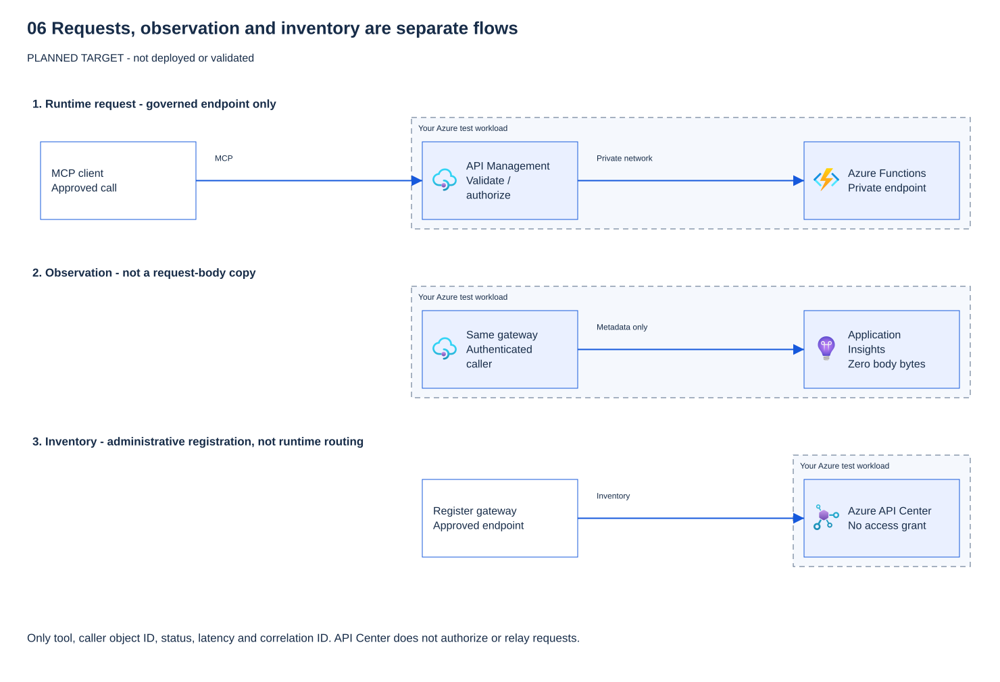

# 06 - Observe and inventory (level 4)

[Français](README.fr.md)

## Goal

Your MCP server is now protected by Microsoft Entra ID (module 03), reachable only through Azure API Management
(APIM, module 04), and it calls downstream data with the right identity (module 05).
One question remains: **can you see what happens, and can other teams find the server?**

This module answers that question in two separate parts:

- **Observe:** see which tool was called, by which caller, when, with which status and how long it took.
  You read this metadata in Application Insights with a Kusto Query Language (KQL) query.
- **Inventory:** list the server in a catalog, so other teams know it exists, who owns it and where to call it.
  You register it in Azure API Center (**Preview**). An administrator can also list it in the Microsoft 365 admin
  center as a bring-your-own (BYO) MCP server (**Preview**).

You deploy nothing new. You read the telemetry, register the server, and learn what each piece of evidence proves
(a log line, an inventory entry, a BYO listing) and what it does not prove.

## Why it matters

A server that nobody can see is not governed. Without metadata, you cannot answer "who used the write tool yesterday?".
Without an inventory, teams build duplicate servers or use unknown ones ("shadow MCP").

Two traps to avoid:

- **Logging too much.** Storing prompts, tool arguments or tool results leaks data. This workshop logs metadata only.
- **Trusting too much.** A log line or a catalog entry is evidence, not a control. HTTP 200 does not prove that the tool
  succeeded, and an inventory entry authorizes nobody.

> [!WARNING]
> **Log rules for this module:** zero body bytes, no tokens, no prompts and no tool arguments or results in any log, query, workbook, ticket or slide. Log metadata only: operation, tool name, status, duration and error type.

## What you deploy

This module deploys **no new Azure resources**. It reuses the API Management instance and the Application Insights component from earlier modules and adds:

| Item | Type | Where | Status |
|---|---|---|---|
| MCP traffic query | KQL file (`queries/mcp-traffic.kql`) | This module folder | Stable |
| API Center MCP server registration | Asset in an API center | Azure portal (manual steps) | **Preview** |
| BYO MCP server listing | Entry in the Microsoft 365 admin center | Microsoft 365 admin center | **Preview** |
| Agent 365 with API Management (demo only) | Optional talk track, see "Go further" | Not built by participants | **Preview** |

No Terraform is used. The module has no `infra/` folder because it adds no infrastructure. Two steps touch tenant-level settings (the BYO listing and any Agent 365 policy). Those are performed by a tenant administrator, never by a participant.

## Prerequisites and required roles

- Modules 00 to 05 completed, with the APIM MCP endpoint answering requests.
- PowerShell 7.4 or later (`pwsh`) and, for the Linux or macOS steps, bash.
- Azure CLI, signed in to an approved non-production subscription that you own. Do not run these steps in a participant tenant from the presenter side.
- **Reader** on the Application Insights component, to run KQL queries.
- For API Center: a role that allows registering assets in the API center. Confirm the exact built-in role name in the Azure RBAC built-in roles page before you assign it. This module does not assume one.
- For the BYO listing: an IT administrator in the Microsoft 365 admin center. The participant does not need this role and must not request it.
- For Agent 365 (optional demo): a tenant administrator holding the Agent 365 MCP Gateway Policy Operator role. Never granted to a participant.

## Steps

### Read the three separate flows



> [!NOTE]
> Application Insights is not an authorization gate. API Center is not a runtime hop.
> Neither registration nor a successful HTTP status proves that a tool completed.

### What can you actually trace?

Kusto Query Language (KQL) queries read stored telemetry, not the agent's reasoning.

| Evidence | Available here | Limit |
|---|---|---|
| Time, operation, HTTP status, latency | Selected by the supplied query | Ingestion delay, sampling and the 200-row limit mean this is not a complete audit |
| Tool name and error type | Selected when emitted by MCP diagnostics | A missing field does not mean no tool ran |
| Caller object ID and correlation | Module 04 policy emits `caller-oid` in `workshop-mcp-gateway` traces; request telemetry has correlation | The supplied request query does not select caller identity or join traces; verify these separately |
| Downstream refusal | Inspect the MCP result in the client | HTTP 200 can contain `isError: true`; HTTP success is not tool success |
| Human approval, prompt, arguments, result | Not collected here | Do not claim the gateway proves approval or records the conversation |

App-only downstream logs identify the application, not Alice or Bob.
OBO can preserve user identity, but downstream audit still needs its own configuration and permissions.
Correlate available metadata across services; never add tokens or bodies to fill a gap.

**Question:** a request returned HTTP 200. Does that prove Bob read the report?

<details>
<summary>Show answer</summary>

No. Storage can refuse Bob and the server can return an MCP tool error inside HTTP 200.
Check the client result and the available downstream evidence. An empty log query proves neither success nor absence of activity.

</details>

### Step 1 - Run the offline checks

Confirm the module files, the KQL query and the logging rules before you query anything.

PowerShell:

```powershell
pwsh ./modules/06-observe-inventory/validate.ps1 -Offline
```

> **Real result** — offline validator, author's workstation, 2026-10-17. Names and IDs withheld.
>
> ```text
> PASS file exists: README.md (offline)
> PASS file exists: README.fr.md (offline)
> PASS file exists: validate.ps1 (offline)
> PASS file exists: validate.sh (offline)
> PASS file exists: cleanup.ps1 (offline)
> PASS file exists: cleanup.sh (offline)
> PASS file exists: queries/mcp-traffic.kql (offline)
> PASS README sections present and in order (offline)
> PASS README.fr.md has the same section count (offline)
> PASS Steps give PowerShell before bash (offline)
> PASS Preview label on API Center, BYO and Agent 365 (offline)
> PASS KQL selects no body, argument, result or token fields (offline)
> PASS KQL filters on api.type Mcp (offline)
> PASS README does not instruct enabling payload logging (offline)
> PASS no secrets or tokens in module files (offline)
> PASS only placeholder GUIDs in module files (offline)
> PASS PROGRESS row 06 is not claimed as validated before live run (offline)
> PASS docs/sources.md has module 06 entries with last-verified dates (offline)
> PASS no infra folder (no Azure resources added) (offline)
> PASS README states the log rules (offline)
> RESULT: all offline checks passed
> ```
>
> **What it means for you:** the module files exist and the KQL query reads metadata only. Nothing in Azure was checked yet; exit code 0 means every offline rule passed.

bash:

```bash
./modules/06-observe-inventory/validate.sh --offline
```

> **Expected result** — the same PASS/FAIL lines as the PowerShell run above.

### Step 2 - Confirm payload logging is off

In the APIM instance, confirm that payload logging for the MCP API is off. Do not turn on `gen_ai.tool.call.arguments` or `gen_ai.tool.call.result` capture for this workshop.

### Step 3 - Query MCP traffic in Application Insights

Open `modules/06-observe-inventory/queries/mcp-traffic.kql` and run it in the Application Insights **Logs** blade of the component that API Management writes to.
The query uses the Application Insights table names (`requests`, `customDimensions`): run it in the scope of that
Application Insights component, not on its Log Analytics workspace, where the same data is in `AppRequests`.

PowerShell, from the repository root (Azure CLI `application-insights` extension: `az extension add --name application-insights`):

```powershell
$ai = '<application-insights-name>'
$group = '<resource-group>'
# '@file' lets the Azure CLI read the query file itself: on Windows a multi-line argument is cut at its first line.
az monitor app-insights query --app $ai --resource-group $group --offset 24h `
  --analytics-query '@modules/06-observe-inventory/queries/mcp-traffic.kql' --query 'tables[0].rows' -o json
```

> **Real result** — author's test subscription, 2026-10-17, on the module 02 Application Insights component. No API Management gateway sends MCP traffic there yet, so no row matches. Names withheld.
>
> ```text
> []
> ```
>
> **Expected result** — with MCP traffic through the module 04 gateway. Values are placeholders; columns follow the query: timestamp, operation, toolName, resultCode, success, duration, errorType, clientApp.
>
> ```text
> [
>   [ "<timestamp>", "tools/call", "whoami", "200", true, <ms>, "", "<client-app>" ],
>   [ "<timestamp>", "tools/list", "", "200", true, <ms>, "", "<client-app>" ],
>   [ "<timestamp>", "tools/call", "create_ticket", "403", false, <ms>, "<error-type>", "<client-app>" ]
> ]
> ```
>
> **What it means for you:** each row is metadata only: no body, token, prompt, argument or result. An empty list is possible when there was no MCP traffic in the last 24 hours or ingestion is still delayed; it proves neither success nor absence of activity.

bash:

```bash
ai='<application-insights-name>'; group='<resource-group>'
az monitor app-insights query --app "$ai" --resource-group "$group" --offset 24h \
  --analytics-query '@modules/06-observe-inventory/queries/mcp-traffic.kql' --query 'tables[0].rows' -o json
```

> **Expected result** — the same list as the PowerShell run above.
The query reads only metadata: operation name, tool name, status, duration and error type. It never reads request or response bodies.

### Step 4 - Register the MCP server in API Center (Preview)

API Center inventory is in **Preview**. In the Azure portal:

1. Open your API center and choose **Assets**.
2. Choose **+ Register an asset**, then **MCP server**.
3. Enter a title, a summary and a description. Use synthetic text, for example "Contoso governed MCP demo".
4. Under **Remotes**, add the runtime URL of the API Management MCP endpoint and choose an environment.
5. Add a version, a lifecycle stage and a license.
6. Choose **Create**. API Center generates SSE and Streamable definitions.

Check: the asset appears in **Assets** with the environment you selected.

**Question:** the server now has an API Center asset. Can Eve call it because she can see it in the catalog?

<details>
<summary>Show answer</summary>

No. An inventory entry authorizes nobody. API Center is not a runtime hop. Every call still goes through API Management,
which validates the Microsoft Entra token (issuer, tenant, audience, expiry, scope), and the gateway checks the app role (`Tools.Read` or `Tools.Write`).
Without a valid token and the right role, Eve is refused.

</details>

### Step 5 - Confirm the BYO listing (Preview)

The BYO MCP listing is in **Preview** and is not for production. A tenant IT administrator reviews and approves it in the Microsoft 365 admin center. As a participant, you only confirm that the entry exists and that its status is what the administrator set. You do not approve it yourself.

Check: the listing shows the server name and an approval state. An approval state does not prove that the server is safe. Modules 04 and 05 still enforce the controls.

## What you should see

- With ingested MCP traffic, the KQL query returns available rows with `api.type` equal to `Mcp`, for `tools/list` and `tools/call`. It is not an exhaustive audit.
- Columns contain tool names and status codes, and no request body, response body, token, prompt or tool argument.
- The API Center asset exists, with a remote URL and an environment.
- The offline validator prints one `PASS` line per check and exits with code 0.

## Validate

Offline (no Azure access):

```powershell
pwsh ./modules/06-observe-inventory/validate.ps1 -Offline
```

> **Real result** — offline validator, author's workstation, 2026-10-17. Names and IDs withheld.
>
> ```text
> PASS file exists: README.md (offline)
> PASS file exists: README.fr.md (offline)
> PASS file exists: validate.ps1 (offline)
> PASS file exists: validate.sh (offline)
> PASS file exists: cleanup.ps1 (offline)
> PASS file exists: cleanup.sh (offline)
> PASS file exists: queries/mcp-traffic.kql (offline)
> PASS README sections present and in order (offline)
> PASS README.fr.md has the same section count (offline)
> PASS Steps give PowerShell before bash (offline)
> PASS Preview label on API Center, BYO and Agent 365 (offline)
> PASS KQL selects no body, argument, result or token fields (offline)
> PASS KQL filters on api.type Mcp (offline)
> PASS README does not instruct enabling payload logging (offline)
> PASS no secrets or tokens in module files (offline)
> PASS only placeholder GUIDs in module files (offline)
> PASS PROGRESS row 06 is not claimed as validated before live run (offline)
> PASS docs/sources.md has module 06 entries with last-verified dates (offline)
> PASS no infra folder (no Azure resources added) (offline)
> PASS README states the log rules (offline)
> RESULT: all offline checks passed
> ```
>
> **What it means for you:** every offline rule passes. KQL results, the API Center asset and the BYO listing are still checked by hand.

```bash
./modules/06-observe-inventory/validate.sh --offline
```

> **Expected result** — the same PASS/FAIL lines as the PowerShell run above.

Each check prints `PASS` or `FAIL` on one line. A `FAIL` line names the file or rule that failed. Live checks (KQL results, API Center asset, BYO listing) are manual in this version and are not run by the script.

## Troubleshooting

| Symptom | Likely cause | Fix |
|---|---|---|
| The KQL query returns no rows | Traffic is older than the time window, or diagnostics are not enabled on the APIM API | Widen both `--offset` and the `ago(24h)` filter in `queries/mcp-traffic.kql`, then confirm the APIM diagnostic setting for the MCP API. |
| Rows exist but `tool.name` is empty | Only `tools/list` was called, or the MCP operation was not classified | Call a tool once from the client, then rerun. |
| Payload fields appear in the logs | Payload logging was turned on | Turn it off in APIM, remove the affected rows according to your retention policy, and report it as a finding. |
| API Center asset cannot be created | The role is missing, or the environment does not exist | Confirm the role in RBAC and create the environment first. |
| BYO listing is missing | Preview feature not enabled, or the administrator has not approved it | Ask the tenant IT administrator. Do not request the role yourself. |

## Clean up

This module creates no Azure resources, so cleanup is a guarded report.

PowerShell:

```powershell
pwsh ./modules/06-observe-inventory/cleanup.ps1
pwsh ./modules/06-observe-inventory/cleanup.ps1 -Apply
```

> **Real result** — `cleanup.ps1`, then `cleanup.ps1 -Apply`, author's workstation, 2026-10-17. Names and IDs withheld.
>
> ```text
> Module 06 creates no Azure resources. Nothing is deleted by this script.
> Manual cleanup, if you created them:
>   - API Center asset: delete in the Azure portal (API center > Assets).
>   - BYO MCP listing: removed only by a Microsoft 365 administrator.
>   - Agent 365 policy (demo): removed only by a tenant administrator.
> Report only. Re-run with -Apply to confirm the guard passed (no deletions are performed).
> Module 06 creates no Azure resources. Nothing is deleted by this script.
> Manual cleanup, if you created them:
>   - API Center asset: delete in the Azure portal (API center > Assets).
>   - BYO MCP listing: removed only by a Microsoft 365 administrator.
>   - Agent 365 policy (demo): removed only by a tenant administrator.
> Guard passed. No module-owned resources to remove.
> ```
>
> **What it means for you:** both runs delete nothing, because this module created nothing. Remove the API Center asset yourself in the portal; leave the BYO listing and any Agent 365 policy to the administrators.

bash:

```bash
./modules/06-observe-inventory/cleanup.sh
./modules/06-observe-inventory/cleanup.sh --apply
```

> **Expected result** — the same report lines as the PowerShell run above.

Without `-Apply` (or `--apply`), the script only reports. With the flag it removes only what this module created, which is nothing. To remove the API Center asset, delete it in the portal. Remove the BYO listing only through the Microsoft 365 admin center, as the administrator.

## Go further

- **Alerts**: create an Azure Monitor log alert on the rate of `403` responses from the MCP operation. Keep it synthetic and aggregate.
- **Agent 365 (Preview, demo only)**: Agent 365 can inventory MCP servers fronted by API Management and block a server that policy does not allow (the caller receives 403). Tool-level control, observability and Defender or Purview integration need the AI Gateway tier, which is also Preview. Tenant-level consent comes from a tenant administrator. This is a talk track for the presenter, with no participant step.
- **Retention**: decide how long MCP telemetry is kept, and align it with the data-protection policy.

## Sources

Official Microsoft Learn pages used for this module are recorded with last-verified dates in `docs/sources.md` under module 06:

- [Monitor MCP traffic](https://learn.microsoft.com/azure/api-management/monitor-mcp-servers): default dimensions and payload logging, kept off here.
- [Application Insights integration](https://learn.microsoft.com/azure/api-management/api-management-howto-app-insights): sampling and correlation.
- [API Center inventory](https://learn.microsoft.com/azure/api-center/register-discover-mcp-server) (Preview registration flow).
- [Bring your own MCP server](https://learn.microsoft.com/microsoft-365/admin/manage/manage-byo-mcp-server) (Preview).
- [Agent 365 with API Management](https://learn.microsoft.com/azure/api-management/agent-365) (Preview; optional talk track, not revalidated here).

Last verified: 2026-10-16 for the reader and telemetry clarification. Agent 365 talk track: 2026-10-14.
