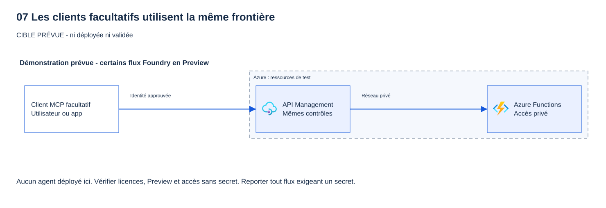
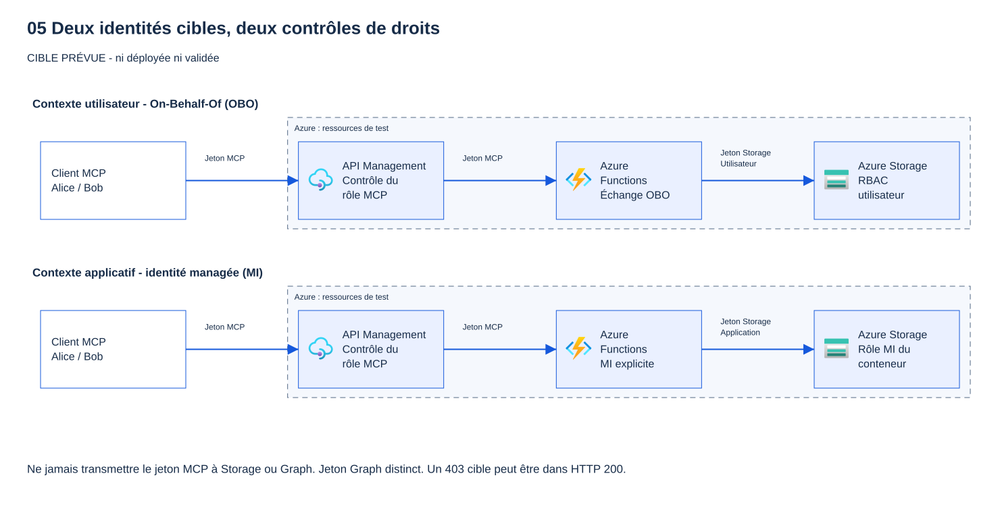
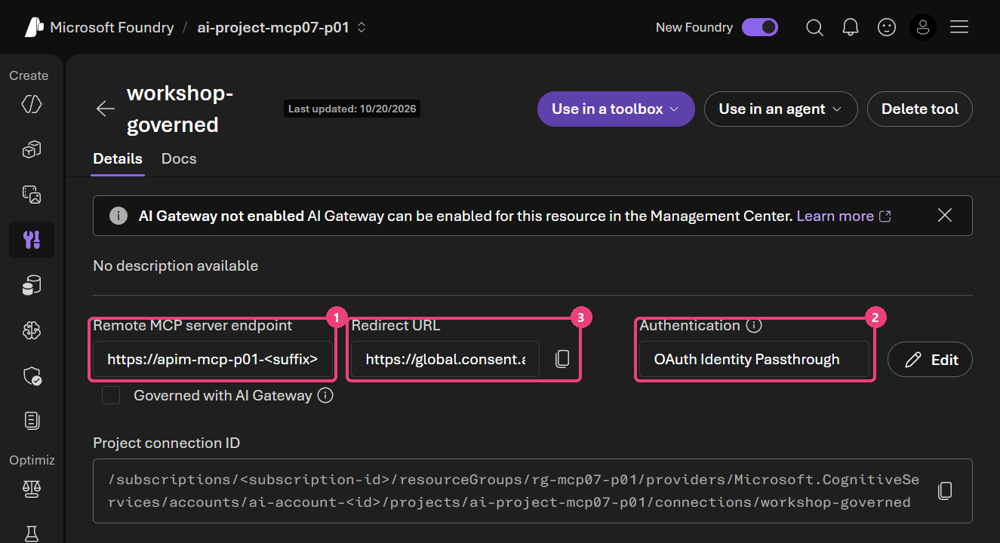
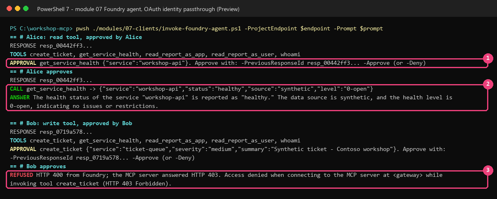
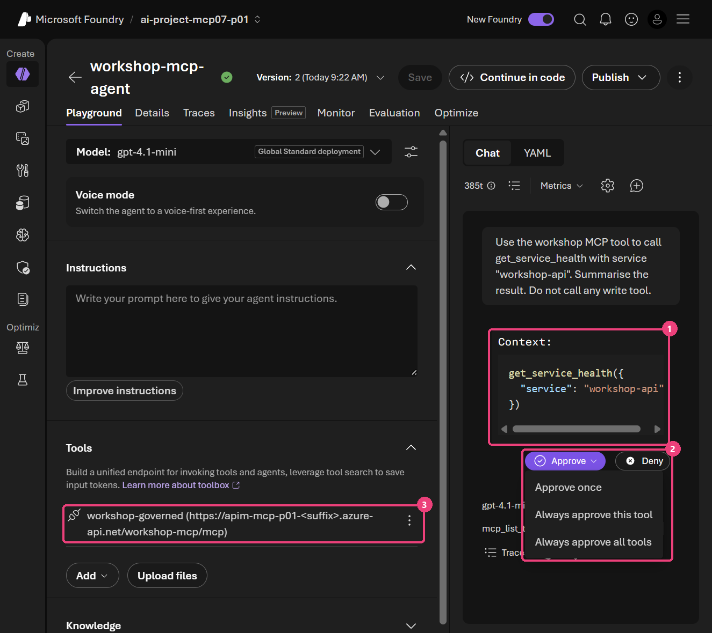
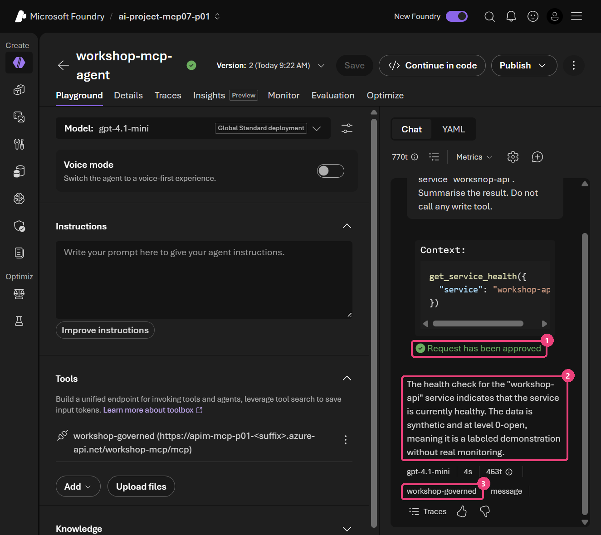
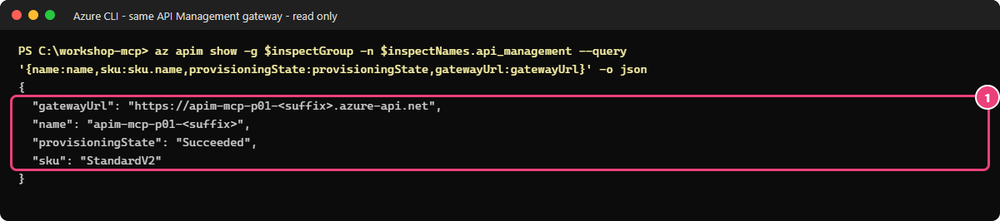

# 07 - Facultatif : essayer un autre client (Microsoft Foundry ; aperçu de Copilot Studio)

[English](README.md)

## Objectif

**Parcours Terraform + PowerShell.** Vous allez réutiliser les ressources gérées par Terraform.
Si vous avez suivi le parcours portail, utilisez plutôt le [guide low-code autonome](LOW-CODE.fr.md).
Exécutez les commandes à la racine du dépôt.

Vous allez appeler le même serveur Model Context Protocol (MCP), protégé par Microsoft Entra ID et accessible uniquement
via API Management, depuis un **agent Microsoft Foundry** (partie A).
Vous vérifierez qu'Alice peut lire les données fictives et que Bob ne peut pas écrire, même après
avoir approuvé l'appel. Réalisez cet exercice facultatif dans votre environnement de test, après les modules 03 à 06.
La partie B vous permet de découvrir **Microsoft Copilot Studio** par la lecture uniquement ; elle ne demande aucune action.
Vous conserverez les contrôles de la passerelle, les rôles d'application et les règles de journalisation des modules précédents.

## Pourquoi c'est important

La gouvernance doit s'appliquer quel que soit le client qui appelle le serveur. Chaque client a sa propre manière de se connecter et d'envoyer le jeton. Les questions à poser sont toujours les mêmes :

- Quelle identité appelle le serveur MCP (l'utilisateur, une identité managée ou une identité d'agent) ?
- Quelle est l'audience du jeton, et s'agit-il bien de l'audience propre au serveur MCP ?
- Le serveur obtient-il un nouveau jeton pour chaque API en aval, sans jamais lui transmettre le jeton MCP (pas de *token passthrough*) ?

## Ce que vous déployez

Seule la partie A vous demande de déployer des ressources. Elle est facultative et payante.
La partie B est un aperçu à lire, pas un exercice à exécuter ; la partie C récapitule les contrôles à vérifier.

| Quoi | Où | Pourquoi |
|---|---|---|
| Un projet Foundry avec un déploiement `gpt-4.1-mini` | Un groupe de ressources dédié, créé à partir du modèle `azd-ai-starter-basic` | Héberge l'agent |
| Une **inscription d'application cliente** `workshop-mcp-foundry-client-<prefix>` | Microsoft Entra | Permet à Foundry de connecter chaque utilisateur avec OAuth |
| Un **secret client valable un jour** sur cette application | Microsoft Entra, transmis uniquement à Foundry | Foundry n'accepte qu'un client confidentiel (vérifié le 2026-10-20) |
| La préautorisation de ce client pour `user_impersonation` | `infra/entra`, fichier privé `.workshop/entra-module07.tfvars.json` | Évite une demande de consentement pour l'autorisation déléguée (scope) MCP |
| L'ID du client dans les applications autorisées | `infra/workload`, fichier privé `.workshop/module07.tfvars.json` | La stratégie de la passerelle et l'authentification de la Function acceptent ce client |
| Le rôle **Foundry User** sur le projet pour chaque utilisateur de test | Le projet Foundry | Chaque utilisateur appelle l'agent avec sa propre identité |
| Un **modèle d'identité d'agent** (agent identity blueprint), créé par Foundry | Microsoft Entra | Créé automatiquement ; à supprimer séparément lors du nettoyage |

> [!NOTE]
> Cet exercice utilise deux fonctionnalités en **préversion (Preview)**. Leurs écrans et leur comportement peuvent changer :
>
> - **Préversion :** relais d'identité OAuth (OAuth identity passthrough) pour les outils MCP de Microsoft Foundry.
> - **Préversion :** le nouveau portail Foundry et sa configuration des outils MCP.

## Prérequis et rôles nécessaires

- Modules 03 à 06 déployés et validés dans votre environnement de test approuvé. Utilisez l'URL de la passerelle du module 04, jamais celle de la Function.
- Contributeur sur un abonnement pour le groupe de ressources Foundry ; Administrateur d'applications (ou propriétaire
  de l'application cliente) pour l'inscription et son secret ; l'administrateur des identités du module 03 pour `infra/entra`.
- Azure Developer CLI (`azd`) 1.34 ou plus récent, et les comptes de test Alice et Bob (Eve est déjà refusée au module 03).

## Étapes

### Conserver les mêmes contrôles d'accès


**Construisez-le étape par étape.** Cliquez sur **Suivant** pour ajouter un élément à la fois ; le schéma complet suit.

```reveal
{
  "title": "Un autre client, les mêmes règles",
  "audience": "attendee",
  "width": 760,
  "height": 380,
  "lanes": [
    {"x": 8, "width": 232, "label": "Clients"},
    {"x": 264, "width": 232, "label": "Entra et passerelle"},
    {"x": 520, "width": 232, "label": "Serveur MCP"}
  ],
  "nodes": [
    {"id":"vscode","step":0,"tone":"morning","x":30,"y":44,"width":188,"title":"VS Code + Copilot","detail":["modules 03 à 06"]},
    {"id":"apim","step":0,"tone":"governed","x":286,"y":164,"width":188,"icon":"apim","title":"API Management","detail":["même URL","mêmes stratégies"]},
    {"id":"fn","step":0,"x":542,"y":164,"width":188,"icon":"functions","title":"Serveur MCP","detail":["mêmes outils, rôles"]},
    {"id":"entra","step":1,"x":286,"y":44,"width":188,"icon":"entra","title":"Microsoft Entra ID","detail":["nouvelle app cliente","préautorisée"]},
    {"id":"foundry","step":2,"tone":"preview","x":30,"y":164,"width":188,"icon":"foundry-agent-service","title":"Agent Foundry","detail":["préversion","OAuth passthrough"]},
    {"id":"approve","step":3,"tone":"governed","x":286,"y":284,"width":188,"title":"Approbation humaine","detail":["dans l'agent Foundry","puis contrôle du rôle"]},
    {"id":"studio","step":4,"x":30,"y":284,"width":188,"icon":"copilot-studio","title":"Copilot Studio","detail":["présenté en résumé"]}
  ],
  "edges": [
    {"from":"apim","to":"fn","step":0,"tone":"governed","label":"privé"},
    {"from":"foundry","to":"entra","step":2,"label":"connexion"},
    {"from":"foundry","to":"apim","step":2,"tone":"governed","label":"jeton"},
    {"from":"approve","to":"apim","step":3,"label":"ensuite"},
    {"from":"studio","to":"apim","step":4,"label":""}
  ],
  "steps": [
    {"title": "Même serveur, même passerelle", "simple": "Rien ne change côté serveur : le nouveau client utilise la même URL de passerelle.", "say": "Les rôles d'application, la limite de débit et les journaux des modules 03 à 06 s'appliquent à tous les clients."},
    {"title": "Inscrire le nouveau client", "simple": "Le nouveau client reçoit sa propre inscription d'application, autorisée à trois endroits.", "say": "Préautorisé sur l'API dans Entra, accepté par l'authentification intégrée de la Function, et listé dans les stratégies de la passerelle. Absent d'une liste : refusé à ce contrôle."},
    {"title": "L'agent agit au nom de l'utilisateur (préversion)", "simple": "L'agent Foundry connecte l'utilisateur et appelle la passerelle avec le jeton de cet utilisateur.", "say": "OAuth identity passthrough est en **préversion**. L'utilisateur donne son consentement une fois ; ne partagez jamais un lien de consentement."},
    {"title": "Une personne approuve les écritures", "simple": "Avant qu'un outil d'écriture s'exécute, une personne l'approuve. Le contrôle des rôles s'applique ensuite.", "say": "L'approbation ne donne aucun droit : le `create_ticket` approuvé de Bob reçoit toujours HTTP 403 de la passerelle."},
    {"title": "Copilot Studio, mêmes règles", "simple": "Copilot Studio se connecterait à la même URL et rencontrerait les mêmes contrôles.", "say": "La partie B est seulement présentée en résumé. La même liste de vérification s'applique à tout client : audience du jeton, rôles, approbation, journaux."}
  ]
}
```



Le client change, pas les droits exigés par le serveur.

| Appel | Jeton et contrôle à prévoir |
|---|---|
| Client vers passerelle MCP | Jeton destiné à l'audience MCP. Les contrôles de la plateforme valident l'émetteur, le tenant, l'audience, l'expiration, le scope et le rôle |
| Passerelle vers Function | Même ressource logique MCP dans l'atelier ; pas d'échange vers une audience en aval. L'authentification et l'accès privé de la Function restent en place |
| Serveur MCP vers Graph ou Storage au nom de l'utilisateur | Nouveau jeton pour cette API par On-Behalf-Of (OBO) ; droits utilisateur et consentement délégué |
| Serveur MCP vers Storage en tant qu'application | Nouveau jeton Storage par identité managée ; droits applicatifs limités au conteneur |
| Serveur local en stdio | Pas de jeton OAuth HTTP sur ce transport ; l'accès au processus et les droits du système d'exploitation restent nécessaires |
| Calcul synthétique dans un outil | Aucun jeton en aval s'il n'y a aucun appel en aval ; l'accès MCP distant reste authentifié |



> [!IMPORTANT]
> **Point de compatibilité :** la passerelle exige un scope délégué et les outils OBO exigent un utilisateur.
> Une identité managée ou une identité d'agent Foundry est applicative : lui attribuer un rôle ne suffit **pas**.
> Cet exercice utilise donc le **relais d'identité OAuth** (partie A) : chaque utilisateur se connecte, et son jeton contient ses rôles.

**Question :** Foundry appelle le serveur avec son identité managée. `whoami` peut-il agir au nom d'Alice ?

<details>
<summary>Afficher la réponse</summary>

Non. Un jeton d'application ne représente pas Alice. La passerelle actuelle refuse ce mode d'accès ;
les outils OBO doivent aussi refuser les appelants applicatifs. L'identité du client et l'identité managée utilisée par un outil en aval sont deux choix distincts.

</details>

### Partie A — Agent Microsoft Foundry avec relais d'identité OAuth (préversion)

Utilisez votre propre tenant et abonnement hors production approuvés.
Faites approuver les modifications et le coût avant de commencer ; nettoyez les ressources le jour même.
Lancez les commandes dans PowerShell depuis la racine du dépôt. Initialisez le contexte du module :

```powershell
$p = Get-Content .\.workshop\participant.tfvars.json -Raw | ConvertFrom-Json
$env:ARM_TENANT_ID = az account show --query tenantId -o tsv
$env:ARM_SUBSCRIPTION_ID = az account show --query id -o tsv
az account show --query '{subscription:name,tenant:tenantId}' -o table
$vars = @('participant.tfvars.json', 'module02.tfvars.json', 'module03.tfvars.json', 'module04.tfvars.json', 'module04b.tfvars.json') |
    Where-Object { Test-Path ".\.workshop\$_" } | ForEach-Object { "-var-file=..\..\.workshop\$_" }
```

> **Résultat attendu** — votre abonnement et tenant de test approuvés. Sinon, arrêtez.

**A1. Créez le projet Foundry.** Le modèle de déploiement `azd` crée son propre groupe de ressources `rg-<nom>`.
Prévoyez environ quatre minutes, sans garantie de durée.

```powershell
$name = "mcp07-$($p.participant_prefix)-$($p.resource_suffix.Substring(0, 10))"
$dir = Join-Path $PWD ".workshop\foundry-07\$name"; New-Item -ItemType Directory -Force $dir | Out-Null; Push-Location $dir
$env:AZURE_DEV_USER_AGENT = 'microsoft_foundry_skill'
azd init -t https://github.com/Azure-Samples/azd-ai-starter-basic -e $name --no-prompt
azd env set AZURE_LOCATION swedencentral
azd env set AZURE_SUBSCRIPTION_ID $env:ARM_SUBSCRIPTION_ID
azd env set ENABLE_HOSTED_AGENTS false; azd env set ENABLE_CAPABILITY_HOST false
azd env set AI_PROJECT_DEPLOYMENTS '[{\"name\":\"gpt-4.1-mini\",\"model\":{\"name\":\"gpt-4.1-mini\",\"format\":\"OpenAI\",\"version\":\"2025-04-14\"},\"sku\":{\"name\":\"GlobalStandard\",\"capacity\":20}}]'
azd provision --no-prompt
$endpoint = azd env get-value AZURE_AI_PROJECT_ENDPOINT; Pop-Location
$p = Get-Content .\.workshop\participant.tfvars.json -Raw | ConvertFrom-Json
az group update -n "rg-$name" --tags workshop=governed-mcp owner=$($p.owner) expiry=$($p.expiry) module=07 -o none
```

> **Résultat réel** — 2026-10-20, tenant de test de l'auteur. Noms et ID masqués.
>
> ```text
>   (✓) Done: Foundry: ai-account-<id> (1m50.42s)
>   (✓) Done: Azure AI Services Model Deployment: ai-account-<id>/gpt-4.1-mini (4.36s)
>   (✓) Done: Foundry project: ai-account-<id>/ai-project-mcp07-p01 (8.454s)
> SUCCESS: Your application was provisioned in Azure in 3 minutes 21 seconds.
> ```
>
> Gardez les guillemets échappés `\"` dans la valeur JSON : `azd` l'insère dans une chaîne JSON.
> Sans ces caractères, `azd provision` s'arrête avec `invalid character 'n' after object key:value pair`.

**A2. Créez l'inscription d'application cliente**, sans secret pour l'instant.
Le bloc suivant conserve ses identifiants dans un fichier privé pour le nettoyage.

```powershell
$mcpApp = terraform -chdir=infra/entra output -raw application_client_id
$scopeId = az ad app show --id $mcpApp --query "api.oauth2PermissionScopes[?value=='user_impersonation'].id | [0]" -o tsv
$f = Join-Path $PWD '.workshop\foundry-client-request.json'
@{ resourceAppId = $mcpApp; resourceAccess = @(@{ id = $scopeId; type = 'Scope' }) } | ConvertTo-Json -Depth 5 -AsArray | Set-Content $f
$app = az ad app create --display-name "workshop-mcp-foundry-client-$($p.participant_prefix)" --sign-in-audience AzureADMyOrg `
    --required-resource-accesses "@$f" --query "{appId:appId,id:id}" -o json | ConvertFrom-Json
Remove-Item $f; az ad sp create --id $app.appId -o none
@{ foundry_client_app_id = $app.appId; foundry_client_object_id = $app.id; foundry_resource_group = "rg-$name" } |
    ConvertTo-Json | Set-Content .\.workshop\module07.private.json
```

> **Résultat attendu** — aucune sortie. `Get-Content .\.workshop\module07.private.json` affiche les deux ID et le nom du
> groupe de ressources. La nouvelle inscription n'a encore ni secret ni certificat.

**A3. Autorisez ce client dans Terraform.** Faites d'abord intervenir l'administrateur des identités pour
`infra/entra`, puis appliquez les changements dans `infra/workload` avec vos droits Azure.
Conservez Visual Studio Code et Azure CLI dans les listes de clients autorisés. Avant chaque application, relisez le plan :
vous devez voir une préautorisation ajoutée, puis des mises à jour des stratégies de la passerelle et de
l'authentification de la Function, sans aucune suppression.

```powershell
$ids = @(@(terraform -chdir=infra/entra output -json pre_authorized_client_ids | ConvertFrom-Json) + $app.appId | Select-Object -Unique)   # VS Code, Azure CLI, client Foundry
@{ pre_authorized_client_ids = $ids } | ConvertTo-Json | Set-Content .\.workshop\entra-module07.tfvars.json
@{ mcp_allowed_client_ids = $ids } | ConvertTo-Json | Set-Content .\.workshop\module07.tfvars.json
terraform '-chdir=infra\entra' plan '-var-file=..\..\.workshop\entra.tfvars.json' '-var-file=..\..\.workshop\entra-module05.tfvars.json' `
    '-var-file=..\..\.workshop\entra-module07.tfvars.json' '-out=..\..\.workshop\entra07.tfplan'
terraform '-chdir=infra\entra' apply '..\..\.workshop\entra07.tfplan'
$vars07 = $vars + '-var-file=..\..\.workshop\module05.tfvars.json', '-var-file=..\..\.workshop\module07.tfvars.json'   # $vars du module 04
terraform '-chdir=infra\workload' plan @vars07 '-out=..\..\.workshop\module07.tfplan'
terraform '-chdir=infra\workload' apply '..\..\.workshop\module07.tfplan'
```

> **Résultat réel** — 2026-10-20, tenant de test de l'auteur (extrait).
>
> ```text
> # azuread_application_pre_authorized.clients["<foundry-client-id>"] will be created
> Plan: 1 to add, 0 to change, 0 to destroy.
> ...
> Plan: 0 to add, 6 to change, 0 to destroy.
> Apply complete! Resources: 0 added, 6 changed, 0 destroyed.
> ```

**A4. Ajouter l'outil MCP dans le portail Foundry.** Ouvrez [Foundry](https://ai.azure.com/nextgen), choisissez votre
projet, puis **Build** → **Tools** → **Connect a tool** → **Custom** → **Model Context Protocol (MCP)** → **Create**
(portail en anglais). Remplissez :

| Champ | Valeur |
|---|---|
| Name | `workshop-governed` |
| Remote MCP Server endpoint | `terraform -chdir=infra/workload output -raw gateway_mcp_endpoint` |
| Authentication | **OAuth Identity Passthrough** |
| Client ID | le `foundry_client_app_id` de l'étape A2 |
| Client secret | laissez vide pour l'instant (l'étape A5 l'ajoute) |
| Token URL et Refresh URL | `https://login.microsoftonline.com/<tenant-id>/oauth2/v2.0/token` |
| Auth URL | `https://login.microsoftonline.com/<tenant-id>/oauth2/v2.0/authorize` |
| Scopes | La valeur renvoyée par `terraform -chdir=infra/entra output -raw user_impersonation_scope`, suivie d'un espace, puis de `offline_access` |

Sélectionnez **Connect**, puis copiez la **Redirect URL** affichée par Foundry. Sélectionnez ensuite **Use in an agent**,
nommez l'agent `workshop-mcp-agent` et gardez uniquement cet outil MCP (retirez **Web search** s'il apparaît, puis **Save**).



*Capture réelle, 2026-10-20, tenant de test de l'auteur. Noms pseudonymisés, ID remplacés.*

**A5. Inscrire l'URL de redirection et transmettre à Foundry un secret valable un jour.** Collez ce bloc en une seule fois.
Ce bloc transmet le secret à Foundry au moyen d'un fichier de requête privé, ignoré par Git et supprimé dans `finally`.
Le transfert ne se fait donc pas uniquement en mémoire. N'affichez pas le secret, n'activez pas de transcription
et ne conservez pas ce fichier.

```powershell
$redirect = '<redirect-url-de-A4>'
$s = Get-Content .\.workshop\module07.private.json -Raw | ConvertFrom-Json
$f = Join-Path $PWD '.workshop\foundry-connection.private.json'
@{ web = @{ redirectUris = @($redirect) } } | ConvertTo-Json -Depth 4 | Set-Content $f
az rest --method patch --url "https://graph.microsoft.com/v1.0/applications/$($s.foundry_client_object_id)" --body "@$f" --headers 'Content-Type=application/json'
$end = (Get-Date).ToUniversalTime().AddDays(1).ToString('yyyy-MM-ddTHH:mm:ssZ')
$secret = az ad app credential reset --id $s.foundry_client_app_id --append --display-name 'foundry-module07-short-lived' --end-date $end --query password -o tsv --only-show-errors
$proj = az resource list -g $s.foundry_resource_group --resource-type Microsoft.CognitiveServices/accounts/projects --query "[0].id" -o tsv
$url = "https://management.azure.com$proj/connections/workshop-governed?api-version=2025-06-01"
$c = (az rest --url $url -o json | ConvertFrom-Json).properties
$body = @{ properties = @{ authType = 'OAuth2'; category = $c.category; group = $c.group; target = $c.target; authorizationUrl = $c.authorizationUrl
    tokenUrl = $c.tokenUrl; refreshUrl = $c.refreshUrl; scopes = $c.scopes; connectorName = $c.connectorName; redirectUrl = $c.redirectUrl
    isSharedToAll = $false; metadata = $c.metadata; credentials = @{ clientId = $s.foundry_client_app_id; clientSecret = $secret } } }
[IO.File]::WriteAllText($f, ($body | ConvertTo-Json -Depth 6 -Compress))
try { az rest --method put --url $url --body "@$f" --headers 'Content-Type=application/json' -o none } finally { Remove-Item $f -Force; $secret = $null; $body = $null }
```

> **Résultat réel** — 2026-10-20 : aucune sortie. Relire la connexion affiche `"credentials": null` : Foundry ne renvoie
> jamais le secret. Dans Microsoft Entra, l'application cliente montre un secret nommé `foundry-module07-short-lived`, valable un jour.

> **Pourquoi un secret ?** Foundry exige ici un client confidentiel : le champ **Client secret** est obligatoire.
> Lors du test du 2026-10-20, un client public permettait la connexion d'Alice à Entra, mais pas l'échange du code par Foundry.
> Utilisez uniquement l'application dédiée et un secret valable un jour. Ne l'affichez pas et n'en conservez aucune copie ;
> le fichier de transfert est supprimé par le bloc, puis le nettoyage retire le secret de l'application.
> Ce secret identifie l'**application cliente** ; chaque utilisateur se connecte toujours avec sa propre identité.

**A6. Attribuez le rôle Foundry User à chaque utilisateur de test sur ce projet uniquement.**
Chacun pourra ainsi appeler l'agent en son propre nom :

```powershell
$users = Get-Content .\.workshop\test-users.private.json -Raw | ConvertFrom-Json
foreach ($u in 'alice', 'bob') {
    az role assignment create --assignee-object-id $users.$u.objectId --assignee-principal-type User --role 'Foundry User' --scope $proj -o none
}
```

> **Résultat attendu** — aucune sortie. Attendez 2 à 3 minutes : tant que le rôle n'est pas appliqué, Foundry répond HTTP 403.

La documentation recommande **Foundry Agent Consumer** pour les agents publiés. Pour des appels directs au projet, comme
ici, ce rôle a renvoyé HTTP 403 lors du test du 2026-10-20 ; **Foundry User** a fonctionné.

**A7. Testez la lecture avec Alice, puis le refus d'écriture avec Bob.** Commencez avec le profil Azure CLI
d'Alice (module 03). Connectez-vous quand Foundry le demande, puis examinez l'appel avant d'approuver la lecture :

```powershell
$env:AZURE_CONFIG_DIR = Join-Path $PWD '.workshop\az-alice'
$prompt = 'Use the workshop MCP tool to call get_service_health with service "workshop-api". Summarise the result. Do not call any write tool.'
pwsh ./modules/07-clients/invoke-foundry-agent.ps1 -ProjectEndpoint $endpoint -Prompt $prompt
# CONSENT : ouvrez le lien affiché dans un navigateur connecté en tant qu'Alice, choisissez « Allow access », connectez-vous, puis relancez la même commande.
# APPROVAL : lisez le nom de l'outil et ses arguments, puis :
pwsh ./modules/07-clients/invoke-foundry-agent.ps1 -ProjectEndpoint $endpoint -PreviousResponseId '<resp_id>' -Approve
```

> **Résultat réel** — Alice, 2026-10-20, après son consentement (ID de réponse raccourcis).
>
> ```text
> TOOLS create_ticket, get_service_health, read_report_as_app, read_report_as_user, whoami
> APPROVAL get_service_health {"service":"workshop-api"}. Approve with: -PreviousResponseId resp_00442ff3... -Approve (or -Deny)
> CALL get_service_health -> {"service":"workshop-api","status":"healthy","source":"synthetic","level":"0-open"}
> ```

Recommencez ensuite en tant que Bob avec une écriture (`$env:AZURE_CONFIG_DIR` sur `.workshop\az-bob`) :

```prompt
Use the workshop MCP tool. Call create_ticket with service "ticket-queue", severity "medium" and summary "Synthetic ticket - Contoso workshop". Show the tool result, or the exact error if the call is refused.
```



Vous pouvez aussi utiliser l'espace de test du portail (playground) : Foundry affiche l'outil et ses arguments, puis attend votre choix, **Approve** ou **Deny**.





*Captures réelles, 2026-10-20, tenant de test de l'auteur. Noms pseudonymisés, ID remplacés.*

> [!WARNING]
> Un lien de consentement appartient à l'utilisateur Foundry qui l'a reçu. Si quelqu'un d'autre l'ouvre et se connecte,
> l'agent du premier utilisateur agit ensuite avec le jeton du second. Ne partagez jamais un lien de consentement : chacun ouvre le sien.

**Question :** Bob choisit **Approve** dans Foundry pour `create_ticket`. Qui refuse l'appel, et pourquoi l'approbation ne suffit-elle pas ?

<details>
<summary>Afficher la réponse</summary>

La passerelle le refuse avec HTTP 403. L'approbation est l'accord de Bob pour lancer l'outil ; elle n'ajoute rien à son
jeton. La passerelle cherche `Tools.Write` dans la revendication `roles`, que Bob n'a pas : la Function ne voit jamais l'appel.

</details>

### Partie B — Aperçu de la connexion à Microsoft Copilot Studio (non validé en conditions réelles)

Cette partie est une **lecture uniquement, non validée en conditions réelles**. N'exécutez pas ces étapes dans
le cadre de l'atelier. Voici le fonctionnement décrit par la documentation ; consultez les sources pour l'étudier.

1. L'ajout se fait dans l'agent, sous **Outils → Ajouter un outil → Nouvel outil → Model Context Protocol**.
2. Le formulaire demande un **Nom du serveur**, une **Description du serveur** et l'**URL du serveur** (celle de la passerelle).
3. L'authentification à étudier est **OAuth 2.0**, jamais **Aucune**. Le parcours **Manual** documenté demande un **Client secret**. La règle de
   l'atelier ne l'autorise que comme dans la partie A : une inscription d'application cliente dédiée, un secret valable un
   jour, transmis sans être affiché ni stocké, et supprimé au nettoyage. L'atelier n'implémente pas l'inscription dynamique
   de clients. Ne passez jamais à **Clé API** pour contourner cette étape.
4. Seul le transport **Streamable** est pris en charge. SSE n'est plus pris en charge.
5. Une expérimentation séparée devrait commencer par un outil de lecture, avec l'audience MCP, le scope délégué
   et les rôles requis. Aucun test réel de cette connexion Copilot Studio n'a été effectué pour l'atelier.

> [!CAUTION]
> Ne passez jamais à **Aucune** ni à **Clé API** pour faire fonctionner une connexion Copilot Studio : cela supprime
> le contrôle d'identité mis en place dans l'atelier. Un secret client n'est acceptable que de courte durée, sur une
> application cliente dédiée, et supprimé ensuite.

> Les libellés exacts des écrans peuvent changer. Consultez la page citée dans les sources avant d'étudier cette intégration.

**Question :** le parcours OAuth Manual de Copilot Studio demande un secret client. Pourquoi ne pas passer plutôt à **Clé API** ?

<details>
<summary>Afficher la réponse</summary>

Une clé API n'identifie aucun utilisateur. La passerelle ne pourrait plus vérifier un jeton pour l'audience MCP, un scope délégué
ni les rôles d'application d'Alice et de Bob : l'autorisation par utilisateur disparaîtrait. Un secret client de courte durée,
sur une application cliente dédiée, garde la connexion de chaque utilisateur : le secret identifie l'application cliente, pas l'utilisateur.

</details>

### Partie C — Points à vérifier pour chaque client

- [ ] L'audience du jeton est l'audience propre au serveur MCP (ni Microsoft Graph, ni une API en aval).
- [ ] Le client connecte chaque utilisateur (OAuth) ; jamais **Aucune** ni une clé API.
- [ ] Tout secret client est valable un jour, sur une application cliente dédiée, jamais affiché ni conservé, et supprimé au nettoyage. Le fichier de transfert temporaire est supprimé dans `finally`.
- [ ] Les outils d'écriture exigent un rôle explicite et une approbation humaine.
- [ ] Les journaux de la passerelle montrent l'appel avec un ID de corrélation et sans corps de requête (module 06).

## Ce que vous devez voir

- Alice : Foundry liste les cinq outils, demande l'approbation, puis renvoie le résultat synthétique `healthy`.
- Bob : l'approbation est demandée pour `create_ticket`, puis la passerelle répond **HTTP 403** ; l'outil ne s'exécute pas.
- Requête du module 06 : les appels de Foundry apparaissent avec le nom de l'outil, le statut et la durée, sans corps.

### Vérifier vous-même avec Azure CLI

**Pourquoi :** changer de client ne doit pas créer un nouvel accès direct à la Function.
Avant les essais dans Foundry, retrouvez la même passerelle qu'au module 04.
Dans PowerShell 7, à la racine du dépôt :

```powershell
$ErrorActionPreference = 'Stop'
$inspectGroup = terraform '-chdir=infra\workload' output -raw resource_group_name
if ($LASTEXITCODE -ne 0) { throw 'Groupe de ressources indisponible.' }
$inspectNames = terraform '-chdir=infra\workload' output -json resource_names | ConvertFrom-Json
if ($LASTEXITCODE -ne 0) { throw 'Noms des ressources indisponibles.' }
```

> **Résultat attendu** — aucune sortie : les variables reçoivent les noms de votre déploiement. Vérifiez avec `$inspectNames`.

Copiez cette lecture de la passerelle existante ; elle ne crée ni agent ni connexion :

```powershell
az apim show -g $inspectGroup -n $inspectNames.api_management --query '{name:name,sku:sku.name,provisioningState:provisioningState,gatewayUrl:gatewayUrl}' -o json
if ($LASTEXITCODE -ne 0) { throw 'Passerelle introuvable. Reprenez les prérequis du module 04.' }
```

> **Résultat attendu** — la passerelle `StandardV2` à l'état `Succeeded`.
> L'adresse MCP reste son `gatewayUrl` suivi de `/workshop-mcp/mcp`, pas le domaine de la Function.



Comparez ensuite avec le résultat de l'appel dans Foundry, après avoir réalisé les étapes approuvées :


*La capture Azure CLI date du 20 octobre 2026 ; les noms sont masqués.
La capture Foundry existante illustre le résultat côté client, pas une nouvelle exécution de cet exercice.
La lecture d'APIM ne prouve ni la connexion OAuth du client ni les droits d'Alice/Bob : utilisez les essais ci-dessous.
En cas d'échec, vérifiez l'URL et les prérequis, sans réactiver l'accès public de la Function.*

## Valider

> [!NOTE]
> **Limites de validation :** le parcours Foundry initial a été testé dans le tenant de test de l'auteur le 2026-10-20.
> Le guide dans sa version actuelle n'a pas été revalidé de bout en bout. Les sorties et captures datées sont des exemples,
> pas des preuves pour votre environnement. La partie B (Copilot Studio) reste une lecture uniquement, sans validation réelle.
> Le relais d'identité OAuth et la configuration MCP du nouveau portail Foundry restent en **préversion (Preview)**.

**Vérifiez d'abord les fichiers, sans accéder à Azure.** Le validateur vérifie que les fichiers requis sont présents,
que la partie A et son nettoyage sont documentés et qu'aucune valeur de secret n'est écrite dans le guide.

```powershell
pwsh ./modules/07-clients/validate.ps1 -Offline
```

> **Résultat réel** — validateur hors ligne, poste de l'auteur, 2026-10-20 (extrait).
>
> ```text
> PASS README sections present in contract order (offline)
> PASS lists what part A deploys and how to delete it (offline)
> PASS marks Preview features (offline)
> PASS never recommends the anonymous None option for Copilot Studio (offline)
> PASS client secrets are short-lived, never printed and deleted (offline)
> PASS no GUIDs or client secret values in module files (offline)
>
> RESULT: all offline checks passed
> ```

**En conditions réelles** (partie A déployée) : lancez l'étape A7 pour Alice et pour Bob. Attendu :
`CALL get_service_health -> {... "status":"healthy" ...}` pour Alice, et `REFUSED ... the MCP server answered HTTP 403`
pour Bob après son approbation.

```bash
bash ./modules/07-clients/validate.sh --offline
```

> **Résultat attendu** — les mêmes lignes PASS/FAIL que l'exécution PowerShell ci-dessus.

**Question :** tous les contrôles hors ligne passent. Cela prouve-t-il que Foundry peut appeler votre serveur ?

<details>
<summary>Afficher la réponse</summary>

Non. Les contrôles hors ligne prouvent que le dossier est complet et que les règles sont écrites. Seule l'étape A7 prouve
le parcours réel : la lecture d'Alice réussit après approbation, et l'écriture approuvée de Bob reçoit HTTP 403 de la passerelle.

</details>

## Dépannage

| Symptôme | Vérification |
|---|---|
| `Access denied ... while enumerating tools (HTTP 403 Forbidden)` | La liste de la passerelle doit accepter `server/discover` (MCP 2026-07-28), que Foundry appelle en premier. Votre copie de `policies/mcp-server.xml` l'accepte avec `Tools.Read`. Sinon : l'ID du client manque dans `mcp_allowed_client_ids` (étape A3). |
| La fenêtre de consentement se termine par « Nous n'avons pas pu effectuer l'authentification », sans connexion visible pour l'application cliente | L'application cliente n'a pas de secret, ou l'URL de redirection n'est pas sur la plateforme **Web** (étape A5). |
| Le même message, mais Entra montre une connexion réussie | Fermez la fenêtre et rappelez l'agent : le jeton est souvent enregistré malgré tout. |
| Votre compte Foundry reçoit AADSTS50105 dans la fenêtre de consentement | Normal : seuls les utilisateurs qui ont un rôle d'application (module 03) peuvent se connecter à l'API MCP. Utilisez Alice ou Bob. |
| HTTP 403 de Foundry avant tout appel d'outil | L'utilisateur n'a pas **Foundry User** sur le projet, ou le rôle se propage encore (attendez 2 à 3 minutes). |
| `invalid character 'n' after object key:value pair` lors de `azd provision` | Échappez les guillemets dans `AI_PROJECT_DEPLOYMENTS` (étape A1). |
| Le client n'atteint pas le serveur | Utilisez l'URL de la passerelle (module 04). L'URL de la Function est fermée volontairement. |
| Le transport SSE échoue | Utilisez Streamable. SSE n'est plus pris en charge. |

## Nettoyer

Lancez d'abord le script en mode rapport pour relire les changements prévus, puis utilisez `-Apply` après approbation.
Le script rétablit les listes de clients autorisés à l'aide de plans Terraform contrôlés,
puis supprime le groupe de ressources Foundry (seulement s'il porte l'étiquette `module=07`) et l'inscription
d'application cliente avec son secret.

Un échec de lecture Azure ou Microsoft Graph arrête le nettoyage : il ne prouve pas qu'une ressource est absente.
Avant de supprimer le groupe, le script enregistre les noms et les régions des comptes dans l'inventaire privé existant.
Il conserve cet inventaire si une suppression ou une purge échoue, pour permettre une nouvelle tentative même après
la disparition du groupe. La purge est définitive. Elle exige l'opération
`Microsoft.CognitiveServices/locations/resourceGroups/deletedAccounts/delete` sur le périmètre du compte supprimé ;
un rôle limité à l'ancien groupe de ressources peut ne pas suffire. Faites vérifier cette opération précise par
l'administrateur, sans vous attribuer un rôle plus large.
La lecture des comptes supprimés de l'abonnement peut aussi exiger des permissions au-delà de l'ancien groupe.
Si le groupe a été supprimé hors du script et qu'un compte n'a pas d'inventaire de propriété enregistré, le nettoyage
s'arrête pour vérification par l'administrateur. Ne jetez pas les fichiers privés et ne considérez pas le nettoyage comme terminé.
Les listes Azure peuvent mettre du temps à refléter une purge : si la confirmation échoue, attendez puis relancez la même commande.
Ces cas d'échec sont testés hors connexion ; ils ne constituent pas un nouveau résultat de nettoyage dans Azure.

```powershell
pwsh ./modules/07-clients/cleanup.ps1 -TenantId $env:ARM_TENANT_ID -SubscriptionId $env:ARM_SUBSCRIPTION_ID
pwsh ./modules/07-clients/cleanup.ps1 -TenantId $env:ARM_TENANT_ID -SubscriptionId $env:ARM_SUBSCRIPTION_ID -Apply
```

> **Résultat réel** — `-Apply`, lancé par le module 99 le 2026-10-20, tenant de test de l'auteur. Noms et ID masqués.
>
> ```text
> PLAN update azapi_resource.mcp_api_policy[0] (remove the Foundry client from the allowed applications)
> ...
> PASS 'remove the Foundry client from the allowed applications' applied (expected HTTP 200).
> PLAN delete azuread_application_pre_authorized.clients["<foundry-client-id>"] (remove the Foundry client pre-authorization)
> PASS 'remove the Foundry client pre-authorization' applied (expected HTTP 200).
> PASS Foundry resource group deleted and accounts purged (expected HTTP 200 from Azure Resource Manager).
> PASS Foundry client app registration and secret deleted (expected HTTP 204 from Microsoft Graph).
> DONE module 07 part A removed. Private module 07 files deleted.
> ```
>
> **Ce que cela signifie pour vous :** vérifiez que la passerelle et la Function n'acceptent plus le client Foundry
> et que son application dédiée, avec son secret, a disparu. Le **modèle d'identité d'agent** de Foundry doit être
> supprimé séparément dans Microsoft Entra : supprimer le groupe de ressources ne suffit pas.
> Le script prévoit cette suppression avant celle du groupe ; vérifiez aussi son résultat.

```bash
export ARM_TENANT_ID="$(az account show --query tenantId -o tsv)"
export ARM_SUBSCRIPTION_ID="$(az account show --query id -o tsv)"
az account show --query '{subscription:name,tenant:tenantId}' -o table
bash ./modules/07-clients/cleanup.sh -TenantId "$ARM_TENANT_ID" -SubscriptionId "$ARM_SUBSCRIPTION_ID"
```

> **Résultat attendu** — les mêmes lignes que le rapport PowerShell ; ajoutez `--apply` pour supprimer.

## Pour aller plus loin

- Dans une expérimentation séparée et approuvée, publiez l'agent et comparez **Foundry Agent Consumer** et **Foundry User** pour ses utilisateurs.
- Suivez la disponibilité générale du relais d'identité OAuth, et la possibilité d'un client public.

## Sources

- [Retrouver la passerelle avec Azure CLI](https://learn.microsoft.com/cli/azure/apim#az-apim-show), vérifié le 20 octobre 2026.

- Microsoft Foundry — Configurer l'authentification des outils MCP : https://learn.microsoft.com/azure/foundry/agents/how-to/mcp-authentication
- Azure Functions — Connecter un serveur MCP sur Azure Functions à un agent Foundry Agent Service : https://learn.microsoft.com/azure/azure-functions/functions-mcp-foundry-tools
- Spécification MCP 2026-07-28 — `server/discover` : https://modelcontextprotocol.io/specification/2026-07-28/server/discover
- Azure-Samples/azd-ai-starter-basic (MIT), vérifié au commit `5bf59a056c41ff37801dea334ba6a141e2dc5f67` : https://github.com/Azure-Samples/azd-ai-starter-basic
- Microsoft Copilot Studio — Ajouter un serveur MCP existant à un agent : https://learn.microsoft.com/microsoft-copilot-studio/mcp-add-existing-server-to-agent
- Azure CLI — Vérifier l'existence du groupe : https://learn.microsoft.com/cli/azure/group#az-group-exists
- Restauration, purge définitive et permissions Foundry : https://learn.microsoft.com/azure/ai-services/recover-purge-resources
- Les comptes supprimés conservent leur identifiant de ressource initial : https://learn.microsoft.com/rest/api/aiservices/accountmanagement/deleted-accounts/list?view=rest-aiservices-accountmanagement-2024-10-01

Dernière vérification : 2026-10-21 (sources du nettoyage et tests d'erreur hors connexion ; aucun nouveau déploiement).
