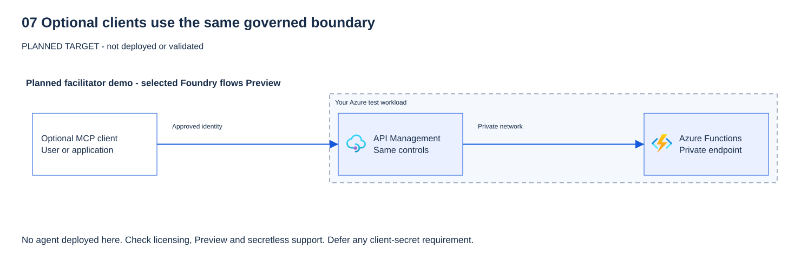
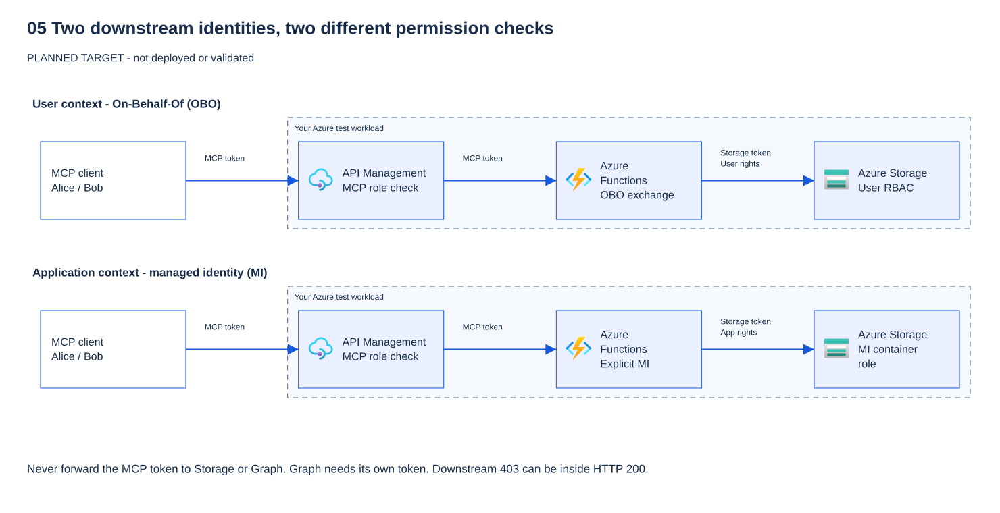

# 07 - Optional: other clients (facilitator demo)

[Français](README.fr.md)

## Goal

Show that the same governed MCP server can be called from other clients: a Microsoft Foundry agent and Microsoft Copilot Studio. This module is a **facilitator demo**. Attendees watch and read the checklist. They do not need to build it.

## Why it matters

Governance must hold no matter which client calls the server. Each client has its own way of signing in and of sending the token. The questions to ask are the same every time:

- Which identity is used to call the MCP server (the user, a managed identity, or an agent identity)?
- Which audience does the token have, and is it the MCP server's own audience?
- Is there any token passthrough to a downstream service?

## What you deploy

Nothing. This module creates no Azure, Microsoft Entra or Copilot Studio resources. It only documents the steps and provides an offline check of this folder.

> [!NOTE]
> Preview features used in this demo (label them as Preview when you show them):
>
> - **Preview:** OAuth identity passthrough for MCP tools in Microsoft Foundry.
> - **Preview:** Microsoft Foundry MCP tool configuration in the Agent Builder.

## Prerequisites and required roles

- Modules 03 to 06 completed and validated (or a recording of them).
- The MCP server URL from module 04 (through the gateway, never the Function URL).
- For a live demo only: a Microsoft Foundry project and a Copilot Studio environment that your tenant allows. Your administrator approves both. Nothing in this module changes their roles.

## Steps

### Keep the same authorization boundary



The product changes; the server's authorization does not.

| Hop | Token and check to plan |
|---|---|
| Client to MCP gateway | Token for the MCP audience. Validate issuer, tenant, audience, expiry, scope and role with platform controls |
| Gateway to Function | Same logical MCP resource in this workshop; not an exchange to a downstream audience. Keep Function authentication and private access |
| MCP server to Graph or Storage as user | New token for that API through On-Behalf-Of (OBO); user rights and delegated consent apply |
| MCP server to Storage as app | New Storage token through the managed identity; only the container-scoped application rights apply |
| Local stdio server | No HTTP OAuth token on this transport; process access and operating-system permissions still matter |
| Synthetic calculation inside a tool | No downstream token needed if it makes no downstream call; remote MCP access still requires authentication |



> [!IMPORTANT]
> **Compatibility gate:** the current gateway requires a delegated scope and the server's OBO tools require a user.
> A Foundry managed identity is app-only: assigning an app role alone does **not** make it compatible.
> Do not claim a working app-only client demo or relax the scope gate. Use an approved user flow or a recording.

**Question:** Foundry calls with its managed identity. Can `whoami` act for Alice?

<details>
<summary>Show answer</summary>

No. An application token contains no delegated Alice context. The current gateway refuses this client flow;
OBO tools must also reject app-only callers. Application identity at the client and managed identity for a downstream tool are different choices.

</details>

### Part A — Microsoft Foundry agent (Preview)

1. In the Foundry project, open the agent and add an **MCP tool**.
2. Set the server URL to the gateway URL from module 04. Use the **Streamable HTTP** transport.
3. Choose the authentication option:
   - **Project managed identity:** a documented Foundry option, but not compatible with this workshop's current delegated-scope gateway. Explain the distinction; do not run it as a successful workshop path.
   - **OAuth identity passthrough (Preview):** each signed-in user's identity is used. The server must accept a token whose audience is the server's own audience. Microsoft tokens are not forwarded to untrusted MCP endpoints.
4. Ask the agent a read-only question that calls a read tool. Paste this prompt in the agent playground, then show the result:

   ```prompt
   Use the workshop MCP tool to call get_service_health with service "workshop-api". Summarise the result. Do not call any write tool.
   ```

5. Before any write demonstration, verify that this client can require human approval for this individual call. If not, omit the write. Approval never supplies a missing role: Bob must still be refused.

### Part B — Microsoft Copilot Studio (outline)

1. In the agent, open **Tools**, then **Add a tool**, then **New tool**, then **Model Context Protocol**.
2. Enter a **Server name**, a **Server description** and the **Server URL** (gateway URL).
3. Inspect **OAuth 2.0**, never **None**. The documented **Manual** setup asks for a **Client secret**, which is outside this workshop's no-secret rules. Stop before creating that connection; use the outline or a recording. Discovery does not prove secretless compatibility, and the workshop does not implement dynamic client registration. Do not switch to **API key** to bypass this gate.
4. Only the **Streamable** transport is supported. SSE is no longer supported.
5. Only test a read tool if an administrator has separately verified a supported secretless flow with the correct MCP audience, delegated scope and roles. This guide does not claim that such a connection has been configured or validated.

> [!CAUTION]
> Stop before creating a Copilot Studio connection that asks for a **Client secret**. Never switch to **None**
> or **API key** to make it work: that removes the identity check this workshop builds.

> The exact screen labels can change. Check the source page below before the session.

**Question:** the Copilot Studio Manual OAuth setup asks for a client secret. Why not switch to **API key** to finish the demo?

<details>
<summary>Show answer</summary>

An API key identifies no user. The gateway could no longer check a token for the MCP audience, a delegated scope or
Alice's and Bob's app roles, so per-user authorization would be gone. A client secret is also outside this workshop's no-secret rule.
Stop, and use the outline or a recording instead.

</details>

### Part C — Checklist for every client

- [ ] The token audience is the MCP server's own audience (not Microsoft Graph, not a downstream API).
- [ ] No client secret or API key is stored in the client configuration.
- [ ] Write tools require an explicit role and a human approval.
- [ ] The gateway logs show the call with a correlation ID and no request body (module 06).

## What you should see

- With a compatible approved user flow, Foundry can return a read-tool result; otherwise show the recording and the compatibility gate.
- Bob's write is refused even if he approves. Alice needs both the role and approval before an individual write.
- Available gateway metadata shows requests without bodies. It does not prove the client displayed approval; inspect that separately.

## Validate

Offline checks only. They confirm that this folder is complete and that the rules above are present:

```powershell
pwsh ./modules/07-clients/validate.ps1 -Offline
```

> **Real result** — offline validator, author's workstation, 2026-10-17. Names and IDs withheld.
>
> ```text
> PASS file exists: README.md (offline)
> PASS file exists: README.fr.md (offline)
> PASS file exists: validate.ps1 (offline)
> PASS file exists: validate.sh (offline)
> PASS file exists: cleanup.ps1 (offline)
> PASS file exists: cleanup.sh (offline)
> PASS README sections present in contract order (offline)
> PASS French README has the same section count (offline)
> PASS states that this module creates no resources (offline)
> PASS marks Preview features (offline)
> PASS never recommends the anonymous None option for Copilot Studio (offline)
> PASS states SSE is no longer supported (offline)
> PASS Sources link the Foundry and Copilot Studio pages (offline)
> PASS no GUIDs or client secrets in module files (offline)
>
> RESULT: all offline checks passed
> ```
>
> **What it means for you:** the folder is complete and the safety rules (no **None**, no secrets, Streamable only) are written down. It does not prove that any client was connected.

```bash
bash ./modules/07-clients/validate.sh --offline
```

> **Expected result** — the same PASS/FAIL lines as the PowerShell run above.

Each check prints one `PASS` or `FAIL` line. No live check is scripted, because this demo depends on tenant settings.

**Question:** every offline check passes. Does that prove Foundry or Copilot Studio can call your server?

<details>
<summary>Show answer</summary>

No. They prove the folder is complete and the rules are written down: never the **None** option, no secret, Streamable
HTTP only. Connecting a client depends on tenant settings, so it stays a manual check.

</details>


## Troubleshooting

- **The client gets 401:** the audience in the token does not match the server. Check module 03.
- **The client gets 403:** the caller lacks the app role. Check module 03 and module 05.
- **The client cannot reach the server:** the URL must be the gateway URL (module 04). The Function URL is locked by design.
- **SSE transport fails:** use Streamable. SSE is no longer supported.

## Clean up

Nothing was created, so there is nothing to delete. Remove any test agent or tool you added to the Foundry project or Copilot Studio after the demo:

```powershell
pwsh ./modules/07-clients/cleanup.ps1
```

> **Real result** — `cleanup.ps1`, author's workstation, 2026-10-17. Names and IDs withheld.
>
> ```text
> INFO module 07 creates no Azure, Entra or Copilot Studio resources.
> INFO remove any test agent or MCP tool you added to the Foundry project or Copilot Studio after the demo, by hand.
> PASS nothing to delete (module 07)
> ```
>
> **What it means for you:** the script deletes nothing. Remove any test agent or MCP tool from Foundry or Copilot Studio by hand.

```bash
bash ./modules/07-clients/cleanup.sh
```

> **Expected result** — the same INFO and PASS lines as the PowerShell run above.

## Go further

- Add a second client and compare the authentication choices.
- Read the Preview notes in the Foundry documentation and track when OAuth passthrough becomes generally available.

## Sources

- Microsoft Foundry — MCP authentication: https://learn.microsoft.com/azure/foundry/agents/how-to/mcp-authentication
- Microsoft Copilot Studio — Add an existing MCP server to an agent: https://learn.microsoft.com/microsoft-copilot-studio/mcp-add-existing-server-to-agent

Last verified: 2026-10-16.
