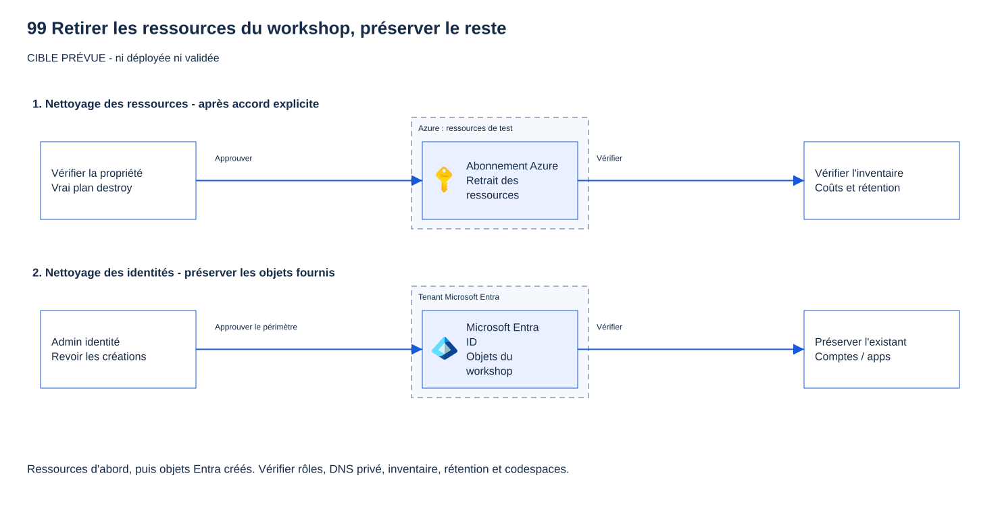

# 99 — Nettoyer les ressources du parcours low-code

[English](LOW-CODE.md)

## Objectif

Vous allez supprimer uniquement ce que **vous avez créé pour le parcours low-code**, puis vérifier qu'il ne reste
aucune ressource ni identité active de votre atelier. Vous établirez d'abord un inventaire, confirmerez à qui appartient
chaque élément, puis demanderez un accord explicite avant toute suppression.
Conservez les noms et les fichiers privés utilisés lors du déploiement jusqu'à la fin des vérifications.

## Pourquoi c'est important

Les éléments de l'atelier ne se trouvent pas tous dans le même groupe de ressources :

- Le serveur MCP et sa passerelle se trouvent dans le groupe utilisé pour les modules 02 à 06.
- Si vous avez suivi le module 07, l'agent Foundry utilise **un autre groupe de ressources**.
  Il possède aussi des objets d'identité dans Microsoft Entra, appelés *agent identity blueprints*
  (modèles d'identité d'agent, **Préversion**). Supprimer le groupe du serveur MCP ne supprime pas ces éléments.
- API Management et Foundry conservent temporairement certaines ressources après leur suppression, pour permettre
  de les restaurer. Vous devrez aussi les **purger**, c'est-à-dire les supprimer définitivement.

Vous allez donc vérifier séparément les ressources Azure, les identités Microsoft Entra et les fiches du catalogue.
Les ressources et les comptes fournis par l'administrateur doivent rester en place.

> [!CAUTION]
> Avant toute suppression, vérifiez que la ressource a bien été créée pour votre atelier et obtenez l'accord
> de son responsable. La présence d'une balise d'atelier ne suffit pas : la ressource peut être partagée.

**Question :** vous avez supprimé le groupe de ressources du serveur MCP. Vous aviez aussi déployé l'agent Foundry
au module 07. Le nettoyage est-il terminé ?

<details>
<summary>Afficher la réponse</summary>

Non. Le groupe de ressources de Foundry est distinct de celui du serveur MCP.
Vérifiez que ce groupe et les objets d'identité créés au module 07 ont été supprimés.
Vérifiez aussi la suppression de l'application cliente dédiée et de son secret, puis la purge du compte Foundry.
Ici, « compte Foundry » désigne une ressource Azure, pas le compte d'un utilisateur.
L'étape 3 vous guide dans ces vérifications.

</details>

## Ce que vous déployez

Vous ne déployez rien. Effectuez le nettoyage dans cet ordre :

1. Si vous avez suivi le module 07, supprimez les objets d'identité de l'agent, le groupe Foundry,
   l'application cliente dédiée et son secret. Purgez aussi le compte Foundry.
2. Retirez la fiche du serveur créée au module 06 et le centre API, s'il a été créé pour votre atelier.
   L'administrateur Microsoft 365 retire l'éventuelle entrée BYO (*Bring Your Own*, ajout de votre propre serveur).
3. Supprimez les ressources du parcours low-code, puis purgez la passerelle supprimée.
   Supprimez leur groupe uniquement s'il a été créé pour votre atelier.
4. Avec l'administrateur des identités, retirez l'inscription de l'API MCP et son principal de service
   s'ils ont été créés pour votre atelier, ainsi que les attributions de rôles et les consentements de l'exercice.
5. Supprimez les comptes de test uniquement s'ils ont été créés pour cet atelier et si leur suppression est approuvée.



*Ce schéma indique les éléments à vérifier ; il ne prouve pas qu'ils ont été supprimés.
Vérifiez vos ressources avec les contrôles ci-dessous.*

## Prérequis et rôles requis

- PowerShell 7.4+, Azure CLI connecté au contexte hors production approuvé du déploiement.
- `.workshop\participant.tfvars.json` ; si 07 a été réalisé, `.workshop\module07.private.json`.
- Pour vous : droit de supprimer les ressources créées pour votre atelier et de purger votre passerelle.
- Pour l'administrateur des identités : droit de supprimer le client, le modèle d'identité d'agent et l'API créés pour l'exercice.
- Pour l'administrateur Microsoft 365 : retrait de l'entrée BYO, si elle existe. Ne demandez pas de rôle d'administration du tenant.
- Si vous ne pouvez pas confirmer à qui appartient un élément, arrêtez-vous. Ne supprimez aucun groupe, utilisateur, application ou centre partagé.

## Étapes

### Vérifier vous-même avec Azure CLI, avant de supprimer

**Pourquoi :** vous allez lister les ressources encore présentes avant de décider lesquelles supprimer.
Dans PowerShell 7, à la racine du dépôt, copiez ce bloc en lecture seule :

```powershell
$ErrorActionPreference = 'Stop'
$inspectParticipant = Get-Content -LiteralPath .\.workshop\participant.tfvars.json -Raw | ConvertFrom-Json
$inspectId = "$($inspectParticipant.participant_prefix)lc"
$inspectSuffix = $inspectParticipant.resource_suffix.Substring(0, 10)
$inspectGroup = if ($inspectParticipant.existing_resource_group_name) { $inspectParticipant.existing_resource_group_name } else { "rg-mcp-$inspectId-$inspectSuffix" }
az resource list -g $inspectGroup --query "[?tags.track=='low-code' && contains(name,'$inspectSuffix')].{name:name,resourceType:type}" -o table
if ($LASTEXITCODE -ne 0) { throw "Inventaire indisponible. Vérifiez le contexte et l'existence du groupe." }
```

> **Résultat attendu** — avant le nettoyage, la commande affiche les ressources de ce groupe portant la balise `track=low-code`
> et votre suffixe. Ce filtre aide à les repérer ; il ne garantit pas qu'elles vous appartiennent et ne montre pas les ressources sans cette balise.
> Complétez avec l'inventaire détaillé de l'étape 1 avant d'approuver une suppression.


*Capture en lecture seule du 20 octobre 2026 dans le parcours Terraform : elle montre les colonnes à comparer,
pas les noms ni les étiquettes du parcours portail. Vos noms comportent `lc`.
Il ne s'agit pas d'une capture de suppression réussie.*

Après le nettoyage approuvé, vérifiez le groupe :

```powershell
az group exists --name $inspectGroup -o tsv
if ($LASTEXITCODE -ne 0) { throw "Vérification de l'existence du groupe impossible." }
```

> **Résultat attendu** — après le nettoyage, `false` si votre groupe dédié a été supprimé ; `true` si le groupe fourni a été conservé.
> Dans ce dernier cas, refaites l'inventaire détaillé pour confirmer que vos ressources ont disparu sans toucher aux autres.
> Si vous ne savez pas à qui appartient un élément, arrêtez-vous.

### 1. Vérifier le contexte et dresser l'inventaire sans rien modifier

Ouvrez **Portail Azure → Abonnements** et vérifiez l'abonnement approuvé.
Exécutez ensuite ce bloc dans PowerShell 7, depuis la racine du dépôt :

```powershell
$p = Get-Content .\.workshop\participant.tfvars.json -Raw | ConvertFrom-Json
$id = "$($p.participant_prefix)lc"; $sfx = $p.resource_suffix.Substring(0, 10)
$rg = if ($p.existing_resource_group_name) { $p.existing_resource_group_name } else { "rg-mcp-$id-$sfx" }
$apim = "apim-mcp-$id-$sfx"; $apic = "apic-mcp-$id-$sfx"
$tenant = az account show --query tenantId -o tsv
$sub = az account show --query id -o tsv
az account show --query '{subscription:name,tenant:tenantId}' -o table
az group show -n $rg --query '{name:name,tags:tags}' -o json
az resource list -g $rg --query '[].{name:name,type:type,id:id}' -o table
$apiApps = @(az ad app list --display-name "Workshop MCP API ($id-$sfx)" -o json | ConvertFrom-Json)
$apiApps | Select-Object displayName, appId, id
$module07 = if (Test-Path .\.workshop\module07.private.json) {
    Get-Content .\.workshop\module07.private.json -Raw | ConvertFrom-Json
} else { $null }
if ($module07) {
    az group show -n $module07.foundry_resource_group --query '{name:name,tags:tags}' -o json
    az resource list -g $module07.foundry_resource_group --query '[].{name:name,type:type}' -o table
    $foundryAccounts = @(az cognitiveservices account list -g $module07.foundry_resource_group --query '[].{name:name,location:location}' -o json | ConvertFrom-Json)
    $foundryAccounts | Format-Table
    pwsh .\modules\07-clients\cleanup.ps1 -TenantId $tenant -SubscriptionId $sub -LowCodeTrack
}
```

> **Résultat attendu** — inventaire `lc` et rapport sans aucune modification.

Le groupe dédié est balisé `track=low-code` et `workshop=governed-mcp`.
Le groupe Foundry séparé porte `module=07` et `workshop=governed-mcp`.
Le module 07 affiche des lignes `PLAN` et `DONE report only`, sans rien modifier.
L'absence du fichier privé du module 07 est normale si vous n'avez jamais déployé ce module.
Sinon, restaurez le fichier manquant depuis votre sauvegarde.
Un fichier absent ne prouve pas que Foundry a disparu.

### 2. Confirmer à qui appartiennent les ressources Azure et les identités Entra

Dans **Groupes de ressources → votre groupe → Ressources**, comparez chaque ligne au déploiement.
Faites de même pour le groupe Foundry. Une balise est un indice nécessaire, pas une preuve de propriété.

- **Groupe dédié créé pour cet atelier** : ne supprimez le groupe que si toutes ses ressources appartiennent à votre atelier.
- **Groupe fourni (`existing_resource_group_name`) : ne supprimez jamais le groupe.** Notez les ID exacts des
  ressources créées et supprimez-les individuellement dans le portail.
- **Applications Entra existantes** : gardez inscriptions et principaux de service. L'administrateur retire seulement
  les préautorisations, identifiants fédérés, consentements et attributions propres à l'atelier.
- **Utilisateurs** : Alice, Bob et Eve restent, sauf confirmation qu'ils ont été créés spécifiquement pour l'atelier.

Conservez le fichier privé du module 07 et la liste des identifiants vérifiés jusqu'à la fin des contrôles.

### 3. Si vous avez suivi le module 07, commencer par Foundry

Si vous avez déployé le module 07, obtenez l'accord de suppression, puis exécutez ce bloc avec votre compte de déploiement
ou celui de l'administrateur, pas avec Alice ou Bob :

```powershell
pwsh .\modules\07-clients\cleanup.ps1 -TenantId $tenant -SubscriptionId $sub -LowCodeTrack -Apply
```

> **Résultat attendu** — lignes `PASS` pour les objets Foundry dédiés puis `DONE`, sans retrait des listes MCP.

**Incluez toujours `-LowCodeTrack`.** Ce mode n'utilise jamais Terraform ni son état.
Le script supprime les modèles d'identité d'agent avant le groupe dédié balisé, purge les comptes Foundry conservés après suppression,
puis supprime le client dédié et son secret. Attendu : lignes `PASS` (Azure Resource Manager HTTP 200,
Microsoft Graph HTTP 204), puis `DONE`.
Il ne retire **pas** l'application cliente des listes de clients autorisés à appeler le serveur MCP.
Terminez les étapes 5 et 6 dans la même session de nettoyage : supprimer votre serveur et son API MCP retire ces listes.
Si vous conservez des ressources partagées, demandez à l'administrateur de retirer précisément l'ID du client Foundry
de la préautorisation de l'API MCP, de l'authentification de la Function et des stratégies de la passerelle.

Si le provisionnement s'est arrêté avant le fichier privé, inspectez **Groupes de ressources →
rg-mcp07-<votre-id-lc>-<suffixe>**. N'inventez pas un fichier de nettoyage.
L'administrateur doit identifier puis supprimer uniquement le modèle d'identité d'agent et le client créés pour votre atelier.
Avant de supprimer le groupe dans le portail, confirmez son contenu et relevez les noms des comptes et leurs régions
avec les commandes en lecture seule suivantes :

```powershell
$foundryGroup = "rg-mcp07-$id-$sfx"
az group show -n $foundryGroup --query '{name:name,tags:tags}' -o json
$foundryAccounts = @(az cognitiveservices account list -g $foundryGroup --query '[].{name:name,location:location}' -o json | ConvertFrom-Json)
$foundryAccounts | Format-Table
```

> **Résultat attendu** — votre groupe dédié balisé et ses comptes Foundry uniquement.
> Arrêtez-vous si vous ne pouvez pas confirmer qu'ils appartiennent à votre atelier.

Après avoir confirmé la suppression du modèle d'identité d'agent et du client, obtenu l'accord et supprimé le groupe
dans le portail, purgez uniquement les comptes relevés. Le bloc suivant reprend l'opération du module 07 :

```powershell
foreach ($a in $foundryAccounts) {
    az cognitiveservices account purge -g $foundryGroup -n $a.name -l $a.location
    if ($LASTEXITCODE -ne 0) { throw 'Échec purge Foundry. Inspectez le compte exact avant de déclarer le nettoyage terminé.' }
}
```

> **Résultat attendu** — comptes de l'atelier purgés. Gardez les noms pour la vérification finale.

### 4. Retirer la fiche du serveur du catalogue

Ouvrez **Portail Azure → API Center → votre centre → Assets → votre Contoso governed MCP demo → Delete**.
Vérifiez que l'adresse enregistrée est celle de votre passerelle.
Si vous avez créé le centre dédié `apic-mcp-<id-lc>-<suffixe>`, inspectez-le puis supprimez-le.
Sinon, conservez le centre fourni, les autres fiches (**Assets**) et les environnements partagés.
Vous pouvez supprimer un environnement créé uniquement pour l'atelier après en avoir retiré les fiches.

Pour une entrée BYO (**Préversion**), demandez à l'administrateur qui l'a créée d'ouvrir
**Centre d'administration Microsoft 365 → Agents → Tools → Registry**, de sélectionner le serveur exact et de le retirer.
Ne demandez pas le rôle d'administrateur. Sans démonstration BYO, aucune entrée à retirer.

### 5. Supprimer les ressources de votre atelier, puis purger la passerelle

Après accord, **groupe dédié** : **Portail Azure → Groupes de ressources → votre `$rg` → Supprimer le groupe
de ressources**. Vérifiez une dernière fois les ressources affichées, entrez le nom exact du groupe et confirmez.
Attendez la fin de la suppression.

**Groupe fourni** : ne sélectionnez jamais la suppression du groupe. Dans **Ressources**, supprimez seulement les
éléments que vous avez identifiés comme propres à votre atelier : passerelle et points de terminaison privés,
Function App et plan d'hébergement, stockage, identités managées, composants de supervision et réseau.
Traitez les erreurs de dépendance en retirant seulement les dépendances identifiées de l'atelier.
Conservez les réseaux, espaces de travail, comptes et attributions fournis par l'administrateur.
Si des ressources partagées restent actives, retirez obligatoirement le client Foundry des trois contrôles d'accès.

API Management conserve un service supprimé pendant 48 heures. Dans **API Management services →
Manage deleted services**, sélectionnez uniquement `$apim`, vérifiez abonnement/région puis **Purge**.
C'est irréversible. Vérification en lecture seule :

```powershell
az group exists -n $rg
az apim deletedservice list --query "[?name=='$apim'].{name:name,location:location}" -o table
```

> **Résultat attendu** — `false` pour le groupe dédié supprimé, aucune ligne pour la passerelle purgée.

Pour un groupe fourni, `true` est normal : à partir des identifiants relevés à l'étape 1,
vérifiez que les ressources de l'atelier ont disparu et que les autres sont toujours présentes.

### 6. Retirer uniquement les objets Entra créés pour votre atelier

Demandez à l'administrateur d'ouvrir **Entra → Inscriptions d'applications → Toutes les applications**
et de rechercher le nom exact `Workshop MCP API (<id-lc>-<suffixe>)`.
Avec lui, comparez l'ID d'objet et l'ID d'application (client) à ceux relevés à l'étape 1.
Si la recherche ne renvoie pas une correspondance unique, arrêtez-vous tant que vous ne pouvez pas identifier
l'objet de votre atelier par un autre moyen fiable.

Pour une API créée uniquement pour cet atelier, ouvrez-la puis **Supprimer**. Cela retire ses identifiants fédérés
et sa configuration de clients préautorisés. Dans **Applications d'entreprise → Toutes les applications**, recherchez
l'ID d'application noté ; vérifiez l'absence du principal de service ou supprimez uniquement celui créé pour l'atelier.
Avec l'administrateur, revoyez les consentements délégués et attributions propres à l'atelier encore présents,
y compris celles qui concernent Azure Storage ou Microsoft Graph. Ne retirez pas tous les droits d'une application partagée.

Pour une API fournie, **gardez-la**. L'administrateur retire seulement la préautorisation du client Foundry dédié,
l'identifiant fédéré de l'atelier, les consentements pour les API appelées par le serveur et les attributions de rôles créés pour l'exercice.
Gardez toute configuration préexistante. Dans **Contrôle d'accès (IAM)** des ressources partagées, retirez seulement
les attributions exactes de l'atelier.

Vérifiez aussi l'absence du client Foundry et du modèle d'identité d'agent : l'expiration du secret ne suffit pas.
Dans **Entra → Utilisateurs**, ne supprimez les comptes qu'après confirmation qu'ils étaient propres à cet atelier.
Conservez les comptes d'administration et les comptes partagés. Les inscriptions supprimées restent restaurables
pendant 30 jours ; elles ne constituent plus un point d'entrée actif.

### Alternative bash pour le rapport

Les suppressions se font toujours dans le portail. Vous pouvez utiliser ce bloc bash pour obtenir
l'inventaire et le rapport, sans rien modifier :

```bash
id="$(jq -r .participant_prefix .workshop/participant.tfvars.json)lc"
sfx="$(jq -r .resource_suffix .workshop/participant.tfvars.json | cut -c1-10)"
rg="$(jq -r '.existing_resource_group_name // empty' .workshop/participant.tfvars.json)"
rg="${rg:-rg-mcp-$id-$sfx}"
tenant=$(az account show --query tenantId -o tsv); sub=$(az account show --query id -o tsv)
az account show --query '{subscription:name,tenant:tenantId}' -o table
az resource list -g "$rg" --query '[].{name:name,type:type}' -o table
if [ -f .workshop/module07.private.json ]; then
  pwsh ./modules/07-clients/cleanup.ps1 -TenantId "$tenant" -SubscriptionId "$sub" -LowCodeTrack
fi
```

> **Résultat attendu** — inventaire et rapport 07 si présent, aucune suppression.

## Ce que vous devriez voir

- Les groupes dédiés au serveur et à Foundry ont disparu. Tout groupe fourni par un administrateur est conservé.
- Aucune Function ni passerelle de votre atelier n'est active. La passerelle et les comptes Foundry supprimés ont été purgés.
- Aucun client dédié, modèle d'identité d'agent, API MCP ni fiche de catalogue créé pour votre atelier ne reste actif.
- Les ressources et comptes fournis par l'administrateur sont intacts.

## Valider

> [!NOTE]
> **Limites de validation :** ce parcours low-code n'a pas été revalidé de bout en bout dans sa version actuelle.
> Les résultats indiqués sont des résultats attendus, pas de nouvelles suppressions observées dans Azure.
> Les exemples antérieurs ne prouvent rien pour votre abonnement. Aucune capture du portail propre au nettoyage
> de ce module n'est disponible ; le schéma d'architecture ne constitue pas une preuve de suppression.

Hors ligne, aucun appel Azure :

```powershell
pwsh .\modules\99-cleanup\validate.ps1 -Offline
```

> **Résultat attendu** — lignes `PASS` hors ligne et code 0, sans contrôle de suppression Azure.

```bash
bash ./modules/99-cleanup/validate.sh --offline
```

> **Résultat attendu** — les mêmes lignes `PASS` hors ligne et code 0.

Un code de sortie 0 confirme les contrôles hors ligne des fichiers du module ; il ne vérifie pas les suppressions
effectuées dans le portail.
N'exécutez **pas** le script de nettoyage agrégé du module 99 pour ce parcours.
Pour valider réellement le nettoyage, comparez les ressources restantes à la liste des identifiants relevés
avant suppression, puis exécutez :

```powershell
az group list --tag workshop=governed-mcp --query '[].{name:name,tags:tags}' -o table
az resource list --tag workshop=governed-mcp --query '[].{name:name,group:resourceGroup,type:type}' -o table
az ad app list --display-name "Workshop MCP API ($id-$sfx)" --query '[].{name:displayName,id:appId}' -o table
az cognitiveservices account list-deleted -o table
```

> **Résultat attendu** — aucune ressource ni API créée pour votre atelier ne subsiste ; les ressources partagées peuvent rester listées.

Examinez les lignes correspondant à **votre** préfixe ; ne modifiez pas les ressources des autres participants.
Les ressources enfants ne portent pas toujours les balises : comparez aussi les ID exacts notés à l'étape 1.
Dans **Cost Management → Cost analysis**, sélectionnez abonnement et groupes approuvés.
Les frais déjà engagés restent visibles et de nouveaux frais peuvent apparaître avec retard.
Un écran de coût vide ne prouve donc pas que le nettoyage est terminé.
Gardez les preuves privées jusqu'à la fin, sans les publier.

## Dépannage

- **Suppression bloquée** : inspectez la dépendance exacte ; ne retirez pas de verrou partagé.
- **Rôle administrateur expiré** : faites réactiver le rôle temporaire approuvé, puis relancez le rapport et l'étape autorisée.
- **Fichier privé manquant** : restaurez-le ; ne créez pas un nouveau suffixe et ne concluez pas que les ressources ont disparu.
- **Client Foundry supprimé mais MCP actif** : retirez ses entrées exactes des trois contrôles ou finissez la suppression
  des ressources et de l'API créées pour votre atelier.
- **`ResourceGroupDeletionBlocked`, plan Flex introuvable** : un enregistrement périmé a été observé lors du test du 2026-10-20.
  Notez l'erreur et les identifiants exacts pour que l'administrateur fasse corriger cet enregistrement.
  Ne créez ni ne supprimez un autre plan pour contourner le problème.

## Nettoyer

Le nettoyage est l'objet de ce module. Avant de terminer, vérifiez les suppressions et assurez-vous que les ressources
à conserver sont toujours présentes.
Ensuite, retirez votre copie locale `.workshop\foundry-07` et les profils Azure CLI des comptes de test si vous n'en avez plus besoin.
Conservez vos preuves de vérification dans un emplacement privé, selon la politique applicable.
Ne supprimez aucun profil ni identifiant partagé.

## Aller plus loin

Au prochain atelier approuvé, prévoyez balises d'expiration et alerte de budget.
Une suppression de groupe réussie n'est qu'un contrôle parmi d'autres.

## Sources

- [Lister les ressources sans les modifier](https://learn.microsoft.com/cli/azure/resource#az-resource-list) et [vérifier l'existence du groupe](https://learn.microsoft.com/cli/azure/group#az-group-exists), vérifiés le 20 octobre 2026.

- [Supprimer les groupes Azure](https://learn.microsoft.com/azure/azure-resource-manager/management/delete-resource-group).
- [Suppression réversible API Management](https://learn.microsoft.com/azure/api-management/soft-delete).
- [Inventaire API Center](https://learn.microsoft.com/azure/api-center/register-discover-mcp-server).
- [Entrée BYO MCP, Préversion](https://learn.microsoft.com/microsoft-365/admin/manage/manage-byo-mcp-server).
- [Azure CLI resource list](https://learn.microsoft.com/cli/azure/resource#az-resource-list).
- [Balises Azure](https://learn.microsoft.com/azure/azure-resource-manager/management/tag-resources).
- [Commandes Foundry list-deleted et purge](https://learn.microsoft.com/cli/azure/cognitiveservices/account).

Dernière vérification : 2026-10-20 (exécutions antérieures de l'auteur ; parcours low-code actuel non revalidé de bout en bout).
