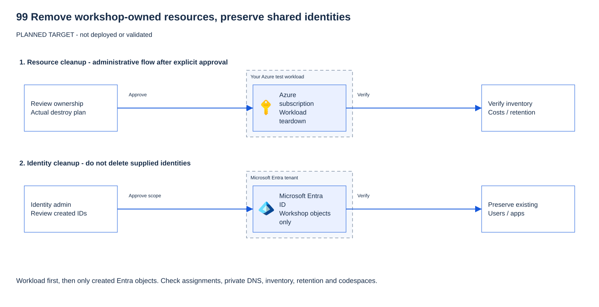

# 99 — Clean up: portal-first low-code

[Français](LOW-CODE.fr.md)

## Goal

Remove only what **you created for the low-code workshop**. Report first, review ownership, then obtain explicit
approval before deletion. Use the same private participant file and names as deployment.
This composition has not been revalidated live. Expected checks below are not new live results.

## Why it matters

Deleting a workload group alone does not finish cleanup. Optional Foundry uses a **second group**, keeps soft-deleted
accounts and creates Microsoft Entra agent identity blueprints. API Management also keeps a deleted service.
Inventory entries and identities can outlive the workload. Preserve administrator-provided accounts and shared resources.

> [!CAUTION]
> Review ownership and obtain approval before deletion. A workshop tag alone does not make a shared resource disposable.

**Question:** Your workload group is gone. Does that prove the optional Foundry exercise is fully cleaned up?

<details>
<summary>Show answer</summary>

No. Foundry uses a separate group and creates tenant-level identities. Check its group, soft-deleted account,
dedicated client and secret, and agent identity blueprint separately.

</details>

## What you deploy

Nothing. Remove in this order:

1. Optional module 07: blueprint, Foundry group/account, dedicated client and one-day secret.
2. Module 06: owned API Center asset/center; administrator removes any workshop BYO listing.
3. Owned low-code workload resources/group, then the soft-deleted gateway.
4. Owned MCP API registration and its service principal; exact remaining workshop role assignments/grants.
5. Optional test accounts **only if specifically created for this workshop and approved for deletion**.



*Architecture illustration, not a cleanup screenshot or evidence of deletion. There is no real module 99 portal
deletion capture in this repository; use the concrete checks below rather than treating another module's image as proof.*

## Prerequisites and required roles

- PowerShell 7.4+ and Azure CLI, signed in to the approved non-production context used for deployment.
- `.workshop\participant.tfvars.json`; if module 07 ran, `.workshop\module07.private.json`.
- Participant: permission to delete owned Azure resources and purge the workshop gateway.
- Identity administrator: permission to delete only the created client, blueprint and MCP registration.
- Microsoft 365 administrator: optional BYO listing removal. Participants need no tenant-wide role.
- Stop if ownership is uncertain. Shared resource groups, users, apps and centers are not disposable.

## Steps

### 1. Report the context and resources (no changes)

As the participant, open **Azure portal → Subscriptions** and confirm your approved subscription.
From the repository root:

```powershell
$p = Get-Content .\.workshop\participant.tfvars.json -Raw | ConvertFrom-Json
$id = "$($p.participant_prefix)lc"; $sfx = $p.resource_suffix.Substring(0, 10)
$rg = if ($p.existing_resource_group_name) { $p.existing_resource_group_name } else { "rg-mcp-$id-$sfx" }
$apim = "apim-mcp-$id-$sfx"; $apic = "apic-mcp-$id-$sfx"
$tenant = az account show --query tenantId -o tsv
$sub = az account show --query id -o tsv
az account show --query '{subscription:name,tenant:tenantId}' -o table
az group show -n $rg --query '{name:name,tags:tags}' -o json
az resource list -g $rg --query '[].{name:name,type:type,id:id}' -o table
$apiApps = @(az ad app list --display-name "Workshop MCP API ($id-$sfx)" -o json | ConvertFrom-Json)
$apiApps | Select-Object displayName, appId, id
$module07 = if (Test-Path .\.workshop\module07.private.json) {
    Get-Content .\.workshop\module07.private.json -Raw | ConvertFrom-Json
} else { $null }
if ($module07) {
    az group show -n $module07.foundry_resource_group --query '{name:name,tags:tags}' -o json
    az resource list -g $module07.foundry_resource_group --query '[].{name:name,type:type}' -o table
    $foundryAccounts = @(az cognitiveservices account list -g $module07.foundry_resource_group --query '[].{name:name,location:location}' -o json | ConvertFrom-Json)
    $foundryAccounts | Format-Table
    pwsh .\modules\07-clients\cleanup.ps1 -TenantId $tenant -SubscriptionId $sub -LowCodeTrack
}
```

> **Expected result** — existing workload names contain your `lc` prefix; report lines change nothing.

A dedicated workload group has `track=low-code` and
`workshop=governed-mcp`. The separate Foundry group must have `module=07` and `workshop=governed-mcp`.
Module 07 prints `PLAN` lines and `DONE report only` without changing anything.
If a module was never deployed, absence is expected; if it was deployed but its private record is missing, stop and
restore the record from your private backup. A missing file is not proof that Foundry is gone.

### 2. Review the two ownership boundaries

In **Resource groups → your workload group → Resources**, review every row against your deployment.
Also review the separate Foundry group if present. A tag is necessary evidence, not proof of ownership.

- **Dedicated group created by this workshop:** group deletion is permitted only when every resource is yours.
- **Administrator-provided group (`existing_resource_group_name`): never delete the group.** Record exact IDs of
  resources you created and delete only those individual resources in the portal.
- **Existing Entra applications:** do not delete their registrations or service principals. Ask the identity
  administrator to remove only this workshop's specific pre-authorized client, federated credential, consent grants
  and role assignments.
- **Test users:** Alice, Bob and Eve stay unless the administrator confirms you created them for this workshop.

Keep the module 07 private record and your reviewed resource-ID list until the checks at the end pass.

### 3. Delete optional Foundry resources first

If module 07 was deployed, in a participant/identity-administrator terminal after approval:

```powershell
pwsh .\modules\07-clients\cleanup.ps1 -TenantId $tenant -SubscriptionId $sub -LowCodeTrack -Apply
```

> **Expected result** — `PASS` lines for the dedicated Foundry objects and final `DONE`; no workload allowlist removal.

**Always include `-LowCodeTrack`.** This branch never invokes the infrastructure-state tool.
The script removes Foundry agent identity blueprints before deleting the tagged dedicated group, purges soft-deleted
Foundry accounts, and deletes the dedicated client registration and its short-lived secret.
Expected: `PASS` deletion lines (Azure Resource Manager HTTP 200; Microsoft Graph HTTP 204) and final `DONE`.
It does **not** remove the client's entries from the workload or MCP API allowlists. Finish steps 5–6 in the same
cleanup session; deleting the owned workload/API removes those lists. For supplied/shared resources, their administrator
must remove just the dedicated Foundry client ID from all three gates before declaring cleanup complete.

If provisioning stopped before the private record existed: inspect **Resource groups → rg-mcp07-<your-lc-id>-<suffix>**.
Do not invent a cleanup record. Have the identity administrator identify any blueprint and dedicated client, delete
only those owned objects. Before deleting the reviewed tagged Foundry group in the portal, record its account names
and regions with the same read-only CLI used by the cleanup script:

```powershell
$foundryGroup = "rg-mcp07-$id-$sfx"
az group show -n $foundryGroup --query '{name:name,tags:tags}' -o json
$foundryAccounts = @(az cognitiveservices account list -g $foundryGroup --query '[].{name:name,location:location}' -o json | ConvertFrom-Json)
$foundryAccounts | Format-Table
```

> **Expected result** — only your dedicated tagged group and its Foundry accounts. Stop on unknown ownership.

After administrator confirmation that the exact blueprint/client are removed, approval and portal group deletion,
purge only those recorded accounts. This is the existing module 07 purge operation:

```powershell
foreach ($a in $foundryAccounts) {
    az cognitiveservices account purge -g $foundryGroup -n $a.name -l $a.location
    if ($LASTEXITCODE -ne 0) { throw 'Foundry purge failed. Inspect the exact account; do not declare cleanup complete.' }
}
```

> **Expected result** — the recorded workshop accounts are purged. Retain the names for the final verification.

### 4. Remove inventory, not a shared catalog

Open **Azure portal → API Center → your center → Assets → your Contoso governed MCP demo asset → Delete**.
Confirm its remote URL is your gateway before deleting.
If you created the dedicated `apic-mcp-<lc-id>-<suffix>` center, review it and delete it too.
For an administrator-provided center, preserve the center, other assets and shared environments.
If an environment was created solely for this workshop, remove only that environment after its assets are removed.

If an administrator added a workshop BYO listing (**Preview**), ask that administrator to open
**Microsoft 365 admin center → Agents → Tools → Registry**, select the exact server and remove it.
Participants must not request an administrator role. If no BYO demonstration ran, there is no listing to remove.

### 5. Delete owned workload resources, then purge the gateway

After approval, dedicated-group path: **Azure portal → Resource groups → your `$rg` → Delete resource group**.
Recheck the resources, enter the exact group name and confirm. Wait for deletion to finish.

**Supplied-group path:** do not select **Delete resource group**. Delete the reviewed workshop-created resources
individually from **Resources**: gateway and private endpoints, Function and its plan, workshop storage, managed
identities, monitoring resources and network resources. Follow dependency errors by deleting only identified
workshop dependents. Never delete an administrator's network, workspace, account or role assignment.
If a shared workload is retained, administrator removal of the Foundry client from the three gates is mandatory.

API Management retains a deleted service for 48 hours. In **API Management services → Manage deleted services**,
select only `$apim`, verify its subscription/location, then **Purge**. This is irreversible.
Read-only verification from the terminal:

```powershell
az group exists -n $rg
az apim deletedservice list --query "[?name=='$apim'].{name:name,location:location}" -o table
```

> **Expected result** — `false` for a dedicated deleted group; no row for your purged gateway.

For a supplied group, `true` is correct: inspect its resource list and confirm only your reviewed IDs disappeared.

### 6. Remove only workshop-owned Entra objects

Identity administrator: **Entra admin center → App registrations → All applications**. Search the exact
`Workshop MCP API (<lc-id>-<suffix>)` name. Compare both object ID and application/client ID with step 1.
Stop on zero or multiple matches unless you can independently identify ownership.

For an API created solely for this workshop, open it and **Delete**. This removes its federated credential and
pre-authorized-client configuration. In **Enterprise applications → All applications**, search the recorded
application ID; confirm its service principal is gone, or delete only that exact workshop-owned principal.
Review any remaining workshop-specific delegated permission grants and role assignments, including external Storage
or Graph grants, with the administrator. Do not remove a shared application's grants wholesale.

For an administrator-provided MCP API, **keep it**. The administrator must instead remove only:
the dedicated Foundry client pre-authorization, this workshop's federated credential, downstream consent grants,
and app-role assignments created for the exercise. Preserve all pre-existing settings.
Likewise remove only exact workshop assignments on shared Azure resources in **Access control (IAM)**.

Check the dedicated Foundry client and blueprint are absent too (step 3), not just its one-day secret expired.
Delete test accounts through **Entra → Users** only with confirmation they were created solely for this workshop.
Keep shared/admin accounts. Deleted registrations remain restorable for 30 days; this is not an active endpoint.

### Bash alternative for reporting

Portal deletion steps above are the same. This independent report reads the same names; it changes nothing:

```bash
id="$(jq -r .participant_prefix .workshop/participant.tfvars.json)lc"
sfx="$(jq -r .resource_suffix .workshop/participant.tfvars.json | cut -c1-10)"
rg="$(jq -r '.existing_resource_group_name // empty' .workshop/participant.tfvars.json)"
rg="${rg:-rg-mcp-$id-$sfx}"
tenant=$(az account show --query tenantId -o tsv); sub=$(az account show --query id -o tsv)
az account show --query '{subscription:name,tenant:tenantId}' -o table
az resource list -g "$rg" --query '[].{name:name,type:type}' -o table
if [ -f .workshop/module07.private.json ]; then
  pwsh ./modules/07-clients/cleanup.ps1 -TenantId "$tenant" -SubscriptionId "$sub" -LowCodeTrack
fi
```

> **Expected result** — inventory and, if present, the module 07 report; nothing is deleted.

## What you should see

Dedicated workload and Foundry groups gone; no active workshop Function or gateway; no matching soft-deleted gateway
or Foundry account; no owned client, blueprint or MCP API; no workshop-only catalog entry.
Supplied/shared resources and users remain. No claim that all resources were in one group.

## Validate

Offline, no Azure calls:

```powershell
pwsh .\modules\99-cleanup\validate.ps1 -Offline
```

> **Expected result** — offline `PASS` lines and exit code 0; no deletion check in Azure.

```bash
bash ./modules/99-cleanup/validate.sh --offline
```

> **Expected result** — the same offline `PASS` lines and exit code 0.

Expected: `PASS` lines, exit 0. This checks the original module's documentation/script safety, not portal deletions.
Do **not** run this module's aggregate cleanup script for the low-code track.
Live verification is the manual ownership checklist plus:

```powershell
az group list --tag workshop=governed-mcp --query '[].{name:name,tags:tags}' -o table
az resource list --tag workshop=governed-mcp --query '[].{name:name,group:resourceGroup,type:type}' -o table
az ad app list --display-name "Workshop MCP API ($id-$sfx)" --query '[].{name:displayName,id:appId}' -o table
az cognitiveservices account list-deleted -o table
```

> **Expected result** — no owned workshop resources or MCP API remain; shared resources may still be listed.

Inspect every matching row for **your** prefix; other participants' resources must stay. Tags may be absent on child
resources, so compare the exact IDs recorded in step 1 too. In **Cost Management → Cost analysis**, select the approved
subscription and your groups; past charges remain and billing data can lag. A zero/empty cost view alone proves nothing.
Preserve private cleanup records until all checks pass; never publish them.

## Troubleshooting

- **Deletion blocked:** inspect the specific resource/dependency in the portal. Stop rather than deleting shared locks.
- **Expired administrator role:** reactivate the approved time-bound role, then rerun the same report and approved step.
- **Missing private file:** restore it; do not infer success or create a new suffix.
- **Foundry client gone but MCP still deployed:** remove its exact entries from all three gates, or finish owned workload/API deletion.
- **`ResourceGroupDeletionBlocked`, Flex plan not found:** the author saw a stale plan record on 2026-10-20.
  Record the exact error/resource ID and ask the administrator to reconcile it; do not invent or delete a different plan.

## Clean up

This module is cleanup. Finish all manual checks, including inventory and soft-deleted resources.
Once complete, remove your local `.workshop\foundry-07` template/environment copy and persona CLI profiles if no longer
needed. Keep any privately required audit evidence according to policy. Never delete shared credentials or profiles.

## Go further

Use expiry tags and a budget alert for the next approved workshop. A successful group deletion is only one cleanup check.

## Sources

- [Delete Azure resource groups](https://learn.microsoft.com/azure/azure-resource-manager/management/delete-resource-group).
- [API Management soft delete](https://learn.microsoft.com/azure/api-management/soft-delete).
- [API Center inventory](https://learn.microsoft.com/azure/api-center/register-discover-mcp-server).
- [BYO MCP listing (Preview)](https://learn.microsoft.com/microsoft-365/admin/manage/manage-byo-mcp-server).
- [Azure CLI resource list](https://learn.microsoft.com/cli/azure/resource#az-resource-list).
- [Azure resource tags](https://learn.microsoft.com/azure/azure-resource-manager/management/tag-resources).
- [Foundry account list-deleted and purge commands](https://learn.microsoft.com/cli/azure/cognitiveservices/account).

Last verified: 2026-10-20 (original author cleanup evidence; new separated composition not live-revalidated).
