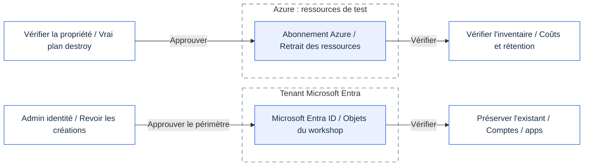
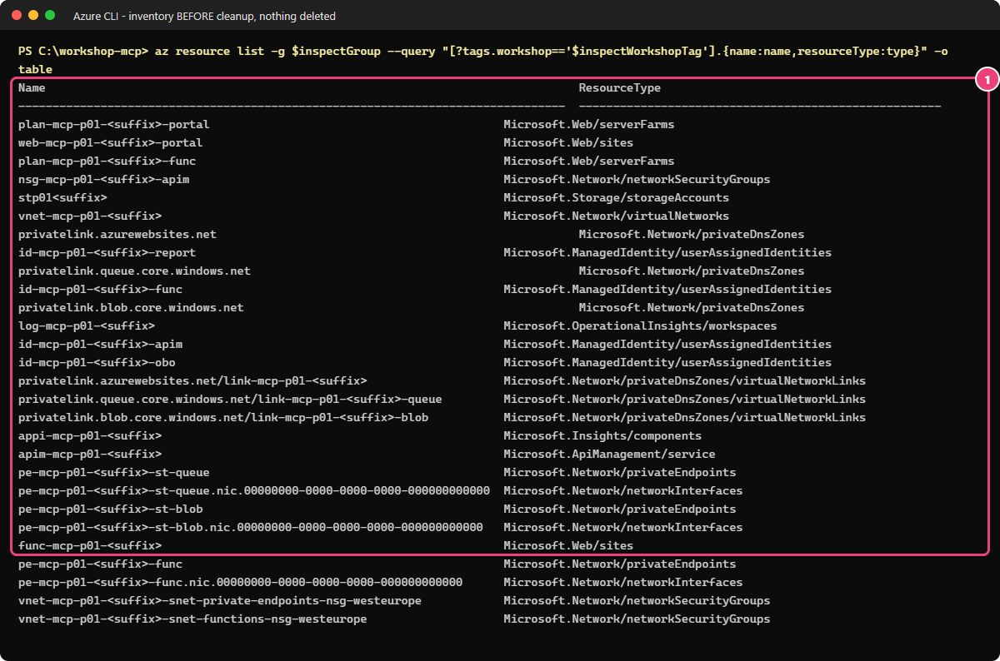

# Module 99 - Nettoyage

## Objectif

**Parcours Terraform + PowerShell.** Vous allez nettoyer les ressources gérées par Terraform.
[English](README.md) · [Guide low-code autonome](LOW-CODE.fr.md).

Vous allez supprimer les ressources et les identités créées pour votre atelier, en remontant les modules dans l'ordre
inverse. Vous examinerez d'abord les suppressions prévues, puis les appliquerez après accord.
Enfin, vous vérifierez ce qui reste, sans toucher aux comptes ni aux ressources fournis par un administrateur.

## Pourquoi c'est important

Les ressources de l'atelier peuvent continuer à être facturées après les exercices.
Les applications et les identités de test peuvent aussi conserver des accès.
Vous allez retirer ce qui a été créé pour l'atelier, puis vérifier qu'il ne reste ni ressource facturée inutilement
ni accès à supprimer.

Si vous avez suivi le module 07, Foundry utilise un groupe de ressources distinct de celui du serveur MCP.
La suppression du serveur ne suffit donc pas : vérifiez aussi les ressources Foundry, leurs identités et les fiches
du catalogue. Les ressources partagées fournies par un administrateur doivent rester en place.

## Ce que vous déployez

Vous ne déployez rien. Vous exécutez les scripts de nettoyage des modules 02 à 07 dans l'ordre inverse :

> [!CAUTION]
> Supprimez uniquement les ressources et identités créées pour l'atelier.
> Conservez les comptes, les applications et les ressources partagées fournis par un administrateur.

<details>
<summary>Périmètres du nettoyage (Mermaid)</summary>

Ce schéma distingue les ressources Azure des identités Microsoft Entra ; il n'indique pas l'ordre exact du script.
Pour effectuer les suppressions, suivez le tableau numéroté ci-dessous.
Vous pouvez consulter le schéma dans GitHub ou sa version avec icônes dans le portail de l'atelier.
[Ouvrir le SVG avec icônes](../../assets/architecture/99.fr.svg) ou le [PNG](../../assets/architecture/99.fr.png).



</details>

| Ordre | Nettoyage | Ce qui est retiré |
|---|---|---|
| 0 | Module 07 | Projet Foundry, application cliente et son secret de courte durée, modèle d'identité d'agent (*blueprint*), client autorisé |
| 1 | Module 05, `-Scope Workload` | Configuration des accès délégués et applicatifs |
| 2 | Module 05, `-Scope Entra` | Identifiant fédéré, demandes d'autorisations et consentements |
| 3 | Module 04 | Passerelle, stratégies et configuration de l'accès privé à la Function |
| 4 | Module 03, `-Scope Workload` | Authentification intégrée de la Function App |
| 5 | Module 03, `-Scope Entra` | Objets Entra créés par l'atelier (jamais ceux fournis par un administrateur) |
| 6 | Module 02 | La Function App et son point de terminaison ouvert |

> [!TIP]
> Commencez en **mode rapport**. Pour chaque étape qu'il peut planifier, le script compare les changements prévus
> à la liste autorisée et les affiche. Certaines étapes doivent attendre les suppressions précédentes.
>
> - Lisez chaque plan avant de continuer.
> - Rien n'est supprimé tant que vous n'ajoutez pas `-Apply`.

## Prérequis et rôles nécessaires

- Les mêmes rôles Azure et Microsoft Entra que dans les modules 02 à 05 (Contributor sur le groupe de ressources de l'atelier,
  et les rôles Entra utilisés pour les inscriptions d'applications).
- PowerShell 7.4 ou plus récent (`pwsh`), Terraform 1.16.6 ou plus récent dans le `PATH`, et Azure CLI connecté au tenant.
- Les mêmes fichiers de paramètres et le même état Terraform que lors des déploiements. Le nettoyage s'appuie sur eux pour retrouver vos ressources.

> [!IMPORTANT]
> Gardez vos paramètres privés `.workshop` et votre état Terraform jusqu'à la fin du nettoyage.
> Réutilisez le même préfixe et le même suffixe. Ne régénérez pas les noms pour réessayer une étape.

## Étapes

> [!WARNING]
> `-Apply` (PowerShell) ou `--apply` (bash) supprime des ressources.
> N'utilisez cette option qu'après un accord explicite et la relecture de chaque plan.
> Arrêtez-vous si un plan contient une ressource inattendue.

### Vérifier vous-même avec Azure CLI, avant de supprimer

**Pourquoi :** vous devez savoir quelles ressources appartiennent à l'atelier avant d'approuver leur suppression.
Cette étape est **en lecture seule**. Dans PowerShell 7, à la racine du dépôt :

```powershell
$ErrorActionPreference = 'Stop'
$inspectParticipant = Get-Content -LiteralPath .\.workshop\participant.tfvars.json -Raw | ConvertFrom-Json
$inspectWorkshopTag = "mcp-$($inspectParticipant.participant_prefix)-$($inspectParticipant.resource_suffix)"
$inspectGroup = if ($inspectParticipant.existing_resource_group_name) { $inspectParticipant.existing_resource_group_name } else { "rg-$inspectWorkshopTag" }
az resource list -g $inspectGroup --query "[?tags.workshop=='$inspectWorkshopTag'].{name:name,resourceType:type}" -o table
if ($LASTEXITCODE -ne 0) { throw "Inventaire indisponible. Vérifiez le contexte et l'existence du groupe." }
```

> **Résultat attendu** — avant le nettoyage, la commande affiche les noms et types des ressources portant votre balise d'atelier.
> La liste ne donne aucune autorisation de suppression. Les éléments sans étiquette, les objets Entra et les ressources
> Foundry éventuelles exigent les contrôles complémentaires décrits dans ce guide.



*Capture en lecture seule du 20 octobre 2026 : ces ressources existent encore. Ce n'est pas une preuve de suppression.
Si un nom vous surprend, arrêtez-vous et faites vérifier à qui appartient la ressource avant d'approuver sa suppression.*

Après le nettoyage approuvé, vous pourrez vérifier l'existence du groupe avec :

```powershell
az group exists --name $inspectGroup -o tsv
if ($LASTEXITCODE -ne 0) { throw "Vérification de l'existence du groupe impossible." }
```

> **Résultat attendu** — après le nettoyage, `false` pour un groupe dédié supprimé ; `true` pour un groupe fourni et conservé.
> Dans ce dernier cas seulement, relancez l'inventaire pour vérifier que vos ressources d'atelier ont disparu.
> La capture précédente montre l'inventaire avant nettoyage, pas le résultat de ces suppressions.

### PowerShell

À la racine du dépôt, initialisez et vérifiez le contexte du déploiement approuvé :

```powershell
$env:ARM_TENANT_ID = az account show --query tenantId -o tsv
$env:ARM_SUBSCRIPTION_ID = az account show --query id -o tsv
az account show --query '{subscription:name,tenant:tenantId}' -o table
```

> **Résultat attendu** — le tenant et l'abonnement approuvés pour votre atelier. Arrêtez-vous s'ils ne correspondent pas.

Avant de supprimer le serveur et sa passerelle, ouvrez **API Center → votre centre → Assets**, vérifiez l'URL de votre
passerelle, puis supprimez seulement la fiche (**asset**) de l'atelier. Ne supprimez un centre dédié que si vous l'avez créé ;
conservez tout centre fourni et tout environnement partagé. L'administrateur Microsoft 365 retire l'entrée BYO éventuelle
(**Préversion**). Le [nettoyage du module 06](../06-observe-inventory/README.fr.md#nettoyer) donne la commande exacte
pour votre centre dédié.

```powershell
# 1. Rapport seul (par défaut). Lisez chaque plan. Rien ne change.
pwsh ./modules/99-cleanup/cleanup.ps1 -TenantId $env:ARM_TENANT_ID -SubscriptionId $env:ARM_SUBSCRIPTION_ID

# 2. Appliquer après avoir relu chaque rapport.
pwsh ./modules/99-cleanup/cleanup.ps1 -TenantId $env:ARM_TENANT_ID -SubscriptionId $env:ARM_SUBSCRIPTION_ID -Apply
```

> **Résultat réel** — mode rapport, 2026-10-19, tenant de test de l'auteur avec les modules 02 et 03 déployés, la
> délégation Entra du module 05 encore présente, et les ressources Azure des modules 04 et 05 déjà retirées. `...` masque des
> lignes semblables. Noms et identifiants masqués.
>
> ```text
> Module 99 clean-up. Mode: REPORT ONLY (no change)
> --> 05-delegated-and-app-only -Scope Workload
> PASS explicit Azure context and private participant parameters (expected HTTP 200 from Azure Resource Manager).
> NOTE plan also restores azurerm_linux_web_app.portal[0] to its reviewed tier (changed outside Terraform, for example F1 at night). Not a module change; the portal is kept.
> NOTE plan also restores azurerm_service_plan.portal[0] to its reviewed tier (changed outside Terraform, for example F1 at night). Not a module change; the portal is kept.
> PASS 'remove module 05 workload resources': nothing to do in this state (idempotent, expected HTTP N/A).
> --> 05-delegated-and-app-only -Scope Entra
> PASS explicit tenant and interactive identity administrator sign-in (expected HTTP 200 from Microsoft Graph).
> PLAN delete azuread_application_api_access.downstream["graph"] (remove module 05 Entra delegation)
> ...
> PLAN delete azuread_service_principal_delegated_permission_grant.downstream["storage"] (remove module 05 Entra delegation)
> PASS 'remove module 05 Entra delegation' plan changes only 5 module 05 object(s). Review it, then rerun with -Apply.
> --> 04-governed-gateway
> PASS 'phase 2: remove the governed gateway': nothing to do in this state (idempotent, expected HTTP N/A).
> --> 03-entra-authentication -Scope Workload
> PLAN update azurerm_function_app_flex_consumption.mcp[0] (phase 1: restore the key gate behind Entra)
> PASS 'phase 1: restore the key gate behind Entra' plan changes only 1 module 03 object(s). Review it, then rerun with -Apply.
> --> 03-entra-authentication -Scope Entra
> WAIT 03-entra-authentication -Scope Entra cannot be planned yet: earlier stages above still have PLAN lines to apply (...)
> --> 02-open-server
> WAIT 02-open-server cannot be planned yet: earlier stages above still have PLAN lines to apply (...)
> DONE report only. Nothing was changed. 2 stage(s) wait for earlier stages: run with -Apply (it applies in order and plans each stage again), or rerun this report after applying.
> ```
>
> **Ce que cela signifie pour vous :** le premier mot de chaque ligne indique de quoi il s'agit.
>
> - `PLAN` : ce que cette étape modifierait. Lisez chaque ligne.
> - `nothing to do` : il ne reste rien à retirer pour cette étape.
> - `SKIP` : un fichier privé manque. Normal pour une étape jamais déployée ; sinon, restaurez le fichier.
> - `NOTE` : dans cet exemple, Terraform rétablit aussi l'offre prévue pour le portail facultatif, modifiée en dehors
>   de Terraform (passage nocturne en F1). Cette correction précise est autorisée ; le portail est conservé.
>   Ne considérez pas ce message comme une autorisation d'appliquer d'autres changements inattendus.
> - `WAIT` : le mode rapport n'applique rien, donc cette étape voit encore des objets qu'une étape précédente *prévoit*
>   seulement de retirer. Ce n'est pas une erreur. Avec `-Apply`, les étapes s'exécutent dans l'ordre et chacune refait son
>   plan après la précédente.
> - `FAIL` : un garde-fou a refusé un plan. Rien n'a été appliqué. Arrêtez-vous et lisez le message.
>
> Après accord, `-Apply` se termine par `DONE module clean-ups applied. Next: delete test users and role assignments, then
> run the tag check in README.md.`

> **Résultat réel** — `-Apply`, 2026-10-20, tenant de test de l'auteur avec les modules 02 à 07 déployés (partie B
> comprise). Extrait ; `...` masque les lignes similaires. Noms et ID masqués.
>
> ```text
> --> 07-clients
> PASS Foundry resource group deleted and accounts purged (expected HTTP 200 from Azure Resource Manager).
> DONE module 07 part A removed. Private module 07 files deleted.
> --> 05-delegated-and-app-only -Scope Workload
> PASS 'remove module 05 workload resources' applied (expected HTTP 200).
> --> 05-delegated-and-app-only -Scope Entra
> PASS 'remove module 05 Entra delegation' applied (expected HTTP 200).
> --> 04-governed-gateway
> PASS 'phase 0: remove optional part B (REST API exposed as MCP)' applied (expected HTTP 200).
> PASS 'phase 1: reopen the Function behind Entra (stage 2 to stage 1)' applied (expected HTTP 200).
> PASS 'phase 2: remove the governed gateway' applied (expected HTTP 200).
> --> 03-entra-authentication -Scope Workload
> PASS 'phase 2: remove built-in authentication' applied (expected HTTP 200).
> INFO archived .workshop/module03.tfvars.json to .workshop/applied/ (stage applied).
> --> 03-entra-authentication -Scope Entra
> PASS provided applications and existing test users were not touched. Deleted registrations stay restorable for 30 days in Microsoft Entra.
> --> 02-open-server
> PASS module 02 resources deleted; the system key was deleted with the Function App (expected HTTP 200 from Azure Resource Manager).
> INFO archived .workshop/module02.tfvars.json to .workshop/applied/ (stage applied).
> DONE module clean-ups applied. Next: delete test users and role assignments, then run the tag check in README.md.
> ```
>
> **Ce que cela signifie pour vous :** chaque étape n'a supprimé que ses propres objets, dans l'ordre. Après chaque étape
> appliquée, son fichier privé d'activation est déplacé dans `.workshop/applied/` pour éviter de recréer les ressources
> supprimées lors d'une nouvelle exécution. Si le script s'arrête, conservez ces fichiers et reprenez avec la même commande
> après avoir corrigé la cause. Par exemple, `Authorization_RequestDenied` peut signaler que le rôle temporaire
> de l'administrateur des identités a expiré : faites réactiver ce rôle avant de reprendre.

### Bash

```bash
export ARM_TENANT_ID="$(az account show --query tenantId -o tsv)"
export ARM_SUBSCRIPTION_ID="$(az account show --query id -o tsv)"
az account show --query '{subscription:name,tenant:tenantId}' -o table
# 1. Rapport seul (par défaut).
./modules/99-cleanup/cleanup.sh --tenant-id "$ARM_TENANT_ID" --subscription-id "$ARM_SUBSCRIPTION_ID"

# 2. Appliquer après relecture.
./modules/99-cleanup/cleanup.sh --tenant-id "$ARM_TENANT_ID" --subscription-id "$ARM_SUBSCRIPTION_ID" --apply
```

> **Résultat attendu** — les mêmes lignes `SKIP`, `-->`, `PLAN`, `PASS` et `DONE` que l'exécution PowerShell ci-dessus ; le script bash appelle `cleanup.ps1`.

### Étapes manuelles de nettoyage

Le script n'effectue pas ces étapes :

1. Supprimez les utilisateurs de test de l'atelier (Alice, Bob, Eve) si vous les avez créés.
2. Retirez les attributions de rôle ajoutées à la main pour l'atelier.
3. Si le portail facultatif est déployé, le script le conserve volontairement. Demandez à son responsable de le retirer seulement à la fin de l'atelier, avec la procédure de [docs/fr/HOSTING.md](../../docs/fr/HOSTING.md).
4. Supprimez ce qu'Azure a créé en dehors de Terraform, s'il existe : les groupes de sécurité réseau qu'une stratégie du
   tenant ajoute à chaque sous-réseau (`<vnet>-snet-...-nsg-<region>`) et le groupe d'actions **Application Insights Smart
   Detection** (commandes ci-dessous).
5. Lancez la vérification des balises ci-dessous.

```powershell
$p = Get-Content -LiteralPath ./.workshop/participant.tfvars.json -Raw | ConvertFrom-Json
$group = "rg-mcp-$($p.participant_prefix)-$($p.resource_suffix)"
az network nsg list -g $group --query "[?contains(name, '-snet-')].name" -o tsv | ForEach-Object { az network nsg delete -g $group -n $_ }
az monitor action-group list -g $group --query "[?name=='Application Insights Smart Detection'].id" -o tsv | ForEach-Object { az monitor action-group delete --ids $_ }
```

> **Résultat réel** — 2026-10-20 : deux NSG et un groupe d'actions supprimés ; aucune sortie en cas de réussite.

```powershell
$p = Get-Content -LiteralPath ./.workshop/participant.tfvars.json -Raw | ConvertFrom-Json
az resource list --tag "workshop=mcp-$($p.participant_prefix)-$($p.resource_suffix)" --query "[].{name:name, type:type}" -o table
```

> **Résultat réel** — 2026-10-20, après le nettoyage complet, avec le portail facultatif du présentateur conservé volontairement.
>
> ```text
> Name
> ---------------------------------------
> plan-mcp-p01-<suffix>-portal
> web-mcp-p01-<suffix>-portal
> ```
>
> Sans portail, la commande n'affiche rien (un résultat vide ne produit pas de tableau).
>
> **Ce que cela signifie pour vous :** une sortie vide indique qu'il ne reste aucune ressource portant cette balise
> d'atelier. Examinez chaque ligne restante : elle peut correspondre à un oubli ou à un élément conservé volontairement,
> comme le portail de cet exemple. Cette recherche ne couvre pas les ressources sans balise ni les objets Entra.

## Résultat attendu

- En mode rapport : une ligne `-->` par étape déployée, le résumé du plan, puis `DONE report only. Nothing was changed.`
  Une étape dont le fichier privé requis est absent affiche `SKIP <étape> (missing .workshop/<fichier>; ...)` : c'est normal si vous ne l'avez jamais déployée.
  Une étape qui dépend de suppressions encore prévues affiche `WAIT` en mode rapport ; `-Apply` la traite dans l'ordre.
- Avec `-Apply` : `DONE module clean-ups applied.` suivi des étapes manuelles.
- La recherche par balise ne renvoie plus de ressource de l'atelier, sauf les éléments explicitement conservés.
  Vous avez aussi vérifié les suppressions manuelles et les objets Entra ; les ressources fournies par un administrateur restent intactes.

**Question :** pourquoi le module 99 lance-t-il les nettoyages des modules dans l'ordre inverse plutôt qu'un seul `terraform destroy` ?

<details>
<summary>Afficher la réponse</summary>

Les modules suivants dépendent des précédents (la passerelle et l'authentification reposent sur la Function App), et les objets
Entra du module 05 doivent être supprimés avant ceux du module 03. Chaque script vérifie que son plan reste dans la liste
des changements autorisés. Cette protection réduit le risque de supprimer un élément partagé, mais ne remplace pas
votre vérification des ressources et de leur propriétaire avant de donner votre accord.

</details>

**Question :** le rapport affiche `SKIP 04-governed-gateway (missing .workshop/module03.tfvars.json; ...)`. Faut-il corriger quelque chose avant d'appliquer ?

<details>
<summary>Afficher la réponse</summary>

Non, si vous n'avez jamais déployé les modules 03 et 04 : il n'y a rien à retirer pour eux. Si vous les avez déployés,
arrêtez-vous : sans ce fichier de paramètres privé, leur nettoyage ne peut pas établir un plan fiable. Restaurez vos fichiers
privés `.workshop`, puis relancez le rapport.

</details>

## Valider

> [!NOTE]
> **Limites de validation :** ce parcours n'a pas été revalidé de bout en bout dans sa version actuelle.
> Les sorties datées proviennent d'exécutions antérieures dans le tenant de test de l'auteur, pas de votre abonnement.
> Un résultat hors ligne ne prouve aucune suppression. Vérifiez les ressources, les objets Entra et les éléments
> conservés volontairement dans votre propre environnement.

Contrôles hors ligne (sans accès Azure) :

```powershell
pwsh ./modules/99-cleanup/validate.ps1 -Offline
```

> **Résultat réel** — exécution hors ligne sur le poste de l'auteur, 2026-10-17.
>
> ```text
> PASS file: cleanup.ps1 exists
> PASS file: cleanup.sh exists
> PASS file: README.md exists
> PASS file: README.fr.md exists
> PASS README.md: all sections present missing:
> PASS README.md: sections in contract order
> PASS README.md: has source links
> PASS README.fr.md: same section count as EN (EN 11, FR 11)
> PASS safety: no blanket terraform destroy
> PASS safety: no hard-coded GUIDs
> PASS safety: no client secret literals
> PASS safety: reports by default (-Apply switch)
> RESULT: PASS (0 failure(s))
> ```
>
> **Ce que cela signifie pour vous :** le guide et le script respectent leurs règles de sécurité (rapport par défaut, pas de
> destruction globale). Si rien ne suit `missing:`, aucune section ne manque.

```bash
./modules/99-cleanup/validate.sh --offline
```

> **Résultat attendu** — les mêmes lignes PASS et `RESULT: PASS (0 failure(s))` que l'exécution PowerShell ci-dessus.

Chaque contrôle affiche `PASS` ou `FAIL`. La dernière ligne est `RESULT: PASS` lorsque tous les contrôles réussissent.

> [!NOTE]
> Un `PASS` hors ligne vérifie le guide et les protections du script. Il ne prouve **pas** la suppression des ressources Azure.
> Effectuez les contrôles manuels et vérifiez l'inventaire restant dans votre propre abonnement.

**Question :** le contrôle `safety: reports by default (-Apply switch)` passe. Pourquoi tester un mode qui ne supprime rien ?

<details>
<summary>Afficher la réponse</summary>

Parce que le rapport vous permet d'examiner les suppressions prévues sans les exécuter.
Vous le relisez avant d'ajouter `-Apply`. Le test vérifie que le script ne supprime rien par défaut. Il ne remplace pas votre relecture :
une commande lancée avec `-Apply` peut bien supprimer les ressources prévues.

</details>


## Dépannage

- **Une étape s'arrête avec un code d'erreur.** Le script s'arrête à la première erreur. Lisez le message, corrigez le problème, puis
  relancez le script. Grâce à leurs garde-fous, les étapes déjà appliquées ne refont rien.
- **Un plan contient une modification inattendue.** Ne l'appliquez pas. Le garde-fou interrompt le script si une modification sort de la
  liste autorisée, avant l'application de cette étape. Faites examiner le plan par l'administrateur responsable
  des ressources avant de reprendre.
- **`Authorization_RequestDenied` dans une étape Entra.** Le rôle de l'administrateur des identités n'est pas actif (par
  exemple un rôle temporaire accordé par Privileged Identity Management, ou PIM, a expiré). Faites-le réactiver,
  attendez une minute, puis relancez la même commande : les étapes
  déjà appliquées sont ignorées.
- **La recherche par balise affiche encore des ressources.** Vérifiez si elles ont été conservées volontairement,
  créées en dehors de Terraform ou oubliées. Confirmez leur propriétaire et leur usage dans le portail avant toute suppression.

## Nettoyage

Ce module est lui-même le nettoyage. Pour remettre l'environnement de l'atelier dans son état initial, exécutez la section
« Étapes » avec `-Apply` après accord, effectuez les étapes manuelles, puis contrôlez les ressources restantes.

## Pour aller plus loin

- Définissez une alerte budgétaire et une date d'expiration sur le groupe de ressources avant le prochain atelier.
- Pour un prochain atelier, préparez des comptes dédiés aux tests et supprimez uniquement ceux créés pour cet usage.

## Sources

- [Lister les ressources sans les modifier](https://learn.microsoft.com/cli/azure/resource#az-resource-list) et [vérifier l'existence du groupe](https://learn.microsoft.com/cli/azure/group#az-group-exists), vérifiés le 20 octobre 2026.

- Terraform destroy : https://developer.hashicorp.com/terraform/cli/commands/destroy
- Balises de ressources Azure : https://learn.microsoft.com/azure/azure-resource-manager/management/tag-resources
- Azure CLI resource list : https://learn.microsoft.com/cli/azure/resource#az-resource-list

Mise en forme : [schémas Mermaid sur GitHub](https://docs.github.com/en/get-started/writing-on-github/working-with-advanced-formatting/creating-diagrams).
Encadrés : [alertes GitHub](https://docs.github.com/en/get-started/writing-on-github/getting-started-with-writing-and-formatting-on-github/basic-writing-and-formatting-syntax#alerts).
Provenance du schéma : [sources de l'architecture](../../assets/architecture/README.fr.md).
Toutes les sources Azure : [docs/sources.md](../../docs/sources.md).

Dernière vérification : 2026-10-16.
