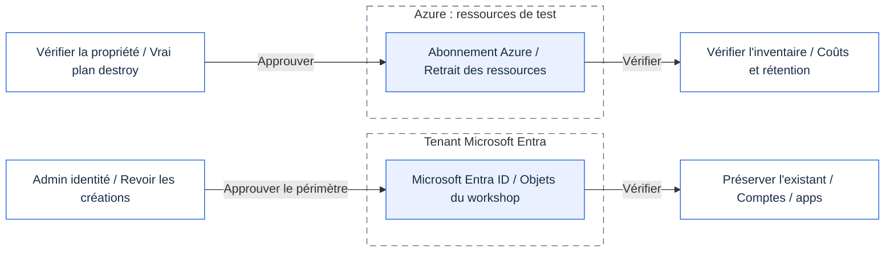

# Module 99 - Nettoyage

## Objectif

Supprimer tout ce que l'atelier a créé, dans l'ordre inverse de la création, et prouver qu'il ne reste rien.

## Pourquoi c'est important

Les ressources de l'atelier coûtent de l'argent. Elles laissent aussi des identités et des points de terminaison actifs.
Bien nettoyer fait partie de la leçon : chaque contrôle ajouté doit être retiré volontairement, pas oublié.

## Ce que vous déployez

Rien. Ce module exécute les scripts de nettoyage des modules 02 à 07 dans l'ordre inverse :

> [!CAUTION]
> Supprimez uniquement les ressources et identités créées pour l'atelier.
> Conservez les comptes, les applications et les ressources partagées fournis par un administrateur.

<details>
<summary>Périmètres du nettoyage (Mermaid)</summary>

Ce schéma présente les périmètres, pas l'ordre exact du script. Suivez le tableau numéroté ci-dessous.
GitHub affiche le schéma Mermaid ; le portail du présentateur affiche le même schéma avec les icônes Microsoft vérifiées.
[Ouvrir le SVG avec icônes](../../assets/architecture/99.fr.svg) ou le [PNG](../../assets/architecture/99.fr.png).



</details>

| Ordre | Nettoyage | Ce qui est retiré |
|---|---|---|
| 0 | Module 07 | Projet Foundry, application cliente et son secret de courte durée, blueprint d'identité d'agent, client autorisé |
| 1 | Module 05, `-Scope Workload` | Paramètres du workload délégué et app-only |
| 2 | Module 05, `-Scope Entra` | Identifiant fédéré, demandes d'autorisations et consentements |
| 3 | Module 04 | Passerelle, stratégies et chemin de la Function verrouillé |
| 4 | Module 03, `-Scope Workload` | Authentification intégrée de la Function App |
| 5 | Module 03, `-Scope Entra` | Objets Entra créés par l'atelier (jamais ceux fournis par un administrateur) |
| 6 | Module 02 | La Function App et son point de terminaison ouvert |

> [!TIP]
> Commencez en **mode rapport**. Le script calcule le plan de chaque étape, le compare à la liste autorisée et affiche ce qui changerait.
>
> - Lisez chaque plan avant de continuer.
> - Rien n'est supprimé tant que vous n'ajoutez pas `-Apply`.

## Prérequis et rôles nécessaires

- Les mêmes rôles Azure et Microsoft Entra que dans les modules 02 à 05 (Contributor sur le groupe de ressources de l'atelier,
  et les rôles Entra utilisés pour les inscriptions d'applications).
- PowerShell 7.4 ou plus récent (`pwsh`), Terraform 1.16.6 ou plus récent dans le `PATH`, et Azure CLI connecté au tenant.
- Les mêmes fichiers de paramètres que lors des déploiements. Le nettoyage les lit pour retrouver les noms des ressources.

> [!IMPORTANT]
> Gardez vos paramètres privés `.workshop` et votre état Terraform jusqu'à la fin du nettoyage.
> Réutilisez le même préfixe et le même suffixe. Ne régénérez pas les noms pour réessayer une étape.

## Étapes

> [!WARNING]
> `-Apply` (PowerShell) ou `--apply` (bash) supprime des ressources.
> N'utilisez cette option qu'après un accord explicite et la relecture de chaque plan.
> Arrêtez-vous si un plan contient une ressource inattendue.

### Parcours low-code (portail et commandes simples)

Tout ce que vous avez construit à la main tient dans **un groupe de ressources** et **deux inscriptions d'applications** :
le nettoyage est court. Vos utilisateurs de test restent. Portail : **Groupes de ressources** → votre groupe
`rg-mcp-<préfixe>lc-…` → **Supprimer le groupe de ressources** ; **Inscriptions d'applications** → *Workshop MCP API (…)*
et *workshop-mcp-foundry-client-…* → **Supprimer** ; puis **Services API Management** → **Gérer les services supprimés** →
**Purger**. Les commandes font la même chose, rapport d'abord.

```powershell
$p = Get-Content .\.workshop\participant.tfvars.json -Raw | ConvertFrom-Json
$id = "$($p.participant_prefix)lc"; $sfx = $p.resource_suffix.Substring(0, 10); $rg = "rg-mcp-$id-$sfx"; $apim = "apim-mcp-$id-$sfx"
$tenant = az account show --query tenantId -o tsv; $sub = az account show --query id -o tsv
# 1. Rapport : lisez la liste. Arrêtez-vous si le groupe n'a pas l'étiquette track=low-code ou contient autre chose que vos ressources.
az group show -n $rg --query tags -o json
az resource list -g $rg --query "[].type" -o tsv | Group-Object | ForEach-Object { "$($_.Count) $($_.Name)" }
az ad app list --display-name "Workshop MCP API ($id-$sfx)" --query "[].displayName" -o tsv
& .\modules\07-clients\cleanup.ps1 -TenantId $tenant -SubscriptionId $sub -LowCodeTrack   # seulement si vous avez fait le module 07
```

> **Résultat réel** — parcours low-code, 2026-10-20, tenant de test de l'auteur (extrait).
>
> ```text
>   "track": "low-code",
>   "workshop": "governed-mcp"
> 1 Microsoft.ApiCenter/services
> 1 Microsoft.ApiManagement/service
> 4 Microsoft.ManagedIdentity/userAssignedIdentities
> 3 Microsoft.Network/privateEndpoints
> 1 Microsoft.Web/sites
> Workshop MCP API (<id>)
> PLAN delete the Foundry client app registration and its short-lived secret
> DONE report only. Nothing was changed. Rerun with -Apply after reviewing every PLAN line.
> ```

```powershell
# 2. Appliquer, après accord. Supprimer l'inscription de l'API retire aussi ses informations fédérées, préautorisations et consentements.
& .\modules\07-clients\cleanup.ps1 -TenantId $tenant -SubscriptionId $sub -LowCodeTrack -Apply   # seulement si vous avez fait le module 07
if ((az group show -n $rg --query tags.track -o tsv) -ne 'low-code') { throw 'Pas le groupe low-code de l''atelier : rien supprimé.' }
$apps = @(az ad app list --display-name "Workshop MCP API ($id-$sfx)" --query "[].id" -o tsv)
az group delete -n $rg --yes
foreach ($a in $apps) { az ad app delete --id $a }
# 3. API Management garde une instance supprimée 48 heures : purgez-la pour libérer le nom.
$d = az apim deletedservice list -o json | ConvertFrom-Json | Where-Object name -eq $apim
if ($d) { az apim deletedservice purge --service-name $d.name --location $d.location }
"group exists: $(az group exists -n $rg); soft-deleted gateways: $((az apim deletedservice list --query '[].name' -o tsv) -join ',')"
```

> **Résultat réel** — parcours low-code, 2026-10-20 (extrait ; le premier `az group delete` s'est arrêté, voir la note
> ci-dessous).
>
> ```text
> PASS Foundry client app registration and secret deleted (expected HTTP 204 from Microsoft Graph).
> DONE module 07 part A removed. Private module 07 files deleted.
> group exists: false; soft-deleted gateways:
> ```
>
> **Ce que cela signifie pour vous :** il ne reste rien du parcours low-code : ni groupe de ressources, ni inscription
> d'application, ni passerelle en suppression réversible. Seuls vos utilisateurs de test restent, volontairement.

> [!NOTE]
> Le 2026-10-20, le premier `az group delete` s'est arrêté avec `ResourceGroupDeletionBlocked` et `Server farm with name
> ASP-… not found` : le plan Flex Consumption avait déjà disparu, mais Azure Resource Manager le listait encore. Tout le
> reste était supprimé. La solution : recréer le plan sous le même nom, le supprimer, puis supprimer à nouveau le groupe.
>
> ```powershell
> $plan = az resource list -g $rg --resource-type Microsoft.Web/serverFarms --query "[0].name" -o tsv
> $url = "https://management.azure.com/subscriptions/$sub/resourceGroups/$rg/providers/Microsoft.Web/serverFarms/$plan`?api-version=2024-04-01"
> $f = New-TemporaryFile; '{"location":"westeurope","kind":"functionapp","sku":{"name":"FC1","tier":"FlexConsumption"},"properties":{"reserved":true}}' | Set-Content $f
> az rest --method put --url $url --body "@$f" -o none; Remove-Item $f; az rest --method delete --url $url; az group delete -n $rg --yes
> ```

### PowerShell

```powershell
# 1. Rapport seul (par défaut). Lisez chaque plan. Rien ne change.
pwsh ./modules/99-cleanup/cleanup.ps1 -TenantId $env:ARM_TENANT_ID -SubscriptionId $env:ARM_SUBSCRIPTION_ID

# 2. Appliquer après avoir relu chaque rapport.
pwsh ./modules/99-cleanup/cleanup.ps1 -TenantId $env:ARM_TENANT_ID -SubscriptionId $env:ARM_SUBSCRIPTION_ID -Apply
```

> **Résultat réel** — mode rapport, 2026-10-19, tenant de test de l'auteur avec les modules 02 et 03 déployés, la
> délégation Entra du module 05 encore présente, et la charge de travail des modules 04 et 05 déjà retirée. `...` masque des
> lignes semblables. Noms et identifiants masqués.
>
> ```text
> Module 99 clean-up. Mode: REPORT ONLY (no change)
> --> 05-delegated-and-app-only -Scope Workload
> PASS explicit Azure context and private participant parameters (expected HTTP 200 from Azure Resource Manager).
> NOTE plan also restores azurerm_linux_web_app.portal[0] to its reviewed tier (changed outside Terraform, for example F1 at night). Not a module change; the portal is kept.
> NOTE plan also restores azurerm_service_plan.portal[0] to its reviewed tier (changed outside Terraform, for example F1 at night). Not a module change; the portal is kept.
> PASS 'remove module 05 workload resources': nothing to do in this state (idempotent, expected HTTP N/A).
> --> 05-delegated-and-app-only -Scope Entra
> PASS explicit tenant and interactive identity administrator sign-in (expected HTTP 200 from Microsoft Graph).
> PLAN delete azuread_application_api_access.downstream["graph"] (remove module 05 Entra delegation)
> ...
> PLAN delete azuread_service_principal_delegated_permission_grant.downstream["storage"] (remove module 05 Entra delegation)
> PASS 'remove module 05 Entra delegation' plan changes only 5 module 05 object(s). Review it, then rerun with -Apply.
> --> 04-governed-gateway
> PASS 'phase 2: remove the governed gateway': nothing to do in this state (idempotent, expected HTTP N/A).
> --> 03-entra-authentication -Scope Workload
> PLAN update azurerm_function_app_flex_consumption.mcp[0] (phase 1: restore the key gate behind Entra)
> PASS 'phase 1: restore the key gate behind Entra' plan changes only 1 module 03 object(s). Review it, then rerun with -Apply.
> --> 03-entra-authentication -Scope Entra
> WAIT 03-entra-authentication -Scope Entra cannot be planned yet: earlier stages above still have PLAN lines to apply (...)
> --> 02-open-server
> WAIT 02-open-server cannot be planned yet: earlier stages above still have PLAN lines to apply (...)
> DONE report only. Nothing was changed. 2 stage(s) wait for earlier stages: run with -Apply (it applies in order and plans each stage again), or rerun this report after applying.
> ```
>
> **Ce que cela signifie pour vous :** le premier mot de chaque ligne indique de quoi il s'agit.
>
> - `PLAN` : ce que cette étape modifierait. Lisez-les toutes.
> - `nothing to do` : il ne reste rien à retirer pour cette étape.
> - `SKIP` : un fichier privé manque. Normal pour une étape jamais déployée ; sinon, restaurez le fichier.
> - `NOTE` : Terraform remet aussi le portail facultatif du présentateur sur son niveau validé, parce qu'un élément extérieur
>   à Terraform l'a modifié (ici, un passage nocturne en F1). Seule cette modification précise est acceptée ; le portail est
>   conservé.
> - `WAIT` : le mode rapport n'applique rien, donc cette étape voit encore des objets qu'une étape précédente *prévoit*
>   seulement de retirer. Ce n'est pas une erreur. Avec `-Apply`, les étapes s'exécutent dans l'ordre et chacune refait son
>   plan après la précédente.
> - `FAIL` : un garde-fou a refusé un plan. Rien n'a été appliqué. Arrêtez-vous et lisez le message.
>
> Après accord, `-Apply` se termine par `DONE module clean-ups applied. Next: delete test users and role assignments, then
> run the tag check in README.md.`

> **Résultat réel** — `-Apply`, 2026-10-20, tenant de test de l'auteur avec les modules 02 à 07 déployés (partie B
> comprise). Extrait ; `...` masque les lignes similaires. Noms et ID masqués.
>
> ```text
> --> 07-clients
> PASS Foundry resource group deleted and accounts purged (expected HTTP 200 from Azure Resource Manager).
> DONE module 07 part A removed. Private module 07 files deleted.
> --> 05-delegated-and-app-only -Scope Workload
> PASS 'remove module 05 workload resources' applied (expected HTTP 200).
> --> 05-delegated-and-app-only -Scope Entra
> PASS 'remove module 05 Entra delegation' applied (expected HTTP 200).
> --> 04-governed-gateway
> PASS 'phase 0: remove optional part B (REST API exposed as MCP)' applied (expected HTTP 200).
> PASS 'phase 1: reopen the Function behind Entra (stage 2 to stage 1)' applied (expected HTTP 200).
> PASS 'phase 2: remove the governed gateway' applied (expected HTTP 200).
> --> 03-entra-authentication -Scope Workload
> PASS 'phase 2: remove built-in authentication' applied (expected HTTP 200).
> INFO archived .workshop/module03.tfvars.json to .workshop/applied/ (stage applied).
> --> 03-entra-authentication -Scope Entra
> PASS provided applications and existing test users were not touched. Deleted registrations stay restorable for 30 days in Microsoft Entra.
> --> 02-open-server
> PASS module 02 resources deleted; the system key was deleted with the Function App (expected HTTP 200 from Azure Resource Manager).
> INFO archived .workshop/module02.tfvars.json to .workshop/applied/ (stage applied).
> DONE module clean-ups applied. Next: delete test users and role assignments, then run the tag check in README.md.
> ```
>
> **Ce que cela signifie pour vous :** chaque étape n'a supprimé que ses propres objets, dans l'ordre. Après chaque étape
> appliquée, son fichier privé d'activation part dans `.workshop/applied/` : une deuxième exécution ne prévoit donc jamais
> de recréer ce qui vient d'être supprimé. La première exécution de l'auteur s'est arrêtée à `05 -Scope Entra` avec
> `Authorization_RequestDenied` : le rôle temporaire de l'administrateur des identités avait expiré. Après sa réactivation,
> la même commande a repris là où elle s'était arrêtée.
### Bash

```bash
# 1. Rapport seul (par défaut).
./modules/99-cleanup/cleanup.sh --tenant-id "$ARM_TENANT_ID" --subscription-id "$ARM_SUBSCRIPTION_ID"

# 2. Appliquer après relecture.
./modules/99-cleanup/cleanup.sh --tenant-id "$ARM_TENANT_ID" --subscription-id "$ARM_SUBSCRIPTION_ID" --apply
```

> **Résultat attendu** — les mêmes lignes `SKIP`, `-->`, `PLAN`, `PASS` et `DONE` que l'exécution PowerShell ci-dessus ; le script bash appelle `cleanup.ps1`.

Étapes manuelles (le script ne les effectue pas) :

1. Supprimez les utilisateurs de test de l'atelier (Alice, Bob, Eve) si vous les avez créés.
2. Retirez les attributions de rôle ajoutées à la main pour l'atelier.
3. Si un présentateur a publié le portail facultatif, le script le conserve volontairement. Retirez-le seulement à la fin de l'atelier, avec la procédure validée de [docs/fr/HOSTING.md](../../docs/fr/HOSTING.md).
4. Supprimez ce qu'Azure a créé en dehors de Terraform, s'il existe : les groupes de sécurité réseau qu'une stratégie du
   tenant ajoute à chaque sous-réseau (`<vnet>-snet-...-nsg-<region>`) et le groupe d'actions **Application Insights Smart
   Detection** (commandes ci-dessous).
5. Lancez la vérification des tags ci-dessous.

```powershell
$p = Get-Content -LiteralPath ./.workshop/participant.tfvars.json -Raw | ConvertFrom-Json
$group = "rg-mcp-$($p.participant_prefix)-$($p.resource_suffix)"
az network nsg list -g $group --query "[?contains(name, '-snet-')].name" -o tsv | ForEach-Object { az network nsg delete -g $group -n $_ }
az monitor action-group list -g $group --query "[?name=='Application Insights Smart Detection'].id" -o tsv | ForEach-Object { az monitor action-group delete --ids $_ }
```

> **Résultat réel** — 2026-10-20 : deux NSG et un groupe d'actions supprimés ; aucune sortie en cas de réussite.

```powershell
$p = Get-Content -LiteralPath ./.workshop/participant.tfvars.json -Raw | ConvertFrom-Json
az resource list --tag "workshop=mcp-$($p.participant_prefix)-$($p.resource_suffix)" --query "[].{name:name, type:type}" -o table
```

> **Résultat réel** — 2026-10-20, après le nettoyage complet, avec le portail facultatif du présentateur conservé volontairement.
>
> ```text
> Name
> ---------------------------------------
> plan-mcp-p01-<suffix>-portal
> web-mcp-p01-<suffix>-portal
> ```
>
> Sans portail, la commande n'affiche rien (un résultat vide ne produit pas de tableau).
>
> **Ce que cela signifie pour vous :** une sortie vide prouve qu'il ne reste aucune ressource portant le tag de l'atelier. Chaque ligne affichée est une ressource oubliée.

## Résultat attendu

- En mode rapport : une ligne `-->` par étape déployée, le résumé du plan, puis `DONE report only. Nothing was changed.`
  Une étape dont le fichier privé requis est absent affiche `SKIP <étape> (missing .workshop/<fichier>; ...)` : c'est normal si vous ne l'avez jamais déployée.
  Une étape qui dépend de suppressions encore prévues affiche `WAIT` en mode rapport ; `-Apply` la traite dans l'ordre.
- En mode application : `DONE module clean-ups applied.` suivi des étapes manuelles.
- La vérification des tags renvoie un tableau vide. Chaque ligne affichée correspond à une ressource qu'il reste à supprimer.

**Question :** pourquoi le module 99 lance-t-il les nettoyages des modules dans l'ordre inverse plutôt qu'un seul `terraform destroy` ?

<details>
<summary>Afficher la réponse</summary>

Les modules suivants dépendent des précédents (la passerelle et l'authentification reposent sur la Function App), et les objets
Entra du module 05 doivent être supprimés avant ceux du module 03. Le garde-fou de chaque module vérifie que son plan ne supprime
que ce que ce module a créé. Ainsi, aucune identité fournie par l'administrateur ni aucune ressource partagée n'est supprimée par erreur.

</details>

**Question :** le rapport affiche `SKIP 04-governed-gateway (missing .workshop/module03.tfvars.json; ...)`. Faut-il corriger quelque chose avant d'appliquer ?

<details>
<summary>Afficher la réponse</summary>

Non, si vous n'avez jamais déployé les modules 03 et 04 : il n'y a rien à retirer pour eux. Si vous les avez déployés,
arrêtez-vous : sans ce fichier de paramètres privé, leur nettoyage ne peut pas établir un plan fiable. Restaurez vos fichiers
privés `.workshop`, puis relancez le rapport.

</details>

## Valider

Contrôles hors ligne (sans accès Azure) :

```powershell
pwsh ./modules/99-cleanup/validate.ps1 -Offline
```

> **Résultat réel** — exécution hors ligne sur le poste de l'auteur, 2026-10-17.
>
> ```text
> PASS file: cleanup.ps1 exists
> PASS file: cleanup.sh exists
> PASS file: README.md exists
> PASS file: README.fr.md exists
> PASS README.md: all sections present missing:
> PASS README.md: sections in contract order
> PASS README.md: has source links
> PASS README.fr.md: same section count as EN (EN 11, FR 11)
> PASS safety: no blanket terraform destroy
> PASS safety: no hard-coded GUIDs
> PASS safety: no client secret literals
> PASS safety: reports by default (-Apply switch)
> RESULT: PASS (0 failure(s))
> ```
>
> **Ce que cela signifie pour vous :** le guide et le script respectent leurs règles de sécurité (rapport par défaut, pas de
> destruction globale). Si rien ne suit `missing:`, aucune section ne manque.

```bash
./modules/99-cleanup/validate.sh --offline
```

> **Résultat attendu** — les mêmes lignes PASS et `RESULT: PASS (0 failure(s))` que l'exécution PowerShell ci-dessus.

Chaque contrôle affiche `PASS` ou `FAIL`. La dernière ligne est `RESULT: PASS` lorsque tous les contrôles réussissent.

> [!NOTE]
> Un `PASS` hors ligne vérifie le guide et les protections du script. Il ne prouve **pas** la suppression des ressources Azure.
> Effectuez les contrôles manuels et vérifiez l'inventaire restant dans votre propre abonnement.

**Question :** le contrôle `safety: reports by default (-Apply switch)` passe. Pourquoi tester un mode qui ne supprime rien ?

<details>
<summary>Afficher la réponse</summary>

Parce que le rapport est votre filet de sécurité. Il liste exactement ce qui serait supprimé, et vous le relisez avant
`-Apply`. Le test garantit que personne ne fait de la suppression le comportement par défaut : une seule mauvaise commande
ne peut pas effacer des ressources que vous n'avez pas relues.

</details>


## Dépannage

- **Une étape s'arrête avec un code d'erreur.** Le script s'arrête à la première erreur. Lisez le message, corrigez le problème, puis
  relancez le script. Grâce à leurs garde-fous, les étapes déjà appliquées ne refont rien.
- **Un plan contient une modification inattendue.** Ne l'appliquez pas. Le garde-fou interrompt le script si une modification sort de la
  liste autorisée, et rien n'est appliqué. Adressez-vous au formateur.
- **`Authorization_RequestDenied` dans une étape Entra.** Le rôle de l'administrateur des identités n'est pas actif (par
  exemple un rôle PIM temporaire a expiré). Réactivez-le, attendez une minute, puis relancez la même commande : les étapes
  déjà appliquées sont ignorées.
- **La vérification des tags affiche encore des ressources.** Soit elles ont été créées en dehors de l'atelier, soit vous avez sauté une étape.
  Identifiez chaque ressource dans le portail avant de la supprimer à la main.

## Nettoyage

Ce module est lui-même le nettoyage. Pour remettre l'environnement de l'atelier dans son état initial, exécutez la section
« Étapes » en mode application, puis les étapes manuelles, puis la vérification des tags.

## Pour aller plus loin

- Définissez une alerte budgétaire et une date d'expiration sur le groupe de ressources avant le prochain atelier.
- Remplacez les utilisateurs de test par vos propres comptes et supprimez-les à la fin de l'atelier.

## Sources

- Terraform destroy : https://developer.hashicorp.com/terraform/cli/commands/destroy
- Balises de ressources Azure : https://learn.microsoft.com/azure/azure-resource-manager/management/tag-resources
- Azure CLI resource list : https://learn.microsoft.com/cli/azure/resource#az-resource-list

Mise en forme : [schémas Mermaid sur GitHub](https://docs.github.com/en/get-started/writing-on-github/working-with-advanced-formatting/creating-diagrams).
Encadrés : [alertes GitHub](https://docs.github.com/en/get-started/writing-on-github/getting-started-with-writing-and-formatting-on-github/basic-writing-and-formatting-syntax#alerts).
Provenance du schéma : [sources de l'architecture](../../assets/architecture/README.fr.md).
Toutes les sources Azure : [docs/sources.md](../../docs/sources.md).

Dernière vérification : 2026-10-16.
