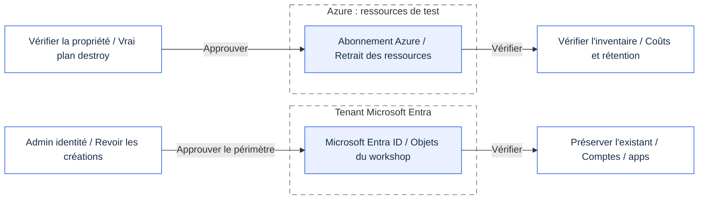

# Module 99 - Nettoyage

## Objectif

Supprimer tout ce que l'atelier a créé, dans l'ordre inverse de la création, et prouver qu'il ne reste rien.

## Pourquoi c'est important

Les ressources de l'atelier coûtent de l'argent et maintiennent actifs des identités et des points d'accès. Un nettoyage propre
fait partie de la leçon : chaque contrôle ajouté doit être retiré délibérément, et non oublié.

## Ce que vous déployez

Rien. Ce module exécute les scripts de nettoyage des modules 02 à 05 dans l'ordre inverse :

> [!CAUTION]
> Supprimez uniquement les ressources et identités créées pour l'atelier.
> Préservez les comptes, applications et ressources partagées fournis par un administrateur.

<details>
<summary>Périmètres du nettoyage (Mermaid)</summary>

Ce schéma présente les périmètres, pas l'ordre exact du script. Suivez le tableau numéroté ci-dessous.
GitHub affiche Mermaid ; l'application du présentateur affiche le schéma correspondant avec les icônes Microsoft vérifiées.
[Ouvrir le SVG avec icônes](../../assets/architecture/99.fr.svg) ou le [PNG](../../assets/architecture/99.fr.png).



</details>

| Ordre | Nettoyage | Ce qui est retiré |
|---|---|---|
| 1 | Module 05, `-Scope Workload` | Paramètres de la charge de travail déléguée et application seule |
| 2 | Module 05, `-Scope Entra` | Identifiant fédéré, demandes de permissions et consentements |
| 3 | Module 04 | Passerelle, stratégies et chemin de la Function verrouillé |
| 4 | Module 03, `-Scope Workload` | Authentification intégrée de la Function App |
| 5 | Module 03, `-Scope Entra` | Objets Entra créés par l'atelier (jamais ceux fournis par un administrateur) |
| 6 | Module 02 | Function App et le point d'accès ouvert |

> [!TIP]
> Commencez en **mode rapport**. Le script établit le plan de chaque étape, vérifie la liste autorisée et affiche ce qui changerait.
>
> - Lisez chaque plan avant de continuer.
> - Rien n'est supprimé tant que vous n'ajoutez pas `-Apply`.

## Prérequis et rôles requis

- Les mêmes rôles Azure et Microsoft Entra que dans les modules 02 à 05 (Contributor sur le groupe de ressources de l'atelier,
  et les rôles Entra utilisés pour les inscriptions d'applications).
- PowerShell 7.4 ou plus récent (`pwsh`), Terraform 1.16.6 ou plus récent dans le `PATH`, et la CLI Azure connectée au tenant.
- Les mêmes fichiers de paramètres que lors des déploiements. Le nettoyage les lit pour retrouver les noms des ressources.

> [!IMPORTANT]
> Gardez vos paramètres privés `.workshop` et votre état Terraform jusqu'à la fin du nettoyage.
> Conservez les mêmes préfixe et suffixe. Ne régénérez pas les noms pour réessayer une étape.

## Étapes

> [!WARNING]
> `-Apply` (PowerShell) ou `--apply` (bash) supprime des ressources.
> Utilisez cette option uniquement après accord explicite et relecture de chaque plan.
> Arrêtez-vous si un plan contient une ressource inattendue.

### PowerShell

```powershell
# 1. Rapport seul (par défaut). Lisez chaque plan. Rien ne change.
pwsh ./modules/99-cleanup/cleanup.ps1 -TenantId <guid-tenant> -SubscriptionId <guid-abonnement>

# 2. Appliquer après avoir relu chaque rapport.
pwsh ./modules/99-cleanup/cleanup.ps1 -TenantId <guid-tenant> -SubscriptionId <guid-abonnement> -Apply
```

### Bash

```bash
# 1. Rapport seul (par défaut).
./modules/99-cleanup/cleanup.sh --tenant-id <guid-tenant> --subscription-id <guid-abonnement>

# 2. Appliquer après relecture.
./modules/99-cleanup/cleanup.sh --tenant-id <guid-tenant> --subscription-id <guid-abonnement> --apply
```

Étapes manuelles (le script ne les effectue pas) :

1. Supprimez les utilisateurs de test de l'atelier (Alice, Bob, Eve) si vous les avez créés.
2. Retirez les attributions de rôle ajoutées à la main pour l'atelier.
3. Lancez la vérification des tags ci-dessous.

```powershell
az resource list --tag workshop=mcp-<prefix>-<suffix> --query "[].{name:name, type:type}" -o table
```

## Résultat attendu

- En mode rapport : une ligne `-->` par étape, le résumé du plan, puis `DONE report only. Nothing was changed.`
- En mode application : `DONE module clean-ups applied.` suivi des étapes manuelles.
- La vérification des tags renvoie un tableau vide. Chaque ligne affichée correspond à un reste à supprimer.

## Valider

Contrôles hors ligne (sans accès Azure) :

```powershell
pwsh ./modules/99-cleanup/validate.ps1 -Offline
```

```bash
./modules/99-cleanup/validate.sh --offline
```

Chaque contrôle affiche `PASS` ou `FAIL`. La dernière ligne est `RESULT: PASS` lorsque tous les contrôles réussissent.

> [!NOTE]
> Un `PASS` hors ligne vérifie le guide et les protections du script. Il ne prouve **pas** la suppression des ressources Azure.
> Effectuez les contrôles manuels et vérifiez l'inventaire restant dans votre propre abonnement.

## Dépannage

- **Une étape s'arrête avec un code de sortie.** Le script s'arrête à la première erreur. Lisez le message, corrigez le problème, puis
  relancez le script. Les étapes déjà appliquées sont ignorées grâce à leurs propres garde-fous.
- **Un plan contient une modification inattendue.** Ne l'appliquez pas. Le garde-fou interrompt le script si une modification sort de la
  liste autorisée, et rien n'est appliqué. Adressez-vous au formateur.
- **La vérification des tags affiche encore des ressources.** Elles ont été créées en dehors de l'atelier, ou une étape a été sautée.
  Retrouvez chaque ligne dans le portail avant de la supprimer à la main.

## Nettoyage

Ce module est le nettoyage. Pour remettre l'environnement de l'atelier dans son état initial, exécutez la section
« Étapes » en mode application, puis les étapes manuelles, puis la vérification des tags.

## Pour aller plus loin

- Définissez une alerte budgétaire et une date d'expiration sur le groupe de ressources avant le prochain atelier.
- Remplacez les utilisateurs de test par vos propres comptes et supprimez-les à la fin de l'atelier.

## Sources

- Terraform destroy : https://developer.hashicorp.com/terraform/cli/commands/destroy
- Balises de ressources Azure : https://learn.microsoft.com/azure/azure-resource-manager/management/tag-resources
- Azure CLI resource list : https://learn.microsoft.com/cli/azure/resource#az-resource-list

Mise en forme : [schémas Mermaid sur GitHub](https://docs.github.com/en/get-started/writing-on-github/working-with-advanced-formatting/creating-diagrams).
Encadrés : [alertes GitHub](https://docs.github.com/en/get-started/writing-on-github/getting-started-with-writing-and-formatting-on-github/basic-writing-and-formatting-syntax#alerts).
Provenance du schéma : [sources de l'architecture](../../assets/architecture/README.fr.md).

Dernière vérification : 2026-10-16 (mise en forme et réutilisation du schéma uniquement).
Sources Azure : voir [docs/sources.md](../../docs/sources.md).
