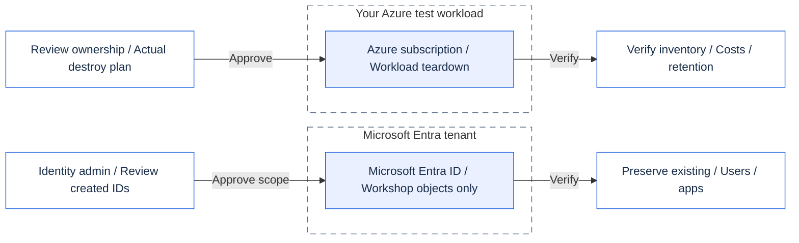

# Module 99 - Clean up

## Goal

Remove everything the workshop created, in the reverse order it was built, and prove that nothing is left behind.

## Why it matters

Workshop resources cost money and keep identities and endpoints alive. A clean exit is part of the lesson: every control you
added must be removed deliberately, not forgotten.

## What you deploy

Nothing. This module runs the clean-up scripts of modules 02 to 05 in reverse order:

> [!CAUTION]
> Delete only workshop-owned resources and identities. Preserve administrator-provided users, applications and shared resources.

<details>
<summary>Clean-up boundaries (Mermaid)</summary>

This is an ownership overview, not the exact script order. Follow the numbered table below.
GitHub renders Mermaid; the presenter app shows the matching diagram with verified Microsoft icons.
[Open the icon-rich SVG](../../assets/architecture/99.en.svg) or [PNG](../../assets/architecture/99.en.png).



</details>

| Order | Clean-up | What it removes |
|---|---|---|
| 1 | Module 05, `-Scope Workload` | Delegated and app-only workload settings |
| 2 | Module 05, `-Scope Entra` | Federated credential, permission requests and consent grants |
| 3 | Module 04 | Gateway, policies and the locked-down Function path |
| 4 | Module 03, `-Scope Workload` | Built-in authentication on the Function App |
| 5 | Module 03, `-Scope Entra` | Workshop-created Entra objects (never administrator-provided ones) |
| 6 | Module 02 | Function App and the open endpoint |

> [!TIP]
> Start in **report mode**. The script plans each step, checks the allow-list and prints what would change.
>
> - Read every plan before continuing.
> - Nothing is deleted until you pass `-Apply`.

## Prerequisites and required roles

- The same Azure and Microsoft Entra roles you used in modules 02 to 05 (Contributor on the workshop resource group, and the
  Entra roles used for app registrations).
- PowerShell 7.4 or later (`pwsh`), Terraform 1.16.6 or later on `PATH`, and the Azure CLI signed in to the tenant.
- The same parameter files you used when you deployed each module. Clean-up reads them to find the resource names.

> [!IMPORTANT]
> Keep your private `.workshop` parameter files and Terraform state until clean-up is complete.
> Use the same participant prefix and suffix. Do not regenerate names to retry a failed step.

## Steps

> [!WARNING]
> `-Apply` (PowerShell) or `--apply` (bash) deletes resources. Use it only after explicit approval and review of every plan.
> Stop if a plan includes an unexpected resource.

### PowerShell

```powershell
# 1. Report only (default). Read each plan. Nothing changes.
pwsh ./modules/99-cleanup/cleanup.ps1 -TenantId <tenant-guid> -SubscriptionId <subscription-guid>

# 2. Apply after you have reviewed every report.
pwsh ./modules/99-cleanup/cleanup.ps1 -TenantId <tenant-guid> -SubscriptionId <subscription-guid> -Apply
```

### Bash

```bash
# 1. Report only (default).
./modules/99-cleanup/cleanup.sh --tenant-id <tenant-guid> --subscription-id <subscription-guid>

# 2. Apply after review.
./modules/99-cleanup/cleanup.sh --tenant-id <tenant-guid> --subscription-id <subscription-guid> --apply
```

Manual steps (the script does not touch these):

1. Delete the workshop test users (Alice, Bob, Eve) if you created them.
2. Remove any role assignment you added by hand for the workshop.
3. Run the tag check below.

```powershell
az resource list --tag workshop=mcp-<prefix>-<suffix> --query "[].{name:name, type:type}" -o table
```

## What you should see

- Report mode prints one `-->` line per step, the plan summary, and `DONE report only. Nothing was changed.`
- Apply mode prints `DONE module clean-ups applied.` followed by the manual steps.
- The tag check returns an empty table. Any row is a leftover to remove.

## Validate

Offline checks (no Azure access):

```powershell
pwsh ./modules/99-cleanup/validate.ps1 -Offline
```

```bash
./modules/99-cleanup/validate.sh --offline
```

Each check prints `PASS` or `FAIL`. The last line is `RESULT: PASS` when every check passes.

> [!NOTE]
> An offline `PASS` checks the guide and script safety. It does **not** prove that Azure resources were deleted.
> Complete the manual checks and inspect the remaining inventory in your own subscription.

## Troubleshooting

- **A step stops with an exit code.** The script stops at the first failure and does not continue. Read the message, fix it,
  then run the script again. Steps that already applied are skipped by their own guards.
- **A plan lists an unexpected change.** Do not apply it. The guard aborts when a change falls outside the allow-list, and
  nothing is applied. Ask the facilitator.
- **The tag check still lists resources.** They were created outside the workshop, or a step was skipped. Find each row in
  the portal before you delete it by hand.

## Clean up

This module is the clean-up. To leave the workshop environment in its starting state, run section "Steps" in apply mode, then
the manual steps, then the tag check.

## Go further

- Set a budget alert and an expiry date on the resource group before the next workshop.
- Replace the test users with your own accounts and remove them when the workshop ends.

## Sources

- Terraform destroy: https://developer.hashicorp.com/terraform/cli/commands/destroy
- Azure resource tags: https://learn.microsoft.com/azure/azure-resource-manager/management/tag-resources
- Azure CLI resource list: https://learn.microsoft.com/cli/azure/resource#az-resource-list

Formatting: [GitHub Mermaid diagrams](https://docs.github.com/en/get-started/writing-on-github/working-with-advanced-formatting/creating-diagrams).
Callouts: [GitHub alerts](https://docs.github.com/en/get-started/writing-on-github/getting-started-with-writing-and-formatting-on-github/basic-writing-and-formatting-syntax#alerts).
Diagram provenance: [architecture sources](../../assets/architecture/README.md).

Last verified: 2026-10-16 (formatting and diagram reuse only). Azure sources: see [docs/sources.md](../../docs/sources.md).
