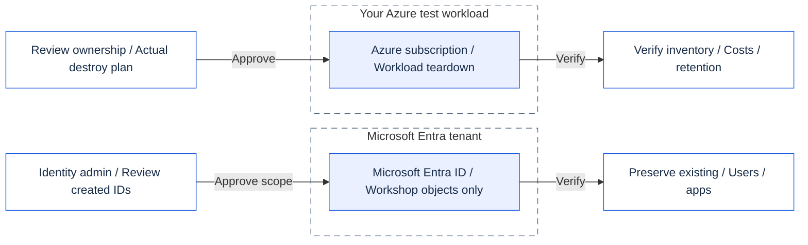

# Module 99 - Clean up

## Goal

Remove everything the workshop created, in the reverse order it was built, and prove that nothing is left behind.

## Why it matters

Workshop resources cost money and keep identities and endpoints alive. A clean exit is part of the lesson: every control you
added must be removed deliberately, not forgotten.

## What you deploy

Nothing. This module runs the clean-up scripts of modules 02 to 05 in reverse order:

> [!CAUTION]
> Delete only workshop-owned resources and identities. Preserve administrator-provided users, applications and shared resources.

<details>
<summary>Clean-up boundaries (Mermaid)</summary>

This is an ownership overview, not the exact script order. Follow the numbered table below.
GitHub renders Mermaid; the presenter app shows the matching diagram with verified Microsoft icons.
[Open the icon-rich SVG](../../assets/architecture/99.en.svg) or [PNG](../../assets/architecture/99.en.png).



</details>

| Order | Clean-up | What it removes |
|---|---|---|
| 1 | Module 05, `-Scope Workload` | Delegated and app-only workload settings |
| 2 | Module 05, `-Scope Entra` | Federated credential, permission requests and consent grants |
| 3 | Module 04 | Gateway, policies and the locked-down Function path |
| 4 | Module 03, `-Scope Workload` | Built-in authentication on the Function App |
| 5 | Module 03, `-Scope Entra` | Workshop-created Entra objects (never administrator-provided ones) |
| 6 | Module 02 | Function App and the open endpoint |

> [!TIP]
> Start in **report mode**. The script plans each step, checks the allow-list and prints what would change.
>
> - Read every plan before continuing.
> - Nothing is deleted until you pass `-Apply`.

## Prerequisites and required roles

- The same Azure and Microsoft Entra roles you used in modules 02 to 05 (Contributor on the workshop resource group, and the
  Entra roles used for app registrations).
- PowerShell 7.4 or later (`pwsh`), Terraform 1.16.6 or later on `PATH`, and the Azure CLI signed in to the tenant.
- The same parameter files you used when you deployed each module. Clean-up reads them to find the resource names.

> [!IMPORTANT]
> Keep your private `.workshop` parameter files and Terraform state until clean-up is complete.
> Use the same participant prefix and suffix. Do not regenerate names to retry a failed step.

## Steps

> [!WARNING]
> `-Apply` (PowerShell) or `--apply` (bash) deletes resources. Use it only after explicit approval and review of every plan.
> Stop if a plan includes an unexpected resource.

### PowerShell

```powershell
# 1. Report only (default). Read each plan. Nothing changes.
pwsh ./modules/99-cleanup/cleanup.ps1 -TenantId <tenant-guid> -SubscriptionId <subscription-guid>

# 2. Apply after you have reviewed every report.
pwsh ./modules/99-cleanup/cleanup.ps1 -TenantId <tenant-guid> -SubscriptionId <subscription-guid> -Apply
```

> **Real result** — report mode in the author's test subscription, 2026-10-17, where only module 02 (with private Storage
> and the optional portal) was deployed. `...` hides 16 similar `PLAN delete` lines. Names and IDs withheld.
>
> ```text
> Module 99 clean-up. Mode: REPORT ONLY (no change)
> SKIP 05-delegated-and-app-only -Scope Workload (missing .workshop/module03.tfvars.json; if you deployed this stage, restore the file and run again)
> SKIP 05-delegated-and-app-only -Scope Entra (missing .workshop/entra.tfvars.json; if you deployed this stage, restore the file and run again)
> SKIP 04-governed-gateway (missing .workshop/module03.tfvars.json; if you deployed this stage, restore the file and run again)
> --> 03-entra-authentication -Scope Workload
> PASS explicit Azure context and private participant parameters (expected HTTP 200 from Azure Resource Manager).
> PASS 'phase 2: remove built-in authentication': nothing to do in this state (idempotent, expected HTTP N/A).
> SKIP 03-entra-authentication -Scope Entra (missing .workshop/entra.tfvars.json; if you deployed this stage, restore the file and run again)
> --> 02-open-server
> PASS explicit Azure context and private participant parameters (expected HTTP 200 from Azure Resource Manager).
> PLAN delete azurerm_application_insights.mcp[0]
> PLAN delete azurerm_function_app_flex_consumption.mcp[0]
> ...
> PLAN delete azurerm_storage_account.mcp[0]
> ...
> PLAN delete azurerm_virtual_network.gateway[0]
> PLAN update azurerm_linux_web_app.portal[0]: remove only the WORKSHOP_MCP_ENDPOINT hint (portal may restart)
> PASS cleanup plan deletes only 20 module 02 resource(s) and removes the portal endpoint hint. Review it, then rerun with -Apply.
> DONE report only. Nothing was changed. Re-run with -Apply after reviewing each plan.
> ```
>
> **What it means for you:** `SKIP` names the private file a stage's clean-up needs. It is normal for a stage you never
> deployed. A stage with nothing left prints `nothing to do`. Every deployed stage prints its own `PLAN` lines: read them
> all. After approval, `-Apply` runs the same steps and ends with `DONE module clean-ups applied. Next: delete test users and
> role assignments, then run the tag check in README.md.` If a guard refuses a plan, the script prints `FAIL` and stops
> without applying anything.
### Bash

```bash
# 1. Report only (default).
./modules/99-cleanup/cleanup.sh --tenant-id <tenant-guid> --subscription-id <subscription-guid>

# 2. Apply after review.
./modules/99-cleanup/cleanup.sh --tenant-id <tenant-guid> --subscription-id <subscription-guid> --apply
```

> **Expected result** — the same `SKIP`, `-->`, `PLAN`, `PASS` and `DONE` lines as the PowerShell run above; the wrapper calls `cleanup.ps1`.

Manual steps (the script does not touch these):

1. Delete the workshop test users (Alice, Bob, Eve) if you created them.
2. Remove any role assignment you added by hand for the workshop.
3. Run the tag check below.

```powershell
az resource list --tag workshop=mcp-<prefix>-<suffix> --query "[].{name:name, type:type}" -o table
```

> **Expected result** — from the Azure CLI table format; not a capture after a complete clean-up.
> After a complete clean-up, the command prints nothing (an empty result has no table).
> Before clean-up, it lists one row per workshop resource, for example `func-mcp-p01-<suffix>` or `stp01<suffix>`.
>
> **What it means for you:** an empty output is your proof that no tagged workshop resource remains. Any row is a leftover.

## What you should see

- Report mode prints one `-->` line per deployed step, the plan summary, and `DONE report only. Nothing was changed.`
  A stage whose required private file is absent prints `SKIP <stage> (missing .workshop/<file>; ...)`: normal if you never deployed it.
- Apply mode prints `DONE module clean-ups applied.` followed by the manual steps.
- The tag check returns an empty table. Any row is a leftover to remove.

**Question:** why does module 99 run the module clean-ups in reverse order instead of one `terraform destroy`?

<details>
<summary>Show answer</summary>

Later modules depend on earlier ones (the gateway and authentication sit on top of the Function App), and module 05's
Entra objects must go before module 03's. Each module's guard checks that its plan deletes only what that module created,
so administrator-provided identities and shared resources are never removed by accident.

</details>

**Question:** the report shows `SKIP 04-governed-gateway (missing .workshop/module03.tfvars.json; ...)`. Should you fix something before applying?

<details>
<summary>Show answer</summary>

No, if you never deployed modules 03 and 04: there is nothing of theirs to remove. If you did deploy them, stop: without that
private parameter file their clean-up cannot plan safely. Restore your private `.workshop` files, then run the report again.

</details>

## Validate

Offline checks (no Azure access):

```powershell
pwsh ./modules/99-cleanup/validate.ps1 -Offline
```

> **Real result** — offline run on the authoring host, 2026-10-17.
>
> ```text
> PASS file: cleanup.ps1 exists
> PASS file: cleanup.sh exists
> PASS file: README.md exists
> PASS file: README.fr.md exists
> PASS README.md: all sections present missing:
> PASS README.md: sections in contract order
> PASS README.md: has source links
> PASS README.fr.md: same section count as EN (EN 11, FR 11)
> PASS safety: no blanket terraform destroy
> PASS safety: no hard-coded GUIDs
> PASS safety: no client secret literals
> PASS safety: reports by default (-Apply switch)
> RESULT: PASS (0 failure(s))
> ```
>
> **What it means for you:** the guide and script keep their safety rules (report by default, no blanket destroy).
> The empty text after `missing:` means no section is missing.

```bash
./modules/99-cleanup/validate.sh --offline
```

> **Expected result** — the same PASS lines and `RESULT: PASS (0 failure(s))` as the PowerShell run above.

Each check prints `PASS` or `FAIL`. The last line is `RESULT: PASS` when every check passes.

> [!NOTE]
> An offline `PASS` checks the guide and script safety. It does **not** prove that Azure resources were deleted.
> Complete the manual checks and inspect the remaining inventory in your own subscription.

## Troubleshooting

- **A step stops with an exit code.** The script stops at the first failure and does not continue. Read the message, fix it,
  then run the script again. Steps that already applied are skipped by their own guards.
- **A plan lists an unexpected change.** Do not apply it. The guard aborts when a change falls outside the allow-list, and
  nothing is applied. Ask the facilitator.
- **The tag check still lists resources.** They were created outside the workshop, or a step was skipped. Find each row in
  the portal before you delete it by hand.

## Clean up

This module is the clean-up. To leave the workshop environment in its starting state, run section "Steps" in apply mode, then
the manual steps, then the tag check.

## Go further

- Set a budget alert and an expiry date on the resource group before the next workshop.
- Replace the test users with your own accounts and remove them when the workshop ends.

## Sources

- Terraform destroy: https://developer.hashicorp.com/terraform/cli/commands/destroy
- Azure resource tags: https://learn.microsoft.com/azure/azure-resource-manager/management/tag-resources
- Azure CLI resource list: https://learn.microsoft.com/cli/azure/resource#az-resource-list

Formatting: [GitHub Mermaid diagrams](https://docs.github.com/en/get-started/writing-on-github/working-with-advanced-formatting/creating-diagrams).
Callouts: [GitHub alerts](https://docs.github.com/en/get-started/writing-on-github/getting-started-with-writing-and-formatting-on-github/basic-writing-and-formatting-syntax#alerts).
Diagram provenance: [architecture sources](../../assets/architecture/README.md).

Last verified: 2026-10-16 (formatting and diagram reuse only). Azure sources: see [docs/sources.md](../../docs/sources.md).
